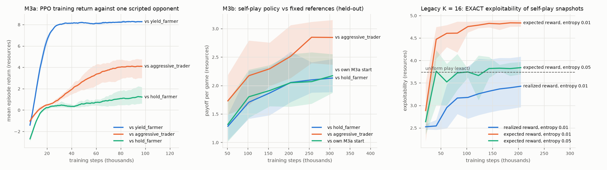

# M2–M3 Implementation Report: the Champion Game and First Multi-Agent RL

*October 2026. Covers milestones M2b–M2e (champion simulation) and M3a–M3c (PPO, self-play, evaluation) of
[docs/rl_research_roadmap.md](rl_research_roadmap.md). The running log with every intermediate result is
[docs/overnight_implementation_log.md](overnight_implementation_log.md). Work is on the local branch
`m2-m3-autonomous`, one commit per milestone, nothing pushed. Coordinates are own-perspective (own tower −2,
the lane 0, enemy tower +2). Payoffs are resources per 32-turn game (1 resource ≈ one wave of farm), zero-sum,
to the first-named player, with 95% confidence intervals.*

---

## A. Milestone completion

| Milestone | Status | Evidence | Commit |
|---|---|---|---|
| M2b Recall and absence | **Completed and verified** | 14 tests; exact timeline for recall_turns 1/2/3; timing economics | `acabf74` |
| M2c Stochastic trading and mechanical skill | **Completed and verified** | 13 tests; 10,000-draw distribution check; skill monotonicity | `e83618d` |
| M2d Ganks, death, respawn | **Completed and verified** | 15 tests; 10,000-draw binomial check; death timeline; no double counting | `bcb6ba6` |
| M2e Validation and benchmarking (gate) | **Completed and verified** | 0 rule violations in 120,960 checked turns; tournaments; skill sweeps; 3 evidence-based default changes; full suite 444 passed | `e311586` |
| M3a PPO against scripted opponents | **Completed and verified** | 9 tests; beats the best scripted response against every opponent tested, 3 seeds | `6e0597b` |
| M3b Self-play with frozen snapshots | **Completed and verified** (with a documented negative result) | 6 tests; 3 seeds × 2 variants; exact exploitability on the legacy game | final commit |
| M3c Evaluation and approximate exploitability | **Completed and verified** | held-out evaluation harness, cross-play, snapshots, skill grid, from-scratch and warm-started best responses, exact legacy benchmark | final commit |
| M3d PSRO, M4–M6 | Not started (out of scope) | — | — |

The legacy models are untouched: `GameConfig()`, `GameConfig.v2()` and `GameConfig.v1()` are unchanged, and every
pre-existing test (395, including the reproduction tests of the three reports) still passes. `mechanics.py`,
`game.py`, the solver, `results/` of the earlier studies: not modified.

---

## B. Architecture

### B.1 New and changed modules

| Module | Role |
|---|---|
| `lanegame/champions.py` | the champion layer: state, legality, the turn resolution (positions, behaviors, recall, trades, tower shots, ganks, death), all chance from one uniform vector |
| `lanegame/config.py` | champion parameters (all inert outside champion mode) |
| `lanegame/env/` (`core`, `agents`, `trace`, `observation`) | champion-mode chance vector and info; `ChampionScriptAgent` and the scripted suite; episode counters; optional `gank_reward="expected"` (legacy variance reduction) |
| `lanegame/experiments/champions/` | M2e: `invariants`, `tournament`, `skill`, `concerns`, `benchmark` → `results/champions/` |
| `lanegame/rl/` | `network` (masked policy/value MLP), `ppo` (config, GAE, update), `train` (collector, loop), `agent` (NetAgent, checkpoints), `selfplay`, `evaluate` |
| `lanegame/experiments/rl/` | `scripted`, `legacy`, `selfplay`, `evaluation`, `br_warm`, `figures` → `results/rl/` |
| `tests/` | `test_champion_recall` (14), `test_champion_combat` (13), `test_champion_ganks` (15), `test_champion_validation` (7), `test_rl` (9), `test_rl_selfplay` (6), `test_env_expected_gank` (3) |

PyTorch is an optional dependency (`pip install "lanegame[rl]"`); `lanegame.env` and the exact modules never import it.

### B.2 State, actions, observation

Per side: cell `pos ∈ {−2,…,2}`, `hp ∈ {0,…,6}`, `absent ∈ {0,…,3}` (number of further turns the champion must
sit out). Per seat: skill `m ∈ [0,1]`. The environment state is (lane `State`, `ChampState`, turn k).
Action `a = wave + 3·behavior + 15·objective` (46 slots): behaviors Hold, Yield, Trade, Safe, Recall
(only `champ_act(SP, Recall) = 12` is ever legal), `ABSENT = 45` (the whole legal set while absent, never legal
otherwise). The 50-feature observation (lane grid, siege/vision/plates, turn and turns remaining, both champions'
cell one-hot, HP, absence timer, skill) is a pure, injective function of the full state: nothing decision-relevant
is hidden (verified on about 84,000 distinct observations across the three M2e sweeps).

### B.3 One champion-mode turn (`champions.resolve_turn`)

0. **Away sides.** An absent champion, or one that recalls and is not interrupted, takes no part: its wave plays
   Slow Push without champion contribution; no farm, zoning, trade, objective or gank.
1. **Wave destinations.** One lane probe with every present champion supporting its wave gives each side's farm spot.
2. **Targets and movement** (≤ `champion_speed = 2` cells): Hold/Yield → farm spot; Safe → min(farm spot, −1);
   objectives → +2; Recall stays (channeling); Trade chases the opponent's intended cell (dive into the tower
   cell if that is where the opponent is).
3. **Recall interruption.** A recalling champion in contact with an enemy Trade's end cell is interrupted.
4. **Evasion.** A Yield or Safe champion that would end in contact with an enemy trader retreats out of contact.
5. **Contact.** Within `trade_range = 1`; a champion in its own tower cell is reachable only from inside that cell.
6. **Modes and wave contribution.** farm / trading (no contribution, ½ farm) / retreat / safe / channel / away.
7. **Authoritative lane step** (`mechanics.step_turn`, unchanged) with those contributions and effective objectives.
8. **Farming** within `farm_reach = 1` of the end cell (`retreat_farm_reach = 2` for a retreating Yield).
9. **Chance events** from the turn's 10 uniforms (trade hits, 2-HP hits, tower shots, gank occurrence, gank damage),
   drawn whatever the actions (common random numbers turn by turn).
10. **Death and state update.** All damage is summed; HP ≤ 0 → death.

### B.4 Recall, death and absence timelines

| Event | Turns without lane participation | Return |
|---|---|---|
| Recall chosen on turn t, not interrupted | t (the recall turn) and t+1 (forced ABSENT): `recall_turns = 2` | start of t+2, own tower, full HP |
| Death at the end of turn t (it acted, and keeps that turn's farm) | t+1, t+2, t+3 (`death_turns = 3`) | start of t+4, own tower, full HP |

Recall is legal at `pos ≤ recall_line = −1`. **Deviation from the brief:** the brief suggested *disallowing*
Recall under an immediate credible threat. A state-based rule ("enemy in contact at turn start") made Recall
impossible in the most common lane state (Safe at −1, opponent at the lane 0: in contact, and no behavior walks
voluntarily to −2). Because actions are simultaneous, the threat is resolved from the committed pair instead: an
enemy **Trade that reaches the recaller interrupts the recall** (the champion stays, channeling: no farm, no
contribution, traded as an exposed defender, gankable). This creates a recall-versus-trade guessing game.
There is no recall penalty: its cost is the farm and wave control given up. From a state where one's own crash
sieges the enemy tower a recall costs 0.00 resources over 6 turns; with the enemy wave walking into one's tower it
costs 0.62 (test).

### B.5 Trading and mechanical skill

A connected Trade of side i on side j hits with probability

  h = clip(0.55 + 0.4 (m_i − m_j) + β[behavior_j] + 0.05 (σ_i − σ_j) − 0.15·[j in its own tower cell], 0.05, 0.95),
  β = (Hold 0, Yield −0.25, Trade 0, Safe −0.40, interrupted Recall 0),

σ = leading-wave stacks (local minion support). Damage: 0 w.p. 1−h, 1 w.p. h(1−q), 2 w.p. hq,
q = clip(0.3 + 0.2 (m_i − m_j), 0, 1). At equal skill against Hold: h = 0.55, E[damage] = 0.72 HP. A miss is
always possible (h ≤ 0.95). **Opportunity cost:** a connected trader gives up its wave contribution and half its
farm; an unconnected trader (target evaded or absent) farms normally where it stands. A Hold defender does not
hit back; Trade versus Trade rolls both ways from start-of-turn HP. **Tower shot:** a dive (connected trade ending
in the enemy tower cell) costs 1 HP with probability 1.0, or 0.5 while the diver's own crashed minions are under
that tower. **Skill enters only execution probabilities** (h, q and gank damage below); M2e verified that
positions, modes, farm and gank occurrence are identical under any skills.

### B.6 Ganks, vision and death

Occurrence (champion-mode parameters, legacy model untouched):

  p = clip(0 + 0.12 (e+2)/4 + b[behavior] + 0.02·[Shove, non-Safe] − 0.01 Δσ, 0, 0.30) · (1 − 0.75·[own vision]),
  b = (Hold 0.01, Yield 0.01, Trade 0.03, Safe 0), e = max(start cell, end cell).

The legacy unconditional base 0.15 is dropped: as an expected loss it cancelled in the zero-sum payoff, but as an
HP event it would have produced ~7 damaging ganks per player per game. Now a Hold champion at the lane is ganked
about 2.1 times per game, a Safe one about once, a champion under its own tower almost never; vision at −1 saves
0.02 per turn (not mandatory when safe). Damage given a gank: X ~ Binomial(4, p_e),
p_e = clip(0.2 + 0.6 (e+2)/4 − 0.2·[played defensively: Safe or retreating Yield] − 0.2 (m − 0.5), 0, 1),
mean 0.8 HP at the own tower, 2.0 at the lane, 3.2 under the enemy tower; 4 < 6 HP, so a full-HP champion never
dies to one gank, and a gank can deal nothing. Vision changes only occurrence. Exposure is max(start, end): Safe
from +2 is still exposed at +2 that turn.

### B.7 Reward accounting

Champion mode: r_k = (farm_A − farm_B) + (plates_A − plates_B) + (bounty_A − bounty_B), B receives −r.
`kill_bounty = 0.5` resources to the opponent of a champion that dies (any cause), reported separately as
`bounty_payoff`. The legacy expected gank loss L·p is **not** charged in champion mode (no double counting; a
gank's cost is HP and possibly absence). Legacy configurations keep their reward exactly.

### B.8 PPO

Shared-trunk MLP (50 → 128 tanh → 128 tanh → 46 policy logits + 1 value), orthogonal init. Masked categorical:
illegal logits set to −10⁹, so illegal actions have probability exactly 0 and are never sampled. GAE with
explicit semantics: δ_t = r_t + γ(1−terminated_t)V(s_{t+1}) − V(s_t), A_t = δ_t + γλ(1−done_t)A_{t+1}; a time-limit
truncation bootstraps with the value of the final observation; γ = 1 (finite undiscounted game; turns remaining
are observed). Clipped surrogate (0.2), clipped value loss (±2.0), entropy 0.01, gradient norm 0.5, Adam 3·10⁻⁴
annealed, 16 lock-step environments × 64 steps, 4 epochs, minibatch 256. Forced single-action steps (absence)
carry no gradient and are excluded from the policy and entropy averages. The learner plays a random seat each
episode against an opponent drawn per episode; everything derives from one seed (bit-for-bit reproducible with one
torch thread, tested). ~5,000–6,600 learner steps/s against scripted opponents, ~2,000–3,000 against frozen networks.

### B.9 Self-play

`SnapshotPool` of at most 8 frozen copies (no gradients; the initial policy is kept as an anchor), a snapshot
every 25 updates (25,600 steps); per episode the opponent is a scripted agent (30%, uniform over 13), the latest
snapshot (35%) or a uniformly drawn snapshot (35%). Snapshots are written with metadata.

### B.10 Evaluation

`head_to_head(x, y)`: N episodes with x in seat A and N with x in seat B on the same held-out seeds (common random
numbers across seats and opponents), payoff to x with a 95% CI, win/loss/tie rates, per-seat means and the full
behavioral and economic profile; skill can be assigned to players rather than seats. `approximate_best_response`:
a PPO learner trained against the frozen target only (from scratch, or warm-started from the target's own weights)
and evaluated on held-out seeds: a lower bound on the target's exploitability, never a certificate.

---

## C. Validation results

### C.1 Tests

| | Count |
|---|---|
| Existing tests (M1, M2a and the three exact-game studies) | 395, all pass; the legacy tests are unchanged, five M2a champion tests were updated where M2b–M2d deliberately changed champion behavior (Recall no longer reserved, HP no longer constant, champion gank parameters, the bounty term in the reward decomposition) |
| New champion tests (M2b–M2e) | 49 |
| New RL and environment tests (M3) | 18 |
| **Full suite** | **462 passed in 5 min 29 s** (final run) |

Notable test-level checks: exact recall/death timelines; 10,000-draw frequency checks of the trade (0/1/2) and gank
(binomial) damage within 4.5 standard errors; skill monotonicity for offense and defense; every illegal action has
probability 0; GAE by hand for termination, truncation and episode boundaries; checkpoint round trips;
reproducible rollouts and training; an exactly evaluated network policy matching 2,000 episodes within 4.5 SE.

### C.2 Invariants (M2e-A, `results/champions/invariants.md`)

A turn-by-turn checker of every rule (state bounds, masks equal legal sets, absence timeline, movement limits, HP
and damage accounting, zero-sum reward decomposition, no remote farming, no remote siege, no participation of away
or channeling champions, observation purity/bounds/injectivity, mirror equivariance with mirrored chance, exact
replay from the recorded chance draws and from seeds): **120,960 turns across three configurations (equal skill,
0.8/0.2 skill, bounty 1 with recall 3), 0 violations**. Seat symmetry: a scripted agent against itself scores
+0.006 ± 0.027 over 8,000 independent episodes.

### C.3 Throughput (`results/champions/benchmark.md`)

Champion environment 6,100–6,900 turns/s uncached and ~11,500 with the bounded lane cache (scripted agents);
raw `env.step` 7,200 / 9,200; legacy siege model through the same environment 11,500. Training is not
simulator-bound at this scale.

### C.4 Behavioral matchups (`results/champions/tournament.md`, 15 agents, 400 episodes per ordered pair)

| Agent | Average vs the 15 | Notes |
|---|---|---|
| TRADE (naive, never recalls) | +3.48 | crushes passive and evasive play (+8.2 vs Yield, +12.5 vs Safe), loses to careful farmers (−0.21 vs hold_farmer, −0.38 vs punisher, −1.14 vs conservative_recaller) |
| hold_farmer / punisher / HOLD | +2.2 to +2.3 | the farm-and-recall family; not beaten by any scripted agent by more than 0.2 |
| opportunistic_trader | +1.72 | trades only with an HP edge; loses −3.9 to persistent traders |
| yield_farmer | +0.95 | exactly Hold against non-traders (0.00); −8.2 against persistent Trade |
| shover / vision shover | −2.5 / −2.8 | crashing waves against a contesting opponent pays poorly |
| safe_player | −5.9 | permanent Safe is heavily punished |

Zero-sum Nash equilibrium of the empirical 15 × 15 matrix: punisher 0.56, HOLD 0.41, TRADE 0.03 (value 0).

### C.5 Mechanical skill (`results/champions/skill.md`)

Realized hit rate 0.51 → 0.63 → 0.76 → 0.92 as A's skill advantage goes 0 → 0.3 → 0.6 → 1.0; damage per gank
falls monotonically. The payoff effect is strategy-dependent: a 0.35-skill aggressive trader still beats a
0.65-skill Yield farmer by +7.9 (trades never connect, so skill barely matters there), while in mutual trading a
0.3 skill edge is worth ~+0.8.

### C.6 Changes made on evidence (M2e-D/E, `results/champions/concerns.md`)

| Change | Evidence |
|---|---|
| `kill_bounty` 0 → **0.5** | At 0, a death cost ≈ 1–1.5 resources (about a recall plus walking back), Trade lost to every non-evasive agent, never recalling beat recalling at ≤ 2 HP, and the scripted meta-game was 100% naive Hold: HP damage had almost no strategic consequence. At 0.5 (half a wave; real kill gold is ~2.4 early waves), trading is viable but exploitable and the meta-game mixes; absence remains the main cost of dying. |
| `retreat_farm_reach` (new) **2** | With 1, a Yield champion zoned by a persistent trader kept 1.2 of 15.3 available resources (−11.4 per game); the roadmap intended Yield to "farm at Safe efficiency". Now −8.2; no other matchup changes. |
| Gank-damage defense requires **defensive play** | Applied to the Yield/Safe *label*, an unthreatened Yield (identical play to Hold) took half of Hold's gank damage for free: YIELD beat HOLD by +0.41. Now 0.00. |

Kept after measurement: `trade_farm_factor 0.5` (at 1.0 Trade dominates: +1.9 against a recaller; at 0.25 it
is useless), `farm_reach 1`, `champion_speed 2` (1 lets traders pin farmers, +2.4), the tower shot (worth ~1.4
resources to a tower-hugging defender), the gank model (switching ganks off moves forward strategies by ~1, so
exposure matters). Degenerate probes: recall spam −13.1, permanent Safe −8.7, Vision used but rarely (sieges are
rare against a contesting opponent), always-Shove −4.7. Remote farming and remote siege: impossible (checked
every turn).

---

## D. RL experiments

All runs are seeded and reproducible; network checkpoints are in `results/rl/checkpoints/` (not tracked by git;
regenerate with the commands in F). Evaluation always uses held-out episode seeds in both seats. Learning curves:
`results/rl/fig_learning_curves.png`. Total RL compute: about 22 minutes wall clock on 9–10 processes (at most ~3.5
CPU-hours), within the 90-minute budget; no single run exceeded 4 minutes.



### D.1 M3a: PPO against fixed scripted opponents (`results/rl/m3a_scripted.md`, 4.6 min)

| Opponent (single, 102,400 steps × 3 seeds) | PPO (held-out, both seats) | Initial policy | Best scripted response |
|---|---|---|---|
| yield_farmer | **+8.28 ± 0.17** | −4.0 | always Trade +8.17 ± 0.11 |
| aggressive_trader | **+4.25 ± 0.99** | −2.1 | conservative_recaller +0.65 ± 0.11 |
| hold_farmer | **+1.24 ± 0.88** | −4.3 | naive Hold +0.22 ± 0.10 |

Every seed beats the best scripted response; ~30 s per run. Against the careful farmer two seeds found different
edges: the mixture policy wins by aggression (Trade 77% of turns, 1.4 kills per game), the single-opponent policy
by wave management (mostly Yield/Hold, Safe 13%, timed Shoves on 18% of turns, almost no trading).

Mixture of all 13 scripted agents (204,800 steps × 3 seeds): **+4.32 ± 0.27** average over the 13 opponents
(best single scripted agent `trade` +3.56, uniform −2.16); beats every careful farmer (hold_farmer +1.21,
punisher +1.03, conservative_recaller +2.73) but not the naive persistent trader (−0.12).

### D.2 Exact calibration on the legacy game (`results/rl/m3a_legacy_exact.md`)

On the exactly solvable siege model (K = 16, 4,951 nodes) the network is a Markov policy, so its value and
exploitability are computed exactly. Share of the exact best-response gain over uniform play reached by PPO
(102,400 steps, 3 seeds):

| Opponent | Exact BR | PPO, realized-gank reward (default) | PPO, expected-gank reward |
|---|---|---|---|
| passive_safe | +6.28 | 23–25% | 37–39% |
| freeze_contest | +4.44 | 31–33% | 46–53% |
| aggressive | +11.14 | 67–75% | 94% |

The exact best responses to passive play need long, specific siege sequences (crash small waves, establish vision,
apply pressure) that PPO does not discover at this budget. The expected-gank reward is an *exact* variance
reduction available only in the legacy game (a legacy gank changes nothing but the payoff, so expected returns and
gradients are unchanged; every deterministic-pair episode then equals the exact value: tested); it is optional,
off by default and reported separately. **Calibration: PPO best responses are loose lower bounds; reward noise from
chance events is a major cost for PPO.**

### D.3 M3b: self-play (`results/rl/m3b_selfplay.md`, 3.3 min)

Equal skill, 307,200 steps × 3 seeds from the M3a mixture policies: held-out payoff against fixed references rises
steadily (vs hold_farmer +1.28 → +2.13, vs aggressive_trader +1.73 → +2.84, vs the frozen initial policy
+1.32 → +2.17). A skill-randomized variant (skills drawn from {0.2, 0.5, 0.8} per seat per episode) improves
similarly (+1.55 vs hold_farmer, +2.35 vs its initial policy at 0.5/0.5).

**Negative result (certified, legacy game).** Self-play from scratch with the same trainer: the EXACT
exploitability of the snapshots first falls (uniform 3.74 → 2.52 at 20k steps) and then *rises* (3.43 at 205k
steps; greedy snapshots 4.97 throughout). With the variance-reduced reward it rises further (4.84, worse than
uniform; final entropy 0.16), and a 5× entropy bonus only holds it at ~3.8. Reward noise is therefore not the
cause: frozen-snapshot self-play PPO behaves like iterated best response against a pool and does not approach this
game's mixed equilibrium.

### D.4 M3c: evaluation (`results/rl/m3c_evaluation.md` 6.9 min, `results/rl/m3c_br_warm.md` 2.5 min)

| Family (3 seeds each) | vs 13 scripted: average | worst matchup | approximate exploitability (best of scratch and warm-started BR, per seed) |
|---|---|---|---|
| M3a mixture | +4.30 ± 0.26 | −0.11 | +2.05, +2.67, +2.45 |
| self-play, equal skill | +4.81 ± 0.24 | +0.76 … +1.81 | +2.67, +0.25, +3.24 |
| self-play, randomized skill | +4.78 ± 0.16 | +0.64 … +0.91 | **+0.46, +0.11, +0.27** |
| *calibration:* hold_farmer / punisher | — | — | +0.61 / +0.48 (best scripted +0.19 / +0.04) |

- **Cross-play** (300 held-out episodes per seat): `sp_s1` and the three skill-randomized policies form a strong
  cluster (≈ +1.4 average, ≈ 0 among themselves); `sp_s0`/`sp_s2` lose ≈ 2 to them; all self-play policies beat the
  M3a policies by ≈ 2. The same procedure produces policies of very different strength across seeds.
- **Historical snapshots:** each self-play policy beats its own earlier snapshots by monotonically less (≈ +2
  against its start, 0 against itself): improvement without visible cycling inside the pool.
- **Best responses:** from-scratch PPO responses could not reach parity against the robust targets (−0.5); the
  warm start (a copy of the target, payoff 0 by symmetry at the start) always found positive exploitation. Every
  trained policy is exploitable; the skill-randomized ones least (0.1–0.5 resources per game).
- **Mechanical skill** (skill-randomized policies, own × enemy skill ∈ {0.2, 0.5, 0.8}²): payoff rises ≈ 1.57 per
  0.3 of skill advantage, both against `hold_farmer` and against another seed; but the learned Trade share is flat
  at 0.54–0.55 for all nine skill pairs. **No skill-dependent aggression was learned at this budget.** Mean exposure
  varies with skill only through deaths (turns away count as −2), not through positioning. A 0.2-skill policy
  beats the 0.5-skill scripted farmer by +1.21 ± 0.19 (strategy compensating for skill), but not reliably the
  0.8-skill one (+0.28 ± 0.64).

### D.5 What is observed and what is hypothesis

Observed (with CIs over held-out seeds and 3 training seeds): the items in D.1–D.4. Hypotheses, not established:
that skill randomization *causes* robustness (one variant, 3 seeds; the two self-play variants used the same
training seeds and initial policies, so the comparison is paired, but three pairs are few); that a longer budget would produce skill-dependent aggression; that the champion-game self-play policies
suffer from the same non-convergence as the legacy ones (only the legacy game can certify this). Nothing here is a
Nash guarantee for the champion game; exploitability numbers are lower bounds from finite-budget attackers.

---

## E. Modeling concerns

- **Yield sacrifices too much farm?** Less than before (retreat reach 2), but against a *persistent* trader a
  permanent Yield still loses ≈ 8 per game: an unconnected trader keeps full fallback farm while zoning (the brief
  requires the fallback). This makes "evade forever" a bad strategy rather than a broken one; Yield's role is
  tactical (low HP). If evasion should be more viable, the candidate lever is a small farm penalty for an
  *unconnected* trader that chased (it spent the turn hunting), not more Yield farm.
- **Safe excessively effective?** No: permanent Safe is the worst scripted strategy (−5.9). Safe matters
  tactically (gank and trade avoidance, tower hugging: a dive costs the diver a tower shot).
- **Trade risk/reward.** Balanced at the defaults: Trade exploits passive play and loses slightly to careful
  farmers; `trade_farm_factor` is the decisive lever (measured). A Hold defender does not hit back; if Trade versus
  Hold should be more symmetric, a small Hold counter-hit chance is the minimal extension.
- **Recall timing.** Creates decisions: its cost ranges from 0 to ≈ 0.6 resources with the wave state, and enemy
  trades can interrupt it. But recalling at a fixed low-HP threshold is not better than never recalling against
  passive opponents (ganks alone rarely finish a low-HP champion): the value of HP management is opponent-dependent.
- **Mechanical skill.** Strongly affects outcomes (≈ 1.6 resources per 0.3 skill) through execution only. Learned
  strategies did not condition on it yet.
- **Gank exposure.** Matters (removing ganks moves forward strategies by ≈ 1) without dominating; vision is rarely
  needed and rarely available (sieges are rare when the opponent contests the wave).
- **Death.** Costs ≈ 1–1.5 resources of farm and wave control plus the 0.5 bounty; a 3-turn absence is too short
  for the opponent to convert into plates (a scripted punisher gained only 0.03–0.09 plates per game). Deaths are
  meaningful but not catastrophic; M4 (XP, items) would make them costlier without arbitrary penalties.
- **Siege objectives** (the siege study's mechanics) are almost unused in champion play: crashes are rare against a
  contesting opponent. The research questions about tower pressure need either longer horizons or M4c plate
  durability.
- **Known simplifications.** The trader's chase ignores minions; Safe zones nothing; ganks need no enemy laner;
  the recall interrupt is binary.

---

## F. Reproduction

```bash
pip install -r requirements.txt && pip install torch           # torch only for lanegame.rl
# champion simulation demos
python -m lanegame env-demo --model champions --a opportunistic_trader --b hold_farmer --episodes 200 --seed 42
python -m lanegame env-demo --model champions --a aggressive_trader --b yield_farmer --trace trace.json
# M2 tests (~25 s) and the full suite (~6-7 min)
python -m pytest tests/test_champions.py tests/test_champion_recall.py tests/test_champion_combat.py tests/test_champion_ganks.py tests/test_champion_validation.py -q
python -m pytest -q
# M2e validation experiments (results/champions/, ~6 min on 10 processes)
python -m lanegame experiments-champions all
# train PPO (M3a) against scripted opponents
python -m lanegame rl-train --opponents hold_farmer,aggressive_trader --steps 100000 --seed 0 --out results/rl/checkpoints/demo
# self-play (M3b) from a trained policy
python -m lanegame rl-selfplay --init results/rl/checkpoints/demo/final.pt --steps 200000 --seed 0 --out results/rl/checkpoints/demo_sp
# evaluate a saved policy (both seats, held-out seeds, 95% CIs; --skill m_x,m_y assigns skills to players)
python -m lanegame rl-eval results/rl/checkpoints/demo_sp/final.pt --episodes 500
# approximate best response to a frozen policy
python -m lanegame rl-br results/rl/checkpoints/demo_sp/final.pt --steps 100000 --seed 0
# the M3 experiments of this report, in order (results/rl/; ~20 min on 10 processes)
python -m lanegame experiments-rl scripted legacy selfplay evaluation br_warm figures
```

`selfplay` needs the `scripted` checkpoints; `evaluation` and `br_warm` need both.

---

## G. Recommended next steps (prioritized)

1. **Make self-play equilibrium-seeking before scaling it (M3d).** The certified legacy result shows the current
   frozen-snapshot PPO does not reduce exploitability, and the champion-game policies are exploitable by 0.1–3.2.
   Implement PSRO with `solve_matrix_game` as the meta-solver (opponents sampled from the meta-Nash mixture, not
   uniformly or by recency), validate it on the legacy K = 16 game where exploitability is exact, then move it to
   the champion game. An average-policy method (NFSP-style) is the fallback. This is the shortest path to robust
   baselines, which the exploitation-versus-robustness research question needs.
2. **Modest budget increases with the existing harness.** Repeat the skill-randomized self-play with 3–5 more
   seeds and ~1M steps, to test (a) whether its low exploitability is reproducible and (b) whether
   skill-dependent aggression emerges with more data. Keep the warm-started best response as the standard
   exploitability probe, with a 3–5× larger attacker budget than now.
3. **Targeted mechanic refinements, each measured with `experiments-champions concerns`.** The Yield/zoning
   balance (an unconnected chaser's farm), a Hold counter-hit, and making sieges reachable in champion play (they
   are almost unused). Small, one parameter at a time.
4. **M4 economic progression after (1).** XP/levels, items and plate durability will make deaths and recall timing
   costlier through the economy rather than penalties; they also enlarge the observation, so do them once the
   trainer's equilibrium behavior is understood.
5. **Bayesian opponent modeling (M5) last.** It needs robust reference policies (from 1) and reliable
   exploitability estimates (from 2); the exact arena (legacy K = 16) remains the place for its certified results.
