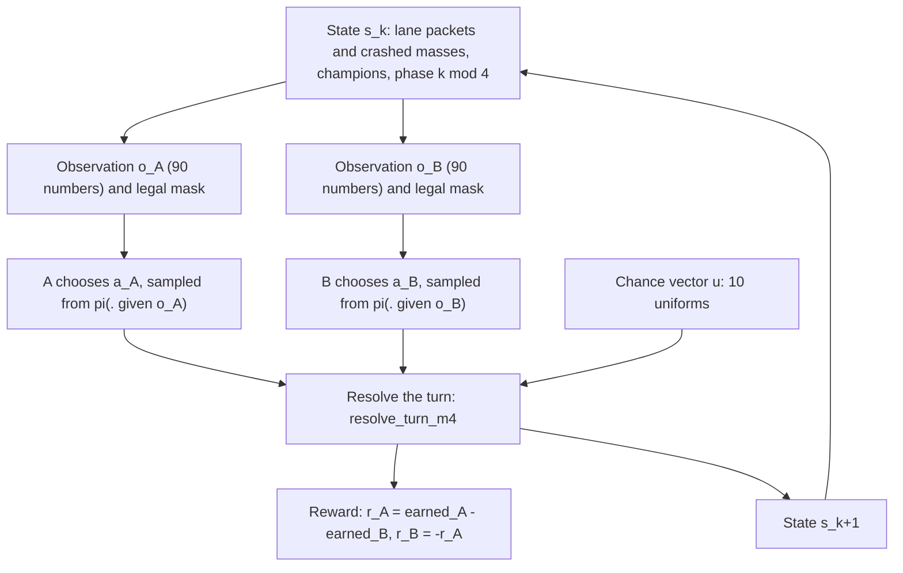
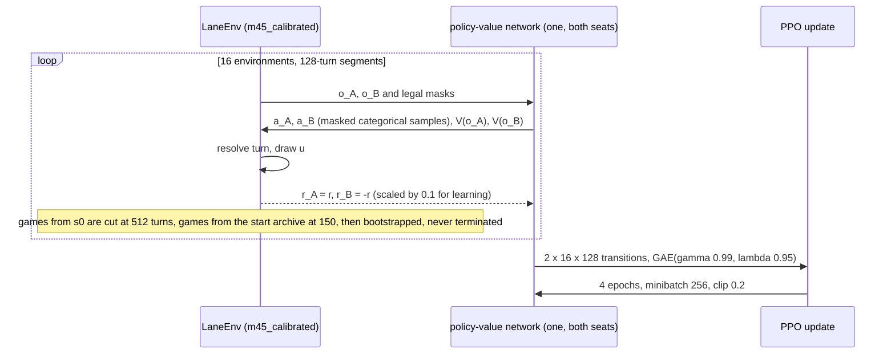
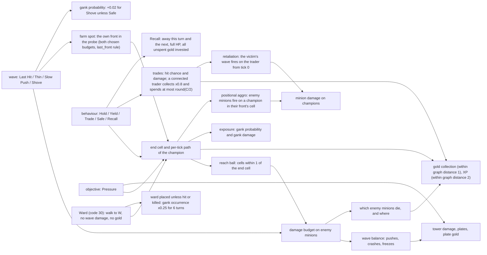
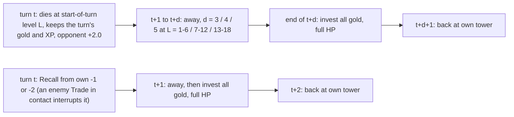

# The Laning Game: Mathematical Reference

**What this is.** The central, living description of the game the agents play: every state variable, every action,
every rule of the turn resolution, every reward term and the RL objective. Each equation names the code that
implements it.

**Which game.** Every section describes the research preset **`GameConfig.m45_calibrated()`**. It is the game of
every campaign since M4.5c: M4.6, M4.7, M4.8, OM2 and the completed M5 campaign (2026-10-19). The user adopted it as
the M5 baseline on 2026-10-17.
- Statements carry no label when they describe this preset. **OPT-IN** marks a configuration field that exists but is
  off in it (§15). **HISTORICAL** marks a rule of an earlier preset (§14).
- How the preset was built from `GameConfig.m4()`, and every field in which it differs from `m4_lasthit()`, the base
  model of the M4.3b pilot, is §14.
- The engine computed every worked example, table and measurement of learned play in this document:
  `python -m lanegame.experiments.reference examples selfplay death report` writes them to `results/reference/`, and
  `tests/test_reference_examples.py` pins the deterministic ones. Learned play is the M5 pure self-play final of seed 0
  (`sp:0`).
- *Rewrite (2026-10-20).* Until then §1–§10 described `m4_lasthit()` and §4.10, §8.7–§8.8 and §14–§15 gave the
  research preset's differences. That version is archived unchanged as
  [laning_game_mathematical_reference_m4_lasthit.md](laning_game_mathematical_reference_m4_lasthit.md). Reports written
  before 2026-10-20 cite its section numbers.

**Terminology.** The midpoint cell $x=0$ is "the lane" or "the lane cell". The off-lane node next to it is "the
Vision node W". The four wave actions are **Last Hit** (slot 0, label `LH`), **Shove** (slot 1, `SH`), **Thin** (slot
2, `TN`) and **Slow Push** (slot 3, `SL`). Shove is the slot the three-action presets call Clear; the codes, masks and
budget are the same. The reward term for champion deaths is **kills**; the configuration field keeps the name
`kill_bounty`, and "kill ledger" is the record of minion HP that died (farm).

**Maintenance rule.** Whenever a rule, a parameter or the objective of the research preset changes, update the
corresponding equation, table, diagram and example here in the same piece of work, re-run the generator, and add a
line to §13.

---

## Contents

0. [Quick reference](#0-quick-reference)
1. [Overview of the mathematical game](#1-overview-of-the-mathematical-game)
2. [State](#2-state)
3. [Actions](#3-actions)
4. [Wave mechanics](#4-wave-mechanics)
5. [Farming, zoning and experience](#5-farming-zoning-and-experience)
6. [Combat, ganks, death and Recall](#6-combat-ganks-death-and-recall)
7. [Gold investment and champion progression](#7-gold-investment-and-champion-progression)
8. [Towers, plates and the reward](#8-towers-plates-and-the-reward)
9. [The RL objective and its evaluation](#9-the-rl-objective-and-its-evaluation)
10. [Strategic walkthroughs](#10-strategic-walkthroughs)
11. [Glossary](#11-glossary)
12. [Where the historical documents disagree with the code](#12-where-the-historical-documents-disagree-with-the-code)
13. [Change log of this document](#13-change-log-of-this-document)
14. [How the research preset was built](#14-how-the-research-preset-was-built)
15. [Opt-in fields](#15-opt-in-fields)

---

## 0. Quick reference

### 0.1 The lane at a glance

```
global cell:   -4        -3       -2          -1        0         +1        +2          +3        +4
               A base             A TOWER               LANE                B TOWER               B base
               (A waves spawn)    (T_A)                 (midpoint)          (T_B)                 (B waves spawn)
                                                         |
                                                         W   the Vision node: off the lane, attached to the lane cell

A's own coordinates = global;  B's own coordinates = -global (W is W for both).  Every side sees itself on the left:
own base -4, own tower -2, the lane 0, enemy tower +2, enemy base +4.  Champions stand on cells -2 .. +2 or on W.
Distances follow the movement graph: d(x, y) = |x - y| on the lane, d(x, W) = 1 + |x|.
```

### 0.2 The numbers that matter most

| quantity | value | where |
|---|---|---|
| decision turn | 2 movement ticks | `ticks_per_turn = 2` |
| wave | 8 HP, one per side every 2 turns (after turns k = 1, 3, 5, …) at the own base | `wave_hp = 8`, `spawn_interval = 4` ticks |
| packet cap | 24 HP (3 waves); larger reinforcements queue behind | `hp_cap = wave_hp (1 + max_stacks)` |
| minion firepower | $f(h)=\max(1,\lfloor 2h/8\rfloor)$ HP per **turn**, split over the 2 ticks | `mechanics.minion_damage` |
| champion wave capacity | $C=\mathrm{round}(4\,AP^\ast)$ HP per turn | `M4Context.capacity` |
| wave actions | Last Hit 1 HP; Thin $\min(\lfloor C/2\rceil,1+\text{need}_0)$; Slow Push $\min(\lfloor C/2\rceil,1+\text{need}_1)$; Shove $C$; a connected trader spends at most $\lfloor C/2\rceil$ | `M4Context.state_budget`, `mechanics.strength_budget` |
| wave reach | own cells within 1 of the end cell and at most $+3$; Safe and a retreating Yield also at most $\min(\text{end},-1)$; from W only the lane cell | `positional.reach_interval` |
| minions on champions | retaliation against an enemy trader that damaged their champion, from tick 0; positional aggro on an enemy champion standing uncovered in their front's cell; $\max(1,\lfloor 50m/1.08^{L-1}\rceil)$ centi-HP for $m$ units | `mechanics._designation`, `positional.minion_damage_centi` |
| tower | 3 HP per tick on crashed minions; shoots a connected trader that ends in its cell (probability 1.0) or next to it (0.5) | `tower_siege_damage`, `tower_shot_p`, `tower_adjacent_p` |
| gold | 0.125 resources per enemy minion HP that dies, times the collection rate: 0.9 within 1 cell, at most 0.8 in the own tower cell, ×0.8 while trading, less when Safe, 0 while warding | `farm_per_hp`, `collection_units` |
| XP | 1 per enemy minion HP that dies within 2 edges of a present champion; level $L\to L+1$ costs $8+3(L-1)$; level 18 at 544 XP | `xp_per_hp`, `xp_range = 2`, `progression` |
| max HP | $H(L)=\mathrm{round}(600\cdot1.05^{L-1})$ centi-HP; one "HP unit" $u(L)=\mathrm{round}(H/6)$ | `progression.tables` |
| attack power | $AP^\ast(L,S)=1.05^{L-1}\,M(S)$, $M(S)=1+1.5\bigl(1-\sqrt{16/(16+S)}\bigr)$, $S$ = invested gold; $M(S)$ also divides damage taken | `progression.Investment` |
| trade | hit 0.55 against a Hold defender, 2 units with probability 0.3 given a hit; damage $\lfloor 100D\,AP^\ast\rceil$ centi-HP, divided by the victim's $M(S)$ | `champions.trade_hit_probability` |
| gank | occurs with $p\approx 0.03(e+2)+\text{behaviour}$ ($e$ = exposure cell, W counts as 0), deals Binomial$(4,p_e)$ units; ×0.25 for 6 turns after a placed ward | `champions.champion_gank_probability` |
| Ward | code 30: walk to W (legal within 2 edges of W), placed at the end of the turn unless the enemy's connected Trade damages the warder | `vision_rule = "ward"` |
| death | at HP $\le 0$: away 3 / 4 / 5 turns at levels 1–6 / 7–12 / 13–18, opponent +2.0 for the kill, gold kept and invested on return | `death_turns_by_level`, `kill_bounty = 2.0` |
| Recall | at own cell $\le -1$: away the Recall turn + 1 turn, full HP and all gold invested on return | `recall_turns = 2` |
| tower damage | Pressure adds $\lfloor 400\,AP^\ast\rceil$ centi-units per turn; crashed minions add $100 f$ per turn, split over the ticks; plates at 1,600 / 3,600 / 6,000; 1.0 resource per plate; clamped at 6,000 | `plate_thresholds`, `pressure_tower_damage` |
| reward | $r_A=(\Delta E_A-\Delta E_B)$, $E$ = farm + plate gold + kills (resources, exact ledger of $10^{-7}$) | `resolve_turn_m4` step 15 |
| objective | $J=\mathbb E\sum_{k\ge0}0.99^k r_{A,k}$; no terminal state | `gamma = 0.99`, `time_mode = "continuing"` |

### 0.3 The formulas you will need most often

$$
r_{A,k}=\underbrace{(F_A-F_B)}_{\text{farm}}+\underbrace{(P_A-P_B)}_{\text{plate gold}}+\underbrace{(K_A-K_B)}_{\text{kills}},
\qquad r_{B,k}=-r_{A,k},\qquad J_A(\pi_A,\pi_B)=\mathbb E\Bigl[\sum_{k=0}^{\infty}\gamma^k r_{A,k}\Bigr].
$$

$$
F_s=\sum_{x}h_x\cdot 0.125\cdot c_s(x),\qquad
c_s(x)=\mathbb 1\bigl[d(x,\mathrm{end}_s)\le\rho\bigr]\cdot\min\bigl(b(\text{mode},x),\ 0.8\ \text{if }x=-2\bigr)\cdot\kappa,\quad\kappa=0.8\text{ while trading, else }1,
$$

$$
\text{XP}_s=\sum_x h_x\,\mathbb 1\bigl[d(x,\mathrm{end}_s)\le2\bigr]\;\;(\text{present}),\qquad
C=\mathrm{round}\Bigl(4\cdot1.05^{L-1}M(S)\Bigr),\qquad f(h)=\max\Bigl(1,\Bigl\lfloor\frac{2h}{8}\Bigr\rfloor\Bigr),\qquad K_s=2.0\cdot\mathbb 1[\text{opponent died}].
$$

**Notation.** $\lfloor x\rfloor$ rounds down, $\lfloor x\rceil$ rounds half up (the engine's rounding of every
table and budget), $\mathbb 1[\cdot]$ is 1 when the condition holds, $d$ is the movement-graph distance, cells are in
the acting side's own coordinates unless marked "global", HP is minion HP for waves and centi-HP (1/100 of a base HP
unit) for champions. $AP^\ast$ is a real number in the formulas; the engine holds it in basis points.

### 0.4 Answers to the common questions

| question | section |
|---|---|
| What are all the state variables? | [§2.1–2.3](#21-the-authoritative-state) |
| How do the actions interact? | [§3.4](#34-how-one-action-reaches-every-mechanic), [§1.3](#13-one-turn-from-start-to-reward) |
| What exactly determines gold and XP income? | [§5.1–5.4](#51-the-kill-ledger) |
| When do minions attack a champion? | [§4.10](#410-minions-and-champions) |
| What makes freezing beneficial or harmful? | [§4.8](#48-freezes), [§5.6](#56-freezes-and-zoning-in-numbers), [§10.1](#101-a-champion-trying-to-maintain-an-early-freeze) |
| What does a ward do, and how is it contested? | [§6.4](#64-ganks-and-vision) |
| How do champion power and death costs scale? | [§7](#7-gold-investment-and-champion-progression), [§6.7](#67-what-a-death-costs) |
| What does PPO actually optimize, and how was M5 trained? | [§9](#9-the-rl-objective-and-its-evaluation) |
| What causes a game to end? | Nothing: [§8.5](#85-after-the-final-plate-and-why-the-game-does-not-end), [§9.1](#91-the-game-objective) (an OPT-IN terminal at the last plate is [§15.2](#152-ending-the-game-at-the-final-plate-terminal_rule--final_plate)) |
| How does this preset differ from `m4_lasthit()` and the earlier presets? | [§14](#14-how-the-research-preset-was-built) |
| Which fields exist but are off? | [§15](#15-opt-in-fields) |

---

## 1. Overview of the mathematical game

### 1.1 The game in one paragraph

Two players, A and B, each control one champion in one lane. Time is a sequence of **decision turns**
$k=0,1,2,\dots$. On every turn both players choose an action **simultaneously**: neither sees the other's choice of
this turn. A deterministic minion simulation of two ticks then runs with the two champions' contributions, including
minion fire on champions. A fixed vector of ten random numbers decides trades, tower shots and ganks, and both players
are paid. Formally it is a **two-player zero-sum stochastic game** (a Markov game)

$$
\mathcal G=\bigl(\mathcal S,\ \mathcal A_A(s),\ \mathcal A_B(s),\ P(s'\mid s,a_A,a_B),\ r(s,a_A,a_B,u),\ \gamma,\ s_0\bigr)
$$

with a countably infinite state space $\mathcal S$ (invested and unspent gold have no upper bound; the engine supports
up to $10^6$ invested resources, far beyond play), state-dependent legal action sets inside one fixed set of 61 codes,
a transition kernel that is deterministic given the chance vector $u\in[0,1)^{10}$, a reward to A whose negative is
B's reward, the discount $\gamma=0.99$ and the standard start $s_0$. **There is no terminal state**
(`time_mode = "continuing"`). The game goes on for ever, and the discount makes the objective finite.

### 1.2 The functions of the game

| function | definition | code |
|---|---|---|
| state $s_k$ | lane state (minion packets, crashed masses, vision timers), champion state (position on the movement graph, HP, absence, XP, invested gold, unspent gold, tower damage) per side, and the spawn phase $k \bmod 4$ | `state.State`, `champions_m4.M4State`, `LaneEnv._k` |
| observation $o_{s,k}$ | 90 numbers in $[0,1]$, own perspective, a lossless function of $(k\bmod4,s_k)$ while gold stays below the encoding's exact range (§2.4) | `env/observation_m4.observe_m4` |
| legal actions $\mathcal A_s(s_k)$ | a subset of $\{0,\dots,60\}$; 27 codes can ever be legal, at most 25 at once (§3.3) | `champions.champion_legal_actions` |
| transition $P$ | `resolve_turn_m4` (§1.3) with $u\sim\mathrm{U}[0,1)^{10}$ drawn by the environment every turn whatever the actions | `champions_m4.resolve_turn_m4`, `env/core.LaneEnv._step_m4` |
| reward $r_A$ | earned-resource difference of the turn, exact in ledger units of $10^{-7}$ resources (§8.6) | step 15 of `resolve_turn_m4` |
| termination | **none**; an episode is only ever *truncated* by a time limit of the run | `LaneEnv.step` (`terminated` is always `False`) |
| objective | $J=\mathbb E\sum_k\gamma^k r_{A,k}$, A maximizes, B minimizes | `env/discounted.py`, `rl/ppo.py` |

**Zero-sum by construction.** The environment returns `(r, -r)`; nothing is added to either side. Because the reward
counts *resources earned* by each side, any event that earns both sides the same amount cancels.

**Randomness.** Each turn draws exactly ten uniforms in a fixed layout (`champions.U_*`). Per side these are a
trade-hit uniform, a double-hit uniform, a tower-shot uniform, a gank-occurrence uniform and a gank-damage uniform. A
hit, a double, a shot or a gank happens when its uniform is below its probability. The gank-damage uniform picks the
number of damaging trials by the inverse distribution function of Binomial$(4,p_e)$. Because the number of draws never
depends on the actions, two policies played on the same seed see identical chance turn by turn (common random numbers;
every paired evaluation uses them). The minion simulation, minion fire on champions included, has no randomness.
Agents sample their actions from their own, separate random streams.

**What is observed, what is random, what is derived.**

| category | quantities |
|---|---|
| fully observed by both players (perfect information about the state) | every lane packet, both crashed masses, both champions' positions (W included), HP, absence timers, XP, invested and unspent gold, both towers' damage, both vision timers, the spawn phase |
| hidden | only the opponent's action of the *current* turn (simultaneous moves) |
| random | trade hits and doubles, tower shots, gank occurrence and gank damage (ten uniforms per turn) |
| derived (never stored) | level, max HP, HP unit, attack power, wave capacity and budgets, window strengths, plates broken, contact, farm spot, reach, exposure, minion targets, all probabilities |

### 1.3 One turn, from start to reward



The resolution order inside one turn (`champions_m4.resolve_turn_m4`; the step numbers are the code's, so 9a comes
before 5):

```mermaid
flowchart LR
    P1["1 probe: where does each wave end under full champion support? = farm spot"] --> P2["2 targets and movement on the graph (max 2 edges), Trade chases, Ward walks to W"]
    P2 --> P2b["2b Recall interrupted by a reaching enemy Trade?"]
    P2b --> P3["3 evasion of Yield / Safe from a Trade"]
    P3 --> P4["4 trade contact: connected?"]
    P4 --> P9a["9a trade rolls"]
    P9a --> P5["5 modes and wave reach"]
    P5 --> P5b["5b capped budget of a connected trader; each wave's minion target"]
    P5b --> P5c["5c each champion's cell after each tick"]
    P5c --> P6["6 lane step: 2 ticks of minions, champion wave damage, minion fire on champions, crashes, tower fire"]
    P6 --> P7["7 gold, 7b XP"]
    P7 --> P8["8 exposure, gank probability"]
    P8 --> P9b["9b tower shots, ganks, summed damage with minion fire, mitigation"]
    P9b --> P10["10 death, 10b ward placement"]
    P10 --> P11["11 tower damage, plates"]
    P11 --> P12["12-14 level-ups, ledger, absence, investment on return"]
    P12 --> P15["15 reward"]
```



Every power-dependent quantity of a turn (wave capacity, trade damage, gank and tower-shot damage, minion damage,
Pressure) uses the levels and investment held **at the start** of the turn.

### 1.4 How PPO meets the game

The M5 campaign trained two arms on this game (§9.2). The pure self-play arm (`sp`) works as follows:



One network plays both seats on its own-perspective observations, and both seats' transitions are training samples
(shared-policy self-play, `rl/shared.py`). The opponent-modelling arm (`om`) plays half of its games against fixed
library opponents, where only its own seat trains. Its network also reads the opponent's previous action (§15.4) and
13 belief features computed outside the game. §9 separates the game's objective from this training procedure.

---

## 2. State

### 2.1 The authoritative state

The Markov state is $(k \bmod 4,\ \text{lane},\ \text{champions})$ plus two constant seat parameters (the mechanical
skills, both 0.5). Every side's data is stored in **its own coordinates** (own base $-4$, own tower $-2$, enemy tower
$+2$); global cells are A's.

**Lane state** (`state.State`, one record per side; written by the lane step `mechanics.step_turn`, called in
`resolve_turn_m4` step 6, except for the ward placement of step 10b):

| variable | symbol (field) | range / units | meaning | updated by |
|---|---|---|---|---|
| front cell | $x_s$ (`ax`, `bx`) | own cells $-4..+1$ (a front reaching $+2$ crashes at once) | cell of the side's leading (most advanced) minion packet | movement, merging, deaths, crashes, spawns (§4) |
| front HP | $h_s$ (`ah`, `bh`) | $0..24$ minion HP; 0 = no front | HP of the leading packet (possibly stacked) | fights, champion damage, merging |
| rear packets | $R_s$ (`ar`, `br`) | tuple of own cells, most advanced first; each packet exactly 8 HP | packets behind the front that could not merge (cap) or have not caught up | movement, merging, spawns |
| crashed mass | $m_s$ (`asg`, `bsg`) | $0..96$ minion HP (`siege_cap`; excess is lost) | this side's minions that entered the **enemy** tower cell (a siege) | crashes, tower fire, defenders, the defending champion (§4.4, §4.6) |
| vision timer | $v_s$ (`va`, `vb`) | $0..6$ turns | turns of gank protection left (§6.4) | set to `vision_turns` = 6 by a placed ward (step 10b); counted down by 1 in every lane step |
| plate counters | `ap`, `bp` | always 0 | plate opportunities of the Phase 1 exact game; `plate_mode = "durability"` uses $\tau$ below | never updated |

Only a placed ward sets the vision timer. The resolver removes the Vision objective from the Ward code before the lane
step (`lane_obj` in `resolve_turn_m4`), so the lane step only counts the timer down. A ward placed on turn $k$ sets
$v_s=6$ after that countdown, and the gank formula reads the start-of-turn timer, so the ward protects turns
$k+1..k+6$ and not turn $k$ itself (§6.4).

**Champion state** (`champions_m4.M4Side(pos, hp, absent, xp, items, gold, tower_dmg)`, one per side in
`M4State(a, b)`; written by `resolve_turn_m4`):

| variable | symbol (field) | range / units | meaning | updated by |
|---|---|---|---|---|
| position | $\mathrm{pos}_s$ (`pos`) | own cells $-2..+2$, or the Vision node W (stored as `positional.WARD` = 99); $-2$ while away | the champion's node at the start of the turn | steps 2–3 (movement, chase, evasion, the walk to W); death and Recall put it at $-2$ |
| HP | $\eta_s$ (`hp`) | $0..H(L)$ centi-HP; 0 only while dead | current health | step 9b (trade, tower, gank and minion damage, divided by $M(S)$), step 12 level-up gain, full on return (step 14) |
| absence | $\alpha_s$ (`absent`) | $0..5$ turns (`champion_absent_max` = 5) | turns still to sit out (0 = present) | Recall sets 1; a death sets 3, 4 or 5 for a start-of-turn level of 1–6, 7–12 or 13–18 (`death_turns_by_level`); counts down by 1 per turn; the champion returns when it reaches 0 (step 14) |
| XP | $X_s$ (`xp`) | $0..544$ | cumulative credited experience (XP beyond 544 is discarded) | steps 7b and 12 |
| invested gold | $S_s$ (`items`, alias `invested`) | $\ge0$ ledger units ($10^{-7}$ resources), unbounded | cumulative gold converted into power (`item_model = "continuous"`) | step 14 moves all unspent gold into it on every return to the lane |
| unspent gold | $g_s$ (`gold`) | $\ge0$ ledger units, unbounded | gold earned since the last return | step 13 (+ earned), step 14 (to 0 on return) |
| tower damage | $\tau_s$ (`tower_dmg`) | $0..6000$ centi-units | cumulative damage this side has dealt to the **enemy** tower | step 11 (clamped at 6,000) |

**The Vision node W.** W is one shared off-lane node attached to the lane cell 0. It is the same node in both sides'
coordinates. The mirror maps a lane cell $y$ to $-y$ and W to W (`positional.mirror_cell`). Champions stand on the
movement graph $\{-2,\dots,+2\}\cup\{W\}$ and minions only on lane cells. Graph distances (`positional.dist`, in one
side's coordinates) are

$$
d(\ell,\ell')=|\ell-\ell'|,\qquad d(\ell,W)=1+|\ell|,\qquad d(W,W)=0,
$$

also for kill cells $\ell$ outside $-2..+2$ (defenders behind a tower). Movement, contact, reach, collection, XP and
legality all use $d$ (§3.3, §4.5, §5.3, §5.4, §6.1). A champion reaches W only with the Ward action (code 30) and
leaves it through the lane cell 0. In uniform random legal play all 2,725 arrivals at W came from code 30
(`results/reference/actions.json`, stage `actions`, key `random_play`).

**Size of the state space.** The state space is countably infinite. Invested and unspent gold have no upper bound in
the game, because steps 13–14 clamp neither under `item_model = "continuous"`. Every other variable is bounded. The
engine supports invested gold up to `progression.INVEST_MAX_RESOURCES` = $10^6$ resources and raises beyond it
(`Investment.multiplier`); unspent gold has no engine limit.

**Phase.** Waves spawn after every odd turn ($k=1,3,5,\dots$), so the dynamics depend on $k$ only through $k\bmod2$.
The environment keeps $k\bmod4$ (`GameConfig.phase_period = 4`, inherited from the scripted wave rules, so the
observation layout did not change); the extra factor two is redundant but harmless.

**Constants of a game.** The skills $m_A=m_B=0.5$ (`skill_a`, `skill_b`) are constants, not state. They enter only
the trade and gank-damage probabilities.

**Standard start $s_0$** (`mechanics.initial_state`, `champions_m4.initial_m4`). One fresh 8-HP wave stands at each
base ($x=-4$), with no rear packets, no crashed mass and both vision timers at 0. Both champions stand at their tower
(own $-2$), present, at level 1 with 600 centi-HP and no XP, invested or unspent gold or tower damage; $k=0$. Each
side has 17 legal codes there (the 16 lane codes and Recall, §3.3).

### 2.2 Derived quantities (never stored)

| quantity | symbol | formula | code |
|---|---|---|---|
| level | $L(X)$ | $\max\{L\le18: \mathcal X(L)\le X\}$, $\mathcal X(L)=8(L-1)+\tfrac32(L-1)(L-2)$ | `progression.level_of` |
| max HP | $H(L)$ | $\lfloor600\cdot1.05^{L-1}\rceil$ centi-HP (600 at level 1, 1,375 at level 18) | `Tables.hp_max` |
| HP unit | $u(L)$ | $\lfloor H(L)/6\rceil$ | `Tables.hp_unit` |
| investment multiplier | $M(S)$ | $1+1.5\bigl(1-\sqrt{16/(16+S)}\bigr)$, $S$ in resources, exact integers; $M(48)=1.75$, $M(128)=2$, supremum 2.5 | `Investment.multiplier` (`invest_curve = "saturating"`) |
| attack power | $AP^\ast(L,S)$ | $1.05^{L-1}M(S)$ (basis points internally) | `Investment.attack_power` |
| graph distance | $d$ | §2.1 | `positional.dist` |
| wave capacity, budgets | $C,\ B_w$ | §4.5 | `M4Context.capacity`, `M4Context.state_budget` |
| window strength, need | $S,\ \text{need}_m$ | §4.5 | `mechanics.window_strength`, `strength_need` |
| plates broken | $\pi(\tau)$ | $\#\{j:\tau\ge\theta_j\}$, $\theta=(1600,3600,6000)$ | `progression.plates_broken` |
| stacks of a packet | $\sigma(h)$ | $\min(2,\lceil h/8\rceil-1)$ | `GameConfig.stacks` |
| contact (champions) | | §6.1 | `champions.in_contact`, `positional.in_contact` |
| farm spot, modes, reach, exposure | | §5.2, §4.5, §6.4 | `resolve_turn_m4` steps 1, 5, 8 |
| path within the turn | $p_1,p_2$ | §6.1 | `positional.tick_path` (step 5c) |
| minion targets | | §4.10 | `positional.MinionTarget` (step 5b), `mechanics._designation` |

### 2.3 What is *not* in the state

No clock and no countdown (the game is stationary; the end of the lane phase at turn 94 is an evaluation checkpoint,
§9.3), no item inventory (investment is one number), no cooldowns, no mana, no minion types, no hidden information
(both players see everything), no jungle state (ganks are a hazard rate), no gold *lost* on death, no tower HP beyond
the damage counter $\tau$. The research preset leaves four more things out:

- **No ward object.** A placed ward exists only as its owner's vision timer. Nothing can see, clear or contest it
  after it is placed; only placement sets the timer, which then counts down.
- **No minion memory.** Retaliation and positional aggro are designated afresh on every tick from the current turn's
  trade and positions (§4.10). Nothing carries over to the next turn.
- **No positions within the turn.** The per-tick path starts from $\mathrm{pos}_s$ each turn and is not stored.
- **No record of earlier actions.** The opt-in `obs_last_action` keeps the previous turn's codes in the environment,
  outside the game state (§15.4).

### 2.4 The agent's observation (90 entries)

`env/observation_m4.observe_m4` returns a fixed-length, own-perspective vector, every entry in $[0,1]$, a function of
$(k\bmod4,\text{lane},\text{champions},\text{side})$ only. Enemy cells are mirrored into the observer's coordinates;
W stays W.

| block | entries | indices | content |
|---|---|---|---|
| phase | 4 | 0–3 | one-hot of $k\bmod4$ |
| own lane | 19 | 4–22 | front cell one-hot over cells $-4..+4$ (all zero without a front); front HP / 24; rear packets per cell / 4 (9 cells) |
| enemy lane | 19 | 23–41 | the same for the enemy, mirrored into own coordinates |
| own side | 3 | 42–44 | crashed mass / 96; vision timer / 6; siege eligible (mass $>0$) |
| enemy side | 3 | 45–47 | the same for the opponent |
| own tower progress | 4 | 48–51 | $\tau/6000$; plates broken / 3; progress towards the next plate (1 when all are broken); plates left / 3. Here $\tau$ is the damage **we** dealt |
| enemy tower progress | 4 | 52–55 | the same for the opponent's $\tau$ (damage dealt to **our** tower) |
| own champion | 17 | 56–72 | cell one-hot over $-2..+2$ and then W (6 entries, `own_champ_W` last); HP / $H(L)$; $H(L)/H(18)$; absence / 5; skill; $(L-1)/17$; XP progress within the level, $(X-\mathcal X(L))/(\mathcal X(L+1)-\mathcal X(L))$ (0 at level 18); invested $n/(n+64)$; unspent $n/(n+8)$ ($n$ = whole resources); the sub-resource parts of both, $(\text{units} \bmod 10^7)/10^7$; $AP^\ast/(AP^\ast+AP^\ast(18,0))$ with $AP^\ast(18,0)=2.292$ |
| enemy champion | 17 | 73–89 | the same for the enemy; its cell mirrored, and the W entry (`enemy_champ_W`) set when it stands at W |

The entry names are `env/observation_m4.m4_feature_names`. The absence entry divides by `champion_absent_max`, so it
is $\alpha/5$ here. The two gold entries use `invest_obs_encoding = "compressed"` with `invest_obs_ref` = 64 and
`invest_obs_gold_ref` = 8 resources.

**Exactness.** The encoding is exactly invertible (`decode_m4`, which reads W back) under three bounds:

- invested gold of at most 23,106 whole resources and unspent gold of at most 8,184
  ($n\le$ `compressed_exact_max(R)` $=\lfloor\sqrt{R\,2^{23}}\rfloor-R$ for $R=64$ and $R=8$). Beyond them the
  observation stays valid and `decode_m4` raises. Play stays far below them. The M5 policy `sp:0` has invested 384
  resources on average after 1,000 turns of self-play, and at most 406.5 in 64 seats
  (`results/reference/selfplay.json`, stage `selfplay`, `m45_calibrated()`);
- at most 4 rear packets in one cell (`rear_count_max`). `observe_m4` raises otherwise; random legal play never put
  more than 2 in a cell;
- crashed mass of at most 96 (`siege_cap`). `observe_m4` raises otherwise; the lane step never exceeds it.

In 80,000 observations of uniform random legal play (200 games of 200 turns), every entry lay in $[0,1]$, the absence
entry equalled $\alpha/5$, and `decode_m4` returned the true phase, lane and champion state of every one, including
3,068 with the observer at W (`results/reference/actions.json`, key `random_play.observation`).

**Compatibility.** A network trained on any preset without the Vision node has 88 inputs. The M4.4 checkpoint guard
(`experiments.rl.m44.common.load_policy`) refuses it on this 90-entry observation, as it refuses any other mismatch of
input or action count.

**The opponent's previous action.** The opt-in field `obs_last_action` appends 13 entries for the opponent's
previous code (103 in all, §15.4). Arm `om` of M5 observes those 103 entries. Its network has 116 inputs, the 103
entries plus the 13 features of the OM2 belief, which the agent computes outside the game
(`experiments/rl/m5/common.py`, `NET_IN_OM`). Arm `sp` observes the 90 entries above.

**Diagnostic statistics** (`lanegame/experiments/rl/m43b/behavior.turn_features`) are *derived from* the state for
analysis only and never enter the game. They are the contact cell of the fronts and the power ratio (the expected hit
on the opponent in the opponent's HP units over the reverse). The situation masks ("neutral lane", "own wave pushing", …)
come from `behavior.situations`.

---

## 3. Actions

### 3.1 The encoding

A present champion's action is a triple (wave slot $w$, behaviour $b$, objective $o$). For the three original wave
slots the code is

$$
a = w + 3\,b + 15\,o,\qquad w\in\{0,1,2\},\ b\in\{0,\dots,4\},\ o\in\{0,1,2\},
$$

which gives codes $0..44$. Code **45** is ABSENT (`config.CHAMP_ABSENT`). The fourth wave slot, Slow Push ($w=3$,
`config.W_SLOWPUSH`, field `wave_slowpush`), has its codes appended after ABSENT so that no earlier code changed
meaning:

$$
a=46+b+5\,o\qquad(w=3),\qquad\text{codes }46..60;\qquad 61\text{ codes in all.}
$$

`config.champ_act` encodes both ranges and `champ_wave`, `champ_behavior`, `champ_objective` decode them;
`GameConfig.action_codes()` is `range(61)`. The slot numbers come from the scripted game (SP = 0, SH = 1, F = 2).
`config.W_HOLD` is slot 0, `W_SHOVE` slot 1 and `W_THIN` slot 2. `W_SHOVE` is the same constant as `W_CLEAR`, so the
Clear of the three-action presets and the Shove of the research preset are the same codes (§14.3).

| wave slot $w$ | name | label | the champion's damage budget on enemy minions this turn (§4.5) |
|---|---|---|---|
| 0 | **Last Hit** | `LH` | $\min(1,\lfloor C/8\rceil)=1$ HP at every power ($C\ge4$), normal last-hitting |
| 2 | **Thin** | `TN` | $\min(\lfloor C/2\rceil,\ 1+\text{need}_0)$, the last hit plus the HP that brings the enemy's window strength down to the own |
| 3 | **Slow Push** | `SL` | $\min(\lfloor C/2\rceil,\ 1+\text{need}_1)$, the same with a margin of one HP in the own wave's favour |
| 1 | **Shove** | `SH` | $C$, everything the champion can |

$C=\lfloor4\cdot1.05^{L-1}M(S)\rceil$ is the wave-clear capacity, 4 at level 1 and 9 at level 18 with nothing
invested. $\text{need}_m=\max(0,\lceil S_E-S_O+m\rceil)$ compares the start-of-turn window strengths of the two sides
(`mechanics.strength_need`). The resolver computes every budget once per turn from the start-of-turn power and lane
(`M4Context.state_budget`, `mechanics.strength_budget`). Shove also adds `champ_gank_shove` = 0.02 to the gank
probability unless the behaviour is Safe (§6.4).

| behaviour $b$ | name | label | where the champion goes (§6.1) |
|---|---|---|---|
| 0 | Hold | `H` | its farm spot (§5.2); never evades |
| 1 | Yield | `Y` | its stand-off cell, the rearmost cell still within 1 of the enemy front and never ahead of the farm spot (`yield_target`); evades a reaching Trade unless it started the turn in contact with the trader, in which case it is pinned and traded like a Hold |
| 2 | Trade | `T` | chases the nearest cell in contact with the opponent (`contact_cell_target`) and deals trade damage if it connects (§6.2); against an absent opponent it positions like Hold |
| 3 | Safe | `S` | heads for its farm spot but not ahead of its own $-1$ (`safe_line`); evades a reaching Trade |
| 4 | Recall | `R` | only as the single code 12 (Last Hit slot + Recall); channels in its cell (§6.6) |

A champion takes trade damage only from an opponent whose Trade connected.

| objective $o$ | name | label | effect |
|---|---|---|---|
| 0 | none | | |
| 1 | Pressure | `+P` | the champion walks into the enemy tower cell and adds $\lfloor400\,AP^\ast\rceil$ centi-units to $\tau$ (§8.2); if its Trade connects there, the objective lapses for the turn and the champion trades instead |
| 2 | Vision | `WARD` | exists only as code 30, the **Ward** (Last Hit slot + Hold + Vision, `config.CHAMP_WARD`). The champion walks to the Vision node W, deals no wave damage and collects no gold, and places a ward at the end of the turn unless the enemy's connected Trade damaged it or it died (§6.4) |

`GameConfig.label` builds the short labels from the slot, the behaviour and the objective. Examples: `LH-H` (0),
`SH-T` (7), `TN-Y` (5), `LH-R` (12, Recall), `SL-H+P` (51), `WARD` (30), `ABSENT` (45).

### 3.2 The 61 codes

The action space keeps every code of the product so that a code means the same in every configuration. Exactly 27
codes can ever be legal: 0–12, 15–17, 21–23, 30, 45, 46–49, 51 and 53. The policy network has 61 outputs, and the
legal mask (`Observation.mask`) removes every code that is illegal on the turn, so the other 34 never receive
probability.

| codes | meaning | ever legal |
|---|---|---|
| 0–11 | {LH, SH, TN} × {Hold, Yield, Trade, Safe}, no objective | yes, for every present champion |
| 12 | Recall (LH + Recall) | yes, at own $-2$ or $-1$ |
| 13, 14 | SH / TN + Recall | never (Recall is the single code 12) |
| 15–17 | {LH, SH, TN} + Hold + Pressure | yes, during an own siege from own 0 or further forward |
| 18–20 | {LH, SH, TN} + Yield + Pressure | never (an objective goes only with Hold or Trade) |
| 21–23 | {LH, SH, TN} + Trade + Pressure | yes, as codes 15–17 |
| 24–29 | {LH, SH, TN} + {Safe, Recall} + Pressure | never |
| 30 | Ward (LH + Hold + Vision), label `WARD` | yes, within 2 edges of W |
| 31, 32 | SH / TN + Hold + Vision | never (Vision exists only as the Ward) |
| 33–44 | {LH, SH, TN} + {Yield, Trade, Safe, Recall} + Vision | never |
| 45 | ABSENT | yes, the only code while away |
| 46–49 | SL × {Hold, Yield, Trade, Safe}, no objective | yes, for every present champion |
| 50 | SL + Recall | never |
| 51 | SL + Hold + Pressure | yes, as codes 15–17 |
| 52 | SL + Yield + Pressure | never |
| 53 | SL + Trade + Pressure | yes, as codes 15–17 |
| 54, 55 | SL + {Safe, Recall} + Pressure | never |
| 56–60 | SL × every behaviour + Vision | never |

Two checks confirm the list (`results/reference/actions.json`, stage `actions`). An exhaustive pass over every input
that `champions.champion_legal_actions` reads (absence 0..5, position $-2..+2$ or W, own crashed mass zero or
positive) yields exactly these 27 codes (key `exhaustive`). In uniform random legal play (200 games of 200 turns,
80,000 seat-turns, key `random_play`) the same 27 codes occurred and no other.

### 3.3 Legality

`champions.champion_legal_actions` builds the set; `mechanics.wave_actions` returns all four wave slots under natural
waves with `wave_slowpush`:

| situation | legal codes | count |
|---|---|---|
| champion absent ($\alpha_s>0$) | {45} | 1 |
| present | every wave slot × {Hold, Yield, Trade, Safe} (codes 0–11, 46–49) | 16 |
| … and $d(\mathrm{pos}_s,W)\le2$ (own $-1$, 0, $+1$ or W), with or without a siege | + Ward (code 30) | +1 |
| … and own crashed mass under the enemy tower ($m_s>0$) **and** $d(\mathrm{pos}_s,+2)\le2$ (own cell $\ge0$; never from W, where $d=3$) | + every wave slot × {Hold, Trade} × Pressure (codes 15–17, 21–23, 51, 53) | +8 |
| … and a lane cell $\mathrm{pos}_s\le-1$ (never from W) | + Recall (code 12) | +1 |

The conditions are `champions.ward_legal`, `objective_reachable` (with `mechanics.siege_eligible`) and `recall_legal`;
the reach of 2 is `champion_speed`. Pressure needs own cell $\ge0$ and Recall own cell $\le-1$, so they never occur
together, and a present champion has at most 25 legal codes:

| own position | no own siege | own siege |
|---|---|---|
| $-2$ | 17 (lane + Recall) | 17 |
| $-1$ | 18 (lane + Ward + Recall) | 18 |
| 0, $+1$ | 17 (lane + Ward) | 25 (lane + Ward + Pressure) |
| $+2$ | 16 | 24 (lane + Pressure) |
| W | 17 (lane + Ward) | 17 |

In 80,000 seat-turns of uniform random legal play the engine's legal set equalled this rule every time, with sizes 1,
16, 17, 18, 24 and 25 (`results/reference/actions.json`, keys `random_play.rule_mismatches` and `sizes`).

Nothing else restricts the actions. The four wave slots are **always** legal for a present champion. A Trade with no
opponent present (its absence timer $>0$) positions like Hold, with a gank term 0.02 higher (`champ_gank_behavior`
gives Trade 0.03 and Hold 0.01). A Ward is legal while the own vision timer still runs; a placed ward resets the timer
to 6 (no stacking). Pressure stays legal after the enemy tower's last plate ($\tau=6000$). It then adds no tower
damage and no plate gold, but it still moves the champion into the enemy tower cell, with that cell's exposure and
reach (§8.5).

### 3.4 How one action reaches every mechanic



The wave slot moves the champion only through the **farm spot**. The step-1 probe resolves the lane with both
champions' *chosen* budgets, and a follower (Hold, an unthreatened Yield, Safe) heads for its own front's cell in the
probe (`farm_spot_rule = "last_front"` keeps the spot at the last cell of a front lost in the probe, §5.2). A wave
choice that kills the enemy front in the probe therefore moves the own front, and with it the end cell, the per-tick
path and the exposure of a follower. It can also move the opponent's farm spot and end cell, which a chasing Trade
targets. In uniform random legal play the wave slot alone changes the end cell in 6.0% of lane actions. The share
grows as capacity grows with level and investment, from 1.8% in turns 0–49 to 9.4% in turns 150–199. By behaviour it
is 14.4% for Hold, 6.0% for Trade, 2.4% for Safe, 1.5% for Yield and 0 for Pressure, whose target is always the enemy
tower cell.

The measurement (`results/reference/actions.json`, key `random_play.end_cell_depends_on_wave`) used 200 games of 200
turns from $s_0$, both seats drawing uniformly from their legal codes. On every turn on which a seat's code was a lane
action (not ABSENT, Recall or Ward), the generator re-resolved the turn with `resolve_turn_m4` for each of the four
wave slots under the same behaviour and objective, with the opponent's code fixed, and compared the four end cells
(65,818 lane actions). The end cell does not depend on the chance vector, because movement precedes every roll.

The behaviour decides whether the budget reaches a target and whether it is spent in full. The reach ball covers the
cells within 1 of the end cell, up to own $+3$ (Safe and a retreating Yield also not ahead of $\min(\mathrm{end},-1)$;
from W only the lane cell 0). A champion that is away, channelling a Recall or warding deals no wave damage. A
connected trader keeps its farm reach but spends at most $\lfloor C/2\rceil$ (`trade_wave_rule = "capped"`,
`trade_wave_fraction` = 0.5, step 5b). Last Hit, Thin and Slow Push never exceed that cap, so it binds only on Shove,
whose budget it cuts from $C$ to $\lfloor C/2\rceil$.

---

## 4. Wave mechanics

The research preset uses natural waves (`wave_dynamics = "natural"`, `mechanics._tick_natural`). Minions obey the
same physical rules whatever the actions. An action sets three things: the champion's damage budget on enemy minions, the cells that damage
reaches, and the cell the champion stands in on each tick, which decides whether enemy minions fire at it (§4.10).
Each turn is two ticks, numbered 0 and 1. On each tick the lane step runs, in this order (the step labels of
`_tick_natural`):

1. movement of fronts and rear packets (step 1, §4.2);
2. merging, then the entry crash of a front that enters the enemy tower cell (steps 2 and 2b, §4.2, §4.4);
3. minion targeting, in which each wave decides from the positions after the movement whether it fires at the enemy
   champion this tick, and fires if the champion is in range (steps 2b′ and 2c, §4.10);
4. the lane fight between fronts in contact, with the champions' budgets (step 3, §4.3, §4.5);
5. on a tick without a lane fight, the defender's front engages the crashed mass under its tower (step 3b, §4.6);
6. a champion's unspent budget strikes the enemy's crashed mass under its own tower, else the enemy's leading packet
   (step 3d, §4.5);
7. the crashed mass hits the tower, and the tower fires on the crashed mass (steps "hits" and 5, §4.4).

After tick 1 `step_turn` spawns the next waves (§4.1). Step 3c, Apply Pressure thinning, removes nothing in the
research preset (`thin_damage = 0`).

### 4.1 Spawning

After turn $k$ the lane spawns one 8-HP packet per side at its own base (cell $-4$) iff $2(k+1)\bmod4=0$, that is
after every odd turn (`step_turn`; `spawn_interval` $=4$ ticks, `ticks_per_turn` $=2$). Each side therefore receives
**4 minion HP per turn** on average. This is the ceiling on every flow the minions carry: farm, XP, and minion damage
on towers and on champions.

### 4.2 Movement, contact and merging

Per tick (`_tick_natural`, steps 1–2):

- **Movement.** Every front advances one cell unless (i) the two fronts are in **contact** at the start of the tick,
  $x_A+x_B\ge-1$ in own coordinates (at most one cell apart in global coordinates), or (ii) it is a defender with an
  enemy crashed mass under its tower and it stands at its own $-3$ or further forward (it engages the mass instead,
  §4.6). Rear packets walk one cell per tick but stop one cell behind their front; they never enter its cell.
  Champions never block or slow minions.
- **Merging** (`_merge`, `cap_rule = "block"`). A packet within one cell behind the leading packet merges into it if
  the sum stays $\le24$ HP (`hp_cap`); otherwise it stays a separate rear packet queued behind. No minion ever
  disappears in the lane.
- **Queued packets fight.** The firepower of a front is computed on its **blob**, the front plus every packet queued
  within one cell behind it (`_blob_hp`, `queue_fights = True`).

A fresh wave walks from its base ($-4$) to the lane cell ($0$) in two turns.

### 4.3 The half-wave Lanchester law

`mechanics.minion_damage`, `damage_law = "lanchester_half"`. A blob of $h$ HP has a firepower of

$$
f(h)=\max\Bigl(1,\Bigl\lfloor\frac{2h}{W}\Bigr\rfloor\Bigr)\ \text{HP per turn},\qquad W=8,
$$

dealt as $\lceil f/2\rceil$ on tick 0 and $\lfloor f/2\rfloor$ on tick 1, with $f$ **recomputed on the HP the blob
has at each tick**. For an undamaged blob:

| $h$ | 1–7 | 8–11 | 12–15 | 16–19 | 20–23 | 24 | 32 |
|---|---|---|---|---|---|---|---|
| $f$ per turn | 1 (tick 0 only) | 2 (1 + 1) | 3 (2 + 1) | 4 (2 + 2) | 5 (3 + 2) | 6 (3 + 3) | 8 |

Both fronts in contact deal their firepower simultaneously, except that a wave firing at a champion on a tick deals no
damage to minions on that tick (§4.10). Each HP lost is a farm opportunity for the other side at the cell where it
died (§5.1). A blob's firepower is about a quarter of its HP per turn, so with both champions on Last Hit (1 HP each)
two equal fronts at the lane cell settle into a cycle in which each side loses exactly **the spawn rate, 4 HP per
turn**. This is why an undisturbed even lane is stationary (§4.9).

### 4.4 Crashes, the siege and tower fire

- **Entry crash** (`natural_crash_rule = "entry"`, step 2b). A front that enters the enemy tower cell ($+2$) leaves the
  lane at once and joins this side's **crashed mass** $m_s$ under the enemy tower (capped at 96 HP, `siege_cap`; the
  excess is deleted and recorded as overflow). Follow-up waves that arrive join the same mass. No front ever fights
  inside the **enemy** tower cell; a defender's front can fight in its own tower cell.
- **Tower fire** (`_tower_fire`, step 5). Each tick, each tower removes
  $\min(3,\ \text{the mass present at the start of the tick},\ \text{the mass still left})$ HP of the crashed mass
  under it (`tower_siege_damage = 3`). HP that crashes during a tick is not fired on until the next tick, because it
  was not there at the start of the tick, and the tower fires less when the defenders or a champion have already
  killed part of the mass during the tick. A fresh 8-HP crash therefore lasts three more ticks against the tower alone
  (3 + 3 + 2).
- **Minion hits on the tower** (step "hits"). Each tick, a crashed mass that was present at the start of the tick and
  was **not** engaged by defenders on that tick hits the tower for that tick's share of $f(m)$ minion-damage units
  ($\lceil f/2\rceil$ on tick 0, $\lfloor f/2\rfloor$ on tick 1, on the mass at the start of the tick).
  The M4 resolver turns each unit into 100 centi-units of tower damage (step 11, §8.2). A defender's front that fires
  at a champion on a tick skips the siege engagement (§4.10), so the mass hits the tower on that tick.
- The tower shoots **lane fronts** only if they contest inside its cell, which the entry rule never allows. It shoots
  champions only in connected trades (§6.3).

### 4.5 The champion's wave damage

`wave_clear_scaling = "capacity"`, `wave_thin_rule = "strength"`, `wave_slowpush = True`, `wave_hold_cap = 1`. The
resolver computes each champion's budget once per turn, before the probe (`resolve_turn_m4` step 1,
`M4Context.state_budget(slot, M4Context.capacity(L, S), lane, k, s)`), from the start-of-turn level $L$, investment
$S$ and lane. Nothing that happens inside the turn changes it, except the trade cap of step 5b.

**Capacity.** A champion at level $L$ with $S$ resources invested has the wave-clear capacity

$$
C(L,S)=\bigl\lfloor\texttt{ticks}\cdot d_{\text{Shove}}\cdot AP^\ast\bigr\rceil=\bigl\lfloor4\cdot1.05^{L-1}M(S)\bigr\rceil\ \text{HP per turn}
$$

(`M4Context.capacity`; $d_{\text{Shove}}=$ `champion_wave_damage[Shove]` $=2$; $1.05^{L-1}$ is the progression table
in basis points and $M(S)$ the investment multiplier of §7.3; round half up on exact rationals). The supremum of
$AP^\ast$ is $2.292\cdot2.5=5.73$ ($M(S)<2.5$), so $C\le23$. Capacity $C$ and the Thin / Slow Push cap
$\lfloor C/2\rceil$ by level and invested gold (resources), from the engine (`results/reference/examples.json`, stage
`examples`, key `"tables"`):

| L \ S | 0 | 8 | 16 | 32 | 64 | 128 | 300 |
|---|---|---|---|---|---|---|---|
| 1 | 4 / 2 | 5 / 3 | 6 / 3 | 7 / 4 | 7 / 4 | 8 / 4 | 9 / 5 |
| 3 | 4 / 2 | 6 / 3 | 6 / 3 | 7 / 4 | 8 / 4 | 9 / 5 | 10 / 5 |
| 6 | 5 / 3 | 7 / 4 | 7 / 4 | 8 / 4 | 9 / 5 | 10 / 5 | 11 / 6 |
| 9 | 6 / 3 | 8 / 4 | 9 / 5 | 10 / 5 | 11 / 6 | 12 / 6 | 13 / 7 |
| 11 | 7 / 4 | 8 / 4 | 9 / 5 | 11 / 6 | 12 / 6 | 13 / 7 | 14 / 7 |
| 13 | 7 / 4 | 9 / 5 | 10 / 5 | 12 / 6 | 13 / 7 | 14 / 7 | 16 / 8 |
| 15 | 8 / 4 | 10 / 5 | 11 / 6 | 13 / 7 | 14 / 7 | 16 / 8 | 17 / 9 |
| 18 | 9 / 5 | 12 / 6 | 13 / 7 | 15 / 8 | 17 / 9 | 18 / 9 | 20 / 10 |

In learned play the mean champion at the lane exit (turn 94) is level 13.6 with 32.6 resources invested (`sp:0`
self-play, `results/reference/selfplay.json`, stage `selfplay`). At level 13 or 14 with that investment $C=12$, so
Shove removes three spawn rates per turn.

**Window strength** (`mechanics.window_strength`). For one side on turn $k$, with $\tau=$ `spawn_interval` $=4$ ticks
(one wave per side) and $n=2$ ticks per turn:

$$
S=\frac1\tau\Bigl(\sum_p h_p\,\rho_p+8\,\rho_{\text{spawn}}\Bigr),\qquad
\rho_p=\begin{cases}\tau & d_p\le1\\ \max(0,\ \tau-d_p+2) & d_p\ge2\end{cases},\qquad
\rho_{\text{spawn}}=\max\bigl(0,\min(\tau-n,\ \tau-n-d+2)\bigr),
$$

summed over the side's start-of-turn packets ($d_p$ = cells behind its leading packet), where $\rho_{\text{spawn}}$
counts only if a wave spawns at the end of turn $k$ (else 0) and $d$ is the walk from the own base to the front.
$\rho$ is the number of the next four ticks in which a packet fights at the front if the front holds its cell, which
gives **4, 4, 4, 3, 2, 1 for $d_p=0..5$, and 0 from $d_p=6$** (a rear packet walks one cell per tick and merges at
distance 1). A spawn counts 2 when the front stands at the own tower cell or behind it, 1 at the own $-1$, and 0 from
the lane cell on. $S=0$ for a side with no packet. Crashed masses are not
counted (towers and defenders fight them). Three examples are in §4.9.

**The four budgets** (`mechanics.strength_need`, `mechanics.strength_budget`, `M4Context.budget_from_capacity`,
`M4Context.state_budget`). With $S_O$ and $S_E$ the own and the enemy window strengths,

$$
\text{need}_m=\max\bigl(0,\lceil S_E-S_O+m\rceil\bigr),\qquad
\begin{aligned}
B_{\text{Last Hit}}&=\min\bigl(1,\lfloor C/8\rceil\bigr)=1\\
B_{\text{Thin}}&=\min\bigl(\lfloor C/2\rceil,\ 1+\text{need}_0\bigr)\\
B_{\text{Slow Push}}&=\min\bigl(\lfloor C/2\rceil,\ 1+\text{need}_1\bigr)\\
B_{\text{Shove}}&=C
\end{aligned}
$$

Last Hit is 1 HP per turn at every level and investment, because `wave_hold_cap = 1` caps it and $C\ge4$ makes
$\lfloor C/8\rceil\ge1$. Thin removes the enemy's excess window strength, restoring parity. Slow Push makes the own
side one HP stronger. Both add the own last hit on top, because the rule assumes both champions' last hits cancel;
neither ever spends more than $1+\text{need}$ or more than $\lfloor C/2\rceil$. The need reads only the start-of-turn
packets, so the opponent's action, tower fire and later turns are not predicted. Every budget is non-decreasing in
$C$.

**The capped budget while trading** (`trade_wave_rule = "capped"`, step 5b). A connected trader (§6.1) keeps its
farm-mode reach and spends

$$
B'=\min\bigl(B,\ \lfloor\varphi C\rceil\bigr),\qquad\varphi=\texttt{trade\_wave\_fraction}=0.5 .
$$

Last Hit, Thin and Slow Push are unchanged, because $\lfloor C/2\rceil$ already caps them; Shove is halved
(`M4Turn.trade_wave_capped`). M4.5b found no measurable effect of $\varphi$ in 0.25–1.0 on any of its indicators
([m4_5b_calibration_report.md](m4_5/m4_5b_calibration_report.md) §3.4, §9.3).

**The reach ball** (`wave_reach_rule = "ball"`, `positional.reach_interval`, step 5). The champion damages enemy
minions at the own cells of an interval around its **end cell**; the interval is the same on both ticks:

| mode (§6.1) | cells reached, own coordinates |
|---|---|
| farm (Hold, an unthreatened Yield, a Trade that does not connect, Apply Pressure) and a connected Trade | $\{x:\ \lvert x-\mathrm{end}\rvert\le1,\ x\le3\}=[\mathrm{end}-1,\ \min(3,\mathrm{end}+1)]$ |
| Safe, and a Yield threatened by an enemy Trade (retreat) | $[\mathrm{end}-1,\ \min(\mathrm{end},-1)]$, possibly empty |
| end cell W (only a trader that started at W and chases a warder) | the lane cell 0 |
| away, channelling (interrupted Recall), warding | none |

From the enemy tower cell ($+2$) the ball reaches the defenders one cell behind that tower ($+3$, `reach_cap` $=3$).
A defender's champion reaches its own tower cell only from $-2$ or $-1$. The reach lies inside the farm collection
range (§5.3, one cell around the end cell, two for a retreat), so a champion damages only minions within its
collection range. A Safe or retreating champion still reaches the enemy's crashed mass under its own tower when it
stands at $-2$ or $-1$. The interval is reported as `info["champion_reach"]` (`[lo, hi]`).

**How a budget is spent** (`_tick_natural`, steps 3, 3b, 3d). Half of the turn's budget is spent on each tick, the
first tick rounding up ($\lceil B/2\rceil$, then $\lfloor B/2\rfloor$). A tick's budget goes to **one** target, the
first reachable one in this order, and overkill is lost:

1. the enemy front in a lane fight with ours, if its own-coordinate cell is in the champion's reach;
2. otherwise, on a tick without a lane fight on which our front engages the enemy's crashed mass under our tower
   (§4.6), that mass, if the reach covers the own tower cell ($-2$);
3. otherwise the unspent budget strikes the enemy's crashed mass under our tower, else the enemy's leading packet
   wherever it walks, if within reach. A champion therefore kills minions even when its own wave is dead.

A champion's budget is never diverted by minion targeting (§4.10). Every HP removed is a farm opportunity for the
remover's side at the cell where it died (§5.1).

**Records.** `M4Turn.wave_budget` and `info["wave_budget"]` hold the budgets given to the lane step, after the trade
cap. The HP each champion actually removed is `info["events"]["champion_hp"][enemy]` (per tick in the lane trace,
`LaneEnv(record_ticks=True)`), and the visual debugger (`lanegame/viewer`, the "Wave management" tab) shows both side
by side with the needs and window strengths. Other values of `wave_hold_cap` and `wave_thin_rule = "adaptive"` are
OPT-IN (§15.3); the three-action Hold / Thin / Clear model of the earlier presets is HISTORICAL (§14.3). The action
encoding is §3.1 (slots 0 Last Hit, 1 Shove, 2 Thin, 3 Slow Push; Slow Push is codes 46–60).

### 4.6 Defending a siege

When a side has a crashed mass under the enemy tower, the defender's front stops as soon as it stands at its own $-3$
or further forward (a wave coming from the base stops at $-3$, one cell behind its tower; a front already on the lane
stays where it is). On every tick without a lane fight it **engages** the mass from there (step 3b). The defender's
blob deals its tick's share of $f(\text{blob})$ plus the defending champion's tick budget (if its reach covers the own
tower cell, so only from $-2$ or $-1$), and the mass deals its share of $f(m)$ back to the defender's front. An engaged
mass does not hit the tower on that tick. A defender's front that fires at a champion on a tick (§4.10) does not engage
the mass on that tick, and the mass hits the tower.

Every HP of the mass that dies, to the defenders, the defending champion or the tower, is the defender's farm
opportunity at its own tower cell, collected at most at **0.8** (`collect_contest_own_tower`, §5.3). Every HP of the
defender's front that the mass kills is the attacker's farm opportunity at the defender's cell, usually out of the
attacker's reach (§4.9, the Shove case). When the defender's wave waited behind the tower until the mass is gone, it
walks out together with the next spawn and pushes back; this is a **bounce**.

### 4.7 Stacking and Slow Push

A side whose front out-fights the enemy front by even a little advances, because the losing front dies sooner and the
next enemy wave arrives later than ours. An edge comes from more HP in the blob (a surviving remnant that merged with
the next wave, a **stack**) or from more champion damage. The half-wave law compounds an edge, because a larger blob
also hits harder.

The strength rule gives the two middle actions opposite roles. **Thin** removes only the enemy's excess window
strength. From an even lane its need is 0, it spends 1 like Last Hit, and it builds nothing (in §4.9 Thin and Last Hit
produce identical games). Against a stronger enemy wave it spends up to $\lfloor C/2\rceil$ to restore parity.
**Slow Push** asks for a lead of one HP of window strength. From the even lane of §4.9 it spends 2 once, then 1 for as
long as the lead holds, and the lead grows through the firepower law from 12 v 11 HP after one turn to 13 v 6 after
eight. A side that wants to crash quickly Shoves. Natural waves have no scripted slow-push movement. The fields
`slowpush_mode` and `slowpush_line` belong to the scripted wave model of Phase 1, and `_tick_natural` never reads
them.

### 4.8 Freezes

A **freeze** in this game is a state, not an action. The enemy wave stands at the freezer's own $-1$, just outside the
freezer's tower, while the freezer's smaller wave meets it in the freezer's tower cell. (The Freeze action and
`freeze_maintenance` of `m4()` are HISTORICAL, §14.)

**The band** (derived in the M4.2e-C report §6.2 under the same half-wave law and 1-HP last hits). Per spawn interval
(two turns) the freezer's front $F$ gains 8 HP and loses $2f(E)$ plus the frozen-on champion's last hits (2); the
enemy front $E$ gains 8 and loses $2f(F)$ plus the freezer's champion damage. $F$ is steady while $f(E)=3$, that is
$E\in[12,15]$. $E$ is steady at $F\in[8,11]$ only if the freezer removes 2 HP per turn, one more than its last hit;
with Last Hit alone $E$ grows by 2 per interval. The band is therefore $E\in[12,15]$ against $F\in[8,11]$. The
balance needs the frozen-on champion to stand where its reach ball covers the freezer's tower cell (its own $+1$, the
walk-up), and the freezer at its tower cell reaches $E$ at its $-1$.

**The controllers.** The freezer keeps the enemy front in the band by thinning it only when it would grow out of it.
Three controllers are used in the studies (cells in the freezer's own coordinates; each Thin is the strength-rule Thin
of §4.5):

$$
w=\text{Thin}\ \text{if } x^{\text{enemy front}}\le-1 \text{ and } h^{\text{enemy front}}\ge14,\ \text{else Last Hit}
\qquad(\text{wave-only harness})
$$

$$
w=\text{Thin}\ \text{if the fronts are in contact},\ x^{\text{own front}}\le-1 \text{ and } h^{\text{enemy front}}\ge14,\ \text{else Last Hit}
\qquad(\text{scripted freezers})
$$

and the M4.5b freezers, which play Thin + Hold whenever the enemy front stands at their own $-1$ or deeper while
their own front is alive. The first is `experiments/rl/m43b/intervene.freeze_controller`, the second
`experiments/m4/zoning_natural.wave_rule("freeze")`, the third the `fz_*` strategies of
`experiments/m45b/strategies.py` (all but `fz_lh`, which keeps the freeze with Last Hit). Under the strength rule the
Thin adds damage only when the enemy's window strength exceeds the freezer's. In the M4.5b freeze start of §4.9 the
freezer is 1 HP stronger, so its Thin spends 1.

Because Last Hit is 1 HP at every power, a stronger champion can freeze. Its own last-hitting no longer pushes the
wave out (the limit of the earlier presets, where Hold grew to 2 HP from $C\ge12$, is HISTORICAL, §14.3). From the
M4.5b freeze start (the freezer's 8-HP front in its tower cell, an enemy front of 5–14 HP at its $-1$, the enemy on
Last Hit + Hold walked up to its $+1$, no chance events), the scripted controller and plain Thin + Hold each hold the
freeze for 18–28 of 40 turns at levels 10, 16 and 18, with equal power and with the freezer ×1.76
(`results/reference/examples.json`, stage `examples`, key `freeze_hold`). At level 4 they hold it as long against held fronts of 5–8 HP, while four of the eight level-4 runs with
12–14 HP break within 4–6 turns. M4.5b measured about 20 turns against a walk-up Last Hit on its scripted strategies
([m4_5b_calibration_report.md](m4_5/m4_5b_calibration_report.md) §3.4).

A freeze **ends** when:

1. the frozen-on champion clears the freezer's front so that its own wave walks into the freezer's tower and crashes.
   It must stand where its reach covers the freezer's tower cell, at its own $+1$ (or $+2$, inside the freezer's
   tower). A walk-up Shove breaks a passive freeze on the first turn, except a 5-HP held wave against a breaker with
   $C\le5$ (levels 3–5 at the typical investment; `results/reference/examples.json`, key `freeze_break`, §10.1).
   Shove + Safe cannot break it, since Safe has no reach there (M4.5b §3.4);
2. the freezer kills the held wave, with its champion's damage or because its own front has grown past the band. In
   the runs above this is the usual end against a passive walk-up. The freezer's reinforcements arrive sooner, its
   front grows by about 1 HP every two turns, and after about 20 turns it kills the held wave and walks out;
3. a bounce arrives (§4.6).

The value of freezing and of breaking a freeze in play is §5.6; a walkthrough is §10.1.

### 4.9 Example: one start, four wave actions

The M4.5b `neutral` start (`experiments/m45b/states.vision_state`) is turn 9, with both 8-HP fronts and both champions
at the lane cell, a rear packet at each tower, level 3 and nothing invested. For 8 turns B plays Last Hit + Hold and A
plays Last Hit, Thin, Slow Push or Shove with Hold. No chance event can happen (`u = None`, so no gank, trade roll or
tower shot); minion fire on champions is deterministic and is played. Lane rows are **global** cells; `A12` is an A
packet of 12 HP, `[A14]` A's crashed mass under B's tower, `a` / `b` the champions. The engine output is
`results/reference/examples.json`, stage `examples`, key `"wave_actions"`, whose rows also record each turn's
champion paths and minion fire by tick.

**Last Hit v Last Hit** (budgets 1 / 1). A stationary two-turn cycle:

```
turn  -4   -3   -2   -1   0            +1   +2   +3   +4   gold A/B   XP A/B
 0    .    .    A8   .    A8 B8 a b    .    B8   .    .
 1    A8   .    .    .    A12 B12 a b  .    .    .    B8   0.45/0.45  4/4
 2    .    .    A8   .    A8 B8 a b    .    B8   .    .    0.45/0.45  4/4
 ...  (repeats; 8 turns: 3.60 / 3.60 resources, 32 / 32 XP, no crash)
```

Each side kills 4 HP per turn and both collect at 0.9 within reach: $4\cdot0.125\cdot0.9=0.45$ resources and 4 XP per
turn each. The level-ups (both reach level 4 on turn 4 and 5 on turn 8) leave Last Hit at 1, so the cycle continues.

**Thin v Last Hit.** Identical to Last Hit v Last Hit, turn by turn (3.60 / 3.60, no crash). The lane is symmetric on
every turn, so $S_A=S_B$, $\text{need}_0=0$ and Thin spends $1+0=1$. Thin has nothing to restore.

**Slow Push v Last Hit.** The neutral lane has $S_A=S_B=16$, so $\text{need}_1=1$ and Slow Push spends 2 on turn 1.
From turn 2 on, A's window strength is at least 1 HP above B's and Slow Push spends only its last hit, while the edge
compounds through the firepower law (rear packets and champions as in the cycle above):

```
turn  budgets   lane cell        gold A/B    XP A/B
 1     2/1      A12 B11 a b      0.56/0.45   5/4
 2     1/1      A9 B7 a b        0.45/0.34   4/3
 3     1/1      A13 B11 a b      0.45/0.45   4/4
 4     1/1      A10 B7 a b       0.45/0.34   4/3
 5     1/1      A14 B11 a b      0.45/0.45   4/4
 6     1/1      A11 B7 a b       0.45/0.34   4/3
 7     1/1      A15 B10 a b      0.56/0.45   5/4
 8     1/1      A13 B6 a b       0.45/0.23   4/2
 8 turns: A 3.83, B 3.04 resources (+0.79); XP 34 / 27; no crash.
```

Most of the lead is B's loss. B's smaller front kills fewer of A's minions, so B has less to farm (B −0.56 against the
cycle, A +0.23).

**Shove v Last Hit** (budgets 4 / 1; 5 / 1 from turn 3, after A's level-up to 4):

```
turn  -4   -3   -2   -1   0           +1      +2        +3   +4   gold A/B   XP A/B  crash A
 0    .    .    A8   .    A8 B8 a b   .       B8        .    .
 1    A8   .    .    .    A12 B9 a b  .       .         .    B8   0.79/0.45  7/4
 2    .    .    A8   .    A10 B2 a b  .       B8        .    .    0.79/0.23  7/2
 3    A8   .    .    .    A16 B1 a b  .       .         .    B8   1.01/0.23  9/2
 4    .    .    A8   .    b           A13 a   B5        .    .    0.45/0.34  4/3
 5    A8   .    .    .    .           A19 a   b         .    B8   0.56/0.23  5/2             (86 cHP of minion fire on B)
 6    .    .    A8   .    .           a       [A14] b   B4   .    0.00/0.50  4/5     19
 7    A8   .    .    .    A8 a        .       [A6] b    B9   .    0.00/0.80  0/8
 8    .    .    A8   .    .           a       [A7] b    B7   .    0.00/0.70  2/7     8
 8 turns: A 3.60, B 3.46 resources (+0.14); XP 38 / 33; two crashes; 86 centi-HP of minion fire on B;
 no minion damage on B's tower.
```

A removes 2 HP per tick (3 + 2 per turn from turn 3) on top of its minions, and B's front ends turns 1–3 with 9, 2
and 1 HP. On tick 0 of turn 4 it dies; A's front walks to $+1$ on tick 1 and A walks with it (§6.1). B stays at the
lane cell where its front died (the `last_front` farm spot, §5.2), two cells ahead of its next wave. On turn 5 B walks
back from the lane cell to its new front in its tower cell. After tick 0 it stands at its own $-1$, the cell of A's
13-HP front, with its own front behind it. A's wave therefore designates B by positional aggro (§4.10) and fires its
tick-0 firepower of 2 units at B, 86 centi-HP at level 3 ($\lfloor50\cdot2/1.08^{2}\rceil$), instead of at B's front.
B's 5-HP front survives that tick and dies on tick 1. This is the side effect of the `last_front` rule that M4.5b measured (§4.10).

A's front, 19 HP after merging, crashes into B's tower on tick 0 of turn 6. For the rest of the example B's next waves
stop at B's $-3$ and engage A's mass on every tick, so the mass never hits the tower (§4.6), and B, in its tower cell,
farms the dying mass at 0.8: 0.50, 0.80 and 0.70 resources on turns 6–8. A earns nothing on those turns. The HP of B's
defenders that A's mass kills die at A's $+3$, two cells from A, out of its farm reach (A keeps the XP while it stands
within two cells). A's second wave crashes with 8 HP on tick 1 of turn 8; on that tick the tower removes 1 HP, the
remnant that was present at the start of the tick, not the new crash (§4.4).

**Why these states emerge.** The lane is a balance of three flows per side: spawns (4 HP per turn), minion firepower
(about a quarter of a blob's HP per turn) and the champion's budget. With equal champions on Last Hit the minion
exchange is even, so the champions' budgets decide. Whoever removes more HP per turn moves the meeting point towards
the enemy tower, and once the enemy front dies before ours, ours walks two cells per turn and crashes. Thin and Slow
Push spend only what their window-strength targets need, so Thin from an even lane changes nothing and Slow Push builds
a slow, lasting edge. **Shove removes $C\ge4$ HP per turn, at least the whole enemy spawn**, so no enemy edge survives
against it. After the crash the pusher pays, because its minions die to the tower and the defenders as the defender's
farm at 0.8 while the pusher earns nothing from them. Over 8 turns against a last-hitter, Slow Push (+0.79) beat Shove
(+0.14) in this example. Against an opponent on Shove the ranking turns. From the same start the Shove mirror is even
over 8 turns, and A loses 0.14 on Last Hit, 0.40 on Thin and 0.41 on Slow Push (`results/reference/examples.json`,
key `wave_actions_vs_shove`). In
learned play on the research preset no fixed wave action beats the policies' state-conditioned choice. Forcing one
turn of Last Hit, Thin, Slow Push or Shove costs 0.11–0.25 over 50 turns, and the policies Shove in about a third of
their decisions, conditionally ([m4_5c_research_report.md](m4_5/m4_5c_research_report.md) §5.1).

**Window strengths of three start-of-turn lanes** (`mechanics.window_strength`, `strength_need`;
`results/reference/examples.json`, key `"windows"`):

| state (engine) | $S_A$ / $S_B$ | Thin need A / B | Slow Push need A / B |
|---|---|---|---|
| `neutral` (turn 9: A8 v B8 at the lane cell, a rear packet at each tower) | 16 / 16 | 0 / 0 | 1 / 1 |
| the same with B's front at 24 HP | 16 / 32 | 16 / 0 | 17 / 0 |
| `freeze` (turn 51: A8 in A's tower cell, B5 held at A's $-1$, B's next wave at its own $-2$) | 12 / 11 | 0 / 1 | 0 / 2 |

In the second row A's Thin would need 17 HP and is capped at $\lfloor C/2\rceil$ (2 at level 3 with nothing invested).
In the third, A's wave that spawns at the end of turn 51 counts two ticks, because A's front stands at its tower cell
($S_A=(8\cdot4+8\cdot2)/4$), and B's rear packet three cells behind its front counts three ticks
($S_B=(5\cdot4+8\cdot3)/4$). B's own spawn is too far from its front to count.

### 4.10 Minions and champions

`minion_retaliation = True`, `minion_retaliation_delay = 0`, `minion_positional_aggro = True`, `minion_range = 1`,
`champion_movement_rule = "tick"`. On tick $t$ each side's wave (its leading blob, §4.2) spends its tick firepower
$f_t(h)$ (§4.3) on **exactly one** target category: enemy minions (the lane fight or the siege fight) or the enemy
champion $o$. The champions' cells on each tick come from step 5c of the resolver (`positional.tick_path`, §6.1) and
reach the lane step in `MinionTarget.path` (step 5b).

**Designation** (`mechanics._designation`, `_tick_natural` step 2b′). After the tick's movement (the minions have
walked, merged and crashed on entry, and every champion stands at its cell $p_{t+1}$ after the tick), side $s$'s wave
designates the present enemy champion $o$ when

$$
\underbrace{o\text{'s connected Trade dealt }s\text{'s champion positive damage this turn}}_{\text{retaliation, from tick }0}
\quad\text{or}\quad
\underbrace{c=p_{t+1}(o)\in\{-2..2\},\ x^{\text{front}}_s(t)=\mu(c),\ \bigl(x^{\text{front}}_o(t)<c\text{ or no front}\bigr),\ \neg(m_o>0\wedge c=+2)}_{\text{positional aggro: }o\text{ occupies our front's cell, uncovered}}
$$

with $c$ and $x^{\text{front}}_o$ in $o$'s own coordinates, $\mu(c)=-c$ the same cell in $s$'s coordinates,
$x^{\text{front}}(t)$ and $m_o$ ($o$'s crashed mass) after the tick's movement, and retaliation first in the record.
Retaliation needs positive damage after the durability division (step 5b, `M4Context.mitigate`); gank and tower
damage do not trigger it. For positional aggro, whether $o$ moved this turn and which behaviour it chose play no role.
A champion that is away (dead, or recalled this turn) is never designated. A champion at W is never designated by
positional aggro.

**Firing** (step 2c). The designated wave **fires** iff its front is within `minion_range` $=1$ of $o$'s cell after
the tick, $d\bigl(x^{\text{front}}_s(t),\mu(p_{t+1}(o))\bigr)\le1$ in graph distance (0 for positional aggro; from W
only a front at the lane cell is in range), and $f_t>0$. It then adds $f_t$ minion damage units to $o$ and deals **no**
damage to enemy minions on that tick, neither in the lane fight nor in the siege fight, so the crashed mass it would
have engaged hits the tower (§4.4, §4.6). The enemy front still fights it at full strength, unless the enemy wave
fires at a champion too. Otherwise the wave fights
minions normally. Champions' own wave budgets are unaffected. Crashed masses never target champions. Damage of an
earlier tick is never reassigned.

Retaliation applies on both ticks of the turn ($\delta=0$). On tick 0 the range test uses the trader's cell after tick
0, not its end cell. A trader that walks two edges to its contact cell is therefore fired on during tick 0 only if the
wave's front is within one cell of its intermediate cell. On tick 1 the trader stands at its end cell. A blob whose
tick share is 0 (1–7 HP on tick 1) has nothing to fire and keeps its normal role.

| situation (B's wave, A the champion) | tick 0 | tick 1 |
|---|---|---|
| A's Trade lands on B; B's front within 1 of A | B's minions on A | B's minions on A |
| the same, but A walked two edges and stood two cells from B's front after tick 0 | normal | B's minions on A |
| A's Trade misses or does not connect | normal | normal |
| A stands in B's front's cell, A's front behind it or absent (moved or not) | B's minions on A | B's minions on A (while it stays and B's front holds the cell) |
| A stands one cell from B's front | normal | normal |
| B's front walks into A's cell during tick 0 (A's front behind) | B's minions on A | B's minions on A if both still share the cell |
| A's front arrives in A's cell on the same tick as B's front | normal | normal |
| A on Hold walks with its wave, which beats B's front at 0 on tick 0 and walks to $+1$ on tick 1 | normal | normal |
| A walks through B's front's cell (chase, Ward through 0, walking back to its wave) | B's minions on A on the tick it is there | |
| A and B's front swap cells within one tick | normal (no shared cell at a tick boundary) | |
| A in B's tower cell with its own crashed mass there | normal | normal |

For example, a level-2 trader whose hit lands next to a 16-HP enemy front takes 3 units (139 centi-HP, 22% of its bar)
when it reached its contact cell on tick 0, and 1 unit (46 centi-HP) when it walked two edges and stood two cells from
the front after tick 0 (`results/reference/examples.json`, key `retaliation`).

**Minion damage on champions** (`positional.minion_damage_centi`, resolver step 9b). $m$ minion damage units taken in a
turn by a champion at start-of-turn level $L$ cost

$$
D_{\text{minion}}(m,L)=\max\Bigl(1,\Bigl\lfloor\frac{\alpha\,m}{\rho^{\,L-1}}\Bigr\rceil\Bigr)\ \text{centi-HP}\ (m>0),\qquad\alpha=50,\ \rho=1.08,
$$

(`minion_damage_alpha`, `minion_damage_growth`; exact rationals). The resolver adds $D_{\text{minion}}$ to the turn's
trade, tower and gank damage and divides the sum by the victim's investment multiplier, so the champion loses
$\lfloor(\text{trade}+\text{tower}+\text{gank}+D_{\text{minion}})/M(S)\rfloor$ centi-HP (`M4Context.mitigate`, §6.5)
and its resistance to minions is $\rho^{L-1}M(S)$. From the engine (`results/reference/examples.json`, key `"odds"`,
`"minion"`; the last column with no other damage in the turn):

| units $m$ | level $L$ | invested $S$ | $D_{\text{minion}}$ (cHP) | HP lost (cHP) | share of max HP |
|---|---|---|---|---|---|
| 2 (an 8-HP wave for a whole turn) | 1 | 0 | 100 | 100 | 16.7% of 600 |
| 2 | 4 | 0 | 79 | 79 | 11.4% of 695 |
| 2 | 11 | 32 | 46 | 28 | 2.9% of 977 |
| 2 | 18 | 128 | 27 | 13 | 0.95% of 1,375 |
| 4 (a 16-HP wave for a whole turn) | 1 | 0 | 200 | 200 | 33% of 600 |

**What M4.5b measured** ([m4_5b_calibration_report.md](m4_5/m4_5b_calibration_report.md) §4, §8.3, §9.2;
`results/m45b/report.md`). All on `m45_calibrated()` with scripted play:

- *One-turn trade expectations.* Exact, with ganks off, the Trade's HP exchange minus Hold's in bars of each
  champion's max HP, at level 2 with A's own wave in cover, equal power and B on Hold, is $+0.079$ into an 8-HP wave,
  $-0.002$ into 16 HP and $-0.067$ into 24 HP; A ×1.76 into 24 HP gets $+0.078$. With the M4.5a delay $\delta=1$ the
  values were $+0.119$, $+0.072$ and $+0.031$. The designated wave then fired only on tick 1, where the half-wave law
  leaves a damaged 8-HP wave no firepower, so retaliation followed the tick split rather than the wave; $\delta=0$
  removed that dependence (M4.5b §9.2).
- *The share of the trade damage dealt that returns as minion fire.* Into a 24-HP wave with own cover and equal power
  it is 169% at level 2, 80% at 6, 34% at 11 and 11% at 18 with 128 invested. On the holdout states it was 21% at
  level 14 into a 20-HP wave, a caveat the review accepted, keeping `minion_damage_growth` at 1.08
  ([rl_research_roadmap.md](../rl_research_roadmap.md), summary).
- *Frequency.* Minions fire at a champion on 0.075 ticks per champion-turn in scripted play (0.18 in uniform random
  play), and 2.5% of those ticks keep an otherwise dying enemy front alive (`results/m45b/report.md`, "Movement and
  timing diagnostics, candidate"). The `last_front` farm spot raised positional fire in the Last Hit mirror from 0 to
  0.03 ticks per champion-turn, because a follower that stays where its front died can stand in the enemy wave's path
  (M4.5b §8.3; the Shove case of §4.9).
- *Economics.* On natural states a one-turn Trade instead of Hold is worth $-0.03\pm0.05$ resources over 50 turns, and
  $-0.19\pm0.20$ when the enemy blob has 17 HP or more (M4.5b §4.3).

In learned play the policies rarely Trade into a heavier enemy wave. Their modal action is a Trade in 15% of such
states, and forcing one costs 0.18–0.34 over 50 turns against three opponents
([m4_5c_research_report.md](m4_5/m4_5c_research_report.md) §5.3). Trades themselves, with retaliation in the damage
sum, are §6.2. Revision 1 of the targeting rule (`m45_unified_r1()`) is HISTORICAL (§14.4).

**Records.** `TurnResult.champion_hits` (units per champion), `TurnResult.champion_fire` (cause per tick), the tick
trace's `minion_fire`; `M4Turn.minion_hits`, `minion_damage` (centi-HP before the durability division),
`retaliation`, `minion_fire`, `minion_targets`, `path`; and the same names in `info` (`"minion_hits"`,
`"minion_damage"`, `"retaliation"`, `"minion_fire"`, `"minion_targets"`, `"champion_path"`).

---

## 5. Farming, zoning and experience

### 5.1 The kill ledger

Every HP of minions that dies, whoever killed it (enemy minions, the enemy champion, the enemy tower, the defenders
under a tower), is recorded once in `kills[s][x]`, the HP of side $s$'s **enemy** minions that died at side $s$'s own
cell $x$ (`mechanics._add_kill`, returned by the lane step as `TurnResult.kills`). Side $s$ can farm only those, and the
same record is its only source of XP (§5.4). Enemy minions die at own cells $-2..+3$; $+3$ holds the defenders that a
champion in the enemy tower cell kills behind that tower (§4.5). Minions that overflow the 96-HP siege cap (§4.4) leave
the lane without a record.

Each recorded HP is worth $\phi=$ `farm_per_hp` $=0.125$ resources at full collection, so **one fresh wave is worth 1
resource**. One wave spawns per side every 2 turns (§4.1), which caps a side's farm at **0.5 resources per turn**, 0.45
at the lane rate 0.9 (§5.3). In the M5 self-play of `sp:0` a side earns 0.39 resources per turn over 1,000 turns, 96%
of it farm, 3.6% kills and 0.8% plate gold (results/reference/selfplay.json, stage `selfplay`, keys `earned_per_game`
and `earned_split`).

### 5.2 The farm spot

**The probe.** Step 1 of `champions_m4.resolve_turn_m4` resolves the turn's lane step once before anything else, to
predict where each wave will be. In this probe:

- every present champion that plays the lane supports its wave; a recalling champion, an absent one and a warder
  (Ward, code 30) do not;
- each supporter spends its chosen wave budget (§4.5), uncapped even if its Trade will connect, with the line reach
  `reach_cap` $=+3$, so it reaches every enemy minion (the reach ball of §4.5 does not apply);
- no wave targets a champion (no retaliation or positional aggro, §4.10);
- the chosen objectives apply (Pressure; a Ward is no lane objective).

The probe also records each side's front after every tick (`TurnResult.fronts_by_tick`, `crashed_by_tick`). Each
side's **farm spot** is the cell where its own leading packet ends in the probe, clipped to $[-2,2]$. A side with no
front keeps its own cell as the spot, except that a champion at W takes the lane cell 0.

**A front lost in the probe** (`farm_spot_rule = "last_front"`, `champions_m4._last_front_cell`). Let $x_s(t)$ be side
$s$'s front cell after tick $t$ of the probe, $x_s(-1)$ its pre-turn front cell (the rule needs a front at the start of
the turn), and $c_s(t)$ the HP it has crashed by the end of tick $t$. The first tick on which the pre-turn front stops
leading is

$$
t^\ast_s=\min\bigl\{t\ge0:\ c_s(t)>0\ \vee\ x_s(t)\ \text{absent}\ \vee\ x_s(t)<x_s(t-1)\bigr\}.
$$

Fronts never walk back, so a leading packet behind the previous front cell is a rear packet, and the front has died. If
$t^\ast_s$ exists, the farm spot is $\operatorname{clip}(x_s(t^\ast_s-1),-2,2)$, the cell the front held last while it
led (its pre-turn cell if it was lost on tick 0). Otherwise the end-of-probe rule above applies. The champion walks back
to its next packet on the following turn, when the probe from the new state puts its front there.

**Targets.** Step 2 maps the spot through the behaviour (full table in §6.1). Hold goes to the spot, Safe to
$\min(\text{spot},-1)$, and Yield to its stand-off cell $\max(-2,\min(\text{spot},e-1))$, with $e$ the enemy front's
cell at the start of the turn (`yield_target`; the spot itself when the enemy has no front). Champions therefore
follow their own wave, and a champion whose wave is pushed back stands back with it.

**Per-tick goals** (`champions_m4._tick_goals`). Each champion reaches its end cell tick by tick (§6.1). A *follower*
(Hold, an unthreatened Yield, Safe, and a Trade whose opponent is absent) heads on tick $t$ for its behaviour's target
computed from $\text{spot}_t$, the farm spot after tick $t$ of the probe by the same rules with the ticks up to $t$.
A Hold champion whose wave beats the enemy front on tick 0 and advances on tick 1 therefore stays with it on tick 0 and
steps forward with it on tick 1.

**Why the rule exists.** The probe gives every supporter full reach, so it often predicts a front dying that the
authoritative step keeps alive. Under the earlier rule `pre_crash_front` the spot then jumped back to the next packet.
In a mutual Shove the probe predicted both fronts dying, each to the other champion's Shove, so both followers walked
back to their next packets, where the reach ball could not touch the fight; both fronts survived and neither champion
collected. M4.5b found this defect, inherited from the natural-wave presets, and corrected it with `last_front`
([m4_5b_calibration_report.md](m4_5/m4_5b_calibration_report.md) §8.2–§8.3, §9.1). Scripted play from s0, 16 DEV seeds
× 300 turns (results/m45b/report.md, "Movement and timing diagnostics"):

| measured | `m45_unified()` (`pre_crash_front`, retaliation delay 1) | `m45_calibrated()` |
|---|---|---|
| farm dying out of reach, Shove mirror | 43.9% of available | 6.6% |
| farm collected, Shove mirror | 0.50 | 0.83 |
| farm collected, Shove v Last Hit / Last Hit mirror | 0.85 / 0.76 | 0.85 / 0.77 |
| farm dying out of reach, all scripted pairings | 21.5% | 7.5% |
| positional fire on followers, Last Hit mirror (ticks per champion-turn) | 0 | 0.03 |

The probe stays an approximation. On `m45_calibrated()` its per-tick fronts differ from those of the authoritative lane
step on 28% of scripted champion-turns. Minion targeting accounts for 0.45% of champion-turns, the full reach and
budgets for the rest (results/m45b/report.md, "Movement and timing diagnostics, candidate").

### 5.3 Collection

`champions_m4.collection_units`. A champion in mode $\mu$ ending at cell $p$ collects a kill at own cell $x$ at the rate

$$
c(x)=\mathbb 1\bigl[d(x,p)\le\rho_\mu\bigr]\cdot\min\bigl(b_\mu(x),\ 0.8\cdot\mathbb 1[x=-2]+\mathbb 1[x\ne-2]\bigr)\cdot\bigl(0.8\ \text{if trading}\bigr),
$$

with $d$ the movement-graph distance (§6.1), and the farm paid is $F_s=\sum_x h_x\cdot0.125\cdot c(x)$, in exact ledger
units of $10^{-7}$ resources.

| mode | who | reach $\rho$ | base $b(x)$ | at own tower cell $x=-2$ | gold per HP |
|---|---|---|---|---|---|
| farm | Hold, an unthreatened or pinned Yield, an unconnected Trade, Pressure | 1 | 0.9 everywhere, at and behind the enemy tower too | 0.8 | 0.1125; 0.1 at $-2$ |
| trading | a connected Trade | 1 | $0.9\times0.8=0.72$ | $0.8\times0.8=0.64$ | 0.09; 0.08 at $-2$ |
| safe | Safe | 1 | $0.8-0.2(\min(x,2)+2)$, so 0.6 at $-1$, 0.4 at 0, 0.2 at $+1$, 0 at $+2$ and $+3$ | 0.8 | 0.075 at $-1$; 0.1 at $-2$ |
| retreat | a threatened Yield | **2** | as Safe | 0.8 | as Safe |
| ward | Ward (at W or on its way) | none | 0 | 0 | 0 |
| channel, away | an interrupted Recall; recalled, absent | none | 0 | 0 | 0 |

The fields are `collect_contest` and `collect_contest_enemy_tower` 0.9, `collect_contest_own_tower` 0.8,
`trade_farm_factor` 0.8, `collect_safe` 0.8 and `collect_safe_slope` 0.2 (`config.exact_safe_base`), `farm_reach` 1 and
`retreat_farm_reach` 2. From W, $d(x,W)=1+\lvert x\rvert$, so a champion that ends at W in farm or trading mode collects
only the kills at the lane cell 0.

**Zoning.** Under `zoning_rule = "none"` an opponent's mere presence never reduces collection. A champion loses gold
only to

1. **reach**, standing more than one cell (by the graph) from where the minions die;
2. the **Safe or retreat** posture;
3. **trading**, after which a connected trader keeps 80% of its farm;
4. the **own-tower rate** 0.8, the tower competing for last hits;
5. **channelling, warding and absence**.

Zoning in the League sense therefore works only through the *threat* of trades and ganks, which makes the opponent
choose (1)–(3) itself, or through kills and absence (5). A kill that nobody collects is lost. There is no shared pool,
and no denied gold goes to the opponent. §5.6 gives the measured size of these channels.

**In play.** Over the lane phase (turns 0–93) of the 32 `sp:0` self-play games, a side collects 0.756 of the value of
its ledger, 0.84 of the 0.9 lane rate. The rest is lost to absence (6.4%), channelling and warding (0.9%), kills out of
reach (4.0%) and the rates themselves (13.1%, from the 0.9 base, the own-tower cap, the trading factor and the Safe
slope). Within reach, 73% of the ledger dies to a farming champion (realized rate 0.889), 10.5% to a trading one
(0.712), 4.0% to a Safe one (0.716) and 1.4% to a retreating one (0.393) (`results/reference/selfplay.json`, stage
`selfplay`, key `in_play.lane`).

**The crash tax at 0.8 (measured by M4.3d).** Rate (4) applies to every HP of a crashed enemy mass that dies under the
own tower, whoever is or is not present, so it is the only collection loss that depends on no decision. M4.3d measured
its size on `m4_four_actions_econ()`, which has the same collection rates (0.9, own tower 0.8, trading ×0.8) but the
line reach, XP range 3 and no minion targeting
([m4_3d_tower_pressure_calibration.md](m4_3/m4_3d_tower_pressure_calibration.md) §3.1–§3.3, §7.1):

- in a neutral lane a last-hitter realized 0.90 of the lane rate (3% lost to reach, 4% to the Safe posture of its
  low-HP walk-back, 2% to absence), while a defender farming an uncontested crash in its tower cell realized 0.91;
- receiving a crash therefore cost the defender no farm (+0.1 to +0.3 resources per 40 turns), and the efficiency was
  the same over 12, 40 and 100 turns, because the crashed minions die within the window and nothing is deferred;
- at 0.9 a crash raised the defender's farm about 9% (a gift); at 0.6, the rate of `m4_lasthit()` (§14), it taxed the
  defender a seventh of its farm.

No measurement of the crash tax exists on `m45_calibrated()` itself.

### 5.4 Experience and levels

Step 7b. A champion that is **not away** (present, channelling an interrupted Recall, warding, or dying this turn) gains

$$
\Delta X_s=\xi\sum_{x}h_x\,\mathbb 1\bigl[d(x,\mathrm{end}_s)\le2\bigr],\qquad\xi=\texttt{xp\_per\_hp}=1\ \text{XP per HP},\quad\texttt{xp\_range}=2,
$$

over the same kill ledger as its gold, **whoever killed the minions and whatever its behaviour** (trading, Safe and
warding champions gain full XP within range), with $d$ the movement-graph distance from its end cell. One fresh wave is 8
XP; the steady maximum is 4 XP per turn. XP above $\mathcal X(18)=544$ is discarded (`xp_discarded`). Level thresholds
(`progression`; §7.1):

$$
n(L)=8+3(L-1)\ \text{XP from }L\text{ to }L+1,\qquad \mathcal X(L)=8(L-1)+\tfrac32(L-1)(L-2).
$$

| level | 2 | 3 | 4 | 5 | 6 | 8 | 10 | 11 | 12 | 14 | 16 | 18 |
|---|---|---|---|---|---|---|---|---|---|---|---|---|
| cumulative XP | 8 | 19 | 33 | 50 | 70 | 119 | 180 | 215 | 253 | 338 | 435 | 544 |
| turns at 4 XP/turn (≈) | 2 | 5 | 8 | 13 | 18 | 30 | 45 | 54 | 63 | 85 | 109 | 136 |

**Geometry of XP.** With range 2 by graph distance, where a champion ends decides which kills it learns from:

| end cell | kills in range | kills missed |
|---|---|---|
| $-2$ (own tower) | $-2..0$ | $+1,+2,+3$ |
| $-1$ | $-2..+1$ | $+2,+3$ |
| 0 (the lane cell) | $-2..+2$ | $+3$ |
| $+1$ | $-1..+3$ | $-2$ |
| $+2$ (enemy tower) | $0..+3$ | $-2,-1$ |
| W | $-1..+1$ ($d(x,W)=1+\lvert x\rvert$) | $-2,+2,+3$ |

A step back costs XP. A champion that concedes a freeze at its $-1$ is out of range of the freezer's minions, which die
at its $+2$, and forfeits about 0.6 XP per turn ([m4_6d_report.md](m4_6/m4_6d_report.md) §4.2). In learned play XP is
still lost mostly to absence. Over the lane phase of the `sp:0` self-play games a side gains 91.9% of the XP on its
ledger, losing 6.4% to absence and 1.7% to kills out of range (`results/reference/selfplay.json`, key
`in_play.lane.xp`).

**Level timing in play** (results/reference/selfplay.json, stage `selfplay`, 32 games × 1,000 turns, 64 seat-games).
A side reaches level 14 at a median turn of 94 and level 18 at 149; both champions are level 18 by a median turn of
150.5, against 85 and 136 turns at the steady maximum. The mean level is 9.4 at turn 50, 14.0 at turn 100 and 17.7 at
turn 150. This reproduces the lane phase of M4.7, turns 0–93 with level 14 at turn 94
([m4_7_horizon_report.md](m4_7/m4_7_horizon_report.md) §1), the evaluation checkpoint of §9.3.

**Level-up.** A surviving present champion that levels up gains the increase in max HP (step 12):
$\eta'=\eta-\text{damage}+H(L')-H(L)$; it is not healed beyond that.

### 5.5 Minions that die while a champion is away

The minions keep walking and dying. Kills on the absent side's ledger are **lost** (no gold, no XP). The enemy's farm
and XP continue as usual. A wave left alone pushes into the absent side's tower and crashes on entry (§4.4), which gives
the present side tower damage (§8.2) and the absent side, if it returns in time, defender farm at the own-tower rate
0.8.

### 5.6 Freezes and zoning in numbers

The rules contain no direct zoning (§5.3), and a freeze is only a wave state (§4.8). What a freezer or a stronger
champion can take from its opponent comes through trades, kills, absence and plates. Three studies measured these
channels on `m45_calibrated()`: M4.5b with scripted strategies, M4.6a with the M4.5c policies and exact one-turn
enumeration, and M4.6d with the 8.192M M4.6c continuations. Each row names its policy and section.

**Freezes.** A *freeze state* holds the enemy front at the freezer's own $-1$ or deeper with both fronts in contact; the
*breaker* is the frozen-on side, and a *walk-up* is the breaker standing at its own $+1$.

| question | measured | source |
|---|---|---|
| does a freeze survive one walk-up Shove? (exact, one turn; levels 4 / 10 / 15, held wave 5 / 12 / 20 HP, equal or ×1.76) | a passive freeze (Thin + Hold) in 2 of 18 cells; a guard (Thin + Trade) in 9 of 18, every level-4 cell and level 10 at ×1.76. The guard steps into the held wave, which then fires at the guard instead of the freezer's 8-HP front (§4.10), so only the breaker's own budget hits that front | [m4_6a_report.md](m4_6/m4_6a_report.md) §2.1 |
| when can a guard hold it? | exactly while the breaker's capacity $C$ is below the freezer's 8-HP wave ($C\le7$). A guard holds in every tested cell at levels 3–6 and, from level 8, only when the freezer is ×1.76 and the breaker's capacity is therefore smaller | [m4_6d_report.md](m4_6/m4_6d_report.md) §3.1 (baseline rows) |
| the breaker's best one-turn reply | always the Shove, by +0.43 to +0.78 over walking up and +0.39 to +0.89 over stepping back, even against the guard (the walk-up cell farms at 0.9 with all XP) | M4.6a §2.1 |
| is freezing worth playing? (scripted, 24 DEV states, G100) | the split-sample freeze premium exceeds +0.2 in 4 of 24 states and in 4 of 16 holdout states (levels 13 and 16); freezer strategies carry equilibrium weight in 14 of 24 | [m4_5b_calibration_report.md](m4_5/m4_5b_calibration_report.md) §3.3, §11.1 |
| does guarding punish a walk-up Shove? (scripted) | by +0.80 ± 0.50 when strong at level 4 (×1.76, held 5 HP) and +0.98 ± 0.66 at level 10 (×1.76); by ≈ 0 at equal power | M4.5b §3.3 |
| natural freezes in learned play (M4.6c continuations, s0 self-play) | 5.8 freeze episodes per 100 turns; 87% begin right after the breaker's own push arrives, 68% last one turn (shares reported for C1, the baseline "similar") | M4.6d §2 |
| defending a best-case constructed freeze against the learned breaker (levels 3 / 5 / 8, G50, guard − policy) | equal power −0.16 ± 0.30; an early edge (one level and about 3 resources, duel ×1.2–1.3) +0.01 ± 0.29; the same edge with the breaker at 60% HP +0.36 ± 0.17; ×1.76 +0.82 ± 0.62 | M4.6d §3.6 |
| can PPO learn a better freezer? (freeze-state attacker against M4.5c finals) | +0.19 ± 0.25 (G50) over a general s0 attacker; it learned general exploitation, nothing freeze-specific | M4.6a §6.2 |
| contest, concede or reset? (the breaker, against the learned freezer) | a healthy breaker should contest; a 3-turn concession costs 0.4–0.7, because standing back at its $-1$ forfeits about 0.07 resources and 0.6 XP per turn; at 45% HP reset and contest are close. Measured under C1 (§15.3); M4.6d finds its freeze results independent of the investment curve | M4.6d §4.1–§4.3, §3.6 |

**Zoning and the value of strength.**

| question | measured | source |
|---|---|---|
| is a stronger champion's threat credible in one turn? (exact; neutral, A's push, B's push; levels 6 / 10; HP at 1.48 resources per bar) | A's Trade − Hold +0.08 to +0.38 when B holds its ground (+0.29 to +0.38 at ×1.76); B's Safe − Hold against a Trade −0.25 to +0.11, positive only in A's push at ×1.76 | M4.6a §2.2 |
| what does stepping back cost? (scripted, level 6, A ×1.76, 50 turns) | always-Safe costs B 7.2 / 4.9 / 7.3 resources (neutral / A's push / B's push), and the stronger side's best G100 is +1.8 to +3.2 higher against it than against a farmer | M4.5b §6.3 |
| does a threat alone deny? (scripted; A guards, B steps back only when catchable) | B loses 0.43 ± 0.44 in the neutral lane and gains 0.78 in A's push; in B's push it loses 2.10 ± 0.37 with about 3 connected trades per 100 turns; on the holdout, B's push at levels 7 and 13 costs B 1.21 and 2.02 | M4.5b §6.3, §11.1 |
| what is a power gap worth under learned play? (M4.5c finals, neutral start) | at ×1.76, +4.54 ± 0.51 (G100) and +6.23 undiscounted per 100 turns; 50% of it is kills and the weaker side's absence, 29% plates, 9% posture denial | M4.6a §3.1–§3.2 |
| can PPO convert it better? (gap-state attacker) | +2.11 ± 0.62 over its target, all through denial (twice the kills and caught Recalls); it beats all 15 finals it never trained against | M4.6a §6.1 |
| how often does the game create a gap? | ×1.25 or more on 0.07–0.37% of s0 self-play turns, almost only in the first 50; a 10–20 resource gold lead gives a power ratio of about ×1.01 | M4.6a §8.3–§8.4 |

Read together:

- **Stepping back costs resources.** A champion at its $-1$ is out of collection reach of a fight at its $+1$ or $+2$
  and out of XP range of one at $+2$, so Safe and concessions cost farm and XP every turn.
- **Approaching costs HP, and only early.** A walk-up is punished only by a guard, and a guard holds only while the
  breaker's capacity is below 8 HP. Breaking stays the breaker's best reply.
- **Strength becomes lane control through kills and absence**, not through posture. The threat of a winning trade
  makes the weaker side recall, die or stand back. The economy rarely creates the gap that this needs.

§10.1 walks through one freeze turn by turn.

---

## 6. Combat, ganks, death and Recall

### 6.1 Positions, movement and contact

**The movement graph** (`positional`). A champion stands on one of six nodes, the lane cells $-2..+2$ (own
coordinates) or the Vision node W, one shared off-lane node attached to the lane cell 0 and stored as `positional.WARD`
= 99. W is the same node in both sides' coordinates. The mirror maps a lane cell $y$ to $-y$ and W to W
(`mirror_cell`).

$$
d(\ell,\ell')=\lvert\ell-\ell'\rvert,\qquad d(\ell,W)=1+\lvert\ell\rvert,\qquad d(W,W)=0\qquad(\text{also for kill cells }\ell\notin[-2,2]).
$$

**Movement** (`champions._move`, `positional.move`). A champion moves at most `champion_speed` = 2 edges per turn along
the shortest path toward its target and never leaves the graph. W is entered and left through the lane cell 0, so W and
$\pm1$ are one turn apart, W and $\pm2$ two. Targets (step 2):

| behaviour | target |
|---|---|
| Ward (code 30) | W (legality guarantees it arrives, §6.4) |
| Pressure objective (Hold or Trade + Pressure) | the enemy tower cell $+2$ |
| Hold | the farm spot (§5.2) |
| Yield | its stand-off cell $\max(-2,\min(\text{spot},e-1))$, $e$ the enemy front's cell at the start of the turn (`yield_target`) |
| Safe | $\min(\text{spot},-1)$ |
| Trade, opponent not absent (a recalling opponent counts) | **chase**, toward the node nearest to the start cell from which it is in contact with the opponent's reference cell. The reference is the opponent's *start* cell if the opponent also Trades without objective, else its intended end cell (a recaller's is its start cell; `champions_m4.contact_cell_target`; ties to the smaller lane cell, W last) |
| Trade, opponent absent (timer > 0) | the farm spot, as Hold |
| Recall | stays where it is (channelling) |
| absent | $-2$ |

**Movement within the turn** (`champion_movement_rule = "tick"`, `positional.tick_path`, step 5c). The end cell is
decided as above, and the champion reaches it tick by tick. With $v=2$ edges per turn and $n=2$ ticks it walks
$v_t=\lceil(t+1)v/n\rceil-\lceil tv/n\rceil=1$ edge on each tick (`positional.tick_speeds`). From $p_0=\mathrm{start}$,
its cell after tick $t$ is

$$
p_{t+1}=\operatorname*{arg\,min}_{x\in\{-2..2\}\cup\{W\}:\ d(p_t,x)\le v_t,\ d(x,\mathrm{end})\le\sum_{t'>t}v_{t'}}
\bigl(d(x,g_t),\ d(x,\mathrm{end}),\ d(x,p_t),\ [x=W],\ x\bigr),\qquad p_n=\mathrm{end},
$$

minimized lexicographically. A follower's goal $g_t$ is its per-tick target of §5.2. Every other champion (a chaser, an
evader, a warder, a Pressure champion) has $g_t=\mathrm{end}$, a direct walk that spends its edges on the earliest tick.
A recalling champion channels in its cell; an absent one is at $-2$. The end cell, and so contact, reach, gold, XP and
exposure, does not depend on the path; minion targeting reads the cell of each tick (§4.10). `M4Turn.path`,
`info["champion_path"]` (own cells after each tick).

**Contact** (`champions.in_contact`, `positional.in_contact`). Champions at own cells $x$ and $y$ are in contact when
$d(x,\mu(y))\le$ `trade_range` $=1$, with $\mu$ the mirror, which on the lane means $\lvert x+y\rvert\le1$. Two
exceptions:

- a champion standing in its **own tower cell** can be reached only from inside that same cell ($x+y=0$, neither at
  W), so to trade with a champion under its tower you must dive;
- W is in contact with the lane cell 0 and with W, and with nothing else.

**Recall interruption** (step 2b). A recalling champion whose cell is in contact with the end cell of an enemy **Trade**
(with or without objective) is interrupted. It stays and channels, with no gold and no wave damage but XP from its cell
(§5.4). It can be traded (behaviour modifier 0, §6.2) and ganked (with Safe's behaviour term, §6.4), and it plays
normally next turn. A Trade + Pressure ends at $+2$ and so interrupts a recaller at its $-1$ or $-2$; it then connects,
and its Pressure is suspended for the turn.

**Evasion** (step 3). A Yield or Safe champion whose end cell would be in contact with an enemy Trade's end cell is
*threatened*. It walks instead toward the most forward cell at or behind its own target that is out of contact with the
trader's end cell (`champions._evasion_cell`), at most 2 edges from its start, so it may still be caught. A threatened
Yield is in mode *retreat* (§5.3); a threatened Safe stays in mode *safe*.

**Pinning** (`position_rule = "standoff"`). A Yield champion that **started** the turn in contact with the trader's
start cell is *pinned*. It cannot evade, it farms as Hold does, and it is traded exactly like Hold. Hold never evades.

**Trade contact** (step 4). With both champions present (an interrupted recaller and a warder are present) and ending in
contact, every Trade champion **connects**. A connected trader:

- has its objective suspended for the turn (a Trade + Pressure deals no Pressure damage);
- keeps its farm-mode reach ball and spends the capped wave budget $\min(B_w,\lfloor0.5\,C\rceil)$ (§4.5,
  `trade_wave_rule = "capped"`), which leaves Last Hit, Thin and Slow Push unchanged and halves Shove;
- collects its farm at ×0.8 (§5.3);
- can be shot by the enemy tower (§6.3).

An unconnected Trade farms in mode *farm* where it stands, with its full budget and its objective in effect. In the
`sp:0` self-play a side is a connected trader on 151 turns per 1,000, 32 of them dives
(`results/reference/selfplay.json`, key `in_play.all.per_1000`).

### 6.2 Trades

For a connected trade of side $i$ on side $j$ (`champions.trade_hit_probability`, `trade_double_probability`, step 9a,
rolled before the lane step because they read only the start-of-turn state and the end cells):

$$
h_i=\operatorname{clip}\bigl(0.55+0.4(m_i-m_j)+\beta(b_j)+0.05(\sigma_i-\sigma_j)-0.15\cdot\mathbb 1[j\text{ ends in its tower cell}],\ 0.05,\ 0.95\bigr),
\qquad q_i=\operatorname{clip}(0.3+0.2(m_i-m_j),0,1),
$$

with $\beta=0$ for a Hold, Trade, pinned-Yield, warding or interrupted-Recall defender, $-0.25$ for an evading Yield that
was still caught, and $-0.40$ for a Safe one (`trade_hit_behavior`). $\sigma$ are the stacks of the two fronts at the
start of the turn, the whole extra waves beyond the first, at most 2 (`GameConfig.stacks`, the local minion support),
and the skills are $m_i=m_j=0.5$. Hit probabilities without stacks (results/reference/examples.json, stage `examples`,
`odds.trade_hit`):

| defender | Hold, Trade, pinned Yield, warder, interrupted Recall | caught evading Yield | caught Safe |
|---|---|---|---|
| in the open | 0.55 | 0.30 | 0.15 |
| in its own tower cell (a dive) | 0.40 | 0.15 | 0.05 |

The base damage $D\in\{0,1,2\}$ has probabilities $(1-h,\ h(1-q),\ hq)$ with $q=0.3$. It is converted at the
**attacker's** power and divided by the **victim's** investment multiplier (§7.1):

$$
\text{dealt}=\Bigl\lfloor\frac{100\,D\cdot AP^\ast(L_i,S_i)+5000}{10^4}\Bigr\rfloor\ \text{centi-HP}\ (AP^\ast\text{ in basis points}),\qquad
\text{taken}_j=\Bigl\lfloor\frac{\text{dealt}_i+\text{tower shot}_j+\text{gank}_j+D_{\text{minion},j}}{M(S_j)}\Bigr\rfloor
$$

(`progression.Investment.hit_damage`, `M4Context.mitigate`, step 9b). The victim's multiplier divides the sum of
everything it takes this turn, with one floor: the opponent's trade, a tower shot (§6.3), a gank (§6.4) and the minion
damage $D_{\text{minion}}$ of §4.10, at its start-of-turn level. At equal skill against a Hold defender
$\mathbb E[D]=0.55\times1.3=0.715$ base units, about 12% of a level-1 bar.

**Who hits back.** When both champions Trade, both roll, independently (separate uniforms). A defender that does not
Trade does not hit back, but its **minions retaliate** (§4.10). When the trader's hit deals positive damage after
mitigation, the defender's wave designates the trader from the exchange tick (`minion_retaliation_delay` = 0) and fires
its tick firepower at it on both ticks while its front is within `minion_range` 1 of the trader's cell. That wave then deals no
damage to the trader's minions on those ticks. Two consequences, measured:

- trading into a large wave early is HP-negative. Against Hold at level 2 with own cover, the trade's HP exchange minus
  Hold's is +0.079 bar into an 8-HP wave, −0.002 into 16 HP and −0.067 into 24 HP; a ×1.76 trader into 24 HP still gains
  +0.078 (exact; [m4_5b_calibration_report.md](m4_5/m4_5b_calibration_report.md) §4.2, §9.2). Minion fire returns 11%
  of the trade damage dealt at level 18 with 128 invested (24-HP wave) and 21% at level 14 with 48 invested (20-HP
  wave, holdout; §11.1–§11.2 there);
- in the gold ledger retaliation and positional aggro *help* the trader, because the minions that fire at it stop
  killing its minions. The opponent then farms less, and that outweighs the 0.04–0.09 bars the trader takes
  ([m4_6a_report.md](m4_6/m4_6a_report.md) §2.3).

### 6.3 Tower shots

Only a **connected trader** can be shot (step 9b), with probability `tower_shot_p` = 1.0 if it ends in the enemy tower
cell (a **dive**), `tower_adjacent_p` = 0.5 if it ends next to it (own $+1$), and 0 elsewhere. Both hold **whatever
minions are under that tower**, because `tower_shot_p_busy` = 1.0 and `tower_adjacent_p_busy` = 0.5 equal the plain
values. The tower thus targets a champion that attacks a champion under it, as League's tower does. A shot deals one HP
unit $u(L)$ of the victim's start-of-turn level (`tower_shot_damage` = 1; §7.1), summed and mitigated with the rest of
the turn's damage (§6.2). A champion that farms, sieges or pressures in or next to the enemy tower cell is **never**
shot. Both shots draw on the same uniform `U_TOWER[i]`, since a trader ends either in the tower cell or next to it,
never both.

While an enemy mass sieges a tower, the defender's newly spawned front stops one cell behind it, so the defender's farm
spot is clipped to its tower cell (§5.2), where it can be reached only by a dive (§6.1). M4.3d measured the effect of removing
the old "busy" discount (0.5 / 0.25 while the diver's minions were under the tower), comparing `m4_four_actions_econ()`
with `m4_four_actions_econ_aggro()`, whose tower rules `m45_calibrated()` inherits
([m4_3d_tower_pressure_calibration.md](m4_3/m4_3d_tower_pressure_calibration.md) §3.4, §5, §7.2–§7.3; scripted, start
S10 one turn after the attacker's crash at level 10, discounted value over 100 turns against a last-hitting tower
farmer):

| contrast | `m4_four_actions_econ()` (busy discount) | `m4_four_actions_econ_aggro()` (the current rule) |
|---|---|---|
| a ×1.76 champion's dive on a positive duel edge (independent seeds) | +4.47 (+3.21) | +2.82 (+1.86) |
| the same champion pressuring without diving | +2.74 | unchanged |
| an equal champion's dive (independent seeds) | −3.09 (−3.72) | −4.49 (−4.61) |
| the ×1.76 diver's deaths per 40 turns | 0.08 | 0.16 |

No equilibrium of the restricted games changed, and every game without a connected trade in or next to the enemy tower
is identical turn by turn. In the `sp:0` self-play every dive is shot (32 dives and 34 tower shots per 1,000 turns per
side, the difference being adjacent shots; `results/reference/selfplay.json`, key `in_play.all.per_1000`).

### 6.4 Ganks and Vision

**Gank occurrence** (`champions.champion_gank_probability`, step 8), with exposure
$e=\max(\text{start cell},\text{end cell})$, where W counts as the lane cell `ward_exposure` = 0
(`positional.exposure_cell`):

$$
p_{\text{gank}}=\operatorname{clip}\Bigl(0.12\,\frac{e+2}{4}+\beta_g(b)+0.02\cdot\mathbb 1[\text{Shove, not Safe}]-0.01(\sigma_{\text{own}}-\sigma_{\text{enemy}}),\ 0,\ 0.30\Bigr)\cdot\bigl(1-0.75\cdot\mathbb 1[v_s>0]\bigr),
$$

$\beta_g$ = 0.01 Hold (and a warder), 0.01 Yield, 0.03 Trade, 0 Safe; an interrupted Recall counts as Safe
(`champ_gank_behavior`, `champ_gank_shove`, `champ_gank_strength`, `champ_gank_max`). The Shove term reads the chosen
wave slot. $v_s$ is side $s$'s vision timer at the start of the turn. An away champion is never ganked. Per turn,
without stacks or Vision (results/reference/examples.json, stage `examples`, `odds.gank_p`):

| exposure $e$ | $-2$ | $-1$ | 0 or W | $+1$ | $+2$ |
|---|---|---|---|---|---|
| Hold + Last Hit (also Yield + Last Hit, and a warder) | 0.01 | 0.04 | 0.07 | 0.10 | 0.13 |
| Hold + Shove | 0.03 | 0.06 | 0.09 | 0.12 | 0.15 |
| Trade + Shove | 0.05 | 0.08 | 0.11 | 0.14 | 0.17 |
| Safe + Last Hit (exposure counts the start cell) | 0.00 | 0.03 | 0.06 | 0.09 | 0.12 |

**Gank damage.** A gank that occurs deals $X\sim\mathrm{Binomial}(4,p_e)$ HP units $u(L)$ of the victim's start-of-turn
level (`gank_damage_scale = "victim_level"`), mitigated with the rest of the turn's damage (§6.2):

$$
p_e=\operatorname{clip}\Bigl(0.2+0.6\,\frac{e+2}{4}-0.2\cdot\mathbb 1[\text{mode safe or retreat}]-0.2(m-0.5),\ 0,\ 1\Bigr)
$$

(`champions.gank_damage_p`). By exposure $-2..+2$ it is 0.20, 0.35, 0.50, 0.65 and 0.80, and 0.00, 0.15, 0.30, 0.45
and 0.60 for a champion that played Safe or retreated (`odds.gank_damage_p`). A gank at the lane cell costs on average 2
units, a third of a bar; at the enemy tower 3.2 units. A full-HP champion survives any single gank (4 units $<6$), but not every
combination (§6.5). In the `sp:0` self-play a side is ganked 58.5 times per 1,000 turns (62 in the lane phase), for 457
centi-HP on average before mitigation (319 in the lane phase; `results/reference/selfplay.json`, key `in_play`).

**Vision and the Ward at W** (`vision_rule = "ward"`, step 10b). Vision exists only as the Ward action, code 30 (Last
Hit slot + Hold + Vision, label `WARD`; §3.2, §8.4). It is legal for a present champion within 2 edges of W
(`champions.ward_legal`, so at its own $-1$, 0, $+1$ or W), with or without a siege. Every other Vision code is never
legal, and there is no siege Vision objective. A warder:

- walks to W and always arrives; from $\pm1$ it stands on the lane cell 0 after tick 0, where it can take positional
  fire (§4.10);
- is in mode **ward**, with no wave damage (no reach), no gold, and XP from W by graph distance (kills at $-1$, 0,
  $+1$, §5.4);
- does not support its wave in the probe (§5.2);
- is traded like Hold ($\beta=0$), has Hold's gank term and the exposure of W, 0.

The ward is **placed** at the end of the turn unless

$$
\text{interrupted}_s=\Bigl\lfloor\tfrac{\text{dealt}_{o}}{M(S_s)}\Bigr\rfloor>0\quad\text{(the enemy's connected Trade damaged the warder)}\quad\text{or the warder dies this turn.}
$$

A connected Trade that misses (or deals 0 after mitigation), an unconnected Trade, a gank and minion fire do not
interrupt. Every Trade without objective connects with a warder, because the contact nodes of W are 0 and W and every
lane cell is within 2 edges of 0. A Trade + Pressure walks to $+2$, where $d(+2,W)=3$, and can never connect with or
interrupt a warder. Contesting a ward is therefore a simultaneous guess, like the Recall interruption, and succeeds with
the trader's hit probability $h$ (0.55 at equal stacks, §6.2).

A placed ward sets $v_s=$ `vision_turns` = 6 after the lane step's countdown; for the next 6 turns (not the Ward turn)
$p_{\text{gank}}$ is multiplied by $1-$ `vision_reduction` $=0.25$. A new ward refreshes the timer; it does not stack.
Both sides may ward in the same turn; their timers are independent. Vision has no other effect. `M4Turn.warding /
ward_placed / ward_interrupted`, `info["ward" / "ward_placed" / "ward_interrupted"]`.

**What Vision is worth** (M4.5b, scripted, [m4_5b_calibration_report.md](m4_5/m4_5b_calibration_report.md) §5):

- on `m45_calibrated()`, Ward rules beat the same strategies without wards significantly in 39 of 240 contrasts and
  lose significantly in 120 (G200). A ward pays most for a shover against a bully (+1.49) and for a guard against a
  bully (+1.50), a little for a shover against a farmer (+0.25), and never for a farmer (−0.27 to −0.88) or in the Shove
  mirror (−1.12) (§5.4 there). The holdout seeds and states give 21 significantly positive and 63 negative of 120
  (§11.1);
- on `m45_unified()`, which has the same Ward rules, the ward turn cost a farmer 0.23–0.45 resources and a shover
  0.65–1.57, and a first ward was placed every time against farmers and shovers, 69% of the time against a guard and 43%
  against a bully (§5.1);
- the retained numbers (6 turns, ×0.25, W at exposure 0) are the most magnitude-sensitive of the preset. Eight turns
  scale Vision's value up without changing where it pays (§5.3, §9.3; §14.5).

In the `sp:0` self-play a side wards 13.8 times per 1,000 turns and 96% of the wards are placed
(results/reference/selfplay.json, `per_1000.wards` 13.78 and `per_1000.ward_placed` 13.22).

### 6.5 Damage, death and kills

All damage of a turn is simultaneous. The opponent's trade, a tower shot, a gank and minion fire are summed and divided
once by the victim's $M(S)$ (§6.2). A present champion whose HP reaches 0 **dies** (step 10, before level-up). It keeps this
turn's gold and XP, and its opponent earns `kill_bounty` = **2.0 resources** for the **kill**, two waves of gold,
whatever caused the death (trade, tower, gank or minions). The reward counts these payments as **kills** (§8.6); they are
champion kills, while a minion kill is farm (§5.1). Both champions can die on the same turn, and then both are paid. The
dead champion is away for the next $d(L)$ turns, set by its **start-of-turn level** (`death_turns_by_level`,
`M4Context.death_turns`):

$$
d(L)=2+\lceil L/6\rceil:\qquad 3\ \text{turns at levels }1\text{–}6,\quad 4\ \text{at }7\text{–}12,\quad 5\ \text{at }13\text{–}18
$$

(`champion_absent_max` = 5 scales the absence entry of the observation, §2.4). **No gold is lost on death**; the unspent
gold is invested when the champion returns (§6.6).

**One-turn kills from full HP.** A single tower shot (1 unit) or a single gank (at most 4 units, two thirds of the bar)
never kills from full HP. Combinations can (`resolve_turn_m4` on constructed states, `results/reference/examples.json`,
stage `examples`, key `kills`):

- at level 1 with nothing invested, a champion trading at its own $+1$ takes the opponent's double hit (200), the
  tower-adjacent shot (100) and a four-trial gank (400), 700 centi-HP against its 600. If its own hit landed as well,
  the opponent's wave retaliates on both ticks and adds 150 (850 in all);
- at level 1, a four-trial gank (400) and the positional fire of a 24-HP enemy wave on a champion standing in that
  wave's cell (5 units, 250) kill it (650 against 600). With a 16-HP wave (3 units, 150) the champion survives;
- a single double hit deals $\lfloor200\,AP^\ast\rceil$ and kills from full HP when
  $1.05^{L_i-L_j}M(S_i)/M(S_j)\ge3$, up to the rounding of $H$ and $AP^\ast$: level 18 with 300 invested against level
  10 with nothing deals 991 against 931 centi-HP (ratio 3.20, kills); with 128 invested it deals 917 (ratio 2.96, does
  not); level 12 with 64 invested against level 1 deals 626 against 600 (ratio 3.13, kills).

At comparable power no single exchange kills. The worked turn of §8.6 ends with a kill by a gank and minion fire on a
damaged champion.

### 6.6 Recall, return and investment

**Recall** (code 12) is legal for a present champion at its own $-1$ or $-2$, never from W (`champions.recall_legal`).
If not interrupted (§6.1), the champion leaves the lane **at once**. It takes no part in the Recall turn (no farm, no XP,
no wave damage) and cannot be traded or ganked. Its own crashed minions keep hitting the enemy tower, and the plate gold
they break is still paid (`plate_gold_requires_presence` = False). In the `sp:0` self-play a side recalls 43.2 times per
1,000 turns (results/reference/selfplay.json, `per_1000.recalls`), and another 34 Recall attempts are interrupted
(`in_play.all.per_1000.interrupted`).

**Return** (step 14). On the turn an away champion's timer reaches 0 it invests **all** its unspent gold
($S\leftarrow S+g,\ g\leftarrow0$; there are no item tiers, every resource counts, §7.2), refills to $H(L)$, and plays the
next turn from its tower cell. Investment happens only here; there is no shopping while present.

Timeline of a death and of a Recall chosen on turn $t$ (`champions_m4.resolve_turn_m4` steps 10 and 14):

| turn | death at level 1–6 ($d=3$) | death at level 7–12 ($d=4$) | death at level 13–18 ($d=5$) | Recall on turn $t$ |
|---|---|---|---|---|
| $t$ | present all turn; HP reaches 0 at the end; opponent +2.0 | the same | the same | leaves the lane at the start of the turn (no farm, no XP) |
| $t+1$ | away (no farm, no XP; its kills are lost) | away | away | away; at the end invest all gold, full HP |
| $t+2$ | away | away | away | **back** at its tower cell |
| $t+3$ | away; at the end invest all gold, full HP | away | away | |
| $t+4$ | **back** at its tower cell | away; at the end invest, full HP | away | |
| $t+5$ | | **back** | away; at the end invest, full HP | |
| $t+6$ | | | **back** | |
| turns without lane income | 3 ($t+1..t+3$) | 4 | 5 | 2 ($t$, $t+1$) |



### 6.7 What a death costs

A death is a Recall from any cell, uninterruptible, with 1 to 3 more turns away and two waves of gold to the killer.
Measured by paired rollouts of `sp:0` in both seats (results/reference/death.json, stage `death`;
`lanegame/experiments/reference/play.py`). The states are 24 present-champion turns per phase from further `sp:0`
self-play games, the focal seat mirrored to A. From each state the focal champion's record is replaced, on the same
chance and sampling streams, by one of three variants:

- *alive*, the state unchanged;
- *recall*, the champion having just recalled, at its tower cell and away one more turn, with its HP kept (full on
  return). The Recall turn itself precedes the state, so its lost income is not counted;
- *death*, the champion having just died, with HP 0, at its tower cell and away $d(L)$ turns.

Each variant is played 16 times for 300 turns. The cost is $G(\text{alive})-G(\text{variant})$, with $G$ the focal
side's discounted reward over the window ($\gamma=0.99$); the death cost adds back the 2.0 kill gold that the opponent
received on the death turn, which precedes the state. 95% t intervals over the 24 states:

| phase (turns sampled) | mean turn, level | mean absence $d$ | Recall cost | death cost (kill gold included) | death − Recall | per extra absent turn |
|---|---|---|---|---|---|---|
| early (20–60) | 36.5, L7.7 | 3.71 | +0.22 ± 0.55 | 3.65 ± 0.45 | 3.43 ± 0.44 | ≈ 0.53 |
| mid (80–130) | 105.0, L14.4 | 4.96 | +0.04 ± 0.49 | 4.03 ± 0.67 | 3.98 ± 0.51 | ≈ 0.50 |
| late (200–300) | 249.7, L18.0 | 5.00 | −0.10 ± 0.47 | 3.51 ± 0.44 | 3.61 ± 0.42 | ≈ 0.40 |

(per extra absent turn = (death − Recall − 2.0) / ($d-1$), since the death variant is away $d-1$ turns longer than the
Recall variant.)

**On this preset a death costs about 3.5–4 resources and a Recall about nothing.** The 2.0 of kill gold is about half
of a death's cost. The other half is the lane income of the turns away; relative to a Recall, each extra absent turn
costs 0.4–0.5, about one turn of income (0.39 per turn in this self-play, §5.1). From the state after the Recall turn,
the refill and the investment repay the remaining absent turn, and the Recall cost is indistinguishable from 0 in every
phase. With the Recall turn included, a full-HP Recall costs about 0.4 resources, a Recall at half HP beats staying by
+0.19 ± 0.11, and one bar of HP is worth 1.2–1.5 resources under learned play
([m4_6a_report.md](m4_6/m4_6a_report.md) §4, the M4.5c finals).

On `m4_lasthit()` (0.5 per kill, 3 turns away at every level) a death cost 0.7–1.4 resources, only 1.2–1.6 more than a
Recall, and the M4.3b policies used it as a cheap reset (§14); here a death costs about nine turns of income.
The `sp:0` policy dies 7.1 times per 1,000 turns per side and recalls 43.2 times
(results/reference/selfplay.json, `per_1000`), so about one absence in seven is a death, and kills are 3.6% of all
earned gold (§5.1). §10.3 compares recalling, staying and risking death from one state.

---

## 7. Gold investment and champion progression

### 7.1 From XP to level to stats

A champion's level follows from its cumulative XP, and its max HP, HP unit and attack power follow from the level
(`progression._build`; integer tables, computed once, round half up):

$$
n(L)=8+3(L-1),\qquad \mathcal X(L)=8(L-1)+\tfrac32(L-1)(L-2),\qquad L(x)=\max\{L:\mathcal X(L)\le x\},
$$

$$
H(L)=\lfloor 600\cdot1.05^{L-1}\rceil,\qquad u(L)=\lfloor H(L)/6\rceil,\qquad AP(L,0)=\lfloor 10^4\cdot1.05^{L-1}\rceil\ \text{basis points}.
$$

The table shows $AP(L,0)$ divided by $10^4$ (`results/reference/examples.json` "tables", stage `examples`):

| $L$ | XP to next $n(L)$ | cumulative $\mathcal X(L)$ | max HP $H(L)$ | HP unit $u(L)$ | $AP(L,0)$ |
|---|---|---|---|---|---|
| 1 | 8 | 0 | 600 | 100 | 1.0000 |
| 2 | 11 | 8 | 630 | 105 | 1.0500 |
| 3 | 14 | 19 | 662 | 110 | 1.1025 |
| 4 | 17 | 33 | 695 | 116 | 1.1576 |
| 5 | 20 | 50 | 729 | 122 | 1.2155 |
| 6 | 23 | 70 | 766 | 128 | 1.2763 |
| 7 | 26 | 93 | 804 | 134 | 1.3401 |
| 8 | 29 | 119 | 844 | 141 | 1.4071 |
| 9 | 32 | 148 | 886 | 148 | 1.4775 |
| 10 | 35 | 180 | 931 | 155 | 1.5513 |
| 11 | 38 | 215 | 977 | 163 | 1.6289 |
| 12 | 41 | 253 | 1026 | 171 | 1.7103 |
| 13 | 44 | 294 | 1078 | 180 | 1.7959 |
| 14 | 47 | 338 | 1131 | 189 | 1.8856 |
| 15 | 50 | 385 | 1188 | 198 | 1.9799 |
| 16 | 53 | 435 | 1247 | 208 | 2.0789 |
| 17 | 56 | 488 | 1310 | 218 | 2.1829 |
| 18 | (cap) | 544 | 1375 | 229 | 2.2920 |

Every level multiplies both max HP and attack power by 1.05. The XP cost of a level rises linearly from 8 to 56, so
**the power bought per XP falls by a factor of seven** over the game. XP comes only from enemy minion HP that dies
within two cells of a present champion (§5.4), and the resolver discards XP beyond $\mathcal X(18)=544$
(`M4Turn.xp_discarded`). On a level-up a surviving present champion gains the increase in max HP, $H(L')-H(L)$, and
keeps the damage it has taken (step 12); a returning champion refills to $H(L)$ (step 14). Every power-dependent
quantity of a turn uses the level held at the start of the turn. The preset has no item tiers (`item_tiers = 0`), so
attack power grows beyond $AP(L,0)$ only through investment (§7.3).

### 7.2 Earned, unspent and invested gold

| quantity | symbol | code | what it is | changes when |
|---|---|---|---|---|
| earned (cumulative) | $E_s$ | not stored; per turn `M4Turn.earned_units` | every resource the side has received (farm, plate gold and kills) | every turn; the reward counts its increment (§8.6) |
| unspent | $g_s$ | `M4Side.gold`, ledger units | gold earned since the last return | + earned every turn, present or away; set to 0 on return |
| invested | $S_s$ | `M4Side.items` (alias `M4Side.invested`), ledger units | everything ever converted into power | + $g_s$ on every return |

$E_s=S_s+g_s$ at all times. Gold is never lost, capped or spent on anything else. Under `item_model = "continuous"`
there are no item tiers and no clamp (the two tiers and the $G_{\text{rem}}$ clamp of `m4()` are HISTORICAL, §14.1),
and a death costs no gold. The resolver invests in step 14 and nowhere else. On the turn an away champion's absence
timer reaches 0, it moves all its unspent gold into $S$, however little ($S\leftarrow S+g,\ g\leftarrow0$), refills to
$H(L)$ and plays the next turn from its tower cell. That turn is the one after a Recall, or the last of the
$d_L$ = 3 / 4 / 5 away turns after a death at start-of-turn level $L$ (§6.6). There is no shopping while present.
Investing is never a reward event, because the reward counts gold when it is earned (§8.6).

### 7.3 Investment, attack power and durability

`progression.Investment` with `invest_curve = "saturating"`, `invest_gain` $=1.5$ and `invest_scale` $=16$
resources:

$$
M(S)=1+1.5\Bigl(1-\sqrt{\frac{16}{16+S}}\Bigr),\qquad AP^\ast(L,S)=\frac{AP(L,0)}{10^4}\,M(S),\qquad 1\le M<2.5 .
$$

The code evaluates $M$ exactly in integers, as the fixed point $\hat M=10^{24}M$ of the invested ledger units $u$
($S=u/10^7$, $k=16\cdot10^7$):

$$
\hat M(u)=10^{24}+\Bigl\lfloor \tfrac32\Bigl(10^{24}-\operatorname{isqrt}\Bigl\lfloor\frac{10^{48}\,k}{k+u}\Bigr\rfloor\Bigr)\Bigr\rfloor
$$

(`Investment.multiplier`), so $M$ is platform independent and non-decreasing per ledger unit. Every quantity derived
from $AP^\ast$ multiplies the integer $AP(L,0)$ by $\hat M$ and rounds once. $AP^\ast$ in basis points,
$AP(L,0)\,\hat M/10^{24}$, is therefore not an integer once $S>0$.

| $S$ (resources) | 0 | 1 | 4 | 8 | 16 | 32 | 48 | 64 | 100 | 128 | 200 | 500 |
|---|---|---|---|---|---|---|---|---|---|---|---|---|
| $M(S)$ | 1.000 | 1.045 | 1.158 | 1.275 | 1.439 | 1.634 | 1.750 | 1.829 | 1.943 | 2.000 | 2.092 | 2.236 |

(`results/reference/examples.json` "tables", key `multiplier`.) The marginal gain $dM/dS=3\,(16+S)^{-3/2}$ falls from
0.047 per resource at $S=0$ to 0.017 at 16, 0.006 at 48 and 0.004 at 64.

**Half of the attainable gain ($M=1.75$) needs $S=48$, and in play that comes after the lane phase.** M4.7 defines
the lane phase as turns 0–93, before a seat first reaches level 14
([m4_7_horizon_report.md](m4_7/m4_7_horizon_report.md) §1). In the self-play games of §7.4 the mean investment is 32.6
resources after 94 turns, 34.5 after 100 and 54.9 after 150, and a seat first holds $S\ge48$ after a median of 133.5
turns (range 113–185; `results/reference/selfplay.json`, keys `checkpoints` and `S48`). At the lane exit a self-play champion therefore holds $M\approx1.64$, 43% of the attainable
gain.

$AP^\ast$ enters four rules:
- trade damage dealt, where a hit of $D$ base HP deals $\lfloor100\,D\,AP^\ast\rceil$ centi-HP (`Investment.hit_damage`,
  §6.2);
- the wave capacity $C=\lfloor4\,AP^\ast\rceil$, and through it every wave budget (§4.5);
- Apply Pressure tower damage $\lfloor400\,AP^\ast\rceil$ (§8.2);
- the observation (§2.4).

Gank damage, tower shots and minion damage on a champion depend on the victim's level ($u(L)$ per gank trial or tower
shot, $50/1.08^{L-1}$ centi-HP per minion damage unit, §4.10), never on the attacker's power.

**Durability.** $M(S)$ also divides every centi-HP the champion takes (`invest_durability = True`,
`M4Context.mitigate`, step 9b). The resolver sums the turn's trade damage, tower shot, gank damage and minion damage
and divides once:

$$
\text{taken}_s=\Bigl\lfloor\frac{\text{trade}+\text{shot}+\text{gank}+\text{minions}}{M(S_s)}\Bigr\rfloor=\Bigl\lfloor\frac{10^{24}\,(\text{trade}+\text{shot}+\text{gank}+\text{minions})}{\hat M(S_s)}\Bigr\rfloor .
$$

**The duel ratio.** Levels raise HP and damage alike, and investment raises damage and divides damage taken. With
equal hit probabilities, the ratio of A's expected trade damage per turn on B, in B's bars, to B's on A, in A's bars,
is

$$
\frac{\text{dealt}_A/H_B}{\text{dealt}_B/H_A}=\Bigl(1.05^{\,L_A-L_B}\Bigr)^{2}\Bigl(\frac{M(S_A)}{M(S_B)}\Bigr)^{2}
$$

up to rounding. Power leads count twice. Three levels give $\times1.34$; 50 resources invested against none give
$M(50)^2=1.761^2=\times3.10$.

**What a lead buys in play.** M4.6b measured the curve on this preset with the six 16.384M M4.5c finals
([m4_6b_investment_report.md](m4_6/m4_6b_investment_report.md), summary). Twenty turns of income (about 8 resources)
buy $\times1.25$ in a duel around turn 35, $\times1.06$ around turn 120 and $\times1.02$ around turn 270. The
elasticity $d\ln M/d\ln S$ falls from 0.17 to 0.09 over the game, so the curve compresses a relative investment lead
6–11 times. The investment-curve override C1, `m45_calibrated(invest_gain=3.24, invest_scale=64.0)`, studied in M4.6b
and piloted in M4.6c, is OPT-IN and not part of the preset; on 2026-10-17 the user kept the baseline curve for M5
(§15.3).

### 7.4 Progression in play

The M5 pure self-play policy `sp:0` (arm B's final of seed 0, a stateless 90-input network) played 32 games against
itself on `m45_calibrated()`, each from the initial state s0 (turn 0, both champions level 1 at their towers) for
1,000 turns (seeds 76,000–76,031). Each seat samples its actions from the policy with its own seeded stream. The two
seats play the same policy, so the statistics pool the 64 seat-games. Means after the given number of turns
(`results/reference/selfplay.json`, stage `selfplay`, key `checkpoints`):

| turns played | 50 | 94 | 100 | 150 | 200 | 300 | 500 | 1000 |
|---|---|---|---|---|---|---|---|---|
| level | 9.4 | 13.6 | 14.0 | 17.7 | 18 | 18 | 18 | 18 |
| earned (resources) | 19.5 | 37.4 | 39.9 | 60.3 | 80.0 | 119.5 | 197.4 | 389.7 |
| invested $S$ | 15.2 | 32.6 | 34.5 | 54.9 | 73.7 | 113.9 | 191.1 | 384.3 |
| $M(S)$, mean over seats | 1.42 | 1.64 | 1.65 | 1.79 | 1.87 | 1.97 | 2.08 | 2.20 |
| $\tau$ dealt (of 6,000) | 1,220 | 2,405 | 2,614 | 3,960 | 4,588 | 5,329 | 5,949 | 6,000 |

- **Levels.** A seat reaches level 14 after a median of 94 turns (p10–p90 91–97) and level 18 after 149 (146–155).
  Both seats of a game are at level 18 after a median of 150.5 turns (keys `L14`, `L18`, `both_L18`). Turn 94 is the
  lane exit of M4.7 and M4.8. From about turn 150 every further XP is discarded, and power grows only through
  investment.
- **Income.** A seat earns about 0.39 resources per turn in every window from turn 0 to turn 1,000 (0.385–0.412,
  key `income_per_turn`). It does not grow with level, because the spawn rate caps it (§5.1).
- **Unspent gold**, the gap between the earned and invested rows, stays between 4.3 and 6.4 resources. A seat returns
  to lane about 50 times per 1,000 turns (43.2 Recalls and 7.1 deaths, `per_1000`).
- **Investment** keeps growing for ever while its effect saturates. $M$ rises by 0.23 from the lane exit to turn 200,
  then by 0.34 over the next 800 turns.
- **Tower damage.** The $\tau$ row is the damage a seat has dealt to the enemy tower; §8.5 gives the plate timing.

---

## 8. Towers, plates and the reward

### 8.1 What a tower is in this game

Each side has one tower, in its own cell $-2$. A tower

1. removes up to 3 HP per tick from the enemy's crashed mass that was under it at the start of the tick
   (`tower_siege_damage = 3`, `mechanics._tower_fire`, §4.4);
2. shoots an enemy connected trader that ends in its cell (a dive, probability 1.0) or next to it, at the trader's own
   $+1$ (probability 0.5), whatever is under the tower, for one HP unit $u(L)$ of the victim (§6.3);
3. lowers the hit chance of a trade against a champion standing in its own tower cell by 0.15 (`trade_hit_tower`),
   and makes that champion reachable only from inside the same cell, by a dive (`champions.in_contact`);
4. carries a damage counter $\tau$ held by the *attacker*. `M4Side.tower_dmg` of side $s$ is the cumulative damage
   $s$ has dealt to the enemy tower, in centi-units, $0\le\tau_s\le6000$, with three plate thresholds (§8.3).

A tower is never destroyed and never stops doing 1–3. It shoots only connected traders, so a champion that stands in
the enemy tower cell with Hold, such as a pressuring one, is never shot, even when the enemy trades it. Under the
entry-crash rule a front that enters the enemy tower cell joins the crashed mass at once, so no front fights inside a
tower cell (§4.4).

### 8.2 Tower damage

Step 11 of `resolve_turn_m4` updates the counter of each side $s$:

$$
\tau_s'=\min\Bigl(6000,\ \tau_s+100\sum_{t=0,1}\mathbb 1\bigl[m_{s,t}>0,\ \text{not engaged on tick }t\bigr]\,\varphi_t(m_{s,t})+\mathbb 1[\text{Pressure effective}]\cdot P(L_s,S_s)\Bigr),
$$

where $m_{s,t}$ is the HP of side $s$'s crashed mass under the enemy tower at the start of tick $t$, and
$\varphi_0(m)=\lceil f(m)/2\rceil$, $\varphi_1(m)=\lfloor f(m)/2\rfloor$ are the two ticks' shares of the half-wave
firepower $f(m)=\max(1,\lfloor2m/8\rfloor)$ (§4.3, `mechanics.minion_damage`). The lane step sums the minion term in
`TurnResult.tower_hits`, in minion damage units. The Pressure term, with $L_s$ and $S_s$ held at the start of the turn,
is

$$
P(L,S)=\Bigl\lfloor\frac{400\cdot AP(L,0)\cdot\hat M(S)+5000\cdot10^{24}}{10^{4}\cdot10^{24}}\Bigr\rfloor=\bigl\lfloor400\,AP^\ast(L,S)\bigr\rceil
$$

(`Investment.pressure_damage`, `M4Context.pressure`; `pressure_tower_damage = 400`). Its numerator is 400 times the
attack power in basis points, $AP(L,0)\,\hat M/10^{24}$, plus 5,000, all scaled by $10^{24}$. Dividing by $10^4$ and
flooring gives $400\,AP^\ast$ rounded half up, with $AP(L,0)$ the integer table of §7.1 and $\hat M$ the fixed point of
§7.3.

**Minion hits.** On each tick the mass that was under the enemy tower at the start of the tick hits the tower for its
tick share of firepower, unless the defender's front engages it in the siege fight of that tick (§4.6). The front does
not engage on a tick with a lane fight between the fronts, or on a tick on which it fires at a champion instead
(positional aggro or retaliation, §4.10); the mass then hits the tower. A front that joins the mass on a tick adds to
the hits from the next tick on. Before the tower kills it, an undisturbed crash (one that no defender engages) hits the
tower for (`results/reference/examples.json`, stage `examples`, key `tower`):

| crash (HP) | 8 | 16 | 24 |
|---|---|---|---|
| ticks it survives | 3 | 6 | 8 |
| hits (minion damage units, by the parity of its first tick) | 2 | 5 or 7 | 12 or 13 |
| centi-units | 200 | 500 or 700 | 1,200 or 1,300 |

**Apply Pressure** adds $P(L,S)$ when it is *effective*, that is, chosen, legal (§8.4) and not suspended. Only the
pressuring champion's own connected Trade suspends it (step 4 sets a connected trader's objective to none); an enemy
Trade on a Hold presser does not. Pressure counts even if the mass dies during the turn and even if the presser dies on
the turn, because step 11 reads neither. The Pressure term grows with power (key `tower`):

| level, invested $S$ | $AP^\ast$ | $P(L,S)$ (centi-units) | Pressure turns to exhaust a tower from $\tau=0$ |
|---|---|---|---|
| 1, 0 | 1.000 | 400 | 15 |
| 5, 0 | 1.216 | 486 | 13 |
| 9, 16 (about turn 50 in self-play) | 2.127 | 851 | 8 |
| 14, 32 (about turn 94 in self-play) | 3.081 | 1,232 | 5 |
| 18, 0 | 2.292 | 917 | 7 |
| 18, 128 | 4.584 | 1,834 | 4 |
| 18, $S\to\infty$ | $\to5.730$ | $<2{,}292$ (2,286 at the largest supported $S=10^6$) | 3 |

**In play Pressure supplies 92% of the tower damage.** In the self-play games of §7.4 it supplies 92.1% of the damage
dealt on the turns before a tower is exhausted (`pressure_share`; the turn that reaches 6,000 is left out, because the
clamp hides its split). Per seat-game the share ranges from 76% to 100% (median 93%, `pressure_share_per_seat`), and
minion hits add a mean of 411 centi-units per seat-game (`minion_tower_damage_per_seat`), a quarter of the first
threshold. Breaking plates is a deliberate act of the attacker.

### 8.3 Plates

The thresholds are $\theta=(1600,3600,6000)$ centi-units (`plate_thresholds`). Step 11 pays the attacker 1.0
resource (`plate_gold`, $10^7$ ledger units) for each threshold crossed this turn, $\#\{j:\tau_s<\theta_j\le\tau_s'\}$,
**even while it is away** (`plate_gold_requires_presence = False`). The hits of a mass left behind can
therefore break a plate during a Recall. The plate gold of a tower is 3 resources in total, about eight turns of a
self-play champion's income (0.39 resources per turn, §7.4). The lane state's plate fields stay 0
(`plate_mode = "durability"`), so plates exist only through $\tau$.

### 8.4 Pressure and the Ward as actions

The research preset has one siege objective in the action code, Apply Pressure. Under `vision_rule = "ward"`,
`champion_legal_actions` offers only Pressure as a siege objective, and Vision is the separate Ward code 30 (label
`WARD`, `champ_act(SP, B_HOLD, VISION)`, that is, Last Hit + Hold + Vision). The siege objective Establish Vision of
the earlier presets is HISTORICAL (§14.3).

| | Apply Pressure (8 codes) | Ward (code 30) |
|---|---|---|
| legal when | the side's crashed mass is under the enemy tower at the start of the turn, and the champion stands at its own 0, $+1$ or $+2$ (it reaches $+2$ within 2 edges; never from W, since $d(W,+2)=3$); behaviour Hold or Trade, any of the four wave slots | the champion is present and within 2 edges of W, at its own $-1$, 0, $+1$ or W itself |
| destination | the enemy tower cell $+2$ | the Vision node W |
| wave damage | its slot's budget over the reach ball $+1..+3$, which takes in defenders one cell behind the tower | none (mode "ward") |
| farm | kills within one cell, at 0.9 | none |
| XP | kills within 2 cells of $+2$ | kills within 2 edges of W, at its own $-1$, 0 and $+1$ |
| gank exposure | $+2$ (the larger of start and end cell) | the larger of its start cell and 0, since W counts as the lane cell (`ward_exposure = 0`) |
| what it adds | $P(L,S)$ on $\tau$ (§8.2) | the vision timer is set to 6 at the end of the turn, so gank occurrence is $\times0.25$ on the next 6 turns (§6.4) |
| lost when | its own connected Trade (Pressure suspended) | positive damage from the enemy's connected Trade, or its death |
| code | `champions.objective_reachable`, steps 2 and 11 | `champions.ward_legal`, steps 2 and 10b |

Pressure keeps the champion's wave damage and farm, moved forward to the enemy tower cell, and adds tower damage. The
Ward gives up the turn's wave damage and farm for six turns of reduced gank risk.

### 8.5 After the final plate, and why the game does not end

When $\tau_s$ reaches 6,000 it stays there (step 11 clamps it). From then on Pressure and minion hits on that tower add
nothing and pay nothing. Apply Pressure stays **legal**, because legality reads only the crashed mass and the
champion's cell (`champions.objective_reachable`). It still walks the champion into the enemy tower cell, where the
objective is wasted. The tower keeps firing on crashed minions and shooting divers.

In the self-play games of §7.4 (`results/reference/selfplay.json`, keys `plates`, `first_tower_exhausted`,
`both_towers_exhausted` and `checkpoints`):

| event | median turn | middle half | range |
|---|---|---|---|
| a seat breaks its first plate | 82.5 | 45–142 | 18–385 |
| a seat breaks its second plate | 129.5 | 81–226 | 30–467 |
| a seat breaks its third plate (the enemy tower is exhausted) | 191.5 | 141–322 | 78–734 |
| the first tower of a game is exhausted | 143 | 122–195 | 78–374 |
| both towers of a game are exhausted | 314.5 | 188–413 | 139–734 |

The share of seats whose enemy tower is exhausted is 3% after 94 turns, 34% after 150, 52% after 200, 72% after 300,
94% after 500 and 100% after 1,000. Both champions reach level 18 after a median of 150.5 turns (§7.4), so the
typical game continues after turn 315 as a farming duel between two level-18 champions whose investment keeps
growing.

**The game has no terminal state at all.** Nothing in the rules ends it, neither plates nor levels nor time.
`LaneEnv._step_m4` sets `terminated` to `M4Turn.terminal`, which stays False unless the OPT-IN
`terminal_rule = "final_plate"` is on. An episode ends only by truncation at `max_turns`, a limit of the run that
training bootstraps and evaluation truncates (§9.2, §9.3). The objective is the discounted gold lead over an unbounded
horizon (§9.1). The end of the lane phase, before level 14 at about turn 94, is an evaluation checkpoint, the lane
exit (§9.3), never a terminal state. The user decided on 2026-10-17 to keep the continuing objective and to add no
termination around level 14 ([rl_research_roadmap.md](../rl_research_roadmap.md), decisions of 2026-10-17). The same
decisions superseded the termination rule that M4.3c had proposed
([m4_3c_economic_objective_design.md](m4_3/m4_3c_economic_objective_design.md)); `terminal_rule = "final_plate"`
remains in the code as an opt-in (§15.2).

### 8.6 The reward, exactly

The ledger unit is $10^{-7}$ resources (`gold_unit`); every per-HP farm value, the plate gold and the gold per kill
are exact integer multiples of it (`GameConfig._validate_exact_economy`). For each side, steps 7, 10 and 11 compute
the turn's earnings and step 15 forms the reward:

$$
E^{\text{turn}}_s=\underbrace{\sum_x h_{s,x}\,\kappa_s(x)}_{\text{farm units}}+\underbrace{\#\text{plates}_s\cdot10^7}_{\text{plate units}}+\underbrace{2.0\cdot10^7\cdot\mathbb 1[\text{opponent died}]}_{\text{kill units}},\qquad \kappa_s(x)=0.125\,c_s(x)\cdot10^7,
$$

$$
r_A=\frac{E^{\text{turn}}_A-E^{\text{turn}}_B}{10^7}=-r_B ,
$$

with $h_{s,x}$ the HP in side $s$'s kill ledger at its own cell $x$ this turn (§5.1) and $c_s(x)$ its collection rate
(§5.3). $\kappa_s(x)$ is `champions_m4.collection_units`, in ledger units per HP. The kills term is
`M4Context.bounty_units` $=2.0\cdot10^7$ (`kill_bounty = 2.0`), paid whatever caused the death (§6.5). The resolver
keeps the components as integers (`M4Turn.farm_units`, `plate_units`, `bounty_units`, `earned_units`, `reward_units`)
and converts to a float once (`reward = reward_units / gold_scale`). `LaneEnv` returns $(r_A,-r_A)$ and the integer
components in `info`. A turn's reward is at most 11.75 in absolute value (`env.discounted.per_turn_bound`, §9.3).

The reward leaves out XP, levels, HP, investment, attack power, position, crashes, the state of the wave, wards and
vision. It counts a death only through the kills term and the income lost while away. `xp_reward_weight` is 0 (an XP
channel is OPT-IN, §15.1).

**What the reward is made of in play.** In the self-play games of §7.4 a seat earns 389.7 resources in 1,000 turns,
95.6% of it farm, 0.8% plate gold and 3.6% kills (`earned_split`). Every seat broke all three plates of the enemy
tower (3.0 resources), and a seat kills its opponent 7.1 times per 1,000 turns (14.2 resources).

**Worked example.** In one turn A earns farm, a plate and a kill. The turn is constructed (the combination is rare in
play) and resolved by the engine on `m45_calibrated()` (`results/reference/examples.json` "one_turn", stage `examples`).
The record also holds the champions' paths, exposures and minion fire; the tick details below come from the lane
step's trace of the same turn (`mechanics.step_turn(record=True)`).

*Before the turn* (turn 12, both champions level 5 with 50 XP, nothing invested, no unspent gold, no vision). A's
10-HP crashed mass is under B's tower. B's 8-HP front waits one cell behind its tower (B's $-3$, global $+3$) and
engages that mass. A's next 8-HP front is at the lane cell. A stands at its $+1$ with full HP (729) and
$\tau_A=1500$, 100 short of the first plate; B stands at the lane cell with 200 of 729 centi-HP. A plays Shove + Hold +
Apply Pressure (`SH-H+P`; legal, since A's mass is under B's tower and $+1$ is within two cells of $+2$). B plays Last
Hit + Hold (`LH-H`). A's capacity is $C=\lfloor4\times1.2155\rceil=5$, so its Shove budget is 5 HP, 3 on tick 0 and 2
on tick 1. B's Last Hit budget is $\min(\lfloor5/8\rceil,1)=1$, all on tick 0. The chance vector makes B's gank happen
(uniform 0.0) with all 4 trials landing (uniform 0.999); every other uniform is 1.0, so nothing else happens.

```
global cell:    -2 (A tower)   -1     0        +1         +2 (B tower)      +3
before:                               A8, b    a          [A10]             B8
after tick 0:                                  A8, b      [A5], a           B4
after tick 1:                                             [A10], a, b       B1
after the turn:                                           [A10], a          B1   (b dead, away 3 turns)
```

*During the turn* (lane step `mechanics._tick_natural`; champion paths from `positional.tick_path`):

| tick | champions (global cells) | A's front | A's crashed mass | B's front at $+3$ | minion fire on champions |
|---|---|---|---|---|---|
| 0 | a walks to $+2$ (a presser walks straight to the enemy tower cell); b, a Hold champion, walks with its wave toward its farm spot, its tower cell, and reaches $+1$ (its $-1$) | walks from 0 to $+1$, into b's cell | $10\to5$ (B's front 1, b's budget 1, the tower 3) | $8\to4$ (the mass 1, a's budget 3) | 1 unit on b (positional aggro, since A's front stands in b's cell with B's own front behind b) |
| 1 | a stays at $+2$; b reaches $+2$ (its tower cell) | enters $+2$ and joins the mass (entry crash) | $5+8-3=10$ (B's front 0, since a 4-HP blob has no second-tick share; b's budget 0; the tower 3 of the 5 present at the start of the tick) | $4\to1$ (the mass 1, a's budget 2) | none, since A has no front left in the lane |

What happened, item by item:
- **8 HP of A's mass die under B's tower.** The tower kills 6, B's front 1 and b's budget 1. B's kill ledger records
  all 8 at B's $-2$, its tower cell, where b ends, and b collects them at the own-tower rate 0.8.
- **7 HP of B's front die at A's $+3$.** A's mass kills 2 and a's budget 5. a ends at $+2$ with the reach ball
  $+1..+3$, so the 7 HP are one cell away and a collects them at 0.9.
- **A's mass never hits the tower.** B's front engages it on both ticks, on tick 1 with no firepower of its own, so
  `tower_hits` is 0 and $\tau_A$ grows by Pressure alone.
- **b takes 37 centi-HP of minion damage.** On tick 0 A's front walks into the cell b has just reached. B's own front
  is behind b, and B has no crashed mass there, so A's wave designates b (positional aggro, §4.10) and fires its tick-0
  share of firepower at b instead of the lane. That share is 1 unit, since an 8-HP wave fires $1+1$ per turn. At b's
  start-of-turn level 5 one unit is $\max(1,\lfloor50/1.08^{4}\rceil)=\lfloor36.75\rceil=37$ centi-HP. On tick 1 A's
  front crashes, and no A minion is left in the lane to fire.
- **The gank.** b's exposure is the larger of its start and end cells, $\max(0,-2)=0$, so its gank chance is
  $0.12\times(0+2)/4+0.01$ (Hold) $=0.07$, and each of the 4 trials lands with
  $p_e=0.2+0.6\times(0+2)/4=0.5$. Four trials of $u(5)=122$ deal 488. a's gank chance at exposure $+2$ is
  $0.12+0.01+0.02$ (Shove) $=0.15$, and its uniform 1.0 draws none.
- **b dies.** b takes $\lfloor(488+37)/M(0)\rfloor=525\ge200$ centi-HP and dies in step 10. The gank alone would
  have killed it; the minion fire alone would not. b died at start-of-turn level 5, so it sits out $d_5=3$ turns
  (13, 14 and 15), invests its 0.8 at the end of turn 15 and plays turn 16 from its tower cell with full HP.
- **Pressure is effective**, because a did not trade. It adds $\lfloor400\times1.2155\rceil=\lfloor486.2\rceil=486$,
  so $\tau_A$ goes from 1,500 to 1,986 and crosses 1,600.

| item | A | B |
|---|---|---|
| farm | $7\times0.125\times0.9=0.7875$ | $8\times0.125\times0.8=0.8000$ |
| plate gold | $1\times1.0$ ($\tau_A$ $1500\to1986$ crosses 1600) | 0 |
| kills | 2.0 (B died) | 0 |
| earned this turn | 3.7875 | 0.8000 |
| XP | 7, all within 2 cells of $+2$ ($50\to57$) | 8, since b was present this turn and its death does not remove the XP ($50\to58$) |
| damage taken (centi-HP) | 0 | 525 (488 gank + 37 minions), dies |

$$
r_A=3.7875-0.8000=+2.9875,\qquad r_B=-2.9875 .
$$

In ledger units:

$$
(7{,}875{,}000+10{,}000{,}000+20{,}000{,}000)-8{,}000{,}000=29{,}875{,}000 .
$$

A's 3.7875 stays in its unspent gold until its next return; b's 0.8 is invested when it returns at the end of turn 15.

---

## 9. The RL objective and its evaluation

### 9.1 The game objective

For policies $\pi_A,\pi_B$ the value to A is

$$
J(\pi_A,\pi_B)=\mathbb E\Bigl[\sum_{k=0}^{\infty}\gamma^k r_{A,k}\Bigr],\qquad\gamma=0.99,
$$

with $r_{A,k}$ the reward of §8.6. A maximizes and B minimizes the same number (zero-sum). $\gamma$ is **part of the
game** (`GameConfig.gamma`), not a training hyperparameter. `rl/ppo.check_time_semantics` refuses a training $\gamma$
that differs from the game's unless the run sets `allow_gamma_mismatch=True`, and every run of the M5 campaign trains
with 0.99.

**Stationary and history-dependent policies.** A stationary policy maps the observation (§2.4) to a distribution over
the legal codes. The observation is an exactly invertible encoding of the state with the spawn phase $k\bmod4$ and no
clock (`time_features` is False), so a stationary policy is a function of the state. The reward per turn is bounded
($|r|\le11.75$, §9.3), every state offers a finite matrix game and $\gamma<1$. The game therefore has a value, and both
players have optimal stationary strategies (by Shapley's argument, the Shapley operator is a $\gamma$-contraction on
bounded value functions). A policy that reads the history cannot beat an optimal stationary policy. It can only do
better against opponents that are not optimal. The two arms of the M5 campaign (§9.2) differ in exactly this respect:

- **Arm B (`sp`, pure self-play) is stationary.** Its network reads the 90 observation entries and nothing else.
- **Arm A (`om`, opponent modelling) is history-dependent** through 26 inputs computed outside the game. 13 are the
  opponent's previous action (the opt-in `obs_last_action` entries, §15.4, which change the observation and not the
  state, the transition or the reward). 13 are the belief features of `lanegame/opponent.Belief`, a posterior over
  OM2's 11 library opponent types plus the catch-alls "mixed" and "unknown" (forgetting $\lambda=0.97$, tremble
  $\varepsilon=0.05$), updated after every turn from the opponent's code and the start-of-turn state and reset at
  every game start (`experiments/rl/om2/collector.py`). Two of arm A's 15 fixed training opponents switch style at a
  fixed turn (40 and 60), so arm A also trains against opponents that are not stationary.

**The discount as a random end of laning.** If the game ended after a random number of turns
$T\sim\mathrm{Geometric}(1-\gamma)$, independent of play, the expected *undiscounted* economic advantage accumulated
before the end would be exactly $J$:
$\mathbb E\bigl[\sum_{k<T}r_k\bigr]=\sum_k\Pr(T>k)\,\mathbb E[r_k]=\sum_k\gamma^k\mathbb E[r_k]$.
At $\gamma=0.99$ this hazard has mean 100 turns and median 69. The lane phase, turns 0–93, carries
$1-0.99^{94}=61\%$ of the weight from $s_0$; 37% of the weight lies beyond turn 100 and 5% beyond turn 300. This is
the only sense in which the game "ends".

**No end at the lane phase (decision of 2026-10-17).** In learned play a seat reaches level 14 at turn 94 (median;
M4.7 on the M4.6c policies, [m4_7_horizon_report.md](m4_7/m4_7_horizon_report.md), and `sp:0` self-play in
`results/reference/selfplay.json`, stage `selfplay`). The game keeps the continuing objective above ($\gamma$ 0.99,
earned-gold reward, no terminal state). Nothing terminates at level 14 or at a fixed turn. Who leaves the lane better
placed is measured at an *evaluation checkpoint* (the lane-exit readout, §9.3), not by ending the game.

### 9.2 PPO training with bootstrapped truncation (the M5 campaign)

The research policies are the twelve finals of the M5 campaign, six matched pairs with one pair per seed $s=0..5$.
Both runs of a pair continue the same start policy, one under each arm. `experiments/rl/m5/train.py` builds both
arms (`ppo_config`, `shared_config`, `collector_cls`, `initial_net`; `training_spec` lists every setting). The PPO
preset is `PPOConfig.continuing` (`rl/ppo.py`). The M4.6c constants come from `experiments/rl/m46c/common.py`, the start
mixture from `m46c/collector.py`, the library mix and the belief from `om2/collector.py` and `om2/common.py`, and the
trainer is `rl/shared.train_shared`. Each run records its settings in `run.json` and `summary.json` under
`results/rl/checkpoints/m5/train/main/<arm>/s<s>/` (git-ignored); `results/m5/train_main.json` collects the twelve
summaries.

| element | arm B, `sp` (pure self-play) | arm A, `om` (opponent modelling) |
|---|---|---|
| game | `GameConfig.m45_calibrated()` | `m45_calibrated(obs_last_action=True)`, the same dynamics with 103 observation entries |
| network | `PolicyValueNet`, 90 → 128 → 128 (tanh) → 61 logits and 1 value; illegal logits set to $-10^9$ (`rl/network.MASK_VALUE`) | 116 inputs (the 103 entries and the 13 belief features); otherwise as arm B |
| critic | the value head shares the actor's trunk (the M4.6f `SeparateCriticNet` is not used); value at $s_0$ +0.07 for both seats | shared trunk; trained on the opponent mixture, it values $s_0$ at +3.9 for both seats (`train_main.json`, seed 0), so it is not a zero-sum game value |
| opponents | `SharedConfig(current_fraction=1.0)`, so every game is a current-policy game; the network plays both seats and both seats' transitions are samples | each game, with probability `P_LIB` = 0.5, against one of OM2's 15 fixed opponents (6 scripted archetypes, 5 learned library policies, 2 per-turn mixtures, 2 style switchers), the learner in a uniformly drawn seat and only its transitions sampled; otherwise a current-policy game. Fixed-opponent games are 50% of games and 33% of transitions (`results/m5/report.md`) |
| snapshots | saved every 25,600 transitions into a pool of 8, never sampled (a current fraction of 1 draws no historical game) | as arm B |
| rollouts | 16 environments × segments of 128 turns × 2 seats = 4,096 transitions per update; 8,000 updates | 16 × 128 environment turns per update with one or two learner seats per game, so an update holds 3,072 transitions on average; 10,651–10,687 updates |
| budget | 32,768,000 additional agent transitions per run, also the learning-rate horizon | the same; a run ends within one update after it. About 21.8M of the transitions are self-play ([m5e_closeout_report.md](../m5/m5e_closeout_report.md) §1) |
| initialization | a copy of `ext/baseline:s`, M4.6c's 8.192M continuation of the M4.5c 16.384M final of seed $s$ (24,576,000 prior transitions) | `widen_inputs(ext/baseline:s, 116)` with zero weights on the 26 new inputs, so the start computes the same actor and value outputs |
| optimizer | fresh Adam (eps $10^{-5}$), learning rate $3\cdot10^{-4}$ annealed linearly to 0 over the budget; PPO seed 70,000 + $s$ | as arm B, with the same PPO seed in both arms of a pair |
| training games | $s_0$ games of 512 turns and archive games of 150. An environment's first game has a seeded random length $L_1\in[1,512]$ ($s_0$) or $1+(L_1-1)\bmod150$ (archive). Every game ends in a bootstrapped truncation; none terminates | as arm B |
| starts | each game starts from an archived state with probability $\beta=0.532$, else from $s_0$; the state is drawn uniformly from the M4.6c archive of 4,800 states and mirrored with probability ½. 25.0% of transitions are played in archive games | as arm B (24.9%) |
| return estimate | GAE with $\lambda=0.95$, $\gamma=0.99$ (below) | as arm B |
| loss | clipped surrogate (0.2) on normalized advantages, value loss (coefficient 0.5) with clipping 0.5, entropy bonus 0.03, 4 epochs, minibatch 256, gradient norm 0.5 | as arm B |
| reward scale | rewards × 0.1 for learning only (reported values are unscaled) | as arm B |

The return estimate (`rl/ppo.compute_gae`) is

$$
\delta_t=r_t+\gamma(1-\text{term}_t)V(s_{t+1})-V(s_t),\qquad A_t=\delta_t+\gamma\lambda(1-\text{done}_t)A_{t+1},\qquad R_t=A_t+V(s_t),
$$

with $\text{done}_t=\text{term}_t\lor\text{trunc}_t$. At a truncation $V(s_{t+1})$ is the critic's value of the true
next observation, and at the end of a segment it is the value of the current observation.

**Truncation is a property of the run, not of the game.** With an exact critic the bootstrapped targets have the
infinite-horizon expectation. With an approximate critic $\hat V$ each cut biases the one-step target by
$\gamma(\hat V(s')-V(s'))$. The game never terminates, so `terminated` is never set and the critic never learns a
terminal value. Every M5 run ended 0 games by termination and one per finished game by truncation (the health check
in `m5/train.py`).

**Mixed starts.** The archive (`m46c/archive.py`, file `results/rl/checkpoints/m46c/archive/train_archive.json.gz`)
holds four kinds of states: 1,800 natural decision states of the six M4.5c finals' self-play, 1,500 such states with
the focal side's invested gold raised by 2–32 resources, 900 constructed zoning situations and 600 constructed
freezes. $\beta=0.532$ is the per-game probability that puts 25% of transitions in 150-turn archive games next to
512-turn $s_0$ games (`m46c.common.ARCHIVE_BETA`). Mirroring puts the leader, the freezer or the trailer in either seat
equally often, so a current-policy game trains both roles at once.

**Library games** (arm A only). `om2.collector.LibrarySampler` draws the fixed opponent and the learner's seat from
the collector's matchup generator, so both arms of a pair see the same sequence of game starts. The fixed opponent
acts through its saved weights or its script and never trains. The learner's belief about it is updated after every
turn, in library games and in self-play games alike.

**Where the training data come from.** M4.7 measured, under the same start mixture and game lengths, that 17% of
training transitions fall in the lane phase and 83% after level 14. In `sp:0` self-play both seats reach level 18 at a
median turn of 150.5 and both towers are exhausted at a median turn of 314.5 (`results/reference/selfplay.json`).
At those medians about 70% of the turns of a 512-turn $s_0$ game are played by two level-18 champions and about 40%
next to two exhausted towers.

### 9.3 Evaluation

**The tail constant.** `env/discounted.tail_constant` bounds the discounted value of any state:

$$
\Omega=a+\frac{b}{1-\gamma}+\frac{g_{\text{kill}}}{1-\gamma^{\,d_{\min}+1}}+3\cdot\text{plate gold},\qquad
a=f\Bigl(A_{\max}+w\,\frac{s-1}{s}\Bigr),\quad b=\frac{f\,w}{s},
$$

with $f=0.125\times0.9=0.1125$ the largest farm value of one minion HP, $A_{\max}=408$ the largest alive minion HP of
one side (`lane_enum.recorded_bounds`), $w=8$ HP per wave, $s=2$ turns between spawns, $g_{\text{kill}}=2.0$ and
$d_{\min}=3$ the shortest death absence of `death_turns_by_level`. For `m45_calibrated()`:

$$
\Omega=46.35+45.00+50.76+3.00=145.11 .
$$

The kills term $2.0/(1-0.99^4)=50.76$ is the whole difference from `m4_lasthit()` ($\Omega=107.04$, kills term 12.69
with 0.5 per kill). `per_turn_bound` bounds one turn's reward at $|r_k|\le11.75$. The bound adds the farm of at most
60 minion HP ($f\times60=6.75$; two ticks of the largest Lanchester fire on both fronts plus the tower's fire, and the
largest champion budget of 24 HP), three plates (3.0) and one kill (2.0) (`results/reference/examples.json` "bounds",
stage `examples`). M5's training check requires $|V|\le\Omega$ of every run's critic, and every run passed.

**The truncation bound.** A window of $W$ turns misses at most $\gamma^W\Omega$ of $J$:

| $W$ | 50 | 150 | 300 | 460 | 500 | 1000 |
|---|---|---|---|---|---|---|
| $\gamma^W\Omega$ | 87.8 | 32.1 | 7.12 | 1.43 | 0.95 | 0.0063 |

The bound is a guarantee for one return. Paired differences on common random numbers share most of their tail, so
the short horizons of the strategic battery are checked empirically against 300 turns instead (below).

**The generic evaluator.** `env/discounted.evaluate_discounted` estimates
$J_W=\mathbb E\sum_{k<W}\gamma^k r_{A,k}$ with $W$ = 1000 for headline numbers (`HEADLINE_WINDOW`) and 460 for
development (`DEV_WINDOW`). Each seed is played twice, the evaluated policy in seat A and in seat B on the same chance
stream; the value is the mean of the two and the 95% interval is over seeds. Protocol E1 starts from $s_0$ only;
protocol E2 starts from a held-out, mirror-closed archive of witnessed states, is diagnostic only and is never mixed
with E1. The M5 campaign does not call this evaluator.

**What M5 reports** (`experiments/rl/m5/games.py`).

- **The lead at turn 114** (`READ_TURN`) is the focal policy's undiscounted earned-gold lead after 114 turns of a
  150-turn game (`T_EVAL`) from $s_0$. In expectation it equals the lane-exit readout $E_{20}$ at turn 94 (below)
  under the playing policies. It is the value of every registered endpoint.
- **The discounted lead over 500 turns** (`T_LONG`) is $\sum_{k<500}0.99^k r_{A,k}$, the objective's own readout,
  reported in the long families. Its truncation bound is $0.99^{500}\Omega=0.95$.
- **The lane-exit panel at turn 94** stands beside them, with $D_0$, the level, XP and HP differences, absence, turns
  since the last return, unspent and invested gold, and wave stocks.
- **Pairing.** Every game is played twice, the focal policy in seat A and in seat B, on the chance stream
  `default_rng(sd)`. A network seat samples with the uniforms of `default_rng([sd, 7, seat])`, a fixed opponent with
  `default_rng([sd, 11, seat])`, and $sd=\text{root}\cdot10^7+\text{cell}\cdot10^4+\text{game}$. All focal policies of
  a cell meet its opponent on the same games, so focal differences are paired.
- **Statistics.** The training seeds are the units. Each endpoint has one value per seed and a 95% t interval with 5
  degrees of freedom over the six; the between-seed spread $\tau^2=\max(0,s^2-\overline{\mathrm{SE}^2})$ is reported
  beside the mean game standard error ([m5_preregistration.md](../m5/m5_preregistration.md) §9).

**The strategic battery** (`experiments/rl/m45c/battery.py`, run on the M5 finals by `m5/battery.py`). From natural
states of a final's own self-play and from constructed states (M4.5b builders), it plays the policy's own choice
against fixed one-turn alternatives and sustained plans on paired rollouts. Every candidate shares the chance stream,
and the per-turn sampling uniforms are fixed by (seed, seat, turn) (`m45c/horizon.CRNNet`). The readouts are $G_h$, the
discounted lead over $h$ turns, and $Q_h=G_h+0.99^hV(s_h)$ with the evaluated policy's own critic; $Q$ is primary in
natural families and $G$ in constructed ones. The horizons:

| horizon | use |
|---|---|
| 50 turns (`DEFAULT_H`) | every candidate; a plan longer than 10 turns runs its length + 40, capped at 100 (the 20-turn freeze plans run 60) |
| 300 turns (`VALIDATION_H`) | a validation subset of max(8, 15%) of each natural family's states and every constructed cell, under protocol "policy" |
| 150 turns (`EXTENDED_H`) | every (final, family) pair whose 50-turn margins fail validation against 300 turns (bias above max(0.15, 2 SE), slope outside [0.8, 1.25], or a contradiction) is re-run at 150 turns for all its states |

In M5c, 51 of the 144 (final, family) pairs failed validation and were re-run at 150 turns. An unregistered diagnostic
found the 150-turn margins in agreement with the 300-turn margins in all 51
([m5c_strategic_report.md](../m5/m5c_strategic_report.md) §2).

**The lane-exit readout** (evaluation only; M4.8, `diagnostics/lane_exit.py`). It applies at a checkpoint state $s$
of a continuing game, for example turn 94:

$$E_h(s)=D_0(s)+\mathbb E\Bigl[\sum_{k<h}r_{A,k}\Bigr],\qquad D_0=E_A-E_B=(S_A+g_A)-(S_B+g_B)\ \text{(§7.2)}.$$

- It is the expected earned-gold lead $h$ turns after the checkpoint, under given continuation policies (by default
  the policies that produced the state).
- It is estimated from $K$ continuations on common random numbers.
- It is undiscounted, with no critic tail or bootstrap. It is neither $J$ nor a discounted $G_h$, and it carries no
  truncation bound because it is an expectation at a finite turn.
- Investing on a return moves $g$ into $S$, so spending never counts as earning again, and $D_0$ plus the summed
  rewards equals the lead at the end of the window exactly.
- XP, levels, HP, absence and the wave are reported beside $E_h$ and never converted into gold.
- The standard presentation (M4.8; adopted by the user on 2026-10-17) is $D_0\to E_{20}$ with its 95% interval and
  the non-gold dimensions. $h=20$ is about one reset cycle. By then the wave, absences and owed Recalls present at the
  checkpoint have resolved in 95% of continuations ([m4_8_lane_exit_report.md](m4_8/m4_8_lane_exit_report.md)).
  M5's lead at turn 114 from $s_0$ is this readout at turn 94 under the playing policies.

### 9.4 What best responses and exploitability numbers mean

**Attackers** (`experiments/rl/m5/attackers.py`). M5 trained 12 attackers, one per arm and seed, each against one
frozen final:

- each starts as a copy of its target in the 116-input `om` format (an `sp` target widened with zero weights), so a
  gain measures the target's exploitability rather than the attacker catching up;
- during play it sees the state, the target's previous action and its own belief about the target, never the
  target's weights, belief or logits; an `om` target keeps updating its own belief from the attacker's actions;
- it trains 8,192,000 transitions (a quarter of a target's M5 budget) on the unchanged objective (zero-sum earned-gold
  reward, $\gamma$ 0.99, continuing time), from $s_0$ in 512-turn bootstrapped games, the learner in a uniformly drawn
  seat, with the M4.6c PPO settings and PPO seed $70{,}600+10\cdot\text{kind}+s$;
- it is evaluated in 128 independent paired-seat games of 500 turns against its target, the other arm's final of its
  seed and the common start `ext/baseline:s`.

An attacker's gain over its target's self-play value (0 by symmetry) is a **lower bound** on the target's
exploitability within the policies PPO finds from that start with that budget. It is not a certificate of
near-equilibrium play, and an attacker that finds little does not show a target to be safe. The registered metric
(the lead at turn 114) also differs from what the attacker optimizes (the discounted continuing return). In M5
([m5e_closeout_report.md](../m5/m5e_closeout_report.md) §5) the attackers lead the `sp` finals by +1.15
[+0.34, +1.96] and the `om` finals by +2.96 [+0.32, +5.61] at turn 114 (discounted 500-turn leads +1.02 and +2.70),
positive in every seed; the registered contrast `om` − `sp` (S6) is inconclusive. The M4.5c attackers measured +1.02 ±
0.48 against their finals on the same preset. The attacks do not transfer. Against the other arm's final and against
the common start each attacker does no better than its starting point, and in three of the four comparisons worse.

**Cross-play** between independently trained finals measures consistency. M5's competent-opponent family `C_cross`
plays each final against the other five seeds' finals of both arms, and the cross-seed head to head plays `om:s`
against `sp:p`, $p\ne s$. **Reference opponents** measure strength against a fixed, interpretable strategy space. M5
used the library's six scripted archetypes (`S_in`), four held-out scripted variants and three conditional styles
built on a competent policy (`S_out`), and mixtures, switchers and imitate-then-switch opponents (`M`)
([m5_preregistration.md](../m5/m5_preregistration.md) §6). None of these is an equilibrium computation. Exact
equilibria exist only for the Phase 1 legacy game (`lanegame.solver`).

### 9.5 Game objective versus training procedure

| belongs to the game (changing it changes what "good play" means) | belongs to training (changing it changes how well PPO finds it) |
|---|---|
| state, actions, transition, reward, $\gamma=0.99$, $s_0$, no terminal state | segment length 128, game lengths 512 ($s_0$) and 150 (archive) with staggered first games, bootstrapping, GAE $\lambda$ 0.95, reward scale 0.1, entropy coefficient 0.03, learning rate and its schedule, the fresh optimizer, network size, the shared critic, initialization and lineage, the opponent mixture (100% self-play or 50% library games), the start archive and $\beta$, the budget, policy inputs beyond the state (arm A's previous action and belief) |

---

## 10. Strategic walkthroughs

Each walkthrough uses the rules of `m45_calibrated()` and measurements made on it. "The `sp` finals" are the six
M5 pure self-play finals; `sp:0` is the seed-0 final that `results/reference/` uses. Constructed states are labelled.
The last paragraph of each walkthrough lists where the simulator departs from League of Legends.

### 10.1 A champion trying to maintain an early freeze

**Set-up** (CONSTRUCTED; `experiments/m45b/states.freeze_state`, the freeze start of M4.5b, M4.6a, M4.6d and the
battery's `F_freeze_c` grid). Turn 51, both champions at the same level with the typical investment of that level.
A's 8-HP front stands in A's tower cell and holds B's front (here 12 HP) at A's $-1$. B's next wave waits in B's tower
cell. A stands in its tower cell; B has walked up to its own $+1$, next to its held front. Global cells:

```
global:  -4    -3    -2 (A's tower)   -1         0 (the lane)   +1    +2 (B's tower)   +3    +4
                     A8  a            B12  b                          B8
```

**What holds the wave.** The two fronts are in contact next to A's tower and fight under the half-wave law (§4.3).
B's front stays outside the tower cell, and A's tower fires only at minions crashed into that cell (§4.4). A keeps the
freeze by thinning B's front only as far as its target needs (§4.5, §4.8), so B's wave neither crashes into the tower
nor dies. A freeze is a state, not an action. It ends when B's wave damage and the held wave kill A's front (B's wave
then walks into A's tower), when A releases it by killing the held wave, or when A's own wave runs out.

**What B can do, and what it costs B.**

- **Walk up and Shove (break it).** Whether one turn breaks the freeze depends on B's capacity $C_B$ (§4.5) against
  A's 8-HP front. Over 200 chance draws per cell (`results/reference/examples.json`, key `freeze_break`), a passive freeze
  (A plays Thin + Hold) survives B's walk-up Shove only with a 5-HP held wave and $C_B\le5$ (levels 3–5). A guarded
  freeze (A plays Thin + Trade) survives exactly while $C_B\le7$, which holds through level 7 at the typical
  investment and never from level 8 ($C_B=8$). The guard steps into the held wave, which then fires at the guard
  instead of A's front (positional aggro and retaliation, §4.10), so only B's own budget hits A's front. This is
  M4.6a's E1 mechanism and M4.6d's capacity threshold. The guard costs B 0.14–0.19 bars in that turn and A 0.02–0.41
  bars, more at low levels with a large held wave.
- **Walk up and Last Hit.** The walk-up cell farms A's dying minions at the full enemy-tower rate 0.9 and keeps all
  the XP (A's tower cell is one cell from B's $+1$, inside XP range 2). Against the `sp` finals' own play this
  one-turn choice costs −0.22 ± 0.18 over 50 turns, and −0.15 to −0.18 against scripted freezers.
- **Step back** (Last Hit + Safe). It costs −0.08 ± 0.14 against the policy and −0.19 to −0.36 against scripted
  freezers.
- **Recall.** It costs −0.30 ± 0.33 against the policy.
- **Shove three turns in a row.** It costs −0.18 ± 0.18 against the policy and −0.18 to −0.29 against scripted
  freezers.

(Natural frozen-on states of the `sp` finals, `B_frozen`, 48 per final, $\Delta Q_{50}$ candidate − policy;
`results/m5/battery/battery_sp.md`.) A single break with Shove is as good as the policy's own choice (−0.08 ± 0.15);
every way of accepting the freeze costs more. M4.5c's finals showed the same pattern, with walk up −0.22, step back
−0.20 and Shove ×3 −0.30 ([m4_5c_research_report.md](m4_5/m4_5c_research_report.md) §5.2).

**What A gets** (the `sp` finals, `B_freeze`, natural states where the focal side holds a freeze, $\Delta Q_{50}$).
Keeping the freeze for up to 20 turns (Thin + Hold while held) earns +0.57 ± 0.09 against an opponent that backs off
(`wk_back`), about nothing against opponents that break or reset (−0.06, −0.09), and costs −0.36 ± 0.10 against the
policy itself, which breaks. On the constructed grid (`F_freeze_c`) the same plan earns +2.15 ± 0.23 ($\Delta G_{50}$)
against the back-off opponent. A one-turn guard beats the `sp` finals' own choice there by +0.24 ± 0.13, positive in
all six seeds ([results/m5/report.md](../../results/m5/report.md), M5c battery families). The policies under-use the
guard in the freezer's best case. M4.6d found the same on the M4.6c policies and found HP to be the condition.
Guarding pays only when the breaker is already damaged (+0.36 ± 0.17 with a plausible early edge and the breaker at 60% HP, baseline
environment) or far weaker, and it is worth nothing between two healthy champions
([m4_6d_report.md](m4_6/m4_6d_report.md) §3).

**Freezes in natural play** (`sp:0` self-play, the 32 games of `results/reference/selfplay.json`, key
`decisions.freezes`). 2.5 freeze episodes start per 100 seat-turns (`m44.records.holds_freeze`) and last 1.9 turns on average; 63%
last one turn and 13% four turns or more. 55% begin right after the breaker's own Shove or Slow Push, so most freeze
states are the breaker's push arriving, not a freeze the freezer built. While in the state the freezer plays Shove on
32% of its turns.

**Why the freeze rarely pays.**

1. The contest is decided in the first turn by the breaker's capacity against a fixed 8-HP wave. Capacity grows with
   level and investment; the wave does not. After level 7 no freeze survives a walk-up Shove.
2. The walk-up cell is a full-rate farming cell with full XP, so contesting costs the breaker only HP.
3. HP has a price (1.2–1.5 resources per bar under learned play, M4.6a E5), but one exchange per turn with a guard
   costs the breaker less than the farm the walk-up keeps. Denial works through the breaker's absences and deaths,
   which is why guarding pays only against a damaged breaker.
4. The policies break freezes at once, so a freezer that commits to holding loses the turns it spends thinning.

**Differences from League.** The lane is five cells, so stepping back is never far. Every wave has 8 HP for the whole
game while champion wave clear grows, so a freeze cannot be defended after the early levels; M4.6d names this the one
interaction weaker than League's. Minion aggro exists (positional and retaliation), but minion damage on champions
falls with level and is small late ($50/1.08^{L-1}$ centi-HP per damage unit). The jungler is a gank hazard fixed by
exposure, not an opponent who reads the frozen lane. XP range counts cells of the movement graph, not a radius.

### 10.2 A champion shoving and pressuring a tower

**Set-up.** A plays Shove every turn, follows its wave to B's tower when it crashes, and adds Apply Pressure whenever
it is legal.

**Mechanics.** Shove spends A's whole capacity $C=\lfloor4AP^\ast\rceil$ per turn (§4.5). $C$ is 4 at level 3 with
nothing invested, 8 at level 9 with 15 invested, 12 at level 14 with 33 and 16 at level 18 with 55 (the means of
`sp:0`'s self-play at turns 50, 94 and 150; `results/reference/examples.json`, key `tower`). Even the smallest capacity matches the enemy's
income of 4 HP per turn (one 8-HP wave every two turns), so B's front dies first and A's wave walks into B's tower
(§4.4). In the §4.9 example A's Shove crashes a 19-HP stack on the sixth turn (`results/reference/examples.json`
"wave_actions"). The crashed mass dies to B's tower and B's next waves. Those kills are B's farm, collected at a rate
of at most 0.8 in B's own tower cell (§5.3), and A earns no farm from them. With an own crashed mass under B's tower
and B's tower cell within A's reach this turn, Pressure is legal (§8.4). An effective Pressure turn (A not in a
connected trade) adds $\lfloor400AP^\ast\rceil$ centi-units to $\tau$ (§8.2), which is 841 at the turn-50 strength,
1,239 at turn 94 and 1,639 at turn 150. The plates fall at $\tau$ = 1,600, 3,600 and 6,000 and pay 1.0 each (§8.3),
so at turn-50 strength the first plate takes two Pressure turns and all three about eight, fewer with the minions' own
tower hits.

**Risks.**

- **Ganks.** A champion in B's tower cell has exposure $+2$, so its gank occurrence is 0.13 (Last Hit + Hold), 0.15
  (Shove + Hold) or 0.17 (Shove + Trade), times 0.25 while A's ward is active. A gank there deals Binomial(4, 0.8) HP units of
  A's level, 3.2 on average, divided by A's investment multiplier (§6.4; `results/reference/examples.json` "odds").
- **Tower shots.** A trade that connects in B's tower cell takes a shot with probability 1.0 whatever is under the
  tower (`tower_shot_p_busy` = 1.0), and one connecting from the cell before it with probability 0.5
  (`tower_adjacent_p_busy`). A shot deals one HP unit of A's level before durability (§6.3). A champion that farms or
  pressures without trading is never shot.
- **Trades.** B can trade A in B's tower cell from that cell or from the cell before it (`positional.in_contact`). If
  A trades back and its Trade connects, A's Pressure adds nothing that turn and A takes the tower shot.
- **Minions** (§4.10). B's minions fire at A when A stands in the cell of B's front ahead of A's own minions
  (positional aggro), except in B's tower cell while A's crashed mass is there, and from the exchange tick whenever
  A's trade damages B (retaliation, delay 0). Two damage units cost 100 centi-HP at level 1 (a sixth of a bar) and 27
  at level 18 (2%), before durability.

**Incentives in numbers.**

- **Immediate gold favours Shove.** In the states where the fronts are in contact, Shove + Hold is worth +0.45 more
  immediate gold than the M4.5c policies' modal action, which is Shove in only 22% of them (exact one-turn
  expectation, [m4_5c_research_report.md](m4_5/m4_5c_research_report.md) §5.7).
- **Over 50 turns it does not.** Forcing one Shove instead of the `sp` finals' own choice costs −0.20 ± 0.08, and four
  Shoves cost −0.47 ± 0.08 ($\Delta Q_{50}$, `A_wave`, `results/m5/battery/battery_sp.md`; the M4.5c finals
  measured −0.11 and −0.35). The policies give up immediate gold for the next wave, the freeze the Shove breaks and
  the deaths it risks.
- **Scripted play is Shove-centred; learned play beats it.** On the preset the restricted scripted games have Shove
  family equilibria (from $s_0$, Shove with Recall; [m4_5b_calibration_report.md](m4_5/m4_5b_calibration_report.md)
  §7.4). The M4.5c finals beat plain Shove by +3.27 ± 0.29 over $W$ = 1000 turns.
- **What `sp:0` does.** It plays Shove on 31% of its present decisions (34% of its wave choices) and Pressure on 1.9%
  of its decisions other than Recall (`results/reference/selfplay.json`, key `decisions`). Pressure supplies 92% of
  the tower damage a seat deals
  before the enemy tower is exhausted. The plates fall at median turns 82.5, 129.5 and 191.5 per seat and both towers
  are exhausted at a median turn of 314.5 (`results/reference/selfplay.json`).
- **Plates are a small part of income.** Over 1,000 turns plate gold is 0.8% of earned gold, kills 3.6% and farm
  95.6% (`selfplay.json`). The value of shoving lies in the wave, not in the plates.
- **The attackers shove less.** The M5 attackers against the `sp` finals shove less than their starting point
  (−0.046 of lane-phase turns, all six seeds; descriptive, closeout §5.4).

**Differences from League.** Plates pay 1 resource (one wave) each and fall when $\tau$ crosses a threshold, not by a
timer; there is no plate falloff at 14:00, no tower destruction and no first-tower gold. Pressure needs an own crashed
mass under the tower, which stands for League's tower targeting minions first. The tower shoots a champion only on a
connected trade in its cell (1.0) or next to it (0.5), never a champion that only farms or hits the tower. A crash
opens no special Recall window, since Recall is legal from the own $-1$ or $-2$ at any time. The gank risk at the
enemy tower is a fixed rate by exposure, not a jungler's route.

### 10.3 Recall, stay, or risk death

**Set-up** (CONSTRUCTED; `results/reference/examples.json`, key `low_hp`). A is at 30% HP at the lane cell. Its 16-HP front at its $+1$ faces
B's 4-HP front there, so A's wave is about to crash (the M4.5b "forward" lane). B stands at its own $-1$ (global $+1$)
at full HP. Both champions have the same level and investment, taken at four points, level 3 with nothing invested
and the `sp:0` self-play means at turns 50 (level 9, 15 invested), 94 (level 14, 33) and 150 (level 18, 55).

**Options.**

- **Recall now.** It is not legal, since `champions.recall_legal` needs a present champion at its own $-1$ or $-2$
  (`recall_line` = −1), not at W. A steps back with Safe for one turn (to its $-1$, or $-2$ if B chases), then
  recalls. The Recall leaves the lane at once unless B plays Trade and ends in contact, which interrupts it. A then
  stays in its cell, farms nothing and takes B's trade. An uninterrupted Recall keeps A away that turn and the next;
  A returns at full HP with all unspent gold invested (§6.6). The Safe turn itself kills A with probability 0.017 at
  level 3, 0.004 at levels 9 and 14, and below 0.001 at level 18.
- **Stay** (Last Hit + Hold or Shove + Hold). A follows its wave to its $+1$ (exposure $+1$). One-turn probability that
  A dies, enumerated exactly over the chance outcomes with `resolve_turn_m4`:

  | level, invested | B plays Trade | of which B's double hit | B only farms (ganks alone) |
  |---|---|---|---|
  | 3, 0 | 0.22 | 0.15 | 0.08 |
  | 9, 15 | 0.20 | 0.15 | 0.05 |
  | 14, 33 | 0.20 | 0.15 | 0.05 |
  | 18, 55 | 0.19 | 0.15 | 0.02 |

  (A on Last Hit + Hold; Shove + Hold adds 0.01–0.02 through the Shove's gank term.) B's connected Trade lands with
  probability 0.50 (0.55 less 0.05 for A's larger wave) and deals two units with probability 0.3. At equal power a hit
  of $D$ units costs $D/6$ of a bar at every level, because damage and maximum HP both grow as $1.05^{L-1}$ and the
  attacker's and the victim's investment multipliers cancel (§6.2), so the double hit (a third of a bar) kills at 30%.
  A gank (0.09 for Last Hit + Hold at exposure $+1$) deals Binomial(4, 0.65) units of A's level divided by A's
  multiplier $M(S)$. Two units kill at $M=1$ (87% of ganks), three at $M$ = 1.42–1.64 (56%) and four at $M$ = 1.79
  (18%). Investment makes ganks less lethal; the trade's double hit stays lethal.
- **Die.** A death sends A away for 3, 4 or 5 turns (levels 1–6, 7–12, 13–18), pays B 2.0 and ends in the same refill
  and investment as a Recall (§6.5, §6.6). Its cost, against a Recall, from paired rollouts of `sp:0` in both seats
  (`results/reference/death.json`, stage `death`; 24 states per phase, 16 rollouts each, 300 turns; cost = value lost
  by the focal side, the killer's 2.0 included):

  | phase (mean turn, level, absence) | Recall | death | death − Recall |
  |---|---|---|---|
  | early (36.5, L7.7, 3.7 turns) | +0.22 ± 0.55 | 3.65 ± 0.45 | 3.43 ± 0.44 |
  | mid (105, L14.4, 5.0 turns) | +0.04 ± 0.49 | 4.03 ± 0.67 | 3.98 ± 0.51 |
  | late (250, L18, 5.0 turns) | −0.10 ± 0.47 | 3.51 ± 0.44 | 3.61 ± 0.42 |

  The Recall variant is the state just after a Recall turn (at the own tower cell, one more turn away); the death
  variant is the state just after a death with the absence of its level. A Recall costs nothing measurable. A death
  costs 3.5–4 resources, the 2.0 of kill gold plus about 0.5 per extra absent turn (§6.7), a little more than the
  0.39 of income per turn (389.7 earned per 1,000 turns in `selfplay.json`).

**The incentive.** Staying one more turn earns about 0.4 resources and risks a death worth 3.5–4. Against an opponent
that trades, the expected loss is $0.19$–$0.22\times3.7\approx0.7$–$0.8$, about twice the turn's income; against one
that only farms it is 0.06–0.3, less than the income. Immediate gold still points the other way, since staying to
Shove at low HP is worth +0.62 immediately (M4.5c §5.7). Over 50 turns the rollouts settle it. In natural states with Recall
legal and HP at most 50% (`E_recall`, the `sp` finals, $\Delta Q_{50}$ against the policy's own choice), staying three
turns with Shove + Hold costs −0.57 ± 0.12, stepping back three turns −0.31 ± 0.13 and recalling at once −0.16 ± 0.08
(`results/m5/battery/battery_sp.md`); the M4.5c finals measured −0.89, −0.33 and −0.03. Recall timing is one of the
four strategic findings that replicate in both M5 arms ([m5e_closeout_report.md](../m5/m5e_closeout_report.md) §4.1).

**What the M5 policy does** (`sp:0` self-play, the 32 games of `results/reference/selfplay.json`, keys `per_1000`
and `decisions`).

- It completes 43.2 Recalls and dies 7.1 times per 1,000 turns per seat, 0.8 times per seat before turn 94.
- It attempts 77 Recalls per 1,000 turns at a median of 44% HP (quartiles 28% and 61%); 44% of the attempts are
  interrupted by an enemy Trade. Completed Recalls happen at a median of 50% HP, 2% of them at 90% HP or more.
- A death turn starts at a median of 14% HP. 81% of deaths involve a trade hit, 21% a gank, 8% a tower shot and 7%
  minion fire.
- 53% of deaths happen on a turn the victim tried to Recall and was interrupted. The killer ends that turn in the
  victim's tower cell in 64% of deaths and takes a tower shot in 64%. The policy's main way to die is a low-HP Recall
  under its own tower that a diving opponent interrupts and finishes.

**Differences from League.** A Recall has no channel beyond the turn. It leaves at once unless an enemy Trade in
contact interrupts it, and the absence is fixed (two turns) with no walk back from base. Death timers grow with level
in three steps (3, 4 and 5 turns). A kill pays 2.0, the gold of two waves, with no shutdown, streak or assist gold, and
gives no XP. HP does not regenerate in lane and there are no potions; a level-up adds only the increase in maximum HP.
Investment is continuous and saturating and happens only on return, with no item thresholds.

---

## 11. Glossary

Every entry holds for `m45_calibrated()`. The section in brackets gives the rule.

| term | meaning in this game |
|---|---|
| absence $\alpha$ | The turns a champion must still sit out, 0 (present) to 5 (`champion_absent_max`). The observation entry is $\alpha/5$ (§2.1, §2.4) |
| ABSENT | Code 45, the only legal action of an absent champion (§3.2) |
| attack power $AP^\ast$ | $AP^\ast(L,S)=1.05^{L-1}M(S)$, real-valued in the formulas and held in basis points internally (`progression`). It scales trade damage, the capacity $C$ and Pressure (§7.3) |
| blob | A front plus the packets queued within one cell behind it. Their HP is pooled for firepower, but only the front packet takes damage (§4.2) |
| bounce | The defender's waiting wave and the next spawn walking out together after a siege (§4.6) |
| capacity $C$ | The wave-clear capacity $\lfloor4AP^\ast\rceil$ HP per turn, 4 at level 1 and at most 23. Shove spends all of it, and Thin and Slow Push are capped at $\lfloor C/2\rceil$ (§4.5) |
| capped trade budget | The wave budget of a connected trader, $\min(B,\lfloor0.5\,C\rceil)$, spent with its farm-mode reach (`trade_wave_rule = "capped"`, `trade_wave_fraction` 0.5). Last Hit, Thin and Slow Push are unchanged and Shove is halved (§4.5) |
| channel | An interrupted Recall. The champion stays present in its cell, collects no gold, deals no wave damage and gains XP; an enemy Trade hits it with modifier 0, and ganks treat it as Safe (§6.1, §6.6) |
| Clear | The name of wave slot 1 in the three-action presets (`m4_lasthit()` and earlier). It is the same slot, codes and budget as Shove (§14.3) |
| connected Trade | A Trade whose champion ends in contact with a present opponent (step 4). The connection suspends the trader's Pressure; the trader collects at ×0.8 and spends the capped trade budget, and its single exchange lands on tick 0 (§6.1, §6.2) |
| contact | Two champions whose end cells are within graph distance 1 (`trade_range`), the opponent's cell mirrored. A champion in its own tower cell is in contact only with a champion inside that cell. W is in contact with the lane cell 0 and with W (`positional.in_contact`, §6.1) |
| crash | A front entering the enemy tower cell joins the crashed mass there (entry rule, §4.4) |
| crash tax | (measured) The defender's loss from collecting a crashed wave at the own-tower rate 0.8 instead of the lane rate 0.9. M4.3d measured that at 0.8 it equals the realized loss of farming the lane, so an uncontested crash is farm-neutral for the defender (§5.3) |
| crashed mass $m$ / siege | A side's minions under the enemy tower, at most 96 HP. The tower (3 HP per tick) and the defenders kill them, and they hit the tower. A side with a crashed mass is sieging (§4.4, §4.6) |
| death absence | The turns a champion that dies sits out, 3 / 4 / 5 at start-of-turn levels 1–6 / 7–12 / 13–18 (`death_turns_by_level`). It returns at its own tower with full HP (§6.5) |
| designation | On each tick a side's wave designates the enemy champion by retaliation or by positional aggro. A designated wave whose front is within `minion_range` 1 of that champion fires the tick's firepower at it and deals no damage to minions on that tick (`mechanics._designation`, §4.10) |
| dive | A connected Trade that ends in the enemy tower cell. The tower shoots it with probability 1.0, whatever is under the tower (§6.3) |
| earned gold $E$ | Cumulative farm + plate gold + kills. The reward is the per-turn difference of the two sides' earned gold (§7.2, §8.6) |
| exposure $e$ | The larger exposure cell of the start and end cells of the turn, with W counted as the lane cell 0 (`ward_exposure` 0). It drives gank probability and gank damage (§6.4) |
| farm spot | The cell a follower heads for, its front's cell at the end of the probe, clipped to $-2..+2$. Without a front it is the own cell, and the lane cell 0 from W. Under the `last_front` rule a front lost in the probe leaves it at the front's last leading cell (§5.2) |
| follower | Hold, an unthreatened Yield, Safe, and a Trade whose opponent is absent. On each tick a follower heads for its behaviour's target computed from the probe's front after that tick, so it walks with its wave (`champions_m4._tick_goals`, §6.1) |
| freeze | A state, not an action. The enemy wave stands at the freezer's own $-1$, held there by an even minion exchange (§4.8, §5.6) |
| front | A side's leading minion packet (§4.2) |
| gank | A random jungle attack. Its probability rises with exposure, and Vision multiplies it by 0.25. It deals Binomial(4, $p_e$) HP units of the victim (§6.4) |
| half-wave law | The minion firepower law `lanchester_half`. A packet of $h$ HP deals $\max(1,\lfloor2h/8\rfloor)$ HP per turn, split over the two ticks with the earlier tick rounding up, so 8 HP deal 1 + 1 and 12 HP deal 2 + 1 (§4.3) |
| Hold | Behaviour 0. The champion stands at the farm spot, walks with its front tick by tick and never evades (§3.1, §6.1) |
| HP unit $u(L)$ | One sixth of the max HP $H(L)$, 100 centi-HP at level 1. Ganks and tower shots deal whole units, before the division by $M(S)$ (§6.3, §6.4, §7.1) |
| investment $S$, multiplier $M(S)$ | $S$ is the gold invested so far; every return invests all unspent gold. $M(S)=1+1.5\bigl(1-\sqrt{16/(16+S)}\bigr)<2.5$ multiplies attack power and divides every damage taken (§7.2, §7.3) |
| kill ledger | Per side, the HP of enemy minions that died at each own cell this turn. Each HP is a farm opportunity for that side (§5.1) |
| kills | The reward term for champion deaths. The opponent of a champion that dies earns 2.0 resources of gold per kill (config field `kill_bounty`, `info` keys `bounty` and `bounty_units`), whatever caused the death. Minion kills are farm (§6.5, §8.6) |
| lane cell | The midpoint cell $x=0$ ("the lane"), the same physical cell for both sides. W is attached to it (§2.1) |
| Last Hit | Wave slot 0 (label `LH`). It spends 1 HP per turn at every power, $\min(1,\lfloor C/8\rceil)$ (`wave_hold_cap` 1). The three-action presets call this slot Hold and spend $\lfloor C/8\rceil$ (§4.5, §14.3) |
| `last_front` farm spot | The research preset's farm-spot rule (`farm_spot_rule = "last_front"`). If a side's pre-turn front crashes or dies in the probe, the farm spot stays at the front's last leading cell (its pre-turn cell if it was lost on tick 0), so the follower stays in reach of the fight (`champions_m4._last_front_cell`, §5.2) |
| ledger unit | $10^{-7}$ resources (`gold_unit`). Every economic amount is an exact integer number of ledger units (§8.6) |
| minion damage | Damage of waves on champions. $m$ minion damage units in a turn cost $\max(1,\lfloor50\,m/1.08^{L-1}\rceil)$ centi-HP at the victim's start-of-turn level $L$, added to the turn's other damage before the division by $M(S)$ (`positional.minion_damage_centi`, §4.10) |
| own coordinates | Each side sees its own tower at $-2$ and the enemy's at $+2$. The mirror $\mu$ maps the other side's cell $y$ to $-y$ and W to W (§2.1) |
| per-tick movement | `champion_movement_rule = "tick"`. A champion reaches its end cell one edge per tick (`positional.tick_path`). A follower heads for its per-tick goal, every other champion walks directly, and a recaller stays in its cell. Contact, reach, gold, XP and exposure read the end cell (§6.1) |
| plate | One of three tower-damage thresholds, 1,600 / 3,600 / 6,000 centi-units. Each pays 1 resource of plate gold (§8.3) |
| positional aggro | A wave designates an enemy champion that, after a tick's movement, stands on a lane cell holding the wave's front, with its own front strictly behind that cell or absent and none of its own crashed mass there. Whether the champion moved plays no role (§4.10) |
| Pressure | Objective 1. A Hold or Trade champion whose side is sieging and that can reach the enemy tower cell this turn (own cell $\ge0$, never from W) walks there and adds $\lfloor400AP^\ast\rceil$ centi-units of tower damage. A connected Trade suspends it (§8.2, §8.4) |
| probe | The resolver's first lane step of a turn (step 1). Every champion that plays the lane damages enemy minions at every cell up to $+3$ with its chosen budget, and no wave targets a champion; recallers, absent champions and warders give no support. Its fronts after each tick set the farm spots and the per-tick goals (§5.2) |
| reach ball | The cells whose enemy minions a champion's wave budget can hit (`wave_reach_rule = "ball"`, `positional.reach_interval`). They lie within graph distance 1 of its end cell and at most at $+3$; for Safe and a retreat they also lie at most at $\min(\text{end},-1)$. From W only the lane cell 0 is in reach, and nothing while away, channelling or warding. It replaced the reach line of earlier presets (§4.5, §14.3) |
| rear packet | A packet behind the front that has not merged (§4.2) |
| Recall | Code 12, legal for a present champion at its own $-1$ or $-2$ (never from W). The champion is away that turn and the next, returns at its own tower with full HP and invests all unspent gold. An enemy Trade that ends in contact interrupts it (§6.6) |
| resource | The economic unit, the farm of one fresh 8-HP wave at full collection (0.125 per minion HP) (§7.2) |
| retaliation | A wave whose champion took positive damage, after mitigation, from the enemy's connected Trade designates the trader from tick 0 (`minion_retaliation_delay` 0). It fires on each tick on which its front is within 1 of the trader's cell after that tick (§4.10) |
| retreat | The mode of a threatened Yield. It collects within 2 cells at the Safe rates and reaches enemy minions at most at $\min(\text{end},-1)$ (§5.3, §6.1) |
| Safe | Behaviour 3. The champion heads for $\min(\text{farm spot},-1)$, evades a Trade that would reach it, and collects at the Safe rates (0.8 in its own tower cell, 0.6 at $-1$) (§3.1, §5.3, §6.1) |
| Shove | Wave slot 1 (label `SH`, `W_SHOVE` = `W_CLEAR`). It spends the whole capacity $C$, or $\lfloor C/2\rceil$ while its Trade is connected (§4.5) |
| slow push | A small sustained wave-damage edge that stacks the own front until it crashes (§4.7) |
| Slow Push | Wave slot 3 (label `SL`, codes 46–60). It spends $\min(\lfloor C/2\rceil,1+\text{need}_1)$, its last hit plus the HP that puts the own window strength 1 HP above the enemy's (§4.5, §4.7) |
| stack $\sigma$ | Whole extra waves in a packet beyond the first, $\min(2,\lceil h/8\rceil-1)$ (§2.2) |
| stand-off cell | Yield's cell, $\max(-2,\min(\text{spot},e-1))$ with $e$ the enemy front at the start of the turn. It is the rearmost cell still within one cell of the enemy front, never ahead of the farm spot (§6.1) |
| Thin | Wave slot 2 (label `TN`). It spends $\min(\lfloor C/2\rceil,1+\text{need}_0)$, its last hit plus the HP that brings the enemy's window strength down to the own. In an even lane that is 1 HP (§4.5) |
| threatened / pinned | A Yield or Safe champion that an enemy Trade would reach at the end cells is threatened and evades. A Yield that started the turn in contact with the trader is pinned instead; it cannot evade and is traded like a Hold (§6.1) |
| tower damage $\tau$ | The cumulative damage a side dealt to the enemy tower, 0–6,000 centi-units, from minion hits (100 per unit) and Pressure (§8.2) |
| tower-adjacent shot | The tower shoots a connected Trade that ends next to it (own $+1$) with probability 0.5, whatever is under the tower. A shot deals one HP unit $u(L)$ (§6.3) |
| Trade | Behaviour 2. The champion walks to the cell nearest its start that is in contact with the opponent's reference cell (the opponent's start cell against a plain Trade, else its end cell) and attacks if connected (§6.1, §6.2) |
| turn / tick | One decision turn is two movement ticks. Each side spawns a wave every two turns (§4.1) |
| Vision | The effect of a placed ward. The resolver multiplies the side's gank occurrence by 0.25 (`vision_reduction` 0.75) on the next 6 turns (`vision_turns`), not on the Ward turn. There is no siege Vision objective (§6.4) |
| Vision node W | One shared off-lane node attached to the lane cell 0, the same node in both sides' coordinates (`positional.WARD` = 99). $d(x,W)=1+\lvert x\rvert$; champions enter and leave it through 0 (§2.1, §6.1) |
| Ward | Code 30 (label `WARD`), legal for a present champion within 2 edges of W (own $-1$, 0, $+1$ or W), with or without a siege. The warder walks to W, deals no wave damage, collects no gold and gains XP from kills at $-1$, 0 and $+1$. The resolver places its ward at the end of the turn unless the enemy's connected Trade damages the warder, after mitigation, or the warder dies (step 10b, §6.4, §8.4) |
| wave | 8 HP of minions spawned at a base (§4.1) |
| window strength | The average minion HP fighting at a side's front over the next four ticks, with reinforcements weighted by when they arrive (`mechanics.window_strength`). Thin and Slow Push remove the enemy's excess over the own value, with a margin of 0 or 1 HP (§4.5) |
| Yield | Behaviour 1. The champion farms from its stand-off cell and evades a Trade that would reach it, unless it is pinned (§6.1) |

---

## 12. Where the historical documents disagree with the code

This section reconciles the historical documents with the code of `m45_calibrated()`. §12.1 covers the M4 design, the
M4.2 implementation and readiness reports, the M4.2d and M4.2e reports, the M4.5a specification and report, the M4.5b
report and the design philosophy. The historical documents are records of their milestones, and this document does
not edit them; the table is the correction. The design philosophy is a living document. Its update of 2026-10-20
corrected its statements about the reward, the size of the game, death timers, minion aggro and Vision, and §12.1
keeps only what remains. §12.2 lists code comments and docstrings that disagree with the code they document; a code
change can fix them, and this document only records them. §12.3 lists the errors of the archived version of this
reference.

The status column uses six words:
- DEPRECATED means that the rule no longer exists in the research preset;
- OUTDATED NUMBER means that the rule exists with another value;
- SUPERSEDED means that the statement was true of the preset it described and a later milestone changed it;
- DISCREPANCY means that the statement is untrue of the code it describes;
- CONDITIONAL means that the statement holds within stated bounds;
- AGREES.

### 12.1 Historical documents

| topic | historical statement | the code (`m45_calibrated()`) | status |
|---|---|---|---|
| wave size | 4-HP waves, cap 12, firepower $\max(1,\lfloor h/4\rfloor)$ per tick (design §6) | 8-HP waves, cap 24, the half-wave law per turn (§4.3) | DEPRECATED |
| Freeze | an action, legal only with the enemy front at $\le-1$, effective only while maintained (design §2, §4, §6.3) | slot 2 is Thin, legal for every present champion; `freeze_maintenance` must be off under natural waves; a freeze is a state (§4.8). `info["freeze_maintained"]` is still computed and has no effect | DEPRECATED |
| champion wave damage | Hold / Thin / Clear = 0 / 1 / 2 HP per tick (natural waves report §11); "Thin 2 (1 HP per tick), fixed" (final review §3) | four budgets out of $C=\lfloor4AP^\ast\rceil$ (§4.5). Last Hit 1, Thin $\min(\lfloor C/2\rceil,1+\text{need}_0)$, Slow Push $\min(\lfloor C/2\rceil,1+\text{need}_1)$, Shove $C$; a connected trader spends at most $\lfloor C/2\rceil$ | DEPRECATED |
| Hold breakpoints | "1 HP per turn up to AP 2.9, 2 up to AP 4.4, 3 after" (`m4_lasthit()` docstring; wave actions report, Summary) | Last Hit spends 1 HP per turn at every power (`wave_hold_cap = 1`). In `m4_lasthit()` itself Hold is 1 below $AP^\ast=2.875$, 2 below 4.875 and 3 from 4.875 (§14.3) | DISCREPANCY (docstring, report); SUPERSEDED in the research preset |
| Pressure thinning | Apply Pressure thins the defenders (design §11.2; natural waves report §2) | `thin_damage = 0`; the champion's wave budget reaches the defenders behind the tower (`natural_tower_reach` 1, reach up to $+3$) | DEPRECATED |
| wave damage of Safe and trading | "a connected Trade, a Recall, an absence or a Safe retreat deals nothing" (wave actions report §3; natural waves report, Summary, "deals none") | a connected trader spends the capped trade budget with its farm-mode reach. Safe and a retreat hit enemy minions within one cell of the end cell and at most at $\min(\text{end},-1)$, so from $-1$ the cells $-2$ and $-1$, an enemy crashed mass under the own tower included (§4.5). A Recall, an absence and a Ward deal nothing | DISCREPANCY |
| farm per HP | 0.25 per HP, 1 per 4-HP wave (design §7.2) | 0.125 per HP, 1 resource per 8-HP wave | OUTDATED NUMBER |
| zoning | presence zoning ×0.7 / ×0.85 (design §6.4, §7.2; M4.2d zoning report) | `zoning_rule = "none"`; zoning acts through trades, minion fire and reach (§5.3, §5.6). "presence" and "contact" are opt-ins (§15.3) | DEPRECATED |
| enemy / own tower collection | 0.5 under the enemy tower, 0.9 in the own tower cell (design §7.2) | 0.9 under the enemy tower; at most 0.8 in the own tower cell, any posture (§5.3) | DEPRECATED (M4.2e-B, M4.3c) |
| XP | $\xi=2$ XP per HP within $R_{xp}=3$ cells (design §7.3) | $\xi=1$ (8 XP per wave, unchanged), within 2 edges of the movement graph (§5.4) | OUTDATED NUMBER |
| ledger | micro-resources, $10^{-6}$ (design §8.6) | $10^{-7}$ resources | OUTDATED NUMBER |
| items | two tiers at 4 and 6 resources, ×1.2 each, bought automatically (design §8.5) | every return invests all unspent gold; saturating $M(S)$ (§7.3) | DEPRECATED |
| gold clamp | unspent gold clamped at $G_{\text{rem}}$ (design §3.1, §5, §8.6) | no clamp; unspent gold is unbounded between returns | DEPRECATED |
| durability | "no defensive item and no damage reduction" (design §8.3); "M(S) ... multiplies attack power only" (M4.2d investment readiness report) | `invest_durability` sums the turn's trade, tower, gank and minion damage and divides it by the victim's $M(S)$ | DEPRECATED |
| what power affects | economic power enters only the damage of a hit and the max HP (design §8.1) | $AP^\ast$ also scales the capacity $C$ and Pressure; $M(S)$ divides damage taken; minion damage also falls with the victim's level ($1.08^{L-1}$, §4.10) | DISCREPANCY |
| one-turn kill | "no state may allow a one-turn kill from full health" (design philosophy §1.4) | possible by a combination of trade, tower shot, gank and minion damage (§6.5), and by a single double hit when $1.05^{L_i-L_j}M(S_i)/M(S_j)\ge3$. For example, level 18 with 300 invested deals 991 centi-HP to a level-10 champion with nothing invested ($H(10)=931$). A single tower shot or gank never kills from full HP | DISCREPANCY |
| minion tower hits | 4 / 8 / 12-HP crashes worth 400 / 900 / 1,800; "a 12-HP crash alone deals 18 minion-damage units = 1,800 centi-units" (design §6.1, §11.2) | an undisturbed 8 / 16 / 24-HP crash hits for 2 / 5–7 / 12–13 units (200 / 500–700 / 1,200–1,300 centi-units, by the tick of entry). Pressure supplies 92.1% of the tower damage dealt before a tower is exhausted in `sp:0` self-play (results/reference/selfplay.json) | DEPRECATED |
| Pressure damage | 613 at L6 N1, 1,320 at L18 N2 (design §11.2) | $\lfloor400AP^\ast\rceil$ centi-units, 400 at level 1, 917 at level 18 with nothing invested, supremum 2,292 (§8.2) | OUTDATED NUMBER |
| tail constant | $\Omega=68.3$ with $A_{\max}=32$ (design §10.5.3; implementation report 68.34; `env/discounted.py` docstring) | $\Omega=145.106$ with the analytic bound $A_{\max}=408$ (`lane_enum.recorded_bounds`); 107.04 for `m4_lasthit()` (results/reference/examples.json "bounds") | OUTDATED NUMBER |
| per-turn bound | 8.575 (design §10.4); "per-turn 10.36, unchanged" (wave actions report §7) | 11.75 (`env/discounted.per_turn_bound`); 10.25 for `m4_lasthit()`, the difference being the gold per kill | OUTDATED NUMBER |
| observation | 88 entries; front HP /12, siege /48, absence /3, item tiers and can-buy bits (design §12.1) | 90 entries with front HP /24, siege /96, absence /5, the compressed investment and gold entries, and a W entry in each champion's cell one-hot (§2.4) | OUTDATED / DEPRECATED |
| "lossless" observation | proven lossless (design §12.2); "the observation is decodable back to the state" (design philosophy §1.7) | exact while invested $\le$ 23,106 and unspent $\le$ 8,184 resources (`observation_m4.compressed_exact_max`) and while no cell holds more than 4 rear packets (`observe_m4` raises beyond) | CONDITIONAL |
| level timing | levels 2 / 6 / 11 / 18 at about 4 / 20 / 59 / 147 turns of mutual farming (design §9.3) | 5 / 21 / 59 / 147 with scripted Last Hit + Hold in both seats (median over 60 seeds and both seats, `results/reference/actions.json`, key `level_timing`). In `sp:0` self-play level 14 comes at turn 94 and level 18 at turn 149 (medians, results/reference/selfplay.json) | AGREES |
| termination | (no document) | no terminal state and no tower destruction (§8.5), confirmed by the decisions of 2026-10-17 | AGREES |
| retaliation timing | "the exchange lands on tick 0, the minions react from the next tick" (`minion_retaliation_delay` 1; M4.5a specification §5, §9; M4.5a report §2) | delay 0, so a damaged champion's wave turns on the trader from tick 0, on both ticks of the turn (§4.10) | SUPERSEDED (M4.5b) |
| positional aggro | the enemy champion "did not move this turn", and designation reads the start-of-tick state (M4.5a report §2, §3.2, revision 1) | on each tick's positions after that tick's movement, moved or not (`champion_movement_rule = "tick"`; the report's §10 records the correction) | SUPERSEDED (M4.5a revision 2) |
| contesting a ward | "any Trader can reach the cell next to W: every Ward can be contested" (M4.5a report §3.4) | a Trade without an objective can, since every lane cell is within 2 edges of 0. A Trade + Pressure walks to the enemy tower cell, 3 edges from W, and never connects with a warder | DISCREPANCY |
| farm spot of earlier presets | "every earlier preset keeps `farm_spot_rule = "pre_crash_front"`" (M4.5b report §8.3, §13; `m45_calibrated()` docstring) | `pre_crash_front` holds from `m4_emergent()` through `m45_unified()` and `m45_unified_r1()`. `GameConfig()`, `v1()`, `v2()`, `champions()`, `champions_continuing()`, `m4()` and `m4_continuous()` keep the default "m2" (§14.1) | DISCREPANCY |
| status of the preset | `m45_unified()` is "a new EXPERIMENTAL candidate preset" with provisional parameters (M4.5a specification; M4.5a report §0, §6); `m45_calibrated()` is "the candidate" (M4.5b report §9) | `m45_calibrated()` is the research preset (every campaign since M4.5c; the M5 baseline since 2026-10-17), and M4.5b fixed the provisional parameters (§14.5) | SUPERSEDED |

### 12.2 Code comments and docstrings

| where | statement | the code | status |
|---|---|---|---|
| `champions_m4.py` module docstring | step 7 "exact integers in ledger units (micro-resources, §8.6)"; step 13 "the gold ledger, clamped at G_rem(N)"; "A separately versioned resolver for `GameConfig.m4()`" | the ledger unit is $10^{-7}$ resources in every natural-wave preset (`gold_scale` 10,000,000). Continuous investment has no clamp (the docstring's last paragraph says so). The resolver serves every ruleset "m4" preset | DISCREPANCY (docstring) |
| `mechanics.py` module docstring | "ganks are the only randomness in the game" | the lane step is deterministic, but the champion rulesets draw 10 chance uniforms per turn, for each side's trade hit, trade double, tower shot, gank occurrence and gank damage (`champions.N_CHANCE`, the `U_*` layout) | DISCREPANCY (docstring) |
| `env/core.py` module docstring, "Randomness" | the chance generator "is used only for the gank draws" | true of the legacy game only. In champion mode every turn draws `N_CHANCE` = 10 uniforms whatever the actions (the same docstring's "Champion mode" paragraph) | DISCREPANCY (docstring) |
| `mechanics._tick_natural` docstring | reach is "NO_REACH while away, channeling or in a connected trade" | under `trade_wave_rule = "capped"` a connected trader keeps its farm-mode reach, and a warder has none (§4.5). The same docstring later allows the interval reach | DISCREPANCY (docstring) |
| `observation_m4.py` module docstring | "siege mass <= siege_cap = 48" | `siege_cap` is 96 in every natural-wave preset; `observe_m4` and `decode_m4` read `cfg.siege_cap` | DISCREPANCY (docstring) |
| `env/discounted.py` module docstring | "A_max = 32 ... At gamma = 0.99, Omega = 68.3" | true of `m4()`. For `m45_calibrated()` $A_{\max}=408$ and $\Omega=145.106$; `tail_constant` computes both per configuration | DISCREPANCY (docstring) |
| `champions.py` module docstring; `env/core.py` comment in the reward code | "kill_bounty (default 0)" | the field's default is 0.5; `m45_calibrated()` pays 2.0 | DISCREPANCY (comment) |
| `config.py` comment on `recall_turns` | "a champion at or behind recall_line with no enemy champion in contact may Recall" | a present champion at own $-1$ or $-2$, never from W, may Recall (`champions.recall_legal`); contact matters only through the interruption by an enemy Trade (step 2b) | DISCREPANCY (comment) |
| `config.py` docstrings of `m4_lasthit()` and `m45_calibrated()` | the Hold breakpoints; "earlier presets keep 'pre_crash_front'" | the rows "Hold breakpoints" and "farm spot of earlier presets" of the first table | DISCREPANCY (docstring) |
| status labels | `config.py` calls `m4_four_actions()` EXPERIMENTAL and `m4_four_actions_econ()`, `m4_four_actions_econ_aggro()`, `m45_unified()` and `m45_calibrated()` "EXPERIMENTAL CANDIDATE". Field comments, the `positional.py`, `champions_m4.py` and `observation_m4.py` docstrings and `M4Context.budget_from_capacity` and `state_budget` call the M4.3c and M4.5a rules EXPERIMENTAL; `observation_m4.py` and `champions_m4.py` call continuous investment "an experiment" | every rule of the chain from `m4_four_actions()` to `m45_calibrated()` is in force in the research preset. "Not a default" stays true, since `GameConfig()` is the Phase 1 siege model | DISCREPANCY (status label) |

### 12.3 Errors in the archived version of this reference

The audit of 2026-10-20 checked the archived version
([laning_game_mathematical_reference_m4_lasthit.md](laning_game_mathematical_reference_m4_lasthit.md)) against the
code. It describes `m4_lasthit()` correctly apart from the statements below, which are wrong for the preset they
describe. The archive is not edited; this list is the correction.

| archived section | archived statement | correct |
|

---

## 13. Change log of this document

| date | change | code |
|---|---|---|
| 2026-10-13 | First version (M4.3c Part A): describes `GameConfig.m4_lasthit()` as used by M4.3b; numbers from `results/m43c/` | `26f8c83` + `lanegame/experiments/m43c/` (diagnostics only) |
| 2026-10-13 | §4.5: EXPERIMENTAL opt-in fields `wave_hold_cap` and `wave_thin_rule = "adaptive"` (M4.3c wave-control screen); the preset is unchanged | `config.py`, `champions_m4.budget_from_capacity`, `mechanics.thin_need` |
| 2026-10-13 | §3.1, §4.5 pointers, new §4.10, glossary: EXPERIMENTAL four-action model `m4_four_actions()` (Last Hit / Thin / Slow Push / Clear, window-strength targets, codes 46–60, 61-code space; M4.3c four-action redesign). `m4_lasthit()` and every CURRENT statement are unchanged; `M4Turn.wave_budget` / `info["wave_budget"]` record the lane step's budgets in every M4 preset | `config.py`, `mechanics.window_strength / strength_need / strength_budget`, `champions_m4.M4Context.state_budget` |
| 2026-10-13 | M4.3c stabilization: label FOUR-ACTION and the slot-1 terminology note (§0); slot 1 of the four-action model is **Shove** (`W_SHOVE` = `W_CLEAR`, label `SH`; §3.1, §4.10, glossary), a semantic change only; the debugger's wave panel (§4.10); the measured crash tax (§5.3); the EXPERIMENTAL opt-ins `xp_reward_weight`, `death_turns_by_level`, `terminal_rule = "final_plate"` and the PROPOSED candidate `m4_four_actions_econ()` (new §8.7; pointers in §5.3, §6.5, §8.5, §8.6). Every CURRENT statement and every preset's defaults are unchanged | `config.py`, `champions_m4.py`, `env/core.py`, `env/discounted.py`, `viewer/` |
| 2026-10-13 | M4.3d tower farming, pressure and gank risk: the measured meaning of the own-tower cap (§5.3: farm-neutral at 0.8), why nearly every dive is "busy" (§6.3), the EXPERIMENTAL candidate `m4_four_actions_econ_aggro()` (new §8.8: `tower_shot_p_busy` 1.0, `tower_adjacent_p_busy` 0.5), a quick-reference row (§0.4), glossary entries. Every CURRENT statement and every earlier preset's values are unchanged | `config.py` (`m4_four_actions_econ_aggro`, `M4_FOUR_AGGRO_FIELDS`), `lanegame/experiments/m43d/` |
| 2026-10-13 | M4.4a: §9.2 pointer to the four-action training settings (61 masked logits, the M4.4 comparison) and the PPO pipeline explanation; §6.3 qualifies "nearly every dive is busy" as a measurement of the M4.3d scripted strategies (16–24% of the learned pilot policies' dives were busy). No rule, parameter or preset changed | `lanegame/experiments/rl/m44/` (training and diagnostics only) |
| 2026-10-14 | M4.5a: new §14 (EXPERIMENTAL unified positional candidate `m45_unified()`: the movement graph and the shared Vision node W, Ward and its interruption, per-tick minion retaliation and positional aggro with exclusive targeting, minion damage on champions, the capped trade budget, the reach ball, XP range 2, the 90-entry observation); label M4.5A (§0), a §0.4 row and pointers in §5.4 and §6.4. Every CURRENT statement and every earlier preset is unchanged (checked byte-for-byte on 12 champion presets against the committed engine) | `config.py` (`m45_unified`, `M45_UNIFIED_FIELDS`), `positional.py` (new), `champions.py`, `champions_m4.py`, `mechanics.py`, `env/core.py`, `env/observation_m4.py`, `viewer/`, `experiments/m45a/` |
| 2026-10-14 | M4.5a movement correction (revision 2 of `m45_unified()`): §14 intro (revisions), §14.1 row, §14.4, new §14.5a (champions walk tick by tick to the unchanged end cell; Hold, an unthreatened Yield and Safe follow the probe's per-tick front), §14.5 (positional aggro on each tick's post-movement positions, moved or not; the stationary condition removed; new situation table; revision-1 note). Revision 1 is kept as `m45_unified_r1()` (byte-identical to `ea3d9cb` on random games). Every CURRENT statement and every earlier preset is unchanged | `config.py` (`champion_movement_rule`, `m45_unified_r1`), `positional.py` (`tick_speeds`, `tick_path`, `MinionTarget.path`), `mechanics.py`, `champions_m4.py`, `env/core.py`, `viewer/session.py`, `experiments/m45a/movement.py` |
| 2026-10-14 | M4.5b: new §15 (EXPERIMENTAL calibrated candidate `m45_calibrated()`: the farm-spot correction `farm_spot_rule = "last_front"` with its equation and measured effect, retaliation from the exchange tick `minion_retaliation_delay = 0`, the table of parameters changed and retained); label M4.5B (§0), a §0.4 row, a §14.10 pointer. Every CURRENT statement, §14 (revision 2) and every earlier preset are unchanged (`farm_spot_rule` keeps `"pre_crash_front"` and delay 1 everywhere else) | `config.py` (`m45_calibrated`, `M45_CALIBRATED_FIELDS`, the `"last_front"` value), `champions_m4.py` (`_last_front_cell`, step 1 and `_tick_goals`), `viewer/session.py`, `experiments/m45b/` |
| 2026-10-17 | M4.8 (documentation of an evaluation convention and a decision; no rule, parameter, preset or objective changed): §9.1 records that the continuing objective is kept and that the lane phase ends in no terminal state (level 14 / turn 94 is an evaluation checkpoint); §9.3 adds the lane-exit readout $E_h$ (undiscounted earned-gold lead $h$ turns after a checkpoint, by repeated continuations; evaluation only) | `diagnostics/lane_exit.py`, `experiments/rl/m48/` (evaluation only) |
| 2026-10-17 | OM2: new §15.4 and a §2.4 pointer for the EXPERIMENTAL opt-in observation field `obs_last_action`: the opponent's previous action as 13 entries after the existing ones (103 with `m45_calibrated()`). A §15 status line records the user's adoption of `m45_calibrated()` as the M5 baseline. No rule, parameter, preset, objective or default changed | `config.py` (`obs_last_action`), `env/observation_m4.encode_last_action`, `env/observation.observe_full`, `env/core.py` (`last_actions`), `diagnostics/branch.py` (`Snapshot.last_actions`) |
| 2026-10-17 | M5a (labelling only; no rule, parameter, preset, objective or default changed): the header now names `m45_calibrated()` as the research preset, with §1–§10 its base model `m4_lasthit()` and §14–§15 the differences; §15's opening says "the research preset" instead of "not the research preset"; §15.4 names its use in M5 | none (documentation); the M5 package `experiments/rl/m5/` uses the presets unchanged |
| 2026-10-20 | Terminology only (no rule, parameter, preset, objective or default changed). The reward term for a champion's death is now called **kills**, not the bounty, in §0.2, §0.3, §6.5, §6.7, §7.2, §8.6, §8.7, §9.3, §10.3, the glossary and §12. §10.2 says "first-tower gold" for League's first-tower bounty. The config field `kill_bounty`, the `info` keys `bounty` and `bounty_units`, and the historical reports keep the old word | none (documentation) |
| 2026-10-20 | Full rewrite for the research preset (decision of the user, 2026-10-20). Every section now describes `m45_calibrated()` directly, and every statement was checked against the code by a section-by-section audit. The previous version is archived unchanged as [laning_game_mathematical_reference_m4_lasthit.md](laning_game_mathematical_reference_m4_lasthit.md); §12.3 lists its errors. Structure: the four-action model (old §4.10), the economy of `m4_four_actions_econ()` and the tower rule of `m4_four_actions_econ_aggro()` (old §8.7–§8.8), the M4.5a rules (old §14) and the M4.5b calibration (old §15) are now part of §2–§8; §4.10 is minions and champions; §8.7 and §8.8 no longer exist; §14 is how the preset was built from `m4()` (HISTORICAL); §15 lists the opt-in fields, with `obs_last_action` still §15.4. Every worked example and measurement was recomputed on the preset by the new generator (`lanegame/experiments/reference/`), with learned play by the M5 policy `sp:0`: the four wave actions (§4.9), the worked reward (§8.6), level and plate timing (§5.4, §7.4, §8.5) and the cost of a death and of a Recall (§6.7; a death now costs about 3.5–4 resources, not 0.7–1.4). §9 gives the M5 training and evaluation settings in place of the M4.3b pilot's. No rule, parameter, preset, objective or default changed | `lanegame/experiments/reference/` (new), `tests/test_reference_examples.py` (new) |

---

## 14. How the research preset was built

This section is HISTORICAL. It lets a reader of a report written before 2026-10-20 translate that report's preset and
rules into the game of §1–§10. Every rule here belongs to an earlier preset unless the text says it is in force.

### 14.1 The preset chain

Each preset is the one before it plus opt-in fields whose defaults reproduce the earlier game exactly. `config.py`
records the added fields of the later presets in `*_FIELDS` tuples; for the earlier ones the preset's docstring lists
them. Digest pins guard the earlier presets (`tests/test_legacy_pins.py`, `test_historical_presets_are_pinned` in
`tests/test_m45a_mechanics.py`, `tests/test_m45b_candidate.py`).

| preset | milestone | built on | what it adds (field values) | `*_FIELDS` tuple |
|---|---|---|---|---|
| `GameConfig()` | Phase 1 siege study ([study](../phase1/phase1_siege_vision_study.md)) | none | the exact wave-management game with scripted waves, siege objectives and crash plates | none |
| `champions()` | M2 ([report](../rl/m2_m3_implementation_report.md)) | `GameConfig()` | `champion_mode` True (positions, HP, trades, ganks, death, Recall) | none |
| `m4()` | M4.1 design, M4.2 implementation ([design](m4_1/m4_integrated_design.md)) | `GameConfig()` | ruleset "m4" with continuing time, $\gamma$ 0.99 and no countdown; XP and levels (`xp_per_hp` 2); two item tiers; Freeze maintenance; the contact-cell chase; the tower-adjacent shot 0.5 (0.25 busy); gank damage by the victim's level; durability plates | none |
| `m4_continuous()` | M4.2c | `m4()` | `item_model` "continuous" (every return invests all unspent gold) | none |
| `m4_emergent()` | M4.2d ([report](m4_2/m4_emergent_parallel_report.md)) | `m4_continuous()` | the saturating curve (`invest_gain` 1.5, `invest_scale` 16), the compressed investment entries (references 64 and 8), `position_rule` "standoff", `zoning_rule` "none", `farm_spot_rule` "pre_crash_front" | none |
| `m4_natural_prototype()` | M4.2e-A ([report](../natural_waves/m4_2e_natural_waves_report.md)) | `m4_emergent()` | natural waves on 8-HP waves (`wave_dynamics` "natural", `farm_per_hp` 0.125, `xp_per_hp` 1, `siege_cap` 96, `gold_unit` $10^{-7}$), no Freeze maintenance | none |
| `m4_natural()` | M4.2e-A.1 ([review](../natural_waves/m4_2e_natural_waves_final_review.md)) | `m4_natural_prototype()` | the entry crash, tower fire 3 HP per tick, `natural_tower_reach` 1, Clear's budget scaled by attack power | none |
| `m4_lane()` | M4.2e-B ([report](../natural_waves/m4_2e_zoning_report.md)) | `m4_natural()` | enemy-tower collection 0.9, own-tower collection 0.6, `invest_durability` | `M4_LANE_FIELDS` |
| `m4_lasthit()` | M4.2e-C ([report](../natural_waves/m4_2e_wave_actions_report.md)) | `m4_lane()` | Hold / Thin / Clear as shares 1/8, 1/2, 1 of $C$; the half-wave law; `thin_damage` 0 | `M4_LASTHIT_FIELDS` |
| `m4_four_actions()` | M4.3c ([report](m4_3/m4_3c_four_action_wave_redesign.md)) | `m4_lasthit()` | `wave_hold_cap` 1 (Last Hit), `wave_thin_rule` "strength", `wave_slowpush` (61 codes) | `M4_FOUR_ACTIONS_FIELDS` |
| `m4_four_actions_econ()` | M4.3c stabilization ([report](m4_3/m4_3c_strategic_economics_calibration.md)) | `m4_four_actions()` | own-tower collection 0.8, trade factor 0.8, 2.0 per kill, death absence 3 / 4 / 5, `champion_absent_max` 5 | `M4_FOUR_ECON_FIELDS` |
| `m4_four_actions_econ_aggro()` | M4.3d ([report](m4_3/m4_3d_tower_pressure_calibration.md)) | `m4_four_actions_econ()` | `tower_shot_p_busy` 1.0, `tower_adjacent_p_busy` 0.5 | `M4_FOUR_AGGRO_FIELDS` |
| `m45_unified()` | M4.5a, revision 2 ([report](m4_5/m4_5a_unified_mechanics_report.md)) | `m4_four_actions_econ_aggro()` | `vision_rule` "ward", `xp_range` 2, `minion_retaliation`, `minion_positional_aggro`, `trade_wave_rule` "capped", `wave_reach_rule` "ball", `champion_movement_rule` "tick" | `M45_UNIFIED_FIELDS` |
| `m45_unified_r1()` | M4.5a, revision 1 (§14.4) | `m45_unified()` | `champion_movement_rule` "turn" | none |
| `m45_calibrated()` | M4.5b ([report](m4_5/m4_5b_calibration_report.md)) | `m45_unified()` | `farm_spot_rule` "last_front", `minion_retaliation_delay` 0 | `M45_CALIBRATED_FIELDS` |

Three presets lie off the chain. `v2()` and `v1()` are the earlier Phase 1 revisions (the crash-reward choice), and
`champions_continuing()` is a test fixture (ruleset "m2c", the M2 game in continuing time).
`experiments/rl/m44/common.KNOWN_PRESETS` names every preset from `champions()` to `m45_calibrated()` except
`m4_continuous()`. `m44/common.load_policy` refuses a checkpoint whose observation length or action count differs, and,
unless `cross_env=True`, one trained on another configuration of the same shapes (an `m45_unified()` checkpoint on
`m45_calibrated()`, for example).

The validators encode the prerequisites. The legacy rulesets pin every M4 field at its default (`M4_ECONOMY_FIELDS`).
`_validate_ruleset` accepts the capacity shares, `wave_hold_cap` and `wave_thin_rule` only under
`wave_clear_scaling = "capacity"`, `wave_slowpush` only with `wave_thin_rule = "strength"`, "adaptive" only with the
half-wave law, and `farm_spot_rule = "last_front"` only with natural waves and tick movement. `_validate_m45` requires
natural waves for every M4.5a rule except `xp_range`, the capacity model for the capped trade budget, `trade_exchanges`
1 for retaliation, and the defaults for the parameters of an inactive rule.

### 14.2 The 19 fields that differ between `m4_lasthit()` and `m45_calibrated()`

`m4_lasthit()` was the research preset of the M4.3b pilot and its validation follow-up (commit `26f8c83`). Every field
not in this table is equal in the two presets.

| field | `m4_lasthit()` | `m45_calibrated()` | the rule in the research preset | added by | section |
|---|---|---|---|---|---|
| `wave_hold_cap` | 0 (Hold = $\lfloor C/8\rceil$) | 1 | slot 0 is Last Hit, 1 HP per turn at every power | `m4_four_actions()` | §4.5 |
| `wave_thin_rule` | "share" (Thin = $\lfloor C/2\rceil$) | "strength" | Thin spends $\min(\lfloor C/2\rceil,1+\text{need}_0)$ | `m4_four_actions()` | §4.5 |
| `wave_slowpush` | False (46 codes) | True (61 codes) | slot 3 is Slow Push (codes 46–60), $\min(\lfloor C/2\rceil,1+\text{need}_1)$ | `m4_four_actions()` | §3.2, §4.5, §4.7 |
| `collect_contest_own_tower` | 0.6 | 0.8 | kills in the own tower cell are collected at most at 0.8 | `m4_four_actions_econ()` | §5.3 |
| `trade_farm_factor` | 0.5 | 0.8 | a connected trader collects ×0.8 | `m4_four_actions_econ()` | §5.3 |
| `kill_bounty` | 0.5 | 2.0 | the gold per kill | `m4_four_actions_econ()` | §6.5, §8.6 |
| `death_turns_by_level` | () (3 turns at every level) | 3 / 4 / 5 at levels 1–6 / 7–12 / 13–18 | the death absence by start-of-turn level | `m4_four_actions_econ()` | §6.5, §6.6 |
| `champion_absent_max` | 3 | 5 | the absence scale; the observation entry is $\alpha/5$ | `m4_four_actions_econ()` | §2.1, §2.4 |
| `tower_shot_p_busy` | 0.5 | 1.0 | the tower shoots a dive with probability 1.0 whatever is under it | `m4_four_actions_econ_aggro()` | §6.3 |
| `tower_adjacent_p_busy` | 0.25 | 0.5 | the tower-adjacent shot keeps 0.5 likewise | `m4_four_actions_econ_aggro()` | §6.3 |
| `vision_rule` | "siege" | "ward" | the Vision node W and the Ward (code 30) replace the siege Vision objective | `m45_unified()` | §2.1, §3.3, §6.4 |
| `xp_range` | 3 | 2 | XP from kills within 2 edges of the end cell | `m45_unified()` | §5.4 |
| `minion_retaliation` | False | True | retaliation | `m45_unified()` | §4.10 |
| `minion_positional_aggro` | False | True | positional aggro | `m45_unified()` | §4.10 |
| `trade_wave_rule` | "none" (a connected trader deals no wave damage) | "capped" | the capped trade budget with farm-mode reach | `m45_unified()` | §4.5 |
| `wave_reach_rule` | "line" | "ball" | the reach ball | `m45_unified()` | §4.5 |
| `champion_movement_rule` | "turn" (the end cell on both ticks) | "tick" | per-tick movement; positional aggro after each tick's movement | `m45_unified()` | §6.1, §4.10 |
| `farm_spot_rule` | "pre_crash_front" | "last_front" | a front lost in the probe keeps its last leading cell as farm spot | `m45_calibrated()` | §5.2 |
| `minion_retaliation_delay` | 1 | 0 | retaliation from tick 0 | `m45_calibrated()` | §4.10 |

Three derived sizes change with them. The action space grows from 46 to 61 codes (`wave_slowpush`) and the
observation from 88 to 90 entries (a W entry in each champion's cell one-hot, `vision_rule`). The evaluation constants
grow from $\Omega=107.04$ and a per-turn bound of 10.25 to 145.106 and 11.75, through the gold per kill alone
(results/reference/examples.json "bounds"). The equal fields include the wave physics (8-HP waves, the half-wave law,
entry crashes, tower fire 3 HP per tick, siege cap 96), the capacity shares 0.125 and 0.5, the investment curve, the
ledger unit $10^{-7}$, `vision_turns` 6 and `vision_reduction` 0.75. `ward_exposure` 0, `minion_range` 1,
`minion_damage_alpha` 50, `minion_damage_growth` 1.08 and `trade_wave_fraction` 0.5 are equal too, but inactive in
`m4_lasthit()`, whose validation holds them at their defaults.

### 14.3 The three-action wave model, the reach line, siege Vision and the busy tower

**Three wave slots.** Up to `m4_lasthit()` a champion had three wave slots, Hold (slot 0, label `HO`), Clear (slot 1,
`CL`) and Thin (slot 2, `TN`), in a 46-code action space (codes 0–45). Each spent a fixed share of the capacity
(`wave_hold_fraction` 0.125, `wave_thin_fraction` 0.5, `wave_thin_rule = "share"`, `M4Context.budget_from_capacity`):

$$
B_{\text{Hold}}=\lfloor C/8\rceil,\qquad B_{\text{Thin}}=\lfloor C/2\rceil,\qquad B_{\text{Clear}}=C .
$$

Hold was 1 HP per turn below $AP^\ast=2.875$ ($C<12$), 2 below 4.875 ($C<20$) and 3 above, so normal last-hitting
pushed harder with power, and a champion with $AP^\ast\gtrsim3$ broke a freeze with Hold alone. Thin was a share, not a
target, so equal champions on Thin against Hold built a slow push of 1 HP per turn at level 1. `m4_four_actions()`
capped Hold at 1 HP (Last Hit), replaced Thin's share by the window-strength target and added Slow Push as codes
46–60. The M4.3c stabilization then renamed slot 1 Shove; its codes, masks and budget kept their meaning.

**The reach line** (`wave_reach_rule = "line"`). A champion damaged enemy minions at every own cell at or behind its
reach line, with no lower bound:

| mode | reach line |
|---|---|
| farm (Hold, an unthreatened Yield, an unconnected Trade, any objective) | $\min(3,\ \text{end}+1)$ |
| Safe and retreat | $\min(\text{end},-1)$ |
| connected Trade (`trade_wave_rule = "none"`), channel, away | none |

A champion one cell forward therefore still damaged a target three cells behind it, and the crashed mass under its own
tower from anywhere. The reach ball of §4.5 replaced the line.

**Siege Vision** (`vision_rule = "siege"`). Vision was objective 2, Establish Vision, with the legality of Pressure
(an own siege, Hold or Trade, a champion able to reach the enemy tower cell this turn; codes 30–32 and 36–38, and 56 and
58 with Slow Push). The champion walked to the enemy tower cell and kept its wave budget. At the end of the turn the
lane step set the side's vision timer to 6, and for the next 6 turns the side's gank occurrence was multiplied by
0.25. Only the champion's own connected Trade suspended it, so the opponent could not contest it. Under
`vision_rule = "ward"` those codes are never legal, except 30, which became the Ward.

**The busy tower.** Before `m4_four_actions_econ_aggro()` the tower discounted its shot on a connected trader while that
trader's own crashed minions were under the tower or crashed this turn ("the tower is busy", `resolve_turn_m4` step
9b). The tower shot a dive with probability 1.0, or 0.5 while busy, and a trader next to it with 0.5, or 0.25. A
defender stands in its tower cell during every siege of its tower, so in the scripted play of M4.3d nearly every dive
was busy. A ×1.76 champion's dive against a last-hitting tower farmer then paid +4.5 discounted resources over 100
turns, more than pressuring without diving (+2.7). Removing the discount brought it to +2.8 and an equal champion's dive
from −3.1 to −4.5, and no equilibrium of the restricted games changed (M4.3d report §0, §5; measured on
`m4_four_actions_econ()`). In the learned play of the M4.3c pilot policies 16–24% of dives were busy (M4.4a readiness
report §1).

### 14.4 The M4.5a revisions

M4.5a implemented its rules twice ([m4_5a_unified_mechanics_report.md](m4_5/m4_5a_unified_mechanics_report.md) §10).
The code keeps revision 1 (commit `ea3d9cb`) as `GameConfig.m45_unified_r1()`, which is `m45_unified()` with
`champion_movement_rule = "turn"`. Revision 2 (commit `8dc5acf`) is `m45_unified()` and the base of `m45_calibrated()`.
A stored configuration or recording without the field reads as revision 1, because "turn" is the field's default.

| rule | revision 1 (`m45_unified_r1()`) | revision 2 (`m45_unified()`, `m45_calibrated()`) |
|---|---|---|
| where a champion stands on each tick | its end cell on both ticks | its cell after each tick (`positional.tick_path`) |
| when positional aggro is designated | from the start-of-tick state, before the tick's movement | after the tick's movement, merging and entry crash |
| who can draw positional aggro | only a champion whose start cell equals its end cell (`MinionTarget.stationary`) | any champion, moved or not |
| a front walking into a champion's cell on tick 0 | targets it from tick 1, if the champion is stationary | targets it on tick 0 |
| where retaliation reads the trader | its end cell | its cell after the tick |

Revision 1's stationary condition hid a false positive of the end-cell placement. A Hold champion's end cell is where
its winning wave will stand at the end of the turn, so on tick 0 it stood one cell ahead of its wave, in the cell of
the enemy front its wave was about to destroy. The exemption also excused every moving champion, such as a Trade
chasing through the enemy wave, a champion walking back through it, a Ward walk, and every Safe and Yield move.
Revision 2 removed the cause by walking followers with their wave.

Both revisions used `minion_retaliation_delay` 1. The wave turned on the trader only on tick 1, which is the end cell
under either rule. The half-wave law leaves a damaged 8-HP wave no firepower on tick 1 (its single unit lands on tick
0), so retaliation depended on the tick split rather than on the wave (8 HP never, 16 HP 1 unit, 24 HP 2 units), and
at level 2 a trade into a 24-HP stack with own cover was HP-positive against Hold (+0.031 bar). M4.5b set the delay to
0 (§4.10, §14.5). M4.5a also moved the trade rolls before the lane step in every preset; they read only the
start-of-turn state and the end cells, so the earlier presets stayed byte-identical.

### 14.5 What M4.5b established

M4.5b ([m4_5b_calibration_report.md](m4_5/m4_5b_calibration_report.md), tables in `results/m45b/report.md`) measured
the M4.5a mechanics with scripted strategies, exact one-turn expectations, restricted games, a joint factorial and a
holdout. It changed two fields, retained the others and ended GO WITH CAVEATS for PPO on `m45_calibrated()` (report
§14).

| field | value | decision | evidence (report section) |
|---|---|---|---|
| `farm_spot_rule` | "last_front" | changed (correction) | the probe defect, §8 |
| `minion_retaliation_delay` | 0 | changed (calibration) | criteria B1–B6, §4, §9.2 |
| `minion_damage_alpha` | 50 | retained | with delay 0 it passes B1–B6; the freeze, zoning and matrix indicators are flat in 30–80 (§9.3, §10) |
| `minion_damage_growth` | 1.08 | retained | B4 and B5 hold; the late-game minion share is 11% |
| `minion_range` | 1 | retained | no evidence against it |
| `trade_wave_fraction` | 0.5 | retained | no measurable effect on any indicator in 0.25–1.0 |
| `vision_turns`, `vision_reduction` | 6, 0.75 (gank occurrence ×0.25) | retained, sensitive in magnitude | Vision pays conditionally already; 8 turns scale its value without changing where it pays (§5.3) |
| `ward_exposure` | 0 | retained | $-1$ helps Vision slightly, $+1$ and $+2$ hurt it; no defect |
| `xp_range` | 2 | fixed by design | not tuned |

**The farm-spot correction.** The probe resolves the turn under full champion support, and a follower's farm spot was
its front's cell at the end of the probe. When the probe had the own front die, the spot jumped back to the next
packet. In a mutual Shove both fronts are predicted to die, so both champions walked back, the reach ball could not
touch the fight, both fronts survived and neither champion collected. The defect predates M4.5a; it is identical under
the line reach of `m4_four_actions_econ_aggro()`. `last_front` keeps a lost front's last leading cell (§5.2). M4.5b
measured its effect with scripted play from s0 (16 DEV seeds × 300 turns, report §8.2):

| measured | `pre_crash_front` | `last_front` (with delay 0) |
|---|---|---|
| farm dying out of reach, Shove mirror | 43.9% of available | 6.6% |
| farm collected, Shove mirror | 0.50 | 0.83 |
| farm collected, Shove v Last Hit / Last Hit mirror | 0.80–0.85 / 0.76 | 0.83–0.85 / 0.77 |
| farm dying out of reach, all scripted pairings | 21.5% | 7.5% |
| farm collected, all scripted pairings | 0.67 | 0.79 |
| positional fire, Last Hit mirror (ticks per champion-turn) | 0 | 0.03 |

The archived version of this document,
[laning_game_mathematical_reference_m4_lasthit.md](laning_game_mathematical_reference_m4_lasthit.md), describes
`m4_lasthit()` in full, with its examples and measurements. Reports written before 2026-10-20 cite its section
numbers.

---

## 15. Opt-in fields

Every field here is OPT-IN: it exists in `GameConfig` and is off in `m45_calibrated()`. Each one validates as a keyword override of
`m45_calibrated()` unless the text says otherwise. The legacy rulesets reject all of them (`M4_ECONOMY_FIELDS`), and
`validate` restricts `obs_last_action` to ruleset "m4".

### 15.1 The XP channel of the reward (`xp_reward_weight`)

With $\lambda$ = `xp_reward_weight` > 0 (resources per XP, an exact multiple of the ledger unit) the reward also counts
the difference of the XP credited this turn:

$$
r_A=(E_A-E_B)+\lambda\,(\Delta\tilde X_A-\Delta\tilde X_B),
$$

with $\Delta\tilde X$ the XP after the level cap (`M4Turn.xp_gain`). The resolver converts no XP into gold; the ledger,
the investment and the observation are unchanged. The channel lives in `M4Context.xp_units`, `resolve_turn_m4` step 15,
`M4Turn.xp_reward_units` and `info["xp_reward_units"]` (included in `reward_units`). The truncation constant counts the
XP channel with the farm terms, $f\to f+\lambda\xi$ per enemy minion HP (`env/discounted.reward_per_hp`).

The evidence is HISTORICAL. Re-pricing the M4.3b counterfactuals on `m4_lasthit()` under gold + $\lambda$·XP
($\lambda\le1/4$) changed the sign of nothing, because XP mostly prices absence
([m4_3c_economic_objective_design.md](m4_3/m4_3c_economic_objective_design.md) §2.5). On `m4_four_actions()` every
restricted game kept the same pure Shove equilibrium up to $\lambda=1/2$, and the level cap made the channel favour the
champion three levels behind ([m4_3c_strategic_economics_calibration.md](m4_3/m4_3c_strategic_economics_calibration.md)
§6). No measurement exists on the research preset. There the cap ends the channel early. In `sp:0` self-play both
champions reach level 18 at median turn 150.5 (results/reference/selfplay.json), and from then on the channel pays
nothing. The decisions of 2026-10-17 keep the gold-only reward.

### 15.2 Ending the game at the final plate (`terminal_rule = "final_plate"`)

Under `terminal_rule = "final_plate"` the game terminates at the end of the turn in which either side's $\tau$ reaches
the last threshold, 6,000. The resolver pays that turn in full, plate gold included, and the terminal value is 0
(`M4Turn.terminal`). `LaneEnv._step_m4` marks the step `terminated`, so GAE drops the bootstrap there
(`rl/ppo.compute_gae`) and an evaluation stops the game. The truncation constant and the per-turn bound are
unchanged.

The M4.3c design proposed ending the laning phase this way
([m4_3c_economic_objective_design.md](m4_3/m4_3c_economic_objective_design.md) Part C). The M4.3c stabilization
implemented the opt-in and did not recommend it. On `m4_four_actions()` it changed no equilibrium, except that
far-ahead games ended early (Shove v Last Hit +5.08 instead of +9.25), which gives a leader a reason to avoid the last
plate ([m4_3c_strategic_economics_calibration.md](m4_3/m4_3c_strategic_economics_calibration.md) §7). The user's
decisions of 2026-10-17 superseded the proposal. They keep the continuing objective with no terminal state, and they
make the lane exit near level 14 (turn 94) an evaluation checkpoint (§9.1, §9.3). In `sp:0` self-play the first
tower's last plate falls at median turn 143 (range 78–374, 32 games, results/reference/selfplay.json, key
`first_tower_exhausted`); the opt-in
would have ended those games there. No study trained a policy with it on the research preset.

### 15.3 Investment-curve overrides and the other opt-in fields

**Investment curves.** M4.6b ([m4_6b_investment_report.md](m4_6/m4_6b_investment_report.md)) defined three
alternative curves as overrides of existing fields (`experiments/rl/m46b/curves.ARMS`). It matched each to the
baseline so that the discount-weighted mean of $\ln M$ over the natural investment distribution is unchanged, which
makes each weaker at small investment and stronger at large investment.

| arm | overrides of `m45_calibrated()` | $M(S)$ | $M$ at $S$ = 8 / 64 / 300 | largest $C$ | per-turn bound |
|---|---|---|---|---|---|
| baseline | none | $1+1.5\bigl(1-\sqrt{16/(16+S)}\bigr)$, below 2.5 | 1.275 / 1.829 / 2.162 | 24 | 11.75 |
| C1 | `invest_gain` 3.24, `invest_scale` 64.0 | $1+3.24\bigl(1-\sqrt{64/(64+S)}\bigr)$, below 4.24 | 1.185 / 1.949 / 2.881 | 40 | 13.55 |
| C2 | `invest_gain` 9.53, `invest_scale` 256.0 | $1+9.53\bigl(1-\sqrt{256/(256+S)}\bigr)$, below 10.53 | 1.146 / 2.006 / 4.063 | 98 | 20.08 |
| C3 | `invest_curve` "power", `invest_alpha` 0.016, `invest_p` 1.0 | $1+0.016\,S$, unbounded | 1.128 / 2.024 / 5.800 | 408 | 54.95 |

"Largest $C$" is the wave-budget bound `env/discounted.max_champion_wave_budget`, and the per-turn bound is
`per_turn_bound`. The tail constant $\Omega$ is 145.106 for all four. Validation accepts `invest_gain` in 0.01–10 and
`invest_scale` in 1–$10^6$ resources (an exact ledger multiple), and under `invest_curve = "power"` it requires the
saturating fields at their defaults.

C1 went further than the others. M4.6c piloted it against the baseline in matched training; the pre-registered primary
statistic was inconclusive (+0.09 ± 0.11, ×1.32), and a mid-game +16 lead was converted ×1.76 more
([m4_6c_report.md](m4_6/m4_6c_report.md)). C1 was an arm of M4.6d, M4.6e, M4.6f, M4.7 Stage 1 and M4.8, whose lane-exit
readout showed no difference from the baseline ([m4_8_lane_exit_report.md](m4_8/m4_8_lane_exit_report.md)). M5
trained both arms on the baseline curve, which the user chose on 2026-10-17. M4.6b alone evaluated C2 and C3, with
fixed policies.

**Other opt-in rules.**

| field | research preset | opt-in value | rule | origin |
|---|---|---|---|---|
| `wave_hold_cap` | 1 | 0, or $n\ge2$ | Last Hit spends $\min(n,\lfloor C/8\rceil)$, or $\lfloor C/8\rceil$ at 0; Thin and Slow Push still add their need to it (`M4Context.state_budget`) | M4.3c wave-control screen ([report](m4_3/m4_3c_wave_control_screen.md)) |
| `wave_thin_rule` | "strength" | "adaptive" | Thin spends $\min(\lfloor C/2\rceil,\max(0,h_{\text{enemy}}-h^\ast))$, the enemy blob's HP above the largest blob that does not out-fire ours (`mechanics.thin_need`). Validation accepts it only with `wave_slowpush = False`, which removes codes 46–60 | M4.3c wave-control screen |
| `zoning_rule` | "none" | "presence", "contact" | an opponent in farm or trading mode within 1 of the kill ("presence"), or whose Trade connected on the collector ("contact"), multiplies the collector's rate by 0.7 (0.85 in its own tower cell) | M4.2d-C ([report](m4_2/m4_zoning_report.md)) |
| `trade_farm_rule` | "trader" | "loser" | in a mutual connected trade only the side that lost the larger share of its max HP pays the trade factor (both on a tie) | M4.2e-B |
| `plate_gold_requires_presence` | False | True | the resolver pays plate gold only to a present champion | M4 design §16 (A9) |
| `gank_damage_scale` | "victim_level" | "attacker_level", "none" | a gank's HP unit is that of the opponent's level, or of level 1 | M4 design |
| `skill_a`, `skill_b` | 0.5, 0.5 | values in [0, 1] | per-seat mechanical skill; it enters the hit and double probabilities through $m_i-m_j$, and the observation's skill entry | M2 |

**Parameter overrides used by studies on the research preset.**
- M4.5b screened `minion_damage_alpha` 30 and 80, `minion_damage_growth` 1.05 and 1.12, `minion_retaliation_delay` 1,
  `trade_wave_fraction` 0.25 and 1.0, `vision_turns` 4 and 8 with `vision_reduction` 0.5 or 0.75, and `ward_exposure`
  $-1$, $+1$ and $+2$. §14.5 gives the results.
- M4.6a's E1 removed one trading cost at a time, as labelled counterfactuals and never as candidates, with
  `trade_farm_factor` 1.0, `trade_wave_fraction` 1.0, `minion_retaliation` False, `minion_positional_aggro` False, or
  the Trade gank term equal to Hold's (`champ_gank_behavior` (0.01, 0.01, 0.01, 0.0))
  ([m4_6a_report.md](m4_6/m4_6a_report.md) §2).
- M4.7 Stage 2 set `gamma` to $1-1/60$, a change of the objective only; the dynamics are the research preset's. The
  pre-registered outcome was 5, and $\gamma$ stayed 0.99 ([m4_7_horizon_report.md](m4_7/m4_7_horizon_report.md)).

Validation rejects five overrides on the research preset:
- `champion_movement_rule = "turn"`, because the `last_front` rule needs the probe's per-tick fronts;
- `trade_exchanges` above 1, because retaliation needs the single exchange on tick 0;
- `wave_thin_rule` "share" or "adaptive" while `wave_slowpush` is on;
- both minion triggers off, unless `minion_retaliation_delay` is set back to its default 1;
- `time_features = True`, because continuing time has no countdown.

The two-tier item track cannot return either. At the $10^{-7}$ ledger unit its prices exceed the exact range of the
float32 gold feature. The historical values of in-force fields (`xp_range` 3, `farm_spot_rule` "pre_crash_front",
`death_turns_by_level` ()) validate, but they reverse §14.2 and are not opt-ins.

### 15.4 The opponent's previous action in the observation (`obs_last_action`)

`GameConfig.obs_last_action` is `False` in every preset and valid for ruleset "m4" only. When it is on, each seat's
observation gains 13 entries after the state encoding, for 101 entries on an 88-entry preset such as `m4_lasthit()` or
`m4_four_actions_econ_aggro()` and 103 on `m45_calibrated()`. The entries encode the code $a^{1-s}_{k-1}$ that the
opponent chose on the previous turn (`env/observation_m4.encode_last_action`; the names are `opp_last_<name>` in
`env/observation`):

| entry | set when the opponent's previous code was |
|---|---|
| none | no previous turn (after `reset`, or a restored state without recorded actions) |
| absent | Absent |
| ward | Ward (`vision_rule = "ward"`); under `vision_rule = "siege"`, a lane action with the Vision objective, beside its behaviour and slot |
| recall | Recall |
| hold, yield, trade, safe | the behaviour of a lane action |
| last hit, thin, slow push, shove | the wave slot of a lane action (Shove is Clear in the three-action presets) |
| pressure | a lane action with the Pressure objective |

Every entry is 0 or 1. Exactly one of none, absent, ward or recall is 1; otherwise a lane action sets its behaviour,
its slot and, with the Pressure objective, the pressure entry.

- **No rule changes.** The dynamics, legality, reward and chance draws are the preset's exactly; only the observation
  grows. The environment keeps the previous turn's codes for the observation only, in `LaneEnv.last_actions` (set to
  $(-1,-1)$ by `reset`, or to its `last_actions` argument for a restored state) and in `Snapshot.last_actions` of the
  diagnostics, which the mirror swaps with the seats.
- **Information.** Both players saw the previous turn resolve, so the field reveals nothing about the current
  simultaneous move. It names the opponent's choice where the state change alone may not identify it. Showing it is an
  assumption of the OM2 design, which the user approved on 2026-10-17.
- **Compatibility.** The first 88 or 90 entries are unchanged. `rl.network.widen_inputs` adds zero-weight inputs to a
  network trained without the field, which then plays exactly as before. A network trained with the field cannot play
  on the 90-entry observation, because `load_policy` refuses any shape mismatch.
- **Use.** The OM2 pilot ([om2_design.md](../opponent_modelling/om2_design.md)) and arm A ("om") of the completed M5
  campaign ([m5_design.md](../m5/m5_design.md), [m5e_closeout_report.md](../m5/m5e_closeout_report.md)) play
  `m45_calibrated(obs_last_action=True)`; arm B ("sp") plays `m45_calibrated()`. The om policies also receive the
  posterior of the OM2 belief over 13 opponent types (`opponent/belief.Belief.features`). Those 13 numbers are network
  inputs computed outside the game, not entries of this observation, so the om network has 116 inputs
  (`experiments/rl/m5/common.NET_IN_OM`). The M5 attackers use the same 116-input format.
