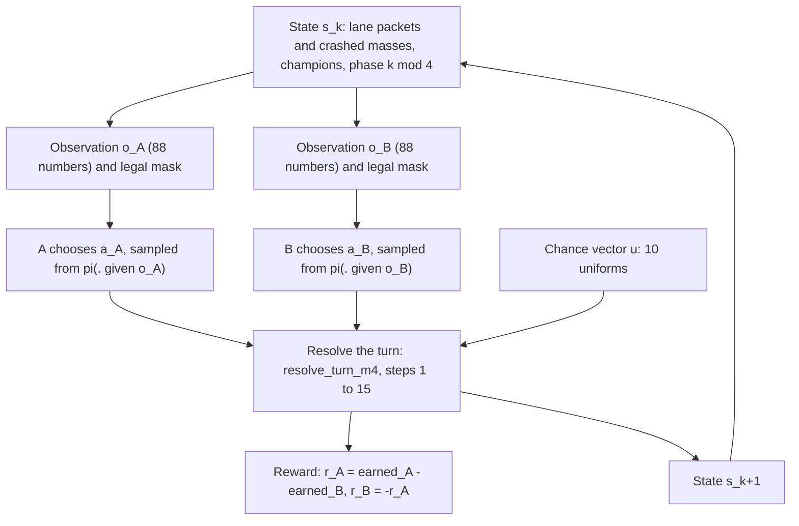
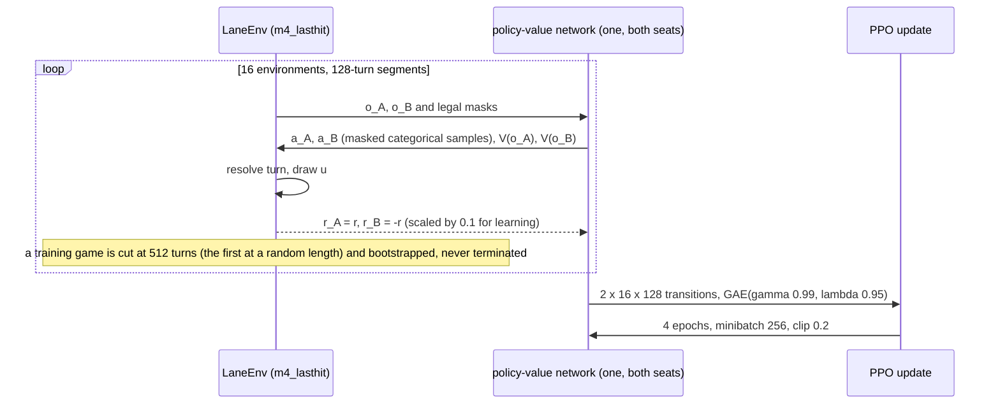
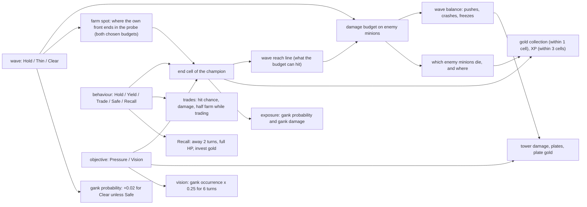
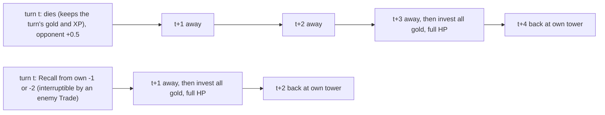

# The Laning Game: Mathematical Reference (archived 2026-10-20)

> **Archived.** This is the reference as it stood on 2026-10-20, before it was rewritten to describe the research
> preset `m45_calibrated()` directly. Here §1–§10 describe the base model `m4_lasthit()` and §4.10, §8.7–§8.8 and
> §14–§15 the differences. Reports written before 2026-10-20 cite the section numbers of this version. It is kept
> unchanged and is not maintained; the living document is
> [laning_game_mathematical_reference.md](laning_game_mathematical_reference.md).

**What this is.** The central, living description of the game the agents actually play: every state variable, every
action, every rule of the turn resolution, every reward term and the RL objective. Each equation names the code that
implements it.

**Which game.** The research preset is **`GameConfig.m45_calibrated()`**. It has been the environment of every
campaign since M4.5c, the user adopted it as the M5 baseline on 2026-10-17, and the M5 campaign is designed on it (§15).
- **§1–§10** describe its base model `GameConfig.m4_lasthit()`, the research preset of the M4.3b PPO pilot and its
  validation follow-up (code at commit `26f8c83`, branch `development/m4-3b-validation`). Everything there is
  **CURRENT** for that base: implemented and verified against the code. The numbers in the examples were produced by
  the engine (`python -m lanegame.experiments.m43c examples`, `results/m43c/examples.md`).
- **§14–§15** give every difference of `m45_calibrated()`: the four-action economy of §4.10 and §8.7–§8.8, the M4.5a
  positional rules and the M4.5b calibration.
- *Labelling (2026-10-17, M5a):* until then this paragraph named `m4_lasthit()` as the research preset. No rule changed.

**Labels used in this document**

| label | meaning |
|---|---|
| **CURRENT** | behaviour of `m4_lasthit()` as implemented (the default reading of every unlabelled statement) |
| **FOUR-ACTION** | the EXPERIMENTAL four-action baseline `m4_four_actions()` (§4.10): `m4_lasthit()` with the wave actions Last Hit / Thin / Slow Push / **Shove**; its measured economics are in [m4_3c_strategic_economics_calibration.md](m4_3/m4_3c_strategic_economics_calibration.md) |
| **PROPOSED** | a mechanic under investigation (M4.3c); described only in [m4_3c_economic_objective_design.md](m4_3/m4_3c_economic_objective_design.md) or the calibration report, never here except as a pointer |
| **EXPERIMENTAL** | an opt-in configuration field that exists in the code but is off in `m4_lasthit()` (and, unless stated, in `m4_four_actions()`) |
| **DEPRECATED** | a rule of an earlier preset or design document that `m4_lasthit()` no longer uses |
| **M4.5A** | the EXPERIMENTAL unified positional candidate `m45_unified()` (§14): `m4_four_actions_econ_aggro()` plus the shared Vision node W, Ward, minion retaliation and positional aggro, per-tick champion movement (revision 2), XP range 2, the capped trade budget and the reach ball; no CURRENT statement of §1–§10 describes it |
| **M4.5B** | the EXPERIMENTAL calibrated candidate `m45_calibrated()` (§15): `m45_unified()` revision 2 with the farm-spot correction `farm_spot_rule = "last_front"` and retaliation from the exchange tick (`minion_retaliation_delay = 0`); everything else is §14 |

**Terminology of slot 1 (`SH`).** The full-capacity wave slot is called **Clear** in `m4_lasthit()` and the other
three-action natural presets (label `CL`), and **Shove** in the four-action model (label `SH`, `config.W_SHOVE`, the same
slot as `W_CLEAR`, the scripted game's original Shove). The rename is semantic only: the codes, legal masks, budget $C$
and every checkpoint keep their meaning. Historical reports keep the names they used (the four-action redesign report
calls it Clear).

**Maintenance rule.** Whenever a rule, a parameter or the objective of the research preset changes, update the
corresponding equation, table, diagram and example here in the same piece of work, and add a line to §13.

---

## Contents

0. [Quick reference](#0-quick-reference)
1. [Overview of the mathematical game](#1-overview-of-the-mathematical-game)
2. [State](#2-state)
3. [Actions](#3-actions)
4. [Wave mechanics](#4-wave-mechanics)
5. [Farming, zoning and experience](#5-farming-zoning-and-experience)
6. [Combat, ganks, death and Recall](#6-combat-ganks-death-and-recall)
7. [Gold investment and champion progression](#7-gold-investment-and-champion-progression)
8. [Towers, plates and the reward](#8-towers-plates-and-the-reward)
9. [The RL objective and its evaluation](#9-the-rl-objective-and-its-evaluation)
10. [Strategic walkthroughs](#10-strategic-walkthroughs)
11. [Glossary](#11-glossary)
12. [Where the historical documents disagree with the code](#12-where-the-historical-documents-disagree-with-the-code)
13. [Change log of this document](#13-change-log-of-this-document)
14. [EXPERIMENTAL: the M4.5a unified positional candidate](#14-experimental-the-m45a-unified-positional-candidate-m45_unified)
15. [EXPERIMENTAL: the M4.5b calibrated candidate](#15-experimental-the-m45b-calibrated-candidate-m45_calibrated)

---

## 0. Quick reference

### 0.1 The lane at a glance

```
global cell:   -4        -3       -2          -1        0         +1        +2          +3        +4
               A base             A TOWER               LANE                B TOWER               B base
               (A waves spawn)    (T_A)                 (midpoint)          (T_B)                 (B waves spawn)

A's own coordinates = global;  B's own coordinates = -global.  Every side sees itself on the left:
own base -4, own tower -2, the lane 0, enemy tower +2, enemy base +4.  Champions live on cells -2 .. +2.
```

### 0.2 The numbers that matter most

| quantity | value | where |
|---|---|---|
| decision turn | 2 movement ticks | `ticks_per_turn = 2` |
| wave | 8 HP, one per side every 2 turns (after turns k = 1, 3, 5, …) at the own base | `wave_hp = 8`, `spawn_interval = 4` ticks |
| packet cap | 24 HP (3 waves); larger reinforcements queue behind | `hp_cap = wave_hp (1 + max_stacks)` |
| minion firepower | $f(h)=\max(1,\lfloor 2h/8\rfloor)$ HP per **turn**, split over the 2 ticks | `mechanics.minion_damage` |
| champion wave capacity | $C=\mathrm{round}(4\,AP)$ HP per turn; Hold $=\mathrm{round}(C/8)$, Thin $=\mathrm{round}(C/2)$, Clear $=C$ | `M4Context.wave_budget` |
| tower | 3 HP per tick on crashed minions; shoots only champions that trade under or next to it | `tower_siege_damage = 3` |
| gold | 0.125 resources per enemy minion HP that dies, times the collection rate (0.9 contested, 0.6 in the own tower cell, less when Safe, ×0.5 while trading) within 1 cell (2 for a retreating Yield) | `farm_per_hp`, `collection_units` |
| XP | 1 per enemy minion HP that dies within 3 cells of a present champion; level $L\to L+1$ costs $8+3(L-1)$; level 18 at 544 XP | `xp_per_hp`, `xp_range`, `progression` |
| max HP | $H(L)=\mathrm{round}(600\cdot1.05^{L-1})$ centi-HP; one "HP unit" $u(L)=\mathrm{round}(H/6)$ | `progression.tables` |
| attack power | $AP^\ast(L,S)=1.05^{L-1}\,M(S)$, $M(S)=1+1.5\bigl(1-\sqrt{16/(16+S)}\bigr)$, $S$ = invested gold; also divides damage taken | `progression.Investment` |
| trade | hit 0.55 (Hold defender), 2 units with prob 0.3 given a hit; damage $\lfloor 100D\,AP^\ast\rceil$ centi-HP, divided by the victim's $M(S)$ | `champions.trade_hit_probability` |
| gank | occurs with $p\approx 0.03(e+2)+\text{behaviour}$ ($e$ = exposure cell), deals Binomial$(4,p_e)$ units | `champions.champion_gank_probability` |
| death | at HP $\le 0$: away 3 turns, opponent +0.5 for the kill, gold kept and invested on return | `death_turns = 3`, `kill_bounty = 0.5` |
| Recall | at own cell $\le -1$: away the Recall turn + 1 turn, full HP and all gold invested on return | `recall_turns = 2` |
| tower damage | Pressure adds $\lfloor 400\,AP^\ast\rceil$ centi-units per turn; crashed minions add $100 f$ per turn, split over the ticks; plates at 1,600 / 3,600 / 6,000; 1.0 resource per plate; clamped at 6,000 | `plate_thresholds`, `pressure_tower_damage` |
| reward | $r_A=(\Delta E_A-\Delta E_B)$, $E$ = farm + plate gold + kills (resources, exact ledger of $10^{-7}$) | `resolve_turn_m4` step 15 |
| objective | $J=\mathbb E\sum_{k\ge0}0.99^k r_{A,k}$; no terminal state | `gamma = 0.99`, `time_mode = "continuing"` |

### 0.3 The formulas you will need most often

$$
r_{A,k}=\underbrace{(F_A-F_B)}_{\text{farm}}+\underbrace{(P_A-P_B)}_{\text{plate gold}}+\underbrace{(K_A-K_B)}_{\text{kills}},
\qquad r_{B,k}=-r_{A,k},\qquad J_A(\pi_A,\pi_B)=\mathbb E\Bigl[\sum_{k=0}^{\infty}\gamma^k r_{A,k}\Bigr].
$$

$$
F_s=\sum_{x}h_x\cdot 0.125\cdot c_s(x),\qquad
c_s(x)=\mathbb 1\bigl[\lvert x-\mathrm{pos}_s\rvert\le\rho\bigr]\cdot b(\text{mode},x)\cdot\kappa(\text{mode}),\quad\kappa=0.5\text{ while trading, else }1,
$$

$$
\text{XP}_s=\sum_x h_x\,\mathbb 1\bigl[\lvert x-\mathrm{pos}_s\rvert\le3\bigr]\;\;(\text{present}),\qquad
C=\mathrm{round}\Bigl(4\cdot1.05^{L-1}M(S)\Bigr),\qquad f(h)=\max\Bigl(1,\Bigl\lfloor\frac{2h}{8}\Bigr\rfloor\Bigr).
$$

**Notation.** $\lfloor x\rfloor$ rounds down, $\lfloor x\rceil$ rounds half up (the engine's rounding of every
table and budget), $\mathbb 1[\cdot]$ is 1 when the condition holds, cells are in the acting side's own coordinates
unless marked "global", HP is minion HP for waves and centi-HP (1/100 of a base HP unit) for champions.

### 0.4 Answers to the common questions

| question | section |
|---|---|
| What are all the state variables? | [§2.1–2.3](#21-the-authoritative-state) |
| How do the actions interact? | [§3.4](#34-how-one-action-reaches-every-mechanic), [§1.3](#13-one-turn-from-start-to-reward) |
| What exactly determines gold and XP income? | [§5.1–5.4](#51-the-kill-ledger-every-minion-hp-is-a-farm-opportunity) |
| What makes freezing beneficial or harmful? | [§4.8](#48-freezes), [§5.6](#56-scenario-a-and-scenario-b-side-by-side), [§10.1](#101-a-champion-trying-to-maintain-an-early-freeze) |
| How do champion power and death costs scale? | [§7](#7-gold-investment-and-champion-progression), [§6.7](#67-why-dying-is-a-relatively-cheap-reset) |
| What does PPO actually optimize? | [§9](#9-the-rl-objective-and-its-evaluation) |
| What changes in the M4.5a candidate (Vision node W, Ward, minion aggro, XP range 2)? | [§14](#14-experimental-the-m45a-unified-positional-candidate-m45_unified) |
| What did M4.5b calibrate, and which numbers are final for M4.5c? | [§15](#15-experimental-the-m45b-calibrated-candidate-m45_calibrated) |
| What causes a game to end? | Nothing: [§8.5](#85-after-the-final-plate-why-the-game-does-not-end), [§9.1](#91-the-game-objective) (EXPERIMENTAL opt-in terminal at the last plate: [§8.7](#87-experimental-the-m43c-economic-opt-ins-and-the-calibrated-candidate)) |
| Why does Shove dominate the four-action model? | The crash tax and break-even trades: [§5.3](#53-collection-what-share-of-a-kill-becomes-gold), [§8.7](#87-experimental-the-m43c-economic-opt-ins-and-the-calibrated-candidate) and the calibration report |
| How risky are pressure and diving, and does a crash cost the defender farm? | [§5.3](#53-collection-what-share-of-a-kill-becomes-gold) (the measured cap), [§6.3](#63-tower-shots), [§6.4](#64-ganks-and-vision), [§8.8](#88-experimental-the-m43d-candidate-m4_four_actions_econ_aggro) and the M4.3d report |

---

## 1. Overview of the mathematical game

### 1.1 The game in one paragraph

Two players, A and B, each control one champion in one lane. Time is a sequence of **decision turns**
$k=0,1,2,\dots$; on every turn both players choose an action **simultaneously** (neither sees the other's choice
of this turn), a deterministic minion simulation of two ticks is run with the two champions' contributions, a
fixed vector of ten random numbers decides trades, tower shots and ganks, and both players are paid. Formally it is
a **two-player zero-sum stochastic game** (a Markov game)

$$
\mathcal G=\bigl(\mathcal S,\ \mathcal A_A(s),\ \mathcal A_B(s),\ P(s'\mid s,a_A,a_B),\ r(s,a_A,a_B,u),\ \gamma,\ s_0\bigr)
$$

with a finite but very large state space $\mathcal S$, state-dependent legal action sets inside one fixed set of 46
codes, a transition kernel that is deterministic given the chance vector $u\in[0,1)^{10}$, a reward to A whose
negative is B's reward, the discount $\gamma=0.99$ and the standard start $s_0$. **There is no terminal state**
(`time_mode = "continuing"`): the game goes on for ever and the discount makes the objective finite.

### 1.2 The functions of the game

| function | definition | code |
|---|---|---|
| state $s_k$ | lane state (minion packets, crashed masses, vision timers), champion state (position, HP, absence, XP, invested gold, unspent gold, tower damage) per side, and the spawn phase $k \bmod 4$ | `state.State`, `champions_m4.M4State`, `LaneEnv._k` |
| observation $o_{s,k}$ | 88 numbers in $[0,1]$, own perspective, a lossless function of $(k\bmod4,s_k)$ while gold stays below the encoding's exact range (§2.4) | `env/observation_m4.observe_m4` |
| legal actions $\mathcal A_s(s_k)$ | a subset of $\{0,\dots,45\}$ (§3.3) | `champions.champion_legal_actions` |
| transition $P$ | `resolve_turn_m4` (15 steps, §1.3) with $u\sim\mathrm{U}[0,1)^{10}$ drawn by the environment every turn whatever the actions | `champions_m4.resolve_turn_m4`, `env/core.LaneEnv._step_m4` |
| reward $r_A$ | earned-resource difference of the turn, exact in ledger units of $10^{-7}$ resources (§8.6) | step 15 of `resolve_turn_m4` |
| termination | **none**; an episode is only ever *truncated* by a time limit of the run | `LaneEnv.step` (`terminated` is always `False`) |
| objective | $J=\mathbb E\sum_k\gamma^k r_{A,k}$, A maximizes, B minimizes | `env/discounted.py`, `rl/ppo.py` |

**Zero-sum by construction.** The environment returns `(r, -r)`; nothing is added to either side. Because the reward
counts *resources earned* by each side, any event that earns both sides the same amount cancels.

**Randomness.** Each turn draws exactly ten uniforms in a fixed layout (`champions.U_*`): per side, a trade-hit
uniform, a double-hit uniform, a tower-shot uniform, a gank-occurrence uniform and a gank-damage uniform. An event
happens when its uniform is below its probability. Because the number of draws never depends on the actions, two
policies played on the same seed see identical chance turn by turn (common random numbers; used by every paired
evaluation). The minion simulation itself has no randomness. Agents sample their actions from their own,
separate random streams.

**What is observed, what is random, what is derived.**

| category | quantities |
|---|---|
| fully observed by both players (perfect information about the state) | every lane packet, both crashed masses, both champions' cells, HP, absence timers, XP, invested and unspent gold, both towers' damage, vision timers, the spawn phase |
| hidden | only the opponent's action of the *current* turn (simultaneous moves) |
| random | trade hits and doubles, tower shots, gank occurrence and gank damage (ten uniforms per turn) |
| derived (never stored) | level, max HP, HP unit, attack power, wave-clear capacity and budgets, plates broken, contact, farm spot, exposure, all probabilities |

There is no fog of war: "vision" in this game is only a gank-probability modifier (§6.4).

### 1.3 One turn, from start to reward



The resolution order inside one turn (`champions_m4.resolve_turn_m4`; the step numbers are the code's):

```mermaid
flowchart LR
    P1["1 probe: where would each wave end with full champion support? = farm spot"] --> P2["2 targets and movement (max 2 cells), Trade chases"]
    P2 --> P2b["2b Recall interrupted by a reaching enemy Trade?"]
    P2b --> P3["3 evasion of Yield / Safe from a Trade"]
    P3 --> P4["4 trade contact: connected?"]
    P4 --> P5["5 modes and wave reach"]
    P5 --> P6["6 lane step: 2 ticks of minions, champion damage, crashes, tower fire"]
    P6 --> P9a["9a trade rolls"]
    P9a --> P7["7 gold, 7b XP"]
    P7 --> P8["8 exposure, gank probability"]
    P8 --> P9b["9b tower shots, ganks, damage, mitigation"]
    P9b --> P10["10 death"]
    P10 --> P11["11 tower damage, plates"]
    P11 --> P12["12-14 XP and level-ups, ledger, absence, investment on return"]
    P12 --> P15["15 reward"]
```



Every power-dependent quantity of a turn (wave budget, trade damage, gank and tower-shot damage, Pressure) uses
the levels and investment held **at the start** of the turn.

### 1.4 How PPO meets the game



One network plays both seats on its own-perspective observations; both seats' transitions are training samples
(shared-policy self-play, `rl/shared.py`). §9 separates the game's objective from this training procedure.

---

## 2. State

### 2.1 The authoritative state

The Markov state is $(k \bmod 4,\ \text{lane},\ \text{champions})$ plus two constant seat parameters (the mechanical
skills, both 0.5). Every side's data is stored in **its own coordinates** (own tower $-2$, enemy tower $+2$).

**Lane state** (`state.State`, one record per side; written by `mechanics.step_turn`):

| variable | symbol | range / units | meaning | updated by |
|---|---|---|---|---|
| front cell | $x_s$ (`ax`, `bx`) | own cells $-4..+1$ (a front reaching $+2$ crashes at once) | cell of the side's leading (most advanced) minion packet | movement, merging, deaths, crashes, spawns (§4) |
| front HP | $h_s$ (`ah`, `bh`) | $0..24$ minion HP; 0 = no front | HP of the leading packet (possibly stacked) | fights, champion damage, merging |
| rear packets | $R_s$ (`ar`, `br`) | tuple of cells, each packet exactly 8 HP | packets behind the front that could not merge (cap) or have not caught up | movement, merging, spawns |
| crashed mass | $m_s$ (`asg`, `bsg`) | $0..96$ minion HP | this side's minions that entered the **enemy** tower cell (a siege) | crashes, tower fire, defenders, the defending champion |
| vision timer | $v_s$ (`va`, `vb`) | $0..6$ turns | turns of gank protection left (§6.4) | Establish Vision, countdown |
| plate opportunities | `ap`, `bp` | always 0 | DEPRECATED crash-plate counters (plate mode `"durability"` uses the tower damage below) | — |

**Champion state** (`champions_m4.M4Side`; written by `resolve_turn_m4`):

| variable | symbol | range / units | meaning | updated by |
|---|---|---|---|---|
| position | $\mathrm{pos}_s$ | own cells $-2..+2$; $-2$ while away | the champion's cell | steps 2–3 (movement, chase, evasion); death and Recall put it at $-2$ |
| HP | $\eta_s$ | $0..H(L)$ centi-HP; 0 only while dead | current health | step 9 damage, step 12 level-up gain, full on return |
| absence | $\alpha_s$ | $0..3$ turns | turns still to sit out (0 = present) | Recall (1), death (3), countdown, return |
| XP | $X_s$ | $0..544$ | cumulative credited experience (XP beyond 544 is discarded) | step 7b / 12 |
| invested gold | $S_s$ (`items`) | $\ge0$ ledger units ($10^{-7}$ resources), unbounded | cumulative gold converted into power | step 14: all unspent gold on every return to lane |
| unspent gold | $g_s$ (`gold`) | $\ge0$ ledger units, unbounded | gold earned since the last return | step 13 (+ earned), step 14 (to 0 on return) |
| tower damage | $\tau_s$ (`tower_dmg`) | $0..6000$ centi-units | cumulative damage this side has dealt to the **enemy** tower | step 11 (clamped at 6,000) |

**Phase.** Waves spawn after every odd turn ($k=1,3,5,\dots$), so the dynamics depend on $k$ only through $k\bmod2$.
The environment keeps $k\bmod4$ (`GameConfig.phase_period = 4`, inherited from the scripted wave rules, so the
observation layout did not change); the extra factor two is redundant but harmless.

**Constants of a game** (not state): skills $m_A=m_B=0.5$ (enter only trade and gank-damage probabilities).

**Standard start $s_0$** (`mechanics.initial_state`, `champions_m4.initial_m4`): one fresh 8-HP wave at each base
($x=-4$), no crashed mass, no vision; both champions at their tower, level 1, 600 centi-HP, no XP, gold, investment or
tower damage; $k=0$.

### 2.2 Derived quantities (never stored)

| quantity | symbol | formula | code |
|---|---|---|---|
| level | $L(X)$ | $\max\{L\le18: \mathcal X(L)\le X\}$, $\mathcal X(L)=8(L-1)+\tfrac32(L-1)(L-2)$ | `progression.level_of` |
| max HP | $H(L)$ | $\mathrm{round}(600\cdot1.05^{L-1})$ centi-HP | `Tables.hp_max` |
| HP unit | $u(L)$ | $\mathrm{round}(H(L)/6)$ | `Tables.hp_unit` |
| investment multiplier | $M(S)$ | $1+1.5\bigl(1-\sqrt{16/(16+S)}\bigr)$, $S$ in resources, exact integers | `Investment.multiplier` |
| attack power | $AP^\ast(L,S)$ | $1.05^{L-1}M(S)$ (basis points internally) | `Investment.attack_power` |
| wave capacity, budgets | $C,\ B_w$ | §4.5 | `M4Context.wave_budget` |
| plates broken | $\pi(\tau)$ | $\#\{j:\tau\ge\theta_j\}$, $\theta=(1600,3600,6000)$ | `progression.plates_broken` |
| stacks of a packet | $\sigma(h)$ | $\min(2,\lceil h/8\rceil-1)$ | `GameConfig.stacks` |
| contact (champions) | — | §6.1 | `champions.in_contact` |
| farm spot, exposure, modes | — | §5.2, §6.4 | `resolve_turn_m4` steps 1, 5, 8 |

### 2.3 What is *not* in the state

No clock and no countdown (the game is stationary), no item inventory (investment is one number), no cooldowns, no
mana, no minion types, no vision of the opponent (both see everything), no jungle state (ganks are a hazard rate),
no gold *lost* on death, no tower HP beyond the plate counter $\tau$.

### 2.4 The agent's observation (88 numbers)

`env/observation_m4.observe_m4`: a fixed-length, own-perspective vector, every entry in $[0,1]$, a function of
$(k\bmod4,\text{lane},\text{champions},\text{side})$ only.

| block | entries | content |
|---|---|---|
| phase | 4 | one-hot of $k\bmod4$ |
| own lane | 19 | front cell one-hot over cells $-4..+4$ (all zero: no front); front HP / 24; rear packets per cell / 4 (9 cells) |
| enemy lane | 19 | the same for the enemy, mirrored into own coordinates |
| own side | 3 | crashed mass / 96; vision timer / 6; siege eligible (mass $>0$) |
| enemy side | 3 | the same for the opponent |
| own tower progress | 4 | $\tau/6000$; plates broken / 3; progress towards the next plate (1 when all broken); plates left / 3 — $\tau$ is the damage **we** dealt |
| enemy tower progress | 4 | the same for the opponent's $\tau$ (damage dealt to **our** tower) |
| own champion | 16 | cell one-hot ($-2..+2$); HP / $H(L)$; $H(L)/H(18)$; absence / 3; skill; $(L-1)/17$; XP progress in the level; invested $n/(n+64)$; unspent $n/(n+8)$ ($n$ = whole resources); the sub-resource parts of both; $AP^\ast/(AP^\ast+AP(18,0))$ |
| enemy champion | 16 | the same, the cell mirrored |

The encoding is exactly invertible (`decode_m4`) while invested gold stays below 23,106 resources and unspent gold
below 8,184 resources (never reached in play), and while at most 4 rear packets share a cell (enforced: the
observation raises otherwise).

The M4.5 presets add a Vision entry per champion (90 entries, §14.9). The opt-in field `obs_last_action` appends 13
entries for the opponent's previous action (§15.4).

**Diagnostic statistics** (`lanegame/experiments/rl/m43b/behavior.turn_features`) are *derived from* the state for
analysis only and never enter the game: contact cell, power ratio (expected hit on the opponent in the opponent's HP
units over the reverse), situation masks ("neutral lane", "freeze-like", "defending", …).

---

## 3. Actions

### 3.1 The encoding

A present champion's action is a triple (wave, behaviour, objective), encoded as

$$
a = w + 3\,b + 15\,o,\qquad w\in\{0,1,2\},\ b\in\{0,\dots,4\},\ o\in\{0,1,2\},
$$

which gives codes $0..44$; code **45** is ABSENT (`config.champ_act`, `CHAMP_ABSENT`). The slot numbers of the wave
component are inherited from the scripted game (SP, SH, F); under natural waves they mean:

| wave slot $w$ | name | the champion's damage on enemy minions this turn |
|---|---|---|
| 0 (`SP`) | **Hold** | $\mathrm{round}(C/8)$ HP: normal last-hitting |
| 1 (`SH`) | **Clear** | $C$ HP: everything it can |
| 2 (`F`) | **Thin** | $\mathrm{round}(C/2)$ HP: controlled thinning |

| behaviour $b$ | name | where the champion goes (§6.1) |
|---|---|---|
| 0 | Hold | its farm spot (where its own front will be), never evades |
| 1 | Yield | its stand-off cell (the rearmost cell still within 1 of the enemy front); evades a reaching Trade unless it started the turn in contact with it |
| 2 | Trade | chases the opponent; deals trade damage if it connects (takes it only from an opponent that also Trades) |
| 3 | Safe | heads for its farm spot but not ahead of its own $-1$ (at most 2 cells per turn); evades a reaching Trade |
| 4 | Recall | only as the single code 12 = Hold-wave + Recall |

| objective $o$ | name | effect |
|---|---|---|
| 0 | none | — |
| 1 | Apply Pressure | the champion walks into the enemy tower cell; adds $\lfloor 400\,AP^\ast\rceil$ to $\tau$ (§8.2) |
| 2 | Establish Vision | the champion walks into the enemy tower cell; gank protection for the next 6 turns (§6.4) |

**EXPERIMENTAL** (off in `m4_lasthit()`; the four-action preset `GameConfig.m4_four_actions()`, §4.10): a fourth wave
slot $w=3$, **Slow Push** (`W_SLOWPUSH`, field `wave_slowpush`), whose codes are appended after ABSENT so that no code
above changes meaning in any configuration:

$$
a=46+b+5\,o\quad(w=3),\qquad\text{codes }46..60;\qquad 61\text{ codes in all (0..44 as above, 45 ABSENT).}
$$

`config.champ_act / champ_wave / champ_behavior / champ_objective` decode both ranges; `GameConfig.action_codes()`
is `range(61)` only under `wave_slowpush`. The legal set adds the Slow Push twin of every legal code with the Hold
wave slot except the Recall code 12 (so code 50, Slow Push + Recall, is never legal), i.e. up to 16 + 16 + 1 = 33
legal codes for a present champion. In that preset the Hold slot is labelled **Last Hit** (`LH`) and slot 1 **Shove**
(`SH`): labels `LH-H`, `TN-H`, `SL-H+P`, `SH-T` (Clear's `CL` labels belong to the three-action presets only).

### 3.2 The 46 codes

| codes | meaning |
|---|---|
| 0–11 | wave $\times$ {Hold, Yield, Trade, Safe}, no objective (12 codes) |
| 12 | **Recall** (Hold-wave + Recall); codes 13, 14 (Clear / Thin + Recall) are never legal |
| 15–17, 21–23 | wave $\times$ {Hold, Trade} + Pressure |
| 30–32, 36–38 | wave $\times$ {Hold, Trade} + Vision |
| 18–20, 24–29, 33–35, 39–44 | never legal (objective with Yield / Safe / Recall) |
| 45 | ABSENT |

### 3.3 Legality

`champions.champion_legal_actions` (with `mechanics.wave_actions` returning all three waves under natural waves):

| situation | legal codes | count |
|---|---|---|
| champion absent ($\alpha_s>0$) | {45} | 1 |
| present | every wave $\times$ {Hold, Yield, Trade, Safe} | 12 |
| … and own crashed mass under the enemy tower ($m_s>0$) **and** $\mathrm{pos}_s+2\ge2$ (it can reach the tower this turn) | + every wave $\times$ {Hold, Trade} $\times$ {Pressure, Vision} | +12 |
| … and $\mathrm{pos}_s\le-1$ | + Recall (12) | +1 |

Hold, Thin and Clear are **always** legal for a present champion. Nothing else restricts the actions: a Trade with
no opponent present (absence timer > 0) positions like Hold, with a gank term 0.02 higher; Pressure remains legal after the enemy tower's last plate even though it
then does nothing (§8.5).

### 3.4 How one action reaches every mechanic



The wave component moves the champion only through the **farm spot**: the step-1 probe uses both champions' *chosen*
budgets, so a wave choice that kills the enemy front in the probe moves the own front, and with it the end cell and
exposure of a Hold, Safe or Yield champion (and the opponent's chase target); in random play this changes the end
cell in about 8% of states. The behaviour component never changes *how much* wave damage a champion has, only whether
that damage can reach its target and whether it is spent at all (a champion in a connected trade, channelling or away
deals none).

---

## 4. Wave mechanics

Natural waves (`wave_dynamics = "natural"`, `mechanics._tick_natural`): minions obey the same physical rules whatever
the actions; the actions only set each champion's damage budget and where it can reach. Each turn is two ticks.

### 4.1 Spawning

After turn $k$ the lane spawns one 8-HP packet per side at its own base (cell $-4$) iff $2(k+1)\bmod4=0$, i.e. after
every odd turn (`step_turn`, lines 700–706). Each side therefore receives **4 minion HP per turn** on average, which is
the hard ceiling on every flow in the game: farm, XP and minion damage on towers.

### 4.2 Movement, contact and merging

Per tick (`_tick_natural`, lines 504–520):

- **Movement.** Every front advances one cell unless (i) the two fronts are in **contact**,
  $x_A + x_B \ge -1$ in own coordinates (they are at most one cell apart in global coordinates), or (ii) it is a
  defender whose tower is under siege and it stands at its own $-3$ or further forward (it engages the crashed mass
  instead, §4.6). Rear packets always walk but stop one cell behind the front (they never enter its cell) and merge from there
  when the sum fits under the cap.
- **Merging** (`_merge`, cap rule `"block"`). A packet within one cell behind the leading packet merges into it if
  the sum stays $\le 24$ HP; otherwise it stays a separate rear packet queued behind. No minion ever disappears.
- **Queued packets fight.** The firepower of a front is computed on its *blob*: the front plus every packet queued
  within one cell behind it (`_blob_hp`).

A fresh wave walks from its base ($-4$) to the lane cell ($0$) in two turns.

### 4.3 Minion combat: the half-wave Lanchester law

`mechanics.minion_damage`, `damage_law = "lanchester_half"`. A blob of $h$ HP has a firepower of

$$
f(h)=\max\Bigl(1,\Bigl\lfloor\frac{2h}{W}\Bigr\rfloor\Bigr)\ \text{HP per turn},\qquad W=8,
$$

dealt as $\lceil f/2\rceil$ on the first tick and $\lfloor f/2\rfloor$ on the second, with $f$ **recomputed on the HP
the blob has at each tick**. For an undamaged blob:

| $h$ | 1–7 | 8–11 | 12–15 | 16–19 | 20–23 | 24 | 32 |
|---|---|---|---|---|---|---|---|
| $f$ per turn | 1 (tick 1 only) | 2 (1 + 1) | 3 (2 + 1) | 4 (2 + 2) | 5 (3 + 2) | 6 (3 + 3) | 8 |

Both fronts in contact deal their firepower simultaneously; each HP lost is a farm opportunity for the other side at
the cell where it died (§5.1). A blob's firepower is about a quarter of its HP per turn, so with both champions
last-hitting (1 HP each with Hold) two equal fronts at the lane settle into a cycle in which each side loses exactly
**the spawn rate, 4 HP per turn** — why an undisturbed even lane is stationary (§4.9, example 1).

### 4.4 Crashes, the siege and tower fire

- **Entry crash** (`natural_crash_rule = "entry"`): a front that enters the enemy tower cell ($+2$) leaves the lane at
  once and joins this side's **crashed mass** $m_s$ under the enemy tower (capped at 96 HP; the excess is deleted and
  recorded as overflow). Follow-up waves that arrive join the same mass. No front ever fights inside the **enemy** tower cell (a defender's front can fight in its own tower cell).
- **Tower fire.** Each tick, each tower removes $\min(3,\ \text{mass present at the start of the tick})$ HP of the
  crashed mass under it (`_tower_fire`). A fresh 8-HP crash therefore lasts three ticks against the tower alone.
- **Minion hits on the tower.** Each tick, a crashed mass that was present at the start of the tick and was **not**
  engaged by defenders hits the tower for that tick's share of $f(m)$ minion-damage units ($\lceil f/2\rceil$ on the
  first tick, $\lfloor f/2\rfloor$ on the second, recomputed on the mass at the start of each tick; `hits`, lines
  619–624); the M4 resolver turns each unit into 100 centi-units of tower damage (§8.2).
- The tower shoots **lane fronts** only if they contest inside its cell, which the entry rule never allows. It shoots
  champions only in trades (§6.3).

### 4.5 The champion's wave damage: capacity, Hold, Thin, Clear

`M4Context.wave_budget` with `wave_clear_scaling = "capacity"`. A champion at level $L$ with investment $S$ has the
wave-clear capacity

$$
C(L,S)=\mathrm{round}\bigl(\texttt{ticks}\cdot d_{\text{Clear}}\cdot AP^\ast\bigr)=\mathrm{round}\Bigl(4\cdot1.05^{L-1}M(S)\Bigr)\ \text{HP per turn}
$$

(round half up on exact rationals) and its wave slot spends a share of it:

$$
B_{\text{Hold}}=\mathrm{round}(C/8),\qquad B_{\text{Thin}}=\mathrm{round}(C/2),\qquad B_{\text{Clear}}=C .
$$

Hold/Thin/Clear budgets $B_{\text{Hold}}/B_{\text{Thin}}/C$ by level and invested gold (resources), from the engine:

| L \ S | 0 | 8 | 16 | 32 | 64 | 128 | 300 |
|---|---|---|---|---|---|---|---|
| 1 | 1/2/4 | 1/3/5 | 1/3/6 | 1/4/7 | 1/4/7 | 1/4/8 | 1/5/9 |
| 6 | 1/3/5 | 1/4/7 | 1/4/7 | 1/4/8 | 1/5/9 | 1/5/10 | 1/6/11 |
| 11 | 1/4/7 | 1/4/8 | 1/5/9 | 1/6/11 | 2/6/12 | 2/7/13 | 2/7/14 |
| 15 | 1/4/8 | 1/5/10 | 1/6/11 | 2/7/13 | 2/7/14 | 2/8/16 | 2/9/17 |
| 18 | 1/5/9 | 2/6/12 | 2/7/13 | 2/8/15 | 2/9/17 | 2/9/18 | 3/10/20 |

Hold is 1 HP per turn until $AP^\ast\ge2.875$ ($C\ge12$), 2 until $AP^\ast\ge4.875$ ($C\ge20$), then 3. The supremum
of $AP^\ast$ is $1.05^{17}\cdot2.5=5.73$, so $C\le23$.

**How the budget is spent** (per tick, half of it each tick, the earlier tick rounding up; a budget is spent on at
most one target per tick and overkill is lost):

1. the enemy front in a lane fight with ours, if its own-coordinate cell is within the champion's reach line;
2. otherwise, if no lane fight happens this tick and our front engages the enemy's crashed mass under our tower, that
   mass (if our reach line is $\ge-2$);
3. otherwise any unspent budget strikes the enemy's crashed mass under our tower, else the enemy's leading packet
   wherever it walks, if within reach. A champion therefore kills minions even when its own wave is dead.

**Reach line** (`resolve_turn_m4` step 5): the champion damages enemy minions whose own-coordinate cell is **at or
behind** this line:

| mode | reach line |
|---|---|
| farm (Hold, unthreatened Yield, unconnected Trade, any objective) | $\min(3,\ \mathrm{end}+1)$: one cell ahead of the champion; from the enemy tower cell it reaches the defenders behind it |
| safe (Safe) and retreat (threatened Yield) | $\min(\mathrm{end},-1)$: it always reaches the crashed mass under its own tower; it reaches an enemy front at its own $-1$ only when it stands at $-1$ or further forward |
| trading (connected Trade), channel (interrupted Recall), away | none |

The reach line has no lower bound: a champion one cell forward still damages a target three cells behind it (it
cannot *collect* that gold, §5.3).

**EXPERIMENTAL** (off in `m4_lasthit()`; screened in [m4_3c_wave_control_screen.md](m4_3/m4_3c_wave_control_screen.md)):
`wave_hold_cap` $=n>0$ replaces $B_{\text{Hold}}$ by $\min(n,\mathrm{round}(C/8))$; `wave_thin_rule = "adaptive"` replaces
$B_{\text{Thin}}$ by $\min\bigl(\mathrm{round}(C/2),\ \max(0,\ h_{\text{enemy}}-h^\ast)\bigr)$ with
$h^\ast=\lfloor(W(f(h_{\text{own}})+1)-1)/2\rfloor$ ($0$ with no own packet), $h$ = the blob HP at the start of the turn
(`mechanics.thin_need`). `wave_thin_rule = "strength"` and `wave_slowpush` (the four-action model) are §4.10.

### 4.6 Defending a siege

When a side has a crashed mass under the enemy tower, the defender's front stops as soon as it stands at its own $-3$
or further forward (a wave coming from the base stops at $-3$, one cell behind its tower; a front already on the lane
stays where it is) and, on every tick without a lane fight, **engages** the mass from there (lines 560–587): the
defender blob deals its tick's share of $f(\text{blob})$ plus the defending champion's budget (if its reach line is
$\ge-2$), the mass deals its share of $f(m)$ back;
an engaged mass does not hit the tower that tick. Every HP of the mass that dies is the defender's farm opportunity
at its own tower cell, collected at most at 0.6 (§5.3). A defender's wave that waited behind the tower until the
mass is gone, plus the next spawn, is a **bounce**: two waves walk out together and push back.

### 4.7 Stacking and slow pushing

A side whose front out-fights the enemy front by even a little advances, because the losing front dies sooner and the
next enemy wave arrives later than ours. Two sources of an edge exist: more HP in the blob (a surviving remnant that
merged with the next wave: a **stack**) and more champion damage. A **slow push** is a small, sustained edge: with
equal champions, one side on Thin (2 at level 1) against Hold (1) gains 1 HP per turn, which compounds through the
firepower law because a larger blob also hits harder; after a few turns the stacked front walks to the enemy tower and
crashes with 16–24 HP (example 2 below). There is no scripted slow-push rule (DEPRECATED: `slowpush_mode`, `slowpush_line`).

### 4.8 Freezes

A **freeze** in this game is a state, not an action (DEPRECATED: the Freeze action and `freeze_maintenance` of
`m4()`). The enemy wave stands at the freezer's own $-1$, just outside the freezer's tower, while the freezer's small
wave meets it at the freezer's tower cell. It is stable while the minion exchange is even: under the half-wave law the
band is an enemy front of 12–15 HP against an own front of 8–11 HP (M4.2e-C report §6.2). The freezer keeps it there
by thinning the enemy front only when it would grow out of the band. Two versions of this threshold controller are
used in the studies:

$$
w=\text{Thin}\ \text{if } x^{\text{enemy front}}\le-1 \text{ and } h^{\text{enemy front}}\ge14,\ \text{else Hold}
\qquad(\text{wave-only harness})
$$

$$
w=\text{Thin}\ \text{if the fronts are in contact},\ x^{\text{own front}}\le-1 \text{ and } h^{\text{enemy front}}\ge14,\ \text{else Hold}
\qquad(\text{scripted freezers})
$$

(the first is `rl/m43b/intervene.freeze_controller`, the second `zoning_natural.wave_rule("freeze")`; cells in the
freezer's own coordinates). A champion with $AP^\ast\gtrsim3$ cannot
freeze this way because its Hold alone (2 HP) breaks the band. A freeze **ends** when (a) the frozen-on champion clears
the freezer's minions so that its own wave walks into the freezer's tower (it must stand within reach, i.e. near the
freezer's tower), (b) the freezer's tower or champion kills the held wave, or (c) a bounce arrives.

### 4.9 Example: one start, three wave actions

The `neutral` start of the M4.2e-B harness (turn 9; both fronts of 8 HP fighting at the lane cell, a rear packet
at each tower; both champions at the lane, level 3, nothing invested). For 8 turns B plays Hold + Hold, A plays
Hold, Thin or Clear with Hold position; no chance event can happen (no trades, `u = None`). Lane rows are **global**
cells; `A12` is an A packet of 12 HP, `[A16]` A's crashed mass under B's tower, `a` / `b` the champions. Engine
output, `results/m43c/examples.md`.

**Example 1: Hold vs Hold** (budgets 1 / 1). A stationary two-turn cycle:

```
turn  -4   -3   -2   -1    0          +1   +2   +3   +4      gold A/B   XP A/B
 0     .    .   A8    .   A8 B8 a b    .   B8    .    .
 1    A8    .    .    .   A12 B12 a b  .    .    .   B8      0.45/0.45   4/4
 2     .    .   A8    .   A8 B8 a b    .   B8    .    .      0.45/0.45   4/4
 ...  (repeats; 8 turns: 3.60 / 3.60 resources, 32 / 32 XP, no crash)
```

Each side kills 4 HP per turn, both collect at 0.9 within reach: $4\cdot0.125\cdot0.9=0.45$ resources and 4 XP per
turn each, for ever.

**Example 2: Thin vs Hold** (budgets 2 / 1, from turn 3 on 3 / 1 after A's level-up). A's edge compounds:

```
turn   0   +1        +2            +3    gold A/B   XP A/B
 2    A9 B6                               0.56/0.34   5/3
 4    A11 B2                              0.68/0.23   6/2
 5    A17 B3                              0.79/0.23   7/2
 6     .  A15 a      B5 b                 0.68/0.11   6/2      B's front pushed into its tower cell
 7     .  A21 a      b                    0.56/0.23   5/2
 8     .   a         [A16] b     B3       0.00/0.38   5/5      A crashed 21 HP; B's next wave waits behind the tower
 8 turns: A 4.50, B 2.40 resources; XP 45 / 24; one crash.
```

**Example 3: Clear vs Hold** (budgets 4–5 / 1). A crashes after four turns and then **earns nothing** for three
turns while B's wave waits behind its tower and the tower (not A) kills A's mass:

```
turn   0        +1      +2            +3     gold A/B   XP A/B
 3    A16 B1                                  1.01/0.23   9/2
 4     .        A14 a   B5 b                  0.45/0.11   4/2
 5    A8        a       [A12] b               0.56/0.23   5/2      first crash, 12 HP
 6    a                 [A12] b       B5      0.00/0.60   3/8      B collects A's dying mass at 0.6
 7    A8 a              [A4] b        B11     0.00/0.60   2/8
 8    a                 B9 [A7] b             0.00/0.38   2/5
 8 turns: A 3.60, B 2.81 resources; XP 39 / 33; three crashes.
```

**Why these states emerge.** The lane is a balance of three flows per side: spawns (4 HP/turn), minion firepower
(about a quarter of a blob's HP per turn) and the champion's budget. With equal champions the minion exchange is even, so the
champions' budgets decide: whoever removes more HP per turn moves the meeting point towards the enemy tower; once the
enemy front dies before ours, ours walks two cells per turn and crashes. **Clear removes $C\ge4$ HP per turn, at least
the whole enemy spawn**, so no enemy edge ever survives against it; that is the mechanical root of Clear dominance
(M4.3b). After a crash the pusher pays: its minions die to the tower and the defenders (the defender's farm at 0.6)
while the defender's wave waits out of the pusher's reach. Over 8 turns against a last-hitter, Thin (+2.10) beat Clear
(+0.79) in this example; against a clearing opponent the ranking reverses (M4.2e-C, M4.3b), because a Thin edge is
removed by the opponent's Clear the turn it is built.

### 4.10 EXPERIMENTAL: the four-action model (`m4_four_actions()`)

**Not the research preset.** `GameConfig.m4_four_actions()` is `m4_lasthit()` with `wave_hold_cap = 1`,
`wave_thin_rule = "strength"` and `wave_slowpush = True`. Everything else, including §4.1–§4.9, is unchanged. Design,
alternatives and validation: [m4_3c_four_action_wave_redesign.md](m4_3/m4_3c_four_action_wave_redesign.md) (which calls the
fourth action Clear); sequences of the four actions, the visual debugger and the economics of the model:
[m4_3c_strategic_economics_calibration.md](m4_3/m4_3c_strategic_economics_calibration.md). The four wave actions are
**Last Hit** (slot 0), **Thin** (slot 2), **Slow Push** (slot 3) and **Shove** (slot 1, the full capacity $C$).

**Window strength** (`mechanics.window_strength`). For one side on turn $k$, with $\tau=$ `spawn_interval` $=4$
ticks (one wave per side) and $n=2$ ticks per turn:

$$
S=\frac1\tau\Bigl(\sum_p h_p\,\rho_p+8\,\rho_{\text{spawn}}\Bigr),\qquad
\rho_p=\begin{cases}\tau & d_p\le1\\ \max(0,\ \tau-d_p+2) & d_p\ge2\end{cases},\qquad
\rho_{\text{spawn}}=\max\bigl(0,\min(\tau-n,\ \tau-n-d+2)\bigr)
$$

where $\rho_{\text{spawn}}$ counts only if a wave spawns at the end of turn $k$ (else 0),

summed over the side's start-of-turn packets ($d_p$ = cells behind its leading packet; $d$ = the walk from the own
base to the front). $S=0$ for a side with no packet; crashed masses are not counted. $\rho$ is the number of the next four
ticks in which a packet fights at the front if the front holds its cell (4, 4, 3, 2, 1, 0 for $d=0..5$; a spawn
counts 2 near the own tower, 1 at the own $-1$, 0 from the lane cell on).

**Need and budgets** (`mechanics.strength_need`, `strength_budget`, `M4Context.state_budget`):

$$
\text{need}_m=\max\bigl(0,\lceil S_E-S_O+m\rceil\bigr),\qquad
\begin{aligned}
D_{\text{Last Hit}}&=\min(1,\lfloor C/8\rceil)=1\\
D_{\text{Thin}}&=\min\bigl(\lfloor C/2\rceil,\ 1+\text{need}_0\bigr)\\
D_{\text{Slow Push}}&=\min\bigl(\lfloor C/2\rceil,\ 1+\text{need}_1\bigr)\\
D_{\text{Shove}}&=C
\end{aligned}
$$

These are computed once per turn on the start-of-turn lane and spent as in §4.5 (half per tick, first reachable
target, overkill lost). Thin restores parity of window strength. Slow Push makes the own wave 1 HP stronger. Both deal
their own last hit on top, because the rule assumes both champions' last hits cancel. Neither ever spends more than
1 + need, and every budget is non-decreasing in $C$.

| state (engine) | $S_A$ / $S_B$ | Thin need A / B | Slow Push need A / B |
|---|---|---|---|
| `neutral` (turn 9: A8 v B8 at the lane cell) | 16 / 16 | 0 / 0 | 1 / 1 |
| the same with B's front 24 | 16 / 32 | 16 / 0 | 17 / 0 |
| `freeze` (turn 51: A8 at −2, B5 at A's −1) | 12 / 11 | 0 / 1 | 0 / 2 |

**Action encoding:** §3.1 (codes 46–60 = Slow Push, 61 codes; the Hold slot is labelled Last Hit, slot 1 Shove). The
resolver records the budgets it used in `M4Turn.wave_budget` / `info["wave_budget"]` in every M4 preset; the HP each
champion actually removed is `info["events"]["champion_hp"][enemy]` (per tick in the lane trace), and the visual
debugger (`lanegame/viewer`, the "Wave management" tab) shows both side by side with the needs and window strengths.

---

## 5. Farming, zoning and experience

### 5.1 The kill ledger: every minion HP is a farm opportunity

Every HP of minions that dies, whoever killed it (enemy minions, the enemy champion, the enemy tower, defenders under
a tower), is recorded once, as `kills[s][x]`: HP of side $s$'s **enemy** minions that died at side $s$'s own cell $x$
(`mechanics._add_kill`). Side $s$ can farm only those. Each recorded HP is worth $\phi=0.125$ resources at full
collection, so **one fresh wave is worth 1 resource** and the spawn rate caps a side's farm at **0.5 resources per
turn** (0.45 at the contested rate 0.9).

### 5.2 Where the champion stands: the farm spot

Step 1 of the resolver *probes* the lane step once with every present, non-recalling champion supporting its wave at
full reach and with both champions' chosen wave budgets; each side's **farm spot** is the cell where its own leading packet ends in that probe, clipped to
$[-2,2]$ (its current cell if it has no front). If that front crashes in the probe, the farm spot stays at the
pre-turn front cell (`farm_spot_rule = "pre_crash_front"`). Hold goes to the farm spot, Safe to
$\min(\text{spot},-1)$, Yield to its stand-off cell $\max(-2,\min(\text{spot},e-1))$ with $e$ the enemy front's cell
(`yield_target`), Trade chases (§6.1), an objective goes to $+2$; every move is at most 2 cells. **Champions follow
their own wave**: a champion whose wave is pushed back stands back with it.

### 5.3 Collection: what share of a kill becomes gold

`champions_m4.collection_units`. A champion in mode $\mu$ at cell $p$ collects a kill at cell $x$ at the rate

$$
c(x)=\mathbb 1\bigl[\lvert x-p\rvert\le\rho_\mu\bigr]\cdot\min\bigl(b_\mu(x),\ 0.6\cdot\mathbb 1[x=-2]+\mathbb 1[x\ne-2]\bigr)\cdot\bigl(0.5\ \text{if trading}\bigr),
$$

| mode | reach $\rho$ | base $b(x)$ | at own tower cell $x=-2$ |
|---|---|---|---|
| farm (Hold, Yield, unconnected Trade, objectives) | 1 | 0.9 everywhere (also at and behind the enemy tower) | 0.6 |
| trading (connected Trade) | 1 | 0.9 × 0.5 = 0.45 | 0.3 |
| safe (Safe) | 1 | $0.8-0.2(\min(x,2)+2)$: 0.6 at $-1$, 0.4 at 0, 0.2 at $+1$ | 0.6 |
| retreat (threatened Yield) | **2** | as Safe | 0.6 |
| channel, away | — | 0 | 0 |

and the farm paid is $F_s=\sum_x h_x\cdot0.125\cdot c(x)$, in exact ledger units. Gold per HP at the common rates:
0.1125 (contested), 0.075 (own tower cell; Safe at $-1$), 0.05625 (trading).

**Zoning.** `zoning_rule = "none"`: an opponent's mere presence never reduces collection (DEPRECATED: the M2
proximity factors 0.7 / 0.85). A champion loses gold only to (i) **reach** — standing more than one cell from where
the minions die, (ii) the **Safe / retreat** posture, (iii) **trading** (half its farm), (iv) the **own-tower rate**
0.6 (the tower competes for last hits) and (v) **absence**. Zoning in the League sense therefore works only through
the *threat* of trades and ganks, which makes the opponent choose (i)–(iii) itself.

A kill that nobody collects is simply lost: there is no shared pool, no "denied" gold that goes to the opponent.

**The crash tax (measured, FOUR-ACTION).** Rate (iv) applies to every HP of a crashed enemy mass that dies under the
own tower, so a side whose waves keep crashing makes its opponent collect them at 0.6 while it collects the
opponent's waves at 0.9 near the enemy tower. Against a perma-Shove the defender's collection efficiency falls from
0.80 to 0.65 of the available farm (about 3 resources per 40 turns, permanently): in `m4_four_actions()` this, not
plate gold, is what makes Shove the best reply in every tested state (calibration report §3). The PROPOSED candidate
`m4_four_actions_econ()` sets the rate to 0.8 and the trading factor (iii) to 0.8 (§8.7).

**What the cap means in play (measured, M4.3d).** Rate (iv) is the only collection loss that depends on no decision:
it applies to every kill in the own tower cell whoever is or is not present (the opponent may be away or dead). Its
size has to be read against what a champion actually collects in the lane, not against the nominal 0.9: in a neutral
lane a last-hitter realizes 0.90 of the lane rate (it loses about 3% to reach, 3–4% to the Safe posture and 2% to
absence), while a defender farming an uncontested crash in its tower cell realizes $\min(0.9,c_{\text{ot}})/0.9$ and
nothing else. At $c_{\text{ot}}=0.8$ the two are equal (0.91 against 0.90, levels 4 and 10): receiving a crash
costs the defender no farm, and it is not displaced either (the same efficiency over 12, 40 and 100 turns). At 0.9 a
crash raises the defender's farm about 9% above the neutral lane. What a defender in its own tower cell loses beyond
the cap comes only from interactions: it can be traded only by a dive (§6.1), the Safe posture collects at most 0.8
there (§5.3 table, so it costs nothing extra at $c_{\text{ot}}\le0.8$), and HP lost becomes absence (§5.5).
[m4_3d_tower_pressure_calibration.md](m4_3/m4_3d_tower_pressure_calibration.md) §3.

### 5.4 Experience and levels

Step 7b: a champion that is **not away** (present, or channelling a Recall that was interrupted) gains

$$
\Delta X_s=\xi\sum_{x}h_x\,\mathbb 1\bigl[\lvert x-\mathrm{end}_s\rvert\le3\bigr],\qquad\xi=1\ \text{XP per HP},
$$

over the same kill ledger as its gold, **whoever killed the minions and whatever its behaviour** (trading and
Safe champions gain full XP). M4.5A (§14.6): range 2, by movement-graph distance. One fresh wave is 8 XP; the steady maximum is 4 XP per turn. XP above
$\mathcal X(18)=544$ is discarded (`xp_discarded`). Level thresholds:

$$
n(L)=8+3(L-1)\ \text{XP from }L\text{ to }L+1,\qquad \mathcal X(L)=8(L-1)+\tfrac32(L-1)(L-2).
$$

| level | 2 | 3 | 4 | 5 | 6 | 8 | 10 | 11 | 12 | 14 | 16 | 18 |
|---|---|---|---|---|---|---|---|---|---|---|---|---|
| cumulative XP | 8 | 19 | 33 | 50 | 70 | 119 | 180 | 215 | 253 | 338 | 435 | 544 |
| turns at 4 XP/turn (≈) | 2 | 5 | 8 | 13 | 18 | 30 | 45 | 54 | 63 | 85 | 109 | 136 |

**Geometry of XP.** Enemy minions die at own cells $-2..+3$ ($+3$: defenders killed behind the enemy tower). The XP
range is 3, so a champion at its own $-1$ collects every kill up to $+2$ and misses only kills at $+3$; one at its own
tower cell misses kills at $+2$ and $+3$; one at the lane cell or forward misses nothing. **In practice XP is lost almost only to absence**, and both champions level at nearly
the same rate whatever they do: in the 27 matchups of the progression audit (`results/m43c/progression.json.gz`: the
M4.3b finals in self-play, against every reference, and reference pairings) the median turn at which **both**
champions are level 18 is 142–158 (182 in one scripted pairing that recalls 72 times a game), against the floor of
136 turns at full presence.

**Level-up.** A surviving present champion that levels up gains the increase in max HP (step 12):
$\eta'=\eta-\text{damage}+H(L')-H(L)$; it is not healed beyond that.

### 5.5 What happens to minions that die while a champion is away

The minions keep walking and dying. Kills on the absent side's ledger are **lost** (no gold, no XP). The enemy's
farm and XP continue as usual; a wave left alone pushes into the absent side's tower and crashes, which gives the
present side tower damage (§8.2) and the absent side, if it returns in time, defender farm at 0.6.

### 5.6 Scenario A and Scenario B side by side

Measured with the engine (`python -m lanegame.experiments.m43c freeze`, `results/m43c/freeze.json`): scripted
policies, 64 paired seeds, equal champions with nothing invested (Scenario A starts at turn 9, level 3; Scenario B at
turn 51, level 10), all policies Recall at 40% HP. Totals over **20 turns** (10 waves) and, in brackets, **40
turns**, from the frozen-on champion B's side.

**Scenario A — both champions farm a neutral lane** (`neutral` start, both Hold + Hold):

| | A | B |
|---|---|---|
| gold | 8.49 (16.03) | 8.50 (16.19) |
| XP | 78 (156) | 79 (157) |
| HP lost, in max-HP bars | 0.37 (0.78) | 0.37 (0.78) |
| ganks / deaths | 1.4 / 0.05 per side (2.6 / 0.1) | |

**Scenario B — A holds a freeze outside its tower; B decides** (`freeze` start: B's 5-HP front held at A's $-1$, a
6-HP crashed B mass under A's tower, B's champion at its $+1$; A plays the threshold controller and stays in its tower
cell):

| B's response | B gold − A gold | B XP − A XP | B HP lost (bars) | B deaths | B ganked | turns the freeze held | B's mean cell |
|---|---|---|---|---|---|---|---|
| walk up and last-hit (Hold) | −3.88 (+0.20) | −33 (+0.4) | 0.69 (0.88) | 0.09 (0.09) | 1.8 (2.3) | 15.9 of 20 (18.4 of 40) | +0.4 |
| stand off (Yield) | identical to walking up (the fronts are adjacent, so the stand-off cell $e-1$ is the farm spot) | | | | | | |
| step back (Safe) | −2.86 (**−4.89**) | −11 (−2.5) | 0.06 (0.08) | 0 (0) | 0.6 (0.8) | 6 (8.6) | −1.6 |
| trade every turn | −4.95 (**−6.46**) | −19 (−13) | 1.55 (2.97) | 0.36 (0.77) | 2.0 (3.5) | 6.5 (12.4) | +0.3 |
| break it: Clear + Hold | −0.06 (+0.72) | −7 (−7) | 0.81 (1.44) | 0.06 (0.12) | 2.1 (3.9) | 6.8 (12.3) | +0.4 |
| break it: Clear + punish + Pressure | +1.83 (**+4.70**, 2.9 plates) | −7 (−3) | 1.15 (2.22) | 0.28 (0.61) | 2.5 (4.7) | 6.0 (10.8) | +0.6 |
| the M4.3b policy (`base_s0`) | +3.38 (**+4.79**, 3 plates) | −6 (−11) | 1.21 (2.06) | 0.61 (1.09) | 2.5 (4.6) | 4.9 (11.2) | +1.2 |

What the current mechanics produce:

- **Walking up to a held freeze costs no gold and no XP over 40 turns.** The 20-turn deficit is a *delay*: the
  freezer's own minions survive longer (that is what holds the wave), so fewer of them die in the first turns; they
  die later. The price of walking up is HP — 1.8 ganks per 20 turns at exposure $+1$ and nearly a bar of damage.
- **Stepping back costs gold, not XP.** B at its $-1$ collects at 0.6 at best and only within one cell, but the XP
  range still covers the kills: −4.9 gold and −2.5 XP over 40 turns.
- **Breaking the freeze is the best response**, and the learned policy finds it: Clear the freezer's small wave, let
  the held wave crash, take plates; it pays with HP and the occasional death (1.1 per 40 turns).
- **The freezer itself never earns more than a farmer would** unless the opponent steps back.

The intended dilemma (approach and risk combat, or stay safe and lose resources, or break it while exposed) is
therefore only partly present: staying back is the only response that loses resources, approaching is cheap in
resources and paid in HP (which is refilled by the next Recall or death), and breaking is profitable. §10.1 and the
M4.3c design document (Part D) discuss why.

---

## 6. Combat, ganks, death and Recall

### 6.1 Positions, movement and contact

**Movement.** A champion moves at most 2 cells per turn towards its target and never leaves $[-2,2]$
(`champions._move`). Targets (step 2):

| behaviour | target |
|---|---|
| any objective (Pressure / Vision) | the enemy tower cell $+2$ |
| Hold | the farm spot (§5.2) |
| Yield | $\max(-2,\min(\text{spot},\,e-1))$, $e$ = the enemy front's cell at the start of the turn (`yield_target`) |
| Safe | $\min(\text{spot},-1)$ |
| Trade (opponent present) | **chase**: the cell nearest to the start cell from which it is in contact with the opponent's reference cell — the opponent's *start* cell if the opponent also Trades without objective, else the opponent's intended end cell (`contact_cell_target`) |
| Trade (opponent absent, timer > 0) | the farm spot (a recalling opponent is still chased at its start cell) |
| Recall | stays where it is (channelling) |
| absent | $-2$ |

**Contact** (`champions.in_contact`). Champions at own cells $x$ and $y$ are in contact when they are at most one
cell apart, $\lvert x+y\rvert\le1$ — except that a champion standing in its **own tower cell** can be reached only from
inside that same cell ($x+y=0$): to trade with a champion under its tower you must dive.

**Recall interruption** (step 2b). A recalling champion whose cell is in contact with an enemy **Trade**'s end cell is
interrupted: it stays, channels (no gold, no wave damage; it still gains XP), can be traded (fully exposed) and
ganked; it plays normally next turn.

**Evasion** (step 3). A Yield or Safe champion whose end cell would be in contact with an enemy Trade is
*threatened* and retreats to the most forward cell at or behind its own target that is out of contact (at most 2
cells from its start). Exception (`position_rule = "standoff"`): a Yield champion that **started** the turn in contact
with the trader is *pinned* — it cannot evade and is traded exactly like Hold. Hold never evades.

**Trade contact** (step 4). With both champions present and ending in contact, every Trade champion **connects**. A
connected trader's objective is suspended for the turn, it deals no wave damage, and it collects gold at half rate.
An unconnected Trade farms where it stands.

### 6.2 Trades

For a connected trade of side $i$ on side $j$ (`champions.trade_hit_probability`, `trade_double_probability`,
`champions_m4` step 9a):

$$
h_i=\operatorname{clip}\bigl(0.55+0.4(m_i-m_j)+\beta(b_j)+0.05(\sigma_i-\sigma_j)-0.15\cdot\mathbb 1[j\text{ in its tower cell}],\ 0.05,\ 0.95\bigr),
\qquad q_i=\operatorname{clip}(0.3+0.2(m_i-m_j),0,1),
$$

with $\beta=0$ for a Hold, Trade, pinned-Yield or interrupted-Recall defender, $-0.25$ for an evading Yield that was
still caught, $-0.40$ for Safe; $\sigma$ are the stacks of the two fronts at the start of the turn (local minion
support); skills $m_i=m_j=0.5$. The base damage $D\in\{0,1,2\}$ has probabilities $(1-h,\ h(1-q),\ hq)$; it is
converted at the **attacker's** power and divided by the **victim's** investment multiplier:

$$
\text{dealt}=\Bigl\lfloor\frac{100\,D\cdot AP^\ast(L_i,S_i)+5000}{10^4}\Bigr\rfloor\ \text{centi-HP}\ (AP^\ast\text{ in basis points}),\qquad
\text{taken}_j=\Bigl\lfloor\frac{\text{dealt}+\text{tower shot}_j+\text{gank}_j}{M(S_j)}\Bigr\rfloor
$$

(the victim's multiplier divides the sum of everything it takes this turn, §6.3–§6.5, with one floor). At equal skill
against a Hold defender $\mathbb E[D]=0.55\times1.3=0.715$ base units, about 12% of a level-1 bar.
Trade against Trade: both roll, independently. A defender that does not Trade does not hit back.

### 6.3 Tower shots

Only a **connected trader** can be shot (step 9b): with probability 1.0 if it ends in the enemy tower cell (a dive),
0.5 if it ends next to it (own $+1$); halved (0.5 / 0.25) while its own crashed minions are under that tower or crash
this turn ("the tower is busy"). A shot deals one HP unit of the victim, $u(L)$ centi-HP (mitigated with the rest of
the turn's damage, §6.2). A
champion that farms, sieges or pressures next to or in the enemy tower cell is **never** shot.

A defender stands in its tower cell during every siege of its tower (its farm spot is clipped there, §5.2), and it can
be reached there only by a dive (§6.1). So, in the scripted play of M4.3d (strategies that dive only during their own
siege), nearly every dive happens while the diver's own minions are under the tower and is shot with the "busy"
probability 0.5 (measured: under `m4_four_actions_econ()` a ×1.76 champion's dive against a last-hitting tower farmer
pays more than pressuring without diving, at no extra risk of death; M4.3d report §4, §7.3). In the learned play of the
M4.3c pilot policies only 16–24% of dives were "busy"; the others are shot with probability 1.0 in every preset
(M4.4a readiness report §6.4). EXPERIMENTAL
`m4_four_actions_econ_aggro()` (§8.8) sets `tower_shot_p_busy` = 1.0 and `tower_adjacent_p_busy` = 0.5: the tower
targets a champion that attacks a champion under it whatever else is in range, as League's tower does.

### 6.4 Ganks and vision

Gank occurrence (`champions.champion_gank_probability`), with exposure $e=\max(\text{start cell},\text{end cell})$:

$$
p_{\text{gank}}=\operatorname{clip}\Bigl(0.12\,\frac{e+2}{4}+\beta_g(b)+0.02\cdot\mathbb 1[\text{Clear, not Safe}]-0.01(\sigma_{\text{own}}-\sigma_{\text{enemy}}),\ 0,\ 0.30\Bigr)\cdot\bigl(1-0.75\cdot\mathbb 1[v_s>0]\bigr),
$$

$\beta_g$ = 0.01 Hold, 0.01 Yield, 0.03 Trade, 0 Safe (an interrupted Recall counts as Safe). Per turn, without stacks
or vision:

| exposure $e$ | $-2$ | $-1$ | 0 | $+1$ | $+2$ |
|---|---|---|---|---|---|
| Hold + Hold-wave | 0.01 | 0.04 | 0.07 | 0.10 | 0.13 |
| Hold + Clear | 0.03 | 0.06 | 0.09 | 0.12 | 0.15 |
| Trade + Clear | 0.05 | 0.08 | 0.11 | 0.14 | 0.17 |
| Safe (exposure counts the start cell) | 0.00 | 0.03 | 0.06 | 0.09 | 0.12 |

A gank that occurs deals $X\sim\mathrm{Binomial}(4,p_e)$ HP units of the victim (mitigated with the rest of the
turn's damage, §6.2):

$$
p_e=\operatorname{clip}\Bigl(0.2+0.6\,\frac{e+2}{4}-0.2\cdot\mathbb 1[\text{played Safe or retreated}]-0.2(m-0.5),\ 0,\ 1\Bigr):
\qquad 0.2,\ 0.35,\ 0.5,\ 0.65,\ 0.8\ \text{for } e=-2..+2 .
$$

A gank at the lane cell costs on average 2 units, a third of a bar; at the enemy tower 3.2 units. A full-HP champion
survives any single gank (4 units $<6$), but not every combination (§6.5).

**Vision.** Establish Vision (legal like Pressure: during an own siege, Hold or Trade, champion able to reach the enemy
tower) sets $v_s=6$; for the next 6 turns (not the current one) the side's gank *occurrence* is multiplied by 0.25.
Vision has no other effect. M4.5A (§14.3): Vision is instead placed at the shared off-lane node W by the Ward action,
contestable by the enemy's Trade; the siege Vision objective does not exist there.

### 6.5 Damage, death and kills

All damage of a turn is simultaneous and summed: the opponent's trade, a tower shot and a gank (step 9b). A present
champion whose HP reaches 0 **dies** (step 10): it keeps this turn's gold and XP, its opponent earns 0.5 resources
for the **kill** (`kill_bounty`), whatever caused the death (trade, tower or gank), and it is away for the next
`death_turns` = 3 turns. The reward counts these payments as **kills** (§8.6). They are champion kills; a minion kill
is farm (§5.1). Both champions can die on the same turn. **No gold is lost on death**; unspent gold is
invested when the champion returns.

A death from full HP in one turn is possible but rare: at level 1 with nothing invested, a champion trading at its
own $+1$ can take the opponent's double hit (200), the tower-adjacent shot (100) and a four-trial gank (400), 700
centi-HP $>600$ (verified with `resolve_turn_m4`). A single tower shot or a single gank never kills from full HP; a
single trade hit does not either at comparable power, but a double hit deals $200\,AP^\ast$ and kills from full HP
when $1.05^{L_i-L_j}M(S_i)/M(S_j)\ge3$ (e.g. level 18 with 300 invested against level 10 with nothing: 991 against
931 centi-HP).

EXPERIMENTAL (§8.7): `death_turns_by_level` makes the absence depend on the level at death; the PROPOSED candidate
`m4_four_actions_econ()` uses 3 / 4 / 5 turns at levels 1–6 / 7–12 / 13–18 and pays 2.0 per kill. Measured on the
four-action model, neither a 7-turn absence nor 2.0 per kill changes any equilibrium of the scripted games on its own
(equilibrium play almost never dies); both matter once trades are cheap enough to be used (calibration report §5).

### 6.6 Recall, return and investment

**Recall** (code 12) is legal for a present champion at its own $-1$ or $-2$ (`recall_legal`). If not interrupted
(§6.1) the champion leaves the lane **at once**: it takes no part in the Recall turn (no farm, no XP, no wave damage; plate gold from its own crashed minions is still paid,
cannot be traded or ganked).

**Return** (step 14). On the turn an away champion's timer reaches 0 it invests **all** its unspent gold
($S\leftarrow S+g,\ g\leftarrow0$; there are no item tiers, every resource counts), refills to $H(L)$ and plays the
next turn from its tower cell. Investment happens only here: there is no shopping while present.

Timeline of a death and of a Recall chosen on turn $t$:

| turn | death on turn $t$ | Recall on turn $t$ |
|---|---|---|
| $t$ | present: moves, deals and takes damage, farms, gains XP; HP reaches 0 at the end; opponent +0.5 | leaves the lane at the start of the turn: no farm, no XP |
| $t+1$ | ABSENT (no farm, no XP; its kills are lost) | ABSENT; at the end: invest all gold, full HP |
| $t+2$ | ABSENT | **back** at its tower cell |
| $t+3$ | ABSENT; at the end: invest all gold, full HP | |
| $t+4$ | **back** at its tower cell | |
| turns without lane income | 3 ($t+1..t+3$) | 2 ($t$, $t+1$) |



### 6.7 Why dying is a relatively cheap reset

A death is a Recall from any cell, uninterruptible, with one more turn away and half a wave of gold to the killer. Its
price is therefore the lane income of the absent turns (about 0.45 resources per turn, which does **not** grow with
level, because it is capped by the spawn rate, §5.1), the 0.5 the opponent earns for the kill, and whatever the
opponent does with the free lane (a crash, plates). Measured by paired rollouts against the M4.3b policy
(`results/m43c/death.json`, 24 states per phase, 16 rollouts each, 300 turns; cost = value lost, the kill's 0.5
included):

| phase (mean turn, level) | Recall from the same state | death, 3 turns away (current) | per extra absent turn |
|---|---|---|---|
| early (40, L8.6) | −0.51 ± 0.29 (a gain) | 0.70 ± 0.30 | ≈ 0.57 |
| mid (101, L14.5) | −0.11 ± 0.27 | 1.40 ± 0.29 | ≈ 0.47 |
| late (245, L18) | −0.31 ± 0.29 | 1.25 ± 0.31 | ≈ 0.41 |

against a per-turn income of 0.45 and a per-game income of about 360 resources per 1000 turns. Dying costs about
1.2–1.5 resources more than recalling from the same state, three turns of lane income, and never more than that,
because the death refills HP and invests gold exactly like a Recall. The M4.3b pilot measured the same premium
(1.1–1.3, report §8.4). In the 1000-turn games of the progression audit the M4.3b finals die 7–25 times per side in
self-play and 67 times against the punishing slow pusher, which they still beat: death is used as a reset.

---

## 7. Gold investment and champion progression

### 7.1 From XP to level to stats

| L | XP to next $n(L)$ | cumulative $\mathcal X(L)$ | max HP $H(L)$ | HP unit $u(L)$ | $AP(L,0)$ |
|---|---|---|---|---|---|
| 1 | 8 | 0 | 600 | 100 | 1.000 |
| 2 | 11 | 8 | 630 | 105 | 1.050 |
| 3 | 14 | 19 | 662 | 110 | 1.103 |
| 4 | 17 | 33 | 695 | 116 | 1.158 |
| 5 | 20 | 50 | 729 | 122 | 1.216 |
| 6 | 23 | 70 | 766 | 128 | 1.276 |
| 8 | 29 | 119 | 844 | 141 | 1.407 |
| 10 | 35 | 180 | 931 | 155 | 1.551 |
| 11 | 38 | 215 | 977 | 163 | 1.629 |
| 12 | 41 | 253 | 1026 | 171 | 1.710 |
| 14 | 47 | 338 | 1131 | 189 | 1.886 |
| 16 | 53 | 435 | 1247 | 208 | 2.079 |
| 18 | — | 544 | 1375 | 229 | 2.292 |

(`progression._build`: integer tables, round half up.) Every level multiplies both max HP and attack power by 1.05;
the XP cost of a level rises linearly from 8 to 56, so **the power bought per XP falls by a factor of seven** over the
game.

### 7.2 Earned, unspent and invested gold

| quantity | symbol | what it is | changes when |
|---|---|---|---|
| earned (cumulative) | $E_s$ | every resource the side has received: farm + plate gold + kills | every turn (it is what the reward counts) |
| unspent | $g_s$ | earned since the last return | + earned every turn; reset to 0 on return |
| invested | $S_s$ | everything ever converted into power | + $g_s$ on every return to lane |

$E_s=S_s+g_s$ at all times: gold is never lost, spent elsewhere or capped (DEPRECATED: the two-tier items and the
$G_{\text{rem}}$ clamp of `m4()`). $E$ is not stored: the reward is its per-turn increment.

### 7.3 Investment, attack power and durability

`progression.Investment` (curve `"saturating"`, exact integer evaluation):

$$
M(S)=1+1.5\Bigl(1-\sqrt{\frac{16}{16+S}}\Bigr),\qquad AP^\ast(L,S)=1.05^{L-1}M(S),\qquad 1\le M<2.5 .
$$

| $S$ (resources) | 0 | 1 | 4 | 8 | 16 | 32 | 64 | 100 | 200 | 500 |
|---|---|---|---|---|---|---|---|---|---|---|
| $M(S)$ | 1.000 | 1.045 | 1.158 | 1.275 | 1.439 | 1.634 | 1.829 | 1.943 | 2.092 | 2.236 |

Half of the attainable gain (1.75) is reached at $S=48$ (about 110 turns of lane income), so investment saturates
within the laning phase; the marginal gain $dM/dS$ falls from 0.047 per resource at $S=0$ to 0.004 at $S=64$.

$AP^\ast$ is used by: trade damage dealt (§6.2), the wave capacity $C$ (§4.5), Pressure tower damage (§8.2), and the
observation. $M(S)$ also divides every centi-HP the champion takes (`invest_durability = True`, `M4Context.mitigate`).

**The duel ratio.** Because levels raise HP and damage alike and investment raises damage and divides damage taken,
the ratio of A's expected damage per turn on B, in B's bars, to B's on A, in A's bars, is

$$
\frac{\text{dealt}_A/H_B}{\text{dealt}_B/H_A}=\Bigl(1.05^{\,L_A-L_B}\Bigr)^{2}\Bigl(\frac{M(S_A)}{M(S_B)}\Bigr)^{2}
$$

(up to rounding): power leads count twice. Three levels give $\times1.34$; 50 resources invested against none give
$1.76^2=\times3.1$.

### 7.4 Representative progression in play

From the progression audit (`results/m43c/progression.json.gz`, `base` seed 0 in self-play, 32 games, mean of seat A):

| turn | 50 | 100 | 150 | 200 | 300 | 500 | 1000 |
|---|---|---|---|---|---|---|---|
| level | 9.9 | 14.4 | 18 | 18 | 18 | 18 | 18 |
| earned (resources) | 19 | 38 | 56 | 73 | 107 | 176 | 358 |
| invested | 12 | 33 | 52 | 69 | 102 | 170 | 354 |
| $M(S)$ at the mean investment | 1.37 | 1.64 | 1.77 | 1.85 | 1.95 | 2.06 | 2.19 |
| $\tau$ dealt (of 6,000) | 1,179 | 3,090 | 5,373 | 5,884 | 5,980 | 6,000 | 6,000 |

Levels saturate at turn ≈142–158 in every matchup; investment keeps growing for ever but its effect saturates; plate
damage is complete around turn 150–200 in self-play.

---

## 8. Towers, plates and the reward

### 8.1 What a tower is in this game

Each tower is a cell (own $-2$) that (i) removes 3 HP per tick from the enemy's crashed mass under it, (ii) shoots
connected traders in or next to it (§6.3), (iii) lowers the trade hit chance against a champion standing in it by
0.15 and makes it reachable only by a dive, and (iv) carries a **damage counter** $\tau$ held by the *attacker*: the
cumulative damage the enemy has dealt to it, in centi-units, with three plate thresholds. A tower is never destroyed
and never stops doing (i)–(iii).

### 8.2 Tower damage

Step 11 of `resolve_turn_m4`:

$$
\tau_s'=\min\Bigl(6000,\ \tau_s+100\sum_{t=0,1}\varphi_t\bigl(m_s^{\text{start of tick }t}\bigr)\,\mathbb 1[\text{mass present, not engaged}]+\mathbb 1[\text{Pressure effective}]\cdot\Bigl\lfloor\frac{400\,AP^\ast(L_s,S_s)+5000}{10^4}\Bigr\rfloor\Bigr).
$$

with $\varphi_0(m)=\lceil f(m)/2\rceil$ and $\varphi_1(m)=\lfloor f(m)/2\rfloor$ the two ticks' shares of the firepower
law (§4.3).

- **Minion hits**: an undisturbed 8-HP crash hits for 2 units (200 centi-units) before the tower kills it, 16 HP for
  5–7, 24 HP for 12–13; a mass engaged by defenders does not hit. Minion hits alone never break a plate quickly: two
  last-hitting reference policies (`farm vs farm`) needed a median of 415 turns for the first plate and never broke
  a second one in 1000 turns.
- **Apply Pressure**: 400 centi-units at $AP^\ast=1$, 917 at level 18 with nothing invested, at most ≈2,290. It is
  *effective* when chosen and legal (own crashed mass under the enemy tower at the start of the turn; the champion
  at own $\ge0$ so that it reaches $+2$; with Hold or Trade) and not suspended by a connected trade; it counts even if
  the mass dies during the turn.
- In play, Pressure supplies **95–100% of all tower damage** (progression audit, every learned matchup). Breaking
  plates is therefore a deliberate act of the attacker: 15 Pressure turns per tower at level 1, about 6 at mid-game
  power ($AP^\ast\approx2.5$).

### 8.3 Plates

Thresholds $\theta=(1600,3600,6000)$. The number of thresholds crossed this turn,
$\#\{j:\tau_s<\theta_j\le\tau_s'\}$, is paid at 1.0 resource each (`plate_gold`) to the attacker, **even while it is
away** (`plate_gold_requires_presence = False`). The total plate gold of a tower is 3 resources: about six turns of
lane income.

### 8.4 Pressure and Vision as actions

Both objectives move the champion into the enemy tower cell, where it is exposed (gank exposure $+2$), reaches the
defenders one cell behind the tower with its wave budget, and collects kills within one cell at 0.9. They differ
only in what they add: tower damage or six turns of gank protection.

### 8.5 After the final plate: why the game does not end

When $\tau_s$ reaches 6,000 it stays there. From then on Pressure and minion hits on that tower add nothing and pay
nothing; Apply Pressure is still **legal** (it still moves the champion to the enemy tower and is a wasted
objective); the tower keeps firing on crashed minions and shooting divers; plate opportunities do not exist. The
game has **no terminal state at all** (`LaneEnv.step` never sets `terminated`): nothing in the rules ends the laning
phase, neither plates, nor levels, nor time. In the progression audit both towers' plates are gone by turn ≈150–200
in self-play, and the game then continues as a farming duel between two level-18 champions whose investment keeps
growing. A scripted pairing of two Clear + Pressure policies even degenerates after the plates are gone (both
champions keep walking to the exhausted enemy tower; farm stalls at about 0.04 per turn).

The PROPOSED termination rule is discussed in the M4.3c design document; it exists as the EXPERIMENTAL opt-in
`terminal_rule = "final_plate"` (§8.7). Measured on the four-action model it changes no equilibrium of the scripted
games and mainly ends dominant games early, cutting the leader's ongoing income (calibration report §7); it is not
part of the candidate preset.

### 8.6 The reward, exactly

The ledger unit is $10^{-7}$ resources (`gold_unit`); every per-HP farm value, the plate gold and the gold per kill are exact
integer multiples of it (`GameConfig._validate_exact_economy`). For each side, step 15 adds

$$
E^{\text{turn}}_s=\underbrace{\sum_x h_x\cdot 0.125\,c_s(x)\cdot10^7}_{\text{farm units}}+\underbrace{\#\text{plates}\cdot10^7}_{\text{plate units}}+\underbrace{0.5\cdot10^7\cdot\mathbb 1[\text{opponent died}]}_{\text{kill units}},
\qquad r_A=\frac{E^{\text{turn}}_A-E^{\text{turn}}_B}{10^7},
$$

converted to a float once. Not in the reward: XP, levels, HP, investment, attack power, position, crashes, the
value of a wave, deaths except through the kills term and the lost income. EXPERIMENTAL (§8.7): `xp_reward_weight` adds the
credited-XP difference times $\lambda$; measured, no weight in $[0,\tfrac12]$ changes an equilibrium of the scripted
four-action games (calibration report §6).

**Worked example: farm, a plate and a kill in one turn** (constructed, resolved by the engine; `examples.one_turn`).

*Before the turn* (turn 12, both champions level 5, nothing invested): A's 10-HP crashed mass is under B's tower; B's
8-HP front waits one cell behind its tower (B's $-3$) and engages that mass; A's next 8-HP front is at the lane cell.
A stands at its $+1$ with $\tau_A=1500$; B stands at its lane cell with 200 of 729 centi-HP. A plays Clear + Hold +
Apply Pressure (A's capacity $C=\mathrm{round}(4\times1.2155)=5$); B plays Hold + Hold. Chance: B is ganked
($p=0.07$ at exposure 0; uniform 0.0) for 4 units (uniform 0.999).

```
global cell:  -2 (A tower)   -1    0        +1    +2 (B tower)    +3
before:                            A8, b    a     [A10]           B8
after:                                            [A10], a        B1        (b dead: away 3 turns)
```

*During the turn:* A walks to $+2$ (objective target) and its reach line becomes $+3$; 8 HP of A's mass die under
B's tower — 6 to the tower, 1 to B's front, 1 to B's Hold budget (B's ledger: 8 HP at B's own $-2$, collected at the
own-tower rate 0.6); A's budget (3 + 2) and the mass's hits
take 7 HP off B's front at A's $+3$, one cell from A (A's ledger: 7 HP at 0.9); A's next front enters B's tower cell
and joins the mass; Pressure adds $\lfloor 400\times1.2155\rceil=486$ to $\tau_A$; B, retreating to its tower with
its wave (its front waits behind its tower; its exposure is still its start cell 0), is ganked for
$4\times u(5)=488\ge200$ and dies.

| item | A | B |
|---|---|---|
| farm | $7\times0.125\times0.9=0.7875$ | $8\times0.125\times0.6=0.6000$ |
| plate gold | $\tau$: 1500 → 1986, crosses 1600: $1\times1.0$ | 0 |
| kills | B died: 0.5 | 0 |
| earned this turn | 2.2875 | 0.6000 |
| XP | 7 (the 7 HP died within 3 cells) | 8 (B was present, it died at the end) |

$$
r_A=2.2875-0.6000=+1.6875,\qquad r_B=-1.6875 .
$$

In ledger units: $22{,}875{,}000-6{,}000{,}000=16{,}875{,}000$. B's 0.6 stays in its unspent gold and is invested
when it returns at the end of turn 15.

### 8.7 EXPERIMENTAL: the M4.3c economic opt-ins and the calibrated candidate

Three opt-in fields (M4.3c stabilization; [m4_3c_strategic_economics_calibration.md](m4_3/m4_3c_strategic_economics_calibration.md)).
Each default is off in `m4_lasthit()`, `m4_four_actions()` and every other preset, and the legacy rulesets reject
them (`M4_ECONOMY_FIELDS`).

| field | rule | code |
|---|---|---|
| `xp_reward_weight` $\lambda\ge0$ (resources per XP, an exact ledger multiple) | $r_A=(E_A-E_B)+\lambda\,(\Delta\tilde X_A-\Delta\tilde X_B)$ with $\Delta\tilde X$ the XP credited this turn (after the level cap). XP is not converted into gold: the ledger, investment and observation are unchanged | `M4Context.xp_units`, `M4Turn.xp_reward_units`, `info["xp_reward_units"]` (included in `reward_units`) |
| `death_turns_by_level` $(d_1,\dots,d_{18})$ | a champion that dies at start-of-turn level $L$ sits out $d_L$ turns instead of `death_turns`; needs `champion_absent_max` $\ge\max d$ (the observation's absence scale) | `M4Context.death_turns` |
| `terminal_rule = "final_plate"` | the game **terminates** at the end of the turn in which either side's $\tau$ reaches the last threshold (6,000); that turn is paid in full, plate gold included; terminal value 0; `terminated = True` (GAE drops the bootstrap; evaluation stops the game) | `M4Turn.terminal`, `LaneEnv._step_m4` |

The truncation constant of §9.3 counts the XP channel with the farm terms ($f\to f+\lambda\xi$ per enemy minion HP)
and uses the shortest death absence of the schedule for the kills term (`env/discounted.tail_constant`,
`per_turn_bound`).

**PROPOSED candidate preset** `GameConfig.m4_four_actions_econ()` (EXPERIMENTAL; not the research preset): the
four-action model of §4.10 with four fixed rates set to League-proportional values. Everything else, including the
gold-only reward and continuing time, is `m4_four_actions()`.

| field | `m4_four_actions()` | candidate | rule it changes |
|---|---|---|---|
| `collect_contest_own_tower` | 0.6 | **0.8** | §5.3: a kill in the own tower cell is collected at most at 0.8 |
| `trade_farm_factor` | 0.5 | **0.8** | §5.3: a connected trader collects 80% of its farm |
| `kill_bounty` | 0.5 | **2.0** | §6.5: the killer receives two waves of gold |
| `death_turns_by_level` | — (3) | **$2+\lceil L/6\rceil$** = 3 / 4 / 5 at levels 1–6 / 7–12 / 13–18 | §6.5–§6.6: the absence after a death |
| `champion_absent_max` | 3 | 5 | §2.4: the absence entry of the observation is $\alpha/5$ |

### 8.8 EXPERIMENTAL: the M4.3d candidate `m4_four_actions_econ_aggro()`

[m4_3d_tower_pressure_calibration.md](m4_3/m4_3d_tower_pressure_calibration.md) investigated tower farming and the risks of
pressure on `m4_four_actions_econ()`. It keeps the own-tower rate 0.8 (§5.3: an uncontested crash is then farm-neutral
for the defender; 0.9 makes it a gift) and every gank parameter (§6.4: ganks already cost a perma-pressuring champion
more than its net gain, and Vision halves that cost). It changes one existing rule, the tower's "busy" discount for
a champion that trades under the enemy tower (§6.3):

$$
P(\text{tower shot})=\begin{cases}1.0 & \text{connected trader ends in the enemy tower cell (a dive)}\\
0.5 & \text{connected trader ends next to it (own }+1)\\ 0 & \text{otherwise}\end{cases}
\qquad\text{whether or not its own minions are under that tower}
$$

(in `m4_four_actions_econ()` 0.5 / 0.25 while they are). A shot still deals one HP unit $u(L)$ of the victim,
mitigated with the rest of the turn's damage (§6.2).

| field | `m4_four_actions_econ()` | `m4_four_actions_econ_aggro()` |
|---|---|---|
| `tower_shot_p_busy` | 0.5 | **1.0** (= `tower_shot_p`) |
| `tower_adjacent_p_busy` | 0.25 | **0.5** (= `tower_adjacent_p`) |

Everything else is `m4_four_actions_econ()`: a game in which no champion trades in or next to the enemy tower is the
same game turn by turn (test). Measured (M4.3d report §5, §7): a ×1.76 champion's dive under the defender's tower
falls from +4.5 to +2.8 (discounted resources over 100 turns, against a last-hitter; +3.2 to +1.9 on independent
seeds), to the level of pressuring without diving (+2.7 / +2.6) and below shoving with Vision and Pressure (+4.2);
an equal champion's dive goes from −3.1 to −4.5; no equilibrium of the restricted games changes.

---

## 9. The RL objective and its evaluation

### 9.1 The game objective

For stationary policies $\pi_A,\pi_B$ (functions of the observation only — there is no clock to condition on),

$$
J(\pi_A,\pi_B)=\mathbb E\Bigl[\sum_{k=0}^{\infty}\gamma^k r_{A,k}\Bigr],\qquad\gamma=0.99,
$$

A maximizes and B minimizes the same number (zero-sum). $\gamma$ is **part of the game** (`GameConfig.gamma`), not a
training hyperparameter: training with a different $\gamma$ is refused unless declared (`check_time_semantics`).

**The discount as a random end of laning.** If the laning phase ended after a random number of turns
$T\sim\mathrm{Geometric}(1-\gamma)$, independent of play, the expected *undiscounted* economic advantage accumulated
before it ends would be exactly $J$:
$\mathbb E\bigl[\sum_{k<T}r_k\bigr]=\sum_k\Pr(T>k)\,\mathbb E[r_k]=\sum_k\gamma^k\mathbb E[r_k]$.
At $\gamma=0.99$ this "hazard" has mean 100 turns and median 69; 37% of the weight lies beyond turn 100 and 5% beyond
turn 300. This is the only sense in which the current game "ends".

**No end at the lane phase (decision of 2026-10-17).** The laning phase of current play ends at about level 14,
reached at turn 94 (M4.7). The game keeps the continuing objective above (γ 0.99, earned-gold reward, no terminal
state): there is no termination at level 14 or at a fixed turn. Who leaves the lane better placed is measured at an
*evaluation checkpoint* (the lane-exit readout, §9.3), not by ending the game.

### 9.2 Training: PPO with bootstrapped truncation

`rl/ppo.py`, `rl/shared.py`, `PPOConfig.continuing` (M4.3b settings in `experiments/rl/m43b/common.py`):

| element | value |
|---|---|
| network | MLP 88 → 128 → 128 (tanh) → 46 masked logits and 1 value; illegal logits set to $-10^9$ |
| self-play | one network, both seats, both seats' transitions are samples (`current_fraction = 1.0`; `hist80`: 20% games against frozen snapshots) |
| rollouts | 16 environments × segments of 128 turns × 2 seats = 4,096 transitions per update; 2,048,000 per run |
| training games | cut at **512 turns** (each environment's first game at a seeded random length in $[1,512]$) and **bootstrapped**, never terminated |
| return estimate | GAE: $\delta_t=r_t+\gamma(1-\text{term}_t)V(s_{t+1})-V(s_t)$, $A_t=\delta_t+\gamma\lambda(1-\text{done}_t)A_{t+1}$, $\lambda=0.95$; at a truncation $V(s_{t+1})$ is the critic's value of the true next observation |
| loss | clipped surrogate (0.2), value loss with clipping 0.5, entropy bonus 0.01 (`base`) or 0.03 (`ent03`), 4 epochs, minibatch 256, Adam 3·10⁻⁴ annealed to 0, gradient norm 0.5 |
| reward scale | rewards × 0.1 for learning only (reported values are unscaled) |
| starts | $s_0$ (the `mixed` condition: 50% from an archive of 857 witnessed states) |

Truncation is a property of the *run*, not of the game: with an exact critic the bootstrapped targets have the
infinite-horizon expectation; with an approximate critic they are biased by $\gamma(\hat V(s')-V(s'))$ at each cut.
Since the game never terminates, `terminated` is never set and the critic never learns a terminal value.

**Four-action presets (EXPERIMENTAL; M4.4).** The same network with 61 masked logits (codes 46–60 = Slow Push; only
34 codes can ever be legal). The M4.4 comparison trains `m4_four_actions()`, `m4_four_actions_econ()` and
`m4_four_actions_econ_aggro()` with one set of the settings above (entropy 0.03, 100% current-policy games;
`lanegame/experiments/rl/m44/common.py`). A step-by-step account of the pipeline with a worked turn:
[ppo_training_explained.md](../rl/ppo_training_explained.md).

**Where the training data come from.** In self-play the levels are capped at turn ≈145 and the plates are gone by
turn ≈150–200, so roughly 70% of the turns of a 512-turn training game are played by two level-18 champions next to
exhausted towers.

### 9.3 Evaluation

`env/discounted.evaluate_discounted`:

- **Window.** $J_W=\mathbb E\sum_{k<W}\gamma^k r_{A,k}$ with $W=1000$ for headline numbers (460 for development).
- **Guaranteed truncation bound** $\lvert J-J_W\rvert\le\gamma^W\Omega$, $\Omega=a+b/(1-\gamma)+\text{gold per kill}/(1-\gamma^{4})+3\cdot\text{plate gold}=107.04$
  for `m4_lasthit()`: 0.0046 at $W=1000$, 1.05 at 460, 5.25 at 300.
- **Pairing.** Each seed is played twice, the evaluated policy in seat A and in seat B, on the same chance stream; the
  value is the mean of the two; the 95% interval is over seeds. Counterfactual rollouts (single moves, plans, wave-only
  interventions) are paired on the same three streams (chance, both agents' sampling) and differ only by the
  intervention; their shared tail beyond 300 turns cancels to within ±0.02 (M4.3b validation §6), even though the
  guaranteed bound on a single 300-turn return is 5.25.
- **Protocols.** E1: from $s_0$ only (every headline number). E2: a held-out, mirror-closed archive of witnessed states
  (diagnostic only, never mixed with E1).
- **Lane-exit readout** (evaluation only; M4.8, `diagnostics/lane_exit.py`). It applies at a checkpoint state $s$ of a
  continuing game, for example turn 94:
  $$E_h(s)=D_0(s)+\mathbb E\Bigl[\sum_{k<h}r_{A,k}\Bigr],\qquad D_0=E_A-E_B=(S_A+g_A)-(S_B+g_B)\ \text{(§7.2)}.$$
  - It is the expected earned-gold lead $h$ turns after the checkpoint, under given continuation policies (by
    default the policies that produced the state).
  - It is estimated from $K$ continuations on common random numbers.
  - It is undiscounted, with no critic tail or bootstrap. It is neither $J$ nor a discounted $G_h$, and it carries no
    truncation bound because it is an expectation at a finite turn.
  - Investing on a return moves $g$ into $S$, so spending never counts as earning again: $D_0$ plus the summed
    rewards equals the lead at the end of the window exactly.
  - XP, levels, HP, absence and the wave are reported beside $E_h$ and never converted into gold.
  - Standard presentation (M4.8; adopted by the user on 2026-10-17): $D_0\to E_{20}$ with its 95% interval and the non-gold
    dimensions. $h=20$ is about one reset cycle: by then the wave, absences and owed Recalls present at the checkpoint
    have resolved in 95% of continuations
    ([M4.8 report](m4_8/m4_8_lane_exit_report.md)).

### 9.4 What best responses and exploitability numbers mean

An **attacker** is a PPO policy trained (1,024,000 transitions, warm-started from its target) against one frozen
final. Its gain over the target's self-play value is a **lower bound** on the target's exploitability within the
policies PPO can find from that start; it is not a certificate of near-equilibrium play and says nothing about
strategies outside the attacker's reach. **Cross-play** between independently trained finals measures consistency.
**Reference opponents** (scripted reactive policies) measure strength against a fixed, interpretable strategy space.
None of these is an equilibrium computation; exact equilibria exist only for the Phase 1 legacy game
(`lanegame.solver`).

### 9.5 Game objective versus training procedure

| belongs to the game (changing it changes what "good play" means) | belongs to training (changing it changes how well PPO finds it) |
|---|---|
| state, actions, transition, reward, $\gamma=0.99$, $s_0$, no terminal state | segment length 128, game length 512, bootstrapping, GAE $\lambda$, reward scale 0.1, entropy coefficient, learning rate, network size, opponent mixture, start archive |

---

## 10. Strategic walkthroughs

Each walkthrough uses only CURRENT mechanics and measured numbers; the last paragraph of each lists where the
simulator departs from League of Legends.

### 10.1 A champion trying to maintain an early freeze

**Set-up** (the `freeze` start, turn 51, both level 10, nothing invested). A's small wave meets B's wave at A's tower
cell; B's front (5 HP, growing as B's waves arrive) stands at A's $-1$. A stays in its tower cell and plays the
threshold controller: Hold, and Thin only when B's front reaches 14 HP.

```
global:   -4   -3   -2 (A tower)      -1          0     +1    +2 (B tower)   +3   +4
          A spawns   A8 a [B6 mass]    B5 (held)         b
```

**What holds the wave.** The minion exchange at A's tower is even (§4.8): B's front loses as much to A's minions,
A's tower-side position and A's Hold as it gains from B's reinforcements. A's own wave survives longer than in a
neutral lane, which is the only thing a freeze stores.

**What B can do, and what it costs B** (§5.6, 40 turns): walk up and last-hit next to A's tower (no gold or XP lost,
0.9 bars of HP to ganks); step back (−4.9 gold, −2.5 XP, safe); trade every turn (−6.5 gold, 0.8 deaths); break
the freeze with Clear (+0.7 gold, 1.4 bars); break it with Clear + punish + Pressure (+4.7 gold, three plates).
The M4.3b policy breaks it (+4.8 gold, about one death per 40 turns).

**What A gets.** Nothing against an opponent that walks up or breaks the freeze; +4.9 against one that steps back.
Punishing the walker (A trades when B starts in reach) makes it worse for A: a connected trade halves A's own farm,
and against the learned policy the punishing freezer ends 8.0 resources behind over 40 turns. With A far ahead
(×1.76 attack power, ×3.1 duel ratio), walking up costs B 1.4 gold over 40 turns and breaking still pays +4.4.

**Why the freeze does not pay.** (i) Zoning works only through trades, and trading costs the trader half its farm;
(ii) approaching is paid in HP, and HP is refilled for free by the next Recall or death (§6.7); (iii) XP is
hardly deniable on a five-cell lane with a three-cell XP range: a champion at its own $-1$ misses only kills behind
the enemy tower, and the frozen-on champion's lost kills are only delayed; (iv) the
freezer's withheld minions are only delayed income, not denied income; (v) breaking the freeze also opens the
freezer's tower to Pressure.

**Differences from League.** The lane is five cells, so "standing far back" is never far; there is no minion aggro
(attacking a champion near enemy minions costs nothing extra); the tower does not shoot a champion that merely
farms in its range; a jungler's gank is a fixed hazard rate, not an opponent who reads the frozen lane; death costs
one resource and refills everything.

### 10.2 A champion aggressively clearing and pressuring a tower

**Set-up.** Clear every turn, walk to the enemy tower whenever the own wave crashes, Apply Pressure.

**Mechanics.** Clear removes $C\ge4$ HP per turn, at least the enemy's spawn rate, so the enemy front dies before
the own front and the own wave walks into the enemy tower (example 3, §4.9: first crash on the fourth turn). The
crashed mass dies to the tower (3 HP per tick) and to the defenders behind it, which pays the **defender** at 0.6 per
HP; the crasher earns no farm until its next wave meets the enemy's next wave. With the champion in the enemy tower
cell, Pressure adds $\lfloor400\,AP^\ast\rceil$ to $\tau$ (about 6 Pressure turns per tower at mid-game power) and its
budget reaches the defenders one cell behind the tower (collected at 0.9).

**Risks.** Exposure $+2$: gank occurrence 0.15–0.17 per turn (Clear, Hold or Trade), 3.2 units of damage per gank on
average; a connected trade in the tower cell takes a tower shot with probability 1 (0.5 while the own minions are
under the tower).

**Incentives in numbers.** Against the punishing slow pusher (`push_punish`) the M4.3b baseline crashes a wave every
two turns, takes all three plates by turn 32 (median of 32 games), keeps choosing Pressure on 30% of its turns long
after the tower is exhausted (it still puts the champion where its budget reaches the defenders), and dies 67 times
per 1000 turns against the reference's 0.25 — yet wins by about 14 discounted resources (M4.3b headline): each death
costs about 1.3 and the crash-and-plate machine earns more. In self-play both sides do this, plates fall at turns 50–73 (first), 93–114 (second) and 132–162 (third,
medians), and the lane never settles. This is the Clear dominance of M4.3b, and it is a property of the incentives
described in §4.9, §6.7 and §8: income is capped by the spawn rate for both players, crashing costs little, and death
is cheap.

**Differences from League.** Plates pay 1 resource (one wave) and fall when $\tau$ crosses a threshold, not by a
timer; there is no plate falloff at 14:00, no tower destruction and no first-tower gold; the tower targets the
crashed minions but never a farming champion; a crash does not open a free Recall window in any special way (the
Recall is legal from the own half regardless).

### 10.3 Recall, stay, or risk death

**Set-up.** A champion at 30% HP at the lane cell, its own wave about to crash; the enemy is at full HP.

**Options.**

- **Recall now.** Not legal at the lane cell: Recall requires the own $-1$ or $-2$. Walk back with Safe (one turn),
  then Recall: away for the Recall turn and one more; back at full HP with every unspent resource invested. Cost:
  about two to three turns of income (≈1 resource) and the wave state; measured value from mid-HP self-play states
  −0.1 to +0.5 (a gain), and +0.5 over staying after the own crash (M4.3b §8.3).
- **Stay.** Keep farming at 0.45 per turn. At the lane cell the gank hazard is 0.07–0.11 per turn, a gank deals
  Binomial(4, 0.5) units ($\approx$ a third of a bar each); at 30% HP (1.8 units) a gank kills with probability
  $\Pr(X\ge2)=0.69$, and a connected enemy trade kills at once with a double hit (probability $0.55\times0.3=0.165$).
- **Die.** If the risk materializes: away 3 turns, the opponent +0.5, and the same refill and investment as a Recall.
  Measured full cost 0.7 (early), 1.4 (mid), 1.25 (late), about 1.2–1.5 above a Recall from the same state.

**The incentive.** Because a death is a Recall plus one turn plus 0.5, a low-HP champion with nothing to protect
loses at most about 1.5 by staying and dying, and loses ≈1 by walking back to recall. The M4.3b policies learned to
recall after their own crash and at low HP (12–16 Recalls per game) and to use death as a reset against punishing
opponents.

**Differences from League.** No recall channel time beyond the turn, no walking back from base beyond the fixed
absence, death timers do not grow with level, a kill pays half a wave (League's kill gold is several
waves), no shutdown gold, no item spikes (investment is continuous and saturating), and no XP is awarded for kills.

---

## 11. Glossary

| term | meaning in this game |
|---|---|
| absence $\alpha$ | turns a champion must still sit out; 0 = present |
| ABSENT | action 45, the only legal action of an absent champion |
| blob | a front plus the packets queued within one cell behind it; their HP is pooled for firepower, but only the front packet takes damage |
| bounce | the defender's waiting wave plus the next spawn walking out together after a siege |
| capacity $C$ | wave-clear capacity, $\mathrm{round}(4AP^\ast)$ HP per turn; Clear (Shove in the four-action model) spends it all |
| candidate preset (PROPOSED) | `m4_four_actions_econ()`: the four-action model with own-tower collection 0.8, trade farm factor 0.8, 2.0 per kill, death absence 3 / 4 / 5 by level (§8.7) |
| candidate preset `m4_four_actions_econ_aggro()` (EXPERIMENTAL, M4.3d) | `m4_four_actions_econ()` with the tower's busy discount removed for divers: a dive is shot with probability 1.0, the tower-adjacent trade 0.5, whatever minions are under the tower (§6.3, §8.8) |
| channel | an interrupted Recall: present, no gold, no wave damage, gains XP, exposed |
| Clear | wave slot 1: spend the whole capacity on enemy minions |
| contact | champions at most one cell apart (a champion in its own tower cell only from inside that cell) |
| crash | a front entering the enemy tower cell joins the crashed mass |
| crash tax | (measured) the defender's loss from collecting a crashed wave at the own-tower rate (0.6) instead of the lane rate (0.9); the main reason Shove is every side's best reply in `m4_four_actions()` (§5.3); at 0.8 it equals the realized loss of farming the lane, so an uncontested crash is farm-neutral (M4.3d) |
| crashed mass $m$ / siege | minions under the enemy tower; killed by the tower and the defenders; hits the tower |
| dive | a trade that ends in the enemy tower cell; shot with probability 1 (0.5 if busy; 1 in the EXPERIMENTAL `m4_four_actions_econ_aggro()`, §8.8) |
| earned gold $E$ | cumulative farm + plate gold + kills; the reward is its per-turn difference |
| exposure $e$ | $\max(\text{start},\text{end})$ cell of the turn; drives gank probability and damage |
| farm spot | the cell where the champion's own front ends in the probe; Hold stands there |
| freeze | a state: the enemy wave held at the own $-1$ by an even exchange; not an action |
| front | a side's leading minion packet |
| gank | a random jungle attack; probability rises with exposure; damage Binomial(4, $p_e$) units |
| Hold (wave) | wave slot 0: last-hit, $\mathrm{round}(C/8)$ HP per turn |
| Last Hit (EXPERIMENTAL) | the Hold slot in `m4_four_actions()`: 1 HP per turn at every power (§4.10) |
| Hold (behaviour) | stand at the farm spot, never evade |
| HP unit $u(L)$ | one sixth of max HP; ganks and tower shots deal whole units |
| investment $S$, multiplier $M(S)$ | gold converted into power on every return; $M$ multiplies attack power and divides damage taken |
| kill ledger | per side, the HP of enemy minions that died at each own cell this turn |
| kills | the reward term for champion deaths. The opponent of a champion that dies earns 0.5 resources (config field `kill_bounty`; documents before 2026-10-20 call it the bounty). Minion kills are farm |
| lane cell | the midpoint cell $x=0$ ("the lane") |
| ledger unit | $10^{-7}$ resources; every economic amount is an exact integer number of them |
| own coordinates | each side sees its tower at $-2$ and the enemy's at $+2$ |
| plate | one of three tower-damage thresholds (1,600 / 3,600 / 6,000); 1 resource each |
| Pressure | objective 1: stand in the enemy tower cell during an own siege, add $\lfloor400AP^\ast\rceil$ tower damage |
| reach line | the furthest own cell at which a champion's wave budget can hit |
| rear packet | a packet behind the front that has not merged (always 8 HP) |
| Recall | code 12, legal at own $\le-1$: away the turn and one more, full HP, invest all gold |
| resource | the economic unit; 1 resource = the farm of one fresh wave at full collection |
| retreat | a threatened Yield's mode: collects within 2 cells at Safe rates, reach line $\le-1$ |
| Safe | behaviour 3: heads back to at most the own $-1$ (2 cells per turn), evades trades, collects at reduced rates |
| slow push | a small sustained wave-damage edge that stacks the own front until it crashes |
| Slow Push (EXPERIMENTAL) | wave slot 3 of `m4_four_actions()` (codes 46–60): the least damage that makes the own window strength 1 HP above the enemy's (§4.10) |
| Shove (FOUR-ACTION) | wave slot 1 (`SH`, `W_SHOVE` = `W_CLEAR`) of `m4_four_actions()`: the whole capacity $C$; the same slot, codes and budget as Clear in the three-action presets (§4.10) |
| stack $\sigma$ | whole extra waves in a packet beyond the first, $\min(2,\lceil h/8\rceil-1)$ |
| stand-off cell | Yield's cell: the rearmost cell still within one cell of the enemy front |
| Thin | wave slot 2: $\mathrm{round}(C/2)$ HP per turn |
| threatened / pinned | a Yield or Safe champion a Trade would reach (it evades) / a Yield that started in contact (it cannot) |
| tower damage $\tau$ | cumulative damage a side dealt to the enemy tower, 0–6,000 centi-units |
| Trade | behaviour 2: chase the opponent and attack if in contact |
| turn / tick | one decision turn = two movement ticks; a wave spawns every two turns |
| Vision | objective 2: gank occurrence ×0.25 for the next 6 turns |
| window strength $S$ (EXPERIMENTAL) | the average minion HP fighting at a side's front over the next four ticks, reinforcements weighted by arrival (§4.10) |
| wave | 8 HP of minions spawned at a base |
| Yield | behaviour 1: farm from the stand-off cell, evade a reaching trade |

---

## 12. Where the historical documents disagree with the code

Audited for this document against the code of `m4_lasthit()` (a read-only reconciliation of the M4 design, the
implementation report, the M4.2d and M4.2e reports, the M4.3b report, the design philosophy and the README). The
historical documents are records of their milestones and are **not** edited; this table is the correction.

| topic | historical statement | CURRENT (`m4_lasthit()`) | status |
|---|---|---|---|
| wave size | 4-HP waves, cap 12, firepower $\max(1,\lfloor h/4\rfloor)$ per tick (design §6) | 8-HP waves, cap 24, half-wave law per turn (§4.3) | DEPRECATED |
| Freeze | an action, legal only with the enemy front at $\le-1$, effective only while maintained (design §2, §4, §6.3) | slot F is **Thin**, always legal; `freeze_maintenance` must be off; a freeze is a state (§4.8). `info["freeze_maintained"]` is still computed and can be true for Thin, but has no effect | DEPRECATED |
| champion wave damage | Hold / Thin / Clear = 0 / 1 / 2 HP per tick (natural waves report); Thin fixed at 2 per turn (final review) | shares 1/8, 1/2, 1 of $C=\mathrm{round}(4AP^\ast)$ (§4.5) | DEPRECATED |
| Hold breakpoints | "Hold 1 up to AP 2.9, 2 up to AP 4.4, 3 after" (config docstring, wave actions report) | 1 below $AP^\ast=2.875$, 2 below 4.875, 3 from 4.875 | DISCREPANCY (docstring wording) |
| Pressure thinning | Apply Pressure thins the defenders (design §11, natural waves report) | `thin_damage = 0`; the champion's wave budget reaches the defenders instead | DEPRECATED |
| Safe and wave damage | "a Safe retreat deals nothing" (wave actions report, natural waves report) | Safe and retreat keep a reach line $\min(\text{end},-1)$: they still damage enemy minions at the own $-1$/$-2$ and the crashed mass under the own tower | DISCREPANCY |
| farm per HP | 0.25 per HP, 1 per 4-HP wave (design §7.2) | 0.125 per HP (1 per 8-HP wave) | OUTDATED NUMBER |
| zoning | presence zoning 0.7 / 0.85 (design §6.4, M4.2d zoning report) | `zoning_rule = "none"` | DEPRECATED |
| enemy / own tower collection | 0.5 under the enemy tower; 0.9 in the own tower cell | 0.9 and 0.6 (any posture) | DEPRECATED (M4.2e-B) |
| XP per HP | ξ = 2 (design §7.3) | ξ = 1 (8 XP per wave unchanged) | OUTDATED NUMBER |
| ledger | micro-resources, $10^{-6}$ (design §8.6, README) | $10^{-7}$ | OUTDATED NUMBER |
| items | two tiers at 4 and 6 resources, ×1.2 each, auto-bought (design §8.5, README) | continuous investment of all gold on return, saturating $M(S)$ (§7.3) | DEPRECATED |
| gold clamp | unspent gold clamped at $G_{\text{rem}}$ (design §3, §8.6) | no clamp; gold unbounded between returns | DEPRECATED |
| durability | "no damage reduction" (design §8.3, M4.2d readiness report) | `invest_durability`: every damage taken is divided by $M(S)$ | DEPRECATED |
| what power affects | only hit damage and max HP (design §8.1) | also wave capacity, Pressure damage and durability | DISCREPANCY for the current preset |
| one-turn kill | "no state may allow a one-turn kill from full health" (design philosophy) | possible by a combination (§6.5); no single event kills | DISCREPANCY |
| reward wording | "gold, XP, plates and kills are ledgers; the reward is their exact difference" (design philosophy) | the reward excludes XP (§8.6) | DISCREPANCY (wording) |
| minion tower hits | 4/8/12-HP crashes worth 400/900/1,800; "a 12-HP crash breaks the first plate" (design §6.1, §11) | an undisturbed 8 / 16 / 24-HP crash hits for about 200 / 600 / 1,250; plates come from Pressure (95–100%) | DEPRECATED |
| Pressure damage | 613 at L6 N1, 1,320 at L18 N2 (design §11.2) | $\lfloor400AP^\ast\rceil$: 400 at L1, 917 at L18 with nothing invested, ≤ 2,292 | OUTDATED NUMBER |
| tail constant | Ω = 68.3, per-turn bound 8.575, $A_{\max}=32$ (design §10.5, implementation report, `discounted.py` docstring) | Ω = 107.04, per-turn bound 10.25, $A_{\max}=408$ for `m4_lasthit()` | OUTDATED NUMBER |
| per-turn bound | "10.36, unchanged" (wave actions report) | 10.25 (thinning removed) | DISCREPANCY (minor) |
| observation scales | front HP /12, siege /48, item tiers, can-buy bits (design §12) | /24, /96, compressed investment and gold entries (§2.4); still 88 entries | OUTDATED / DEPRECATED |
| "lossless" observation | proven lossless (design §12.2) | exact while invested < 23,106 and unspent < 8,184 resources | CONDITIONAL |
| Recall legality | "no enemy champion in contact" (config comment) | present at own $\le-1$; contact matters only through interruption by an enemy Trade | DISCREPANCY (comment) |
| `kill_bounty` default | "kill_bounty (default 0)" (comments in `champions.py`, `env/core.py`) | 0.5 | DISCREPANCY (comment) |
| level timing | L2/6/11/18 at about 4/20/59/147 turns (design §9.3) | 5/21/58/142 under Hold/Hold (agrees) | AGREES |
| termination | — (every document) | no terminal state, no tower destruction (§8.5) | AGREES |

---

## 13. Change log of this document

| date | change | code |
|---|---|---|
| 2026-10-13 | First version (M4.3c Part A): describes `GameConfig.m4_lasthit()` as used by M4.3b; numbers from `results/m43c/` | `26f8c83` + `lanegame/experiments/m43c/` (diagnostics only) |
| 2026-10-13 | §4.5: EXPERIMENTAL opt-in fields `wave_hold_cap` and `wave_thin_rule = "adaptive"` (M4.3c wave-control screen); the preset is unchanged | `config.py`, `champions_m4.budget_from_capacity`, `mechanics.thin_need` |
| 2026-10-13 | §3.1, §4.5 pointers, new §4.10, glossary: EXPERIMENTAL four-action model `m4_four_actions()` (Last Hit / Thin / Slow Push / Clear, window-strength targets, codes 46–60, 61-code space; M4.3c four-action redesign). `m4_lasthit()` and every CURRENT statement are unchanged; `M4Turn.wave_budget` / `info["wave_budget"]` record the lane step's budgets in every M4 preset | `config.py`, `mechanics.window_strength / strength_need / strength_budget`, `champions_m4.M4Context.state_budget` |
| 2026-10-13 | M4.3c stabilization: label FOUR-ACTION and the slot-1 terminology note (§0); slot 1 of the four-action model is **Shove** (`W_SHOVE` = `W_CLEAR`, label `SH`; §3.1, §4.10, glossary), a semantic change only; the debugger's wave panel (§4.10); the measured crash tax (§5.3); the EXPERIMENTAL opt-ins `xp_reward_weight`, `death_turns_by_level`, `terminal_rule = "final_plate"` and the PROPOSED candidate `m4_four_actions_econ()` (new §8.7; pointers in §5.3, §6.5, §8.5, §8.6). Every CURRENT statement and every preset's defaults are unchanged | `config.py`, `champions_m4.py`, `env/core.py`, `env/discounted.py`, `viewer/` |
| 2026-10-13 | M4.3d tower farming, pressure and gank risk: the measured meaning of the own-tower cap (§5.3: farm-neutral at 0.8), why nearly every dive is "busy" (§6.3), the EXPERIMENTAL candidate `m4_four_actions_econ_aggro()` (new §8.8: `tower_shot_p_busy` 1.0, `tower_adjacent_p_busy` 0.5), a quick-reference row (§0.4), glossary entries. Every CURRENT statement and every earlier preset's values are unchanged | `config.py` (`m4_four_actions_econ_aggro`, `M4_FOUR_AGGRO_FIELDS`), `lanegame/experiments/m43d/` |
| 2026-10-13 | M4.4a: §9.2 pointer to the four-action training settings (61 masked logits, the M4.4 comparison) and the PPO pipeline explanation; §6.3 qualifies "nearly every dive is busy" as a measurement of the M4.3d scripted strategies (16–24% of the learned pilot policies' dives were busy). No rule, parameter or preset changed | `lanegame/experiments/rl/m44/` (training and diagnostics only) |
| 2026-10-14 | M4.5a: new §14 (EXPERIMENTAL unified positional candidate `m45_unified()`: the movement graph and the shared Vision node W, Ward and its interruption, per-tick minion retaliation and positional aggro with exclusive targeting, minion damage on champions, the capped trade budget, the reach ball, XP range 2, the 90-entry observation); label M4.5A (§0), a §0.4 row and pointers in §5.4 and §6.4. Every CURRENT statement and every earlier preset is unchanged (checked byte-for-byte on 12 champion presets against the committed engine) | `config.py` (`m45_unified`, `M45_UNIFIED_FIELDS`), `positional.py` (new), `champions.py`, `champions_m4.py`, `mechanics.py`, `env/core.py`, `env/observation_m4.py`, `viewer/`, `experiments/m45a/` |
| 2026-10-14 | M4.5a movement correction (revision 2 of `m45_unified()`): §14 intro (revisions), §14.1 row, §14.4, new §14.5a (champions walk tick by tick to the unchanged end cell; Hold, an unthreatened Yield and Safe follow the probe's per-tick front), §14.5 (positional aggro on each tick's post-movement positions, moved or not; the stationary condition removed; new situation table; revision-1 note). Revision 1 is kept as `m45_unified_r1()` (byte-identical to `ea3d9cb` on random games). Every CURRENT statement and every earlier preset is unchanged | `config.py` (`champion_movement_rule`, `m45_unified_r1`), `positional.py` (`tick_speeds`, `tick_path`, `MinionTarget.path`), `mechanics.py`, `champions_m4.py`, `env/core.py`, `viewer/session.py`, `experiments/m45a/movement.py` |
| 2026-10-14 | M4.5b: new §15 (EXPERIMENTAL calibrated candidate `m45_calibrated()`: the farm-spot correction `farm_spot_rule = "last_front"` with its equation and measured effect, retaliation from the exchange tick `minion_retaliation_delay = 0`, the table of parameters changed and retained); label M4.5B (§0), a §0.4 row, a §14.10 pointer. Every CURRENT statement, §14 (revision 2) and every earlier preset are unchanged (`farm_spot_rule` keeps `"pre_crash_front"` and delay 1 everywhere else) | `config.py` (`m45_calibrated`, `M45_CALIBRATED_FIELDS`, the `"last_front"` value), `champions_m4.py` (`_last_front_cell`, step 1 and `_tick_goals`), `viewer/session.py`, `experiments/m45b/` |
| 2026-10-17 | M4.8 (documentation of an evaluation convention and a decision; no rule, parameter, preset or objective changed): §9.1 records that the continuing objective is kept and that the lane phase ends in no terminal state (level 14 / turn 94 is an evaluation checkpoint); §9.3 adds the lane-exit readout $E_h$ (undiscounted earned-gold lead $h$ turns after a checkpoint, by repeated continuations; evaluation only) | `diagnostics/lane_exit.py`, `experiments/rl/m48/` (evaluation only) |
| 2026-10-17 | OM2: new §15.4 and a §2.4 pointer for the EXPERIMENTAL opt-in observation field `obs_last_action`: the opponent's previous action as 13 entries after the existing ones (103 with `m45_calibrated()`). A §15 status line records the user's adoption of `m45_calibrated()` as the M5 baseline. No rule, parameter, preset, objective or default changed | `config.py` (`obs_last_action`), `env/observation_m4.encode_last_action`, `env/observation.observe_full`, `env/core.py` (`last_actions`), `diagnostics/branch.py` (`Snapshot.last_actions`) |
| 2026-10-17 | M5a (labelling only; no rule, parameter, preset, objective or default changed): the header now names `m45_calibrated()` as the research preset, with §1–§10 its base model `m4_lasthit()` and §14–§15 the differences; §15's opening says "the research preset" instead of "not the research preset"; §15.4 names its use in M5 | none (documentation); the M5 package `experiments/rl/m5/` uses the presets unchanged |
| 2026-10-20 | Terminology only (no rule, parameter, preset, objective or default changed). The reward term for a champion's death is now called **kills**, not the bounty, in §0.2, §0.3, §6.5, §6.7, §7.2, §8.6, §8.7, §9.3, §10.3, the glossary and §12. §10.2 says "first-tower gold" for League's first-tower bounty. The config field `kill_bounty`, the `info` keys `bounty` and `bounty_units`, and the historical reports keep the old word | none (documentation) |

---

## 14. EXPERIMENTAL: the M4.5a unified positional candidate (`m45_unified()`)

**Not the research preset.** `GameConfig.m45_unified()` is `m4_four_actions_econ_aggro()` (§4.10, §8.7, §8.8) with the
seven fields of `M45_UNIFIED_FIELDS`: `vision_rule = "ward"`, `xp_range = 2`, `minion_retaliation = True`,
`minion_positional_aggro = True`, `trade_wave_rule = "capped"`, `wave_reach_rule = "ball"`,
`champion_movement_rule = "tick"`. Each rule below is an opt-in field whose default reproduces every earlier preset
exactly; the legacy rulesets reject them (`M4_ECONOMY_FIELDS`), and every one needs natural waves. Design:
[m4_5a_unified_mechanics_spec.md](m4_5/m4_5a_unified_mechanics_spec.md); report and validation:
[m4_5a_unified_mechanics_report.md](m4_5/m4_5a_unified_mechanics_report.md) (§10: the movement correction). Every number in
this section is **provisional**: M4.5b calibrates them together.

**Revisions.** This section states **revision 2** (the M4.5a movement correction, `champion_movement_rule = "tick"`).
Revision 1, as first implemented (`ea3d9cb`), is `GameConfig.m45_unified_r1()`: champions stood at their end cells for
both ticks and positional aggro was designated at the start of a tick, only on a champion that had not moved this turn
(§14.5 notes the differences). A stored configuration or recording without the field is revision 1.

### 14.1 State and the movement graph

The champion position gains one value: $\mathrm{pos}_s\in\{-2,-1,0,+1,+2,W\}$ (own coordinates; W is stored as
`positional.WARD` = 99). W is one shared off-lane node attached to the lane cell 0; it is the same node in both sides'
coordinates (the mirror maps a lane cell $y$ to $-y$ and W to W). No other state variable is added: the vision timers
$v_A,v_B$ (§2.1) remain per side.

$$
d(\ell,\ell')=|\ell-\ell'|,\qquad d(\ell,W)=1+|\ell|,\qquad d(W,W)=0\qquad(\text{also for kill cells }\ell\notin[-2,2]).
$$

| rule | M4.5A | code |
|---|---|---|
| movement | shortest path, at most 2 edges per turn; W is entered and left through 0 (W ↔ ±1 in one turn, W ↔ ±2 in two) | `positional.move`, `champions._move` |
| movement within the turn | the end cell is decided as above; the champion reaches it tick by tick, one edge per tick (§14.5a); a recaller channels in its cell | `positional.tick_path`, `champions_m4._tick_goals` |
| contact | $d(x,\mu(y))\le1$ with $\mu$ the mirror; a champion in its own tower cell is reachable only from that cell (§6.1). W is in contact with 0 and W | `positional.in_contact`, `champions.in_contact` |
| chase target | nearest node in contact with the reference cell (§6.1); ties: smallest lane cell, W last | `champions_m4.contact_cell_target` |
| exposure | W counts as the own cell `ward_exposure` = 0 in the gank formulas (§6.4) | `positional.exposure_cell` |
| farm spot without a front | from W: the lane cell 0 | `resolve_turn_m4` step 1 |
| Pressure / Recall legality | Pressure needs $d(\mathrm{pos},+2)\le2$ (never from W); Recall a lane cell $\le-1$ (never from W) | `champions.objective_reachable`, `recall_legal` |

### 14.2 Actions and legality

The action space keeps its 61 codes. **Code 30** (Last Hit slot + Hold + Vision, label `WARD`) is the Ward action;
it is legal for a present champion with $d(\mathrm{pos},W)\le2$ (own $-1$, 0, $+1$ or W), with or without a siege. Every
other Vision code (31, 32, 36–38, 56–60) is never legal: there is no siege Vision objective. Pressure keeps its
legality (§3.3). A present champion therefore has up to 16 + 1 (Ward) + 16 (Pressure, during a siege in reach) + 1
(Recall) legal codes.

### 14.3 Ward placement and its interruption

A Ward champion moves to W (it always arrives: legality) and is in mode **ward**: no wave damage (reach none), no
gold, XP by graph distance (§14.6), trade-exposed with the hit modifier of Hold ($\beta=0$), gank behaviour term of Hold,
exposure of W. The ward is **placed** at the end of the turn unless

$$
\text{interrupted}_s=\Bigl\lfloor\tfrac{\text{dealt}_{o}}{M(S_s)}\Bigr\rfloor>0\quad\text{(the enemy's connected Trade damaged the warder)}\quad\text{or the warder dies this turn.}
$$

A connected Trade that misses (or deals 0 after mitigation), an unconnected Trade, a gank and minion fire do not
interrupt. A placed ward sets $v_s=$ `vision_turns` = 6 after the lane step's countdown; for the next 6 turns (not the
Ward turn) $p_{\text{gank}}$ is multiplied by $1-0.75$ (§6.4). Both sides may ward in the same turn; their timers are
independent. Every Trade can reach a warder (every lane cell is within 2 of the cell 0 next to W), so contesting a ward
is a simultaneous guess like the Recall interruption (§3 of the M4.4c report). `M4Turn.warding / ward_placed /
ward_interrupted`, `info["ward" / "ward_placed" / "ward_interrupted"]`.

### 14.4 Resolution order of one turn (M4.5A)

1. both actions committed simultaneously; 2. the probe (unchanged; a warder, like a recaller, does not support its
wave in it; no minion targeting; it also reports each side's front after every tick) and the farm spots; 3. champion
movement (Ward path, chase, evasion; graph-aware): the end cells, Recall interruption; 4. trade contact (at the end
cells) and **the trade rolls** (moved before the lane step in every preset: they read only the start-of-turn state and
the end cells, so earlier presets are unchanged); the single exchange lands on **tick 0**; 5. modes, reach (§14.8) and
wave budgets, the connected trader's capped budget (§14.7); each champion's cell after each tick $p_1,p_2$ (§14.5a);
each side's minion target $(\mu(\mathrm{end}_o),\ \text{retaliation tick},\ \text{stationary}_o,\ \mu(p_1(o)),\mu(p_2(o)))$;
6. the lane step, tick by tick: minion movement (walk, merge, entry crash) and the champions' step to $p_{t+1}$, then
targeting on these positions, then firing and the fights (§14.5); 7. gold and XP (graph distances from the end cells);
8. ganks; 9. the turn's damage $\lfloor(\text{trade}+\text{tower}+\text{gank}+D_{\text{minion}})/M(S)\rfloor$; 10. death,
ward placement; 11–15 unchanged (plates, progression, ledger, absence, reward). The reward is unchanged: no term is added
for any action or event.

### 14.5a Movement within the turn

With $v=2$ edges per turn and $n=2$ ticks, a champion walks $v_t=\lceil(t+1)v/n\rceil-\lceil tv/n\rceil=1$ edge on each
tick. From $p_0=\mathrm{start}$, its cell after tick $t$ is

$$
p_{t+1}=\operatorname*{arg\,min}_{x\in\{-2..2\}\cup\{W\}:\ d(p_t,x)\le v_t,\ d(x,\mathrm{end})\le\sum_{t'>t}v_{t'}}
\bigl(d(x,g_t),\ d(x,\mathrm{end}),\ d(x,p_t),\ [x=W],\ x\bigr),\qquad p_n=\mathrm{end},
$$

(lexicographic). The goal $g_t$ of a **follower** — Hold, an unthreatened Yield, Safe, and a Trade whose opponent is
away — is its behaviour's target (Hold: the spot; Safe: $\min(\text{spot},-1)$; Yield: the stand-off cell of §6.2) from
the farm spot after tick $t$ of the probe, $\text{spot}_t=\operatorname{clip}(x^{\text{front}}_s(t),-2,2)$ (the own
cell without a front, 0 from W; the pre-turn front cell once the front has crashed, `farm_spot_rule`); every other
champion (chase, evasion, Ward, Pressure) has $g_t=\mathrm{end}$, a direct walk with its edges spent on the earliest
tick. So a Hold champion whose wave beats the enemy front on tick 0 and advances on tick 1 stays with it on tick 0 and
steps with it on tick 1. The end cell — and contact, reach, gold, XP and exposure, which read it — is the same as in
revision 1. `M4Turn.path`, `info["champion_path"]` (own cells after each tick).

### 14.5 Minion targeting, per tick

On tick $t$ each side's wave (its leading blob, §4.2) spends its tick firepower $f_t(h)$ (§4.3) on **exactly one**
target category: enemy minions (the lane fight or the siege fight) or the enemy champion $o$. After the tick's movement
— the minions have walked, merged and crashed on entry, every champion stands at its cell $p_{t+1}$ (§14.5a) — side
$s$'s wave **designates** $o$ (present) when

$$
\underbrace{o\text{'s Trade damaged }s\text{'s champion this turn and }t\ge\delta}_{\text{retaliation},\ \delta=1}
\quad\text{or}\quad
\underbrace{c=p_{t+1}(o)\in[-2,2],\ x^{\text{front}}_s(t)=\mu(c),\ \bigl(x^{\text{front}}_o(t)<c\text{ or no front}\bigr),\ \neg(m_o>0\wedge c=+2)}_{\text{positional aggro: }o\text{ occupies our front's cell, uncovered}}
$$

with $x^{\text{front}}(t)$ and $m_o$ (o's crashed mass) after the tick's movement (retaliation first in the record).
Whether $o$ moved this turn, and which behaviour it chose, play no role. The designated wave **fires** iff its front is
within `minion_range` $=1$ of $o$, $d(x^{\text{front}}_s,\mu(p_{t+1}(o)))\le1$ (distance 0 for positional aggro), and
$f_t>0$: it adds $f_t$ minion damage units to $o$ and deals **no** damage to enemy minions on that tick (neither the lane
fight nor the siege fight; the crashed mass it would have engaged then hits the tower). Otherwise it fights minions
normally. Champions' own wave budgets are unaffected. Crashed masses never target champions; a champion at W is never in
a wave's cell. Damage of an earlier tick is never reassigned; an un-designated wave behaves exactly as in §4. With
$\delta=1$ the retaliation tick is the last one, where $p_2=\mathrm{end}$: retaliation reads the end cell, as in
revision 1.

| situation | tick 0 | tick 1 |
|---|---|---|
| A's Trade lands on B; B's front within 1 of A | B's minions on A's minions | B's minions on A |
| A's Trade misses | normal | normal |
| A stands in B's front's cell, A's front behind (moved or not) | B's minions on A | B's minions on A (while it stays and B's front holds the cell) |
| A stands one cell from B's front | normal | normal |
| B's front walks into A's cell during tick 0 (A's front behind) | B's minions on A | B's minions on A if both still share the cell |
| A's front arrives in A's cell on the same tick as B's front | normal | normal |
| Hold: A's wave beats B's front at 0 on tick 0 and walks to +1 on tick 1; A walks with it | normal | normal |
| A walks through B's front's cell (chase, Ward through 0, walking back to its wave) | B's minions on A on the tick it is there | |
| A and B's front swap cells within one tick | normal (no shared cell at a tick boundary) | |
| A in B's tower cell with its own crashed mass there | normal | normal |

**Revision 1** (`m45_unified_r1()`): every champion stood at its end cell for both ticks, designation was made from the
start-of-tick state before the tick's movement, and positional aggro additionally required
$\mathrm{start}_o=\mathrm{end}_o$; a front walking into a stationary champion's cell during tick 0 targeted it from
tick 1. The exemption hid a false positive of the end-cell placement (a Hold champion stood in the cell its winning wave
had not yet taken) and also exempted every moving champion.

`TurnResult.champion_hits` (units per champion), `champion_fire` (cause per tick), the tick trace's `minion_fire`;
`info["minion_fire" / "minion_hits" / "minion_damage" / "retaliation" / "minion_targets" / "champion_path"]`. Code:
`mechanics._designation` (both revisions), `mechanics._tick_natural` step 2b'.

### 14.6 Minion damage on champions and XP range 2

$m$ minion damage units taken in a turn by a champion at start-of-turn level $L$:

$$
D_{\text{minion}}(m,L)=\max\Bigl(1,\Bigl\lfloor\frac{\alpha\,m}{\rho^{\,L-1}}\Bigr\rceil\Bigr)\ \text{centi-HP}\ (m>0),\qquad\alpha=50,\ \rho=1.08,
$$

summed with the turn's other damage and divided by $M(S)$ (`invest_durability`), so the resistance is
$R(L,S)=\rho^{L-1}M(S)$ (`positional.minion_damage_centi`). An 8-HP wave firing a whole turn ($m=2$): 100 cHP (17% of
the bar) at level 1, 79 (11%) at 4, 28 (2.9%) at level 11 with 32 invested, 13 (0.9%) at level 18 with 128 invested
(`results/m45a/report.md`). XP: $\Delta X_s=\xi\sum_x h_x\,\mathbb 1[d(x,\mathrm{end}_s)\le2]$ — from W the kills at
$-1$, 0, $+1$.

### 14.7 Wave maintenance while trading

A connected trader keeps its farm-mode reach and spends $B'_w=\min(B_w,\lfloor\varphi C\rceil)$, $\varphi=0.5$: Last
Hit, Thin and Slow Push are unchanged (their cap is $\lfloor C/2\rceil$), Shove is halved; gold is still collected at
`trade_farm_factor` 0.8 (§5.3). `M4Turn.trade_wave_capped`, `info["wave_budget"]` holds the capped budget.

### 14.8 The reach ball

The champion's wave damage (§4.5) reaches enemy minions at own cells $x$ with $d(x,\mathrm{end})\le1$ and $x\le3$; Safe
and a retreating Yield also only $x\le\min(\mathrm{end},-1)$; from W only the cell 0; none while away, channelling or
warding. The reach is an interval (`positional.reach_interval`, `info["champion_reach"]` as `[lo, hi]`). Historically
(§4.5) it is a line with no lower bound.

### 14.9 Observation and compatibility

90 entries: each champion's cell one-hot has a W entry after its five lane cells (`own_champ_W`, `enemy_champ_W`);
everything else is §2.4. `decode_m4` reads W back. Networks trained on any earlier preset (88 inputs) are refused by
the M4.4 checkpoint guard (`experiments.rl.m44.common.load_policy`); `preset_name` recognizes `m45_unified` and
`m45_unified_r1`.

### 14.10 Parameters reserved for M4.5b

*M4.5b has measured every row below; its decisions (one changed, the others retained) are §15.3.*

| field | value | what M4.5b should establish |
|---|---|---|
| `vision_turns`, `vision_reduction` | 6, 0.75 | the value of Vision now that it costs a lane turn and can be contested |
| `ward_exposure` | 0 | the gank exposure of W |
| `minion_damage_alpha`, `minion_damage_growth` | 50, 1.08 | the early cost of trading into a wave and its decline with level |
| `minion_retaliation_delay`, `minion_range` | 1, 1 | how fast and how far minions react |
| `trade_wave_fraction` | 0.5 | whether a connected freezer can hold a freeze, and whether Shove + Trade is still too strong |
| `xp_range` | 2 | the XP cost of standing back and of warding |

---

## 15. EXPERIMENTAL: the M4.5b calibrated candidate (`m45_calibrated()`)

**The research preset** (labelled so on 2026-10-17; no rule changed). `GameConfig.m45_calibrated()` is `m45_unified()` revision 2 (§14) with the two fields of
`M45_CALIBRATED_FIELDS`: `farm_spot_rule = "last_front"` (a mechanical correction) and
`minion_retaliation_delay = 0` (a numerical calibration). Everything else, including the action space (61 codes), the
observation (90 entries), the reward and every other number of §14, is unchanged. Evidence and decisions:
[m4_5b_calibration_report.md](m4_5/m4_5b_calibration_report.md); generated tables: `results/m45b/report.md`. Every earlier
preset keeps `farm_spot_rule = "pre_crash_front"` and delay 1.

*Status (2026-10-17):* the user adopted `m45_calibrated()` unchanged as the baseline of the M5 campaign (roadmap
§AU). The M5 design ([m5_design.md](../m5/m5_design.md)) trains both arms on it; its modelling arm adds only the
observation field of §15.4. The main sections of this document still describe `m4_lasthit()`; §14–§15 give the
differences.

### 15.1 The farm spot of a front lost in the probe (`farm_spot_rule = "last_front"`)

The probe (§14.4 step 2) resolves the turn under full champion support: every champion that plays the lane damages
enemy minions with reach `reach_cap` wherever they are. A follower's farm spot is its front's cell at the end of the
probe (§5.2, §14.5a). When the probe has the own front die, the spot jumps back to the next packet, and the follower
walks away from the fight; with the reach ball (§14.8) it then cannot damage the enemy front, so in a mutual Shove
both fronts survive and neither champion collects: a self-defeating prediction (identical under the historical line
reach; 38–50% of the farm of Shove-mirror play died out of reach, 21.5% of all scripted play).

With $x_s(t)$ side $s$'s front after tick $t$ of the probe ($x_s(-1)$ its pre-turn front cell, which must hold a
front) and $c_s(t)$ the HP it has crashed by then, the first tick on which the pre-turn front stops leading is

$$
t^\ast_s=\min\{t\ge0:\ c_s(t)>0\ \vee\ x_s(t)\ \text{absent}\ \vee\ x_s(t)<x_s(t-1)\}
$$

(fronts never walk back, so a leading packet behind the previous front cell is a rear packet: the front died). If
$t^\ast_s$ exists, the farm spot is $\operatorname{clip}(x_s(t^\ast_s-1),-2,2)$, the front's last cell while it led
(its pre-turn cell if it was lost on tick 0); otherwise the rule of §5.2 (`pre_crash_front` included). The per-tick
goal $g_t$ of §14.5a uses the same rule with the ticks up to $t$. Behaviour targets map the spot as before (Safe
$\min(\cdot,-1)$, Yield the stand-off cell). The champion walks back to its next packet on the following turn, when the
probe from the new state puts its front there. `champions_m4._last_front_cell`; requires natural waves and
`champion_movement_rule = "tick"` (the probe's per-tick fronts).

| measured (scripted play from s0, 16 DEV seeds × 300 turns) | `pre_crash_front` | `last_front` (with delay 0) |
|---|---|---|
| farm dying out of reach, Shove mirror | 43.9% of available | 6.6% |
| farm collected, Shove mirror | 0.50 | 0.83 |
| farm collected, Shove v Last Hit / Last Hit mirror | 0.85 / 0.76 | 0.85 / 0.77 |
| farm dying out of reach, all scripted pairings | 21.5% | 7.5% |
| positional fire, Last Hit mirror (ticks per champion-turn) | 0 | 0.03 |

### 15.2 Retaliation from the exchange tick (`minion_retaliation_delay = 0`)

The designation of §14.5 with $\delta=0$: a wave whose champion took positive damage from the enemy's connected
Trade designates the trader from **tick 0**, so it fires its tick firepower at the trader on both ticks of the turn
while its front is within `minion_range` of it. With $\delta=1$ it fired only on the last tick, where the half-wave law
(§0.2) leaves a damaged 8-HP wave no firepower ($f=1$ is split $1+0$): retaliation then depended on the tick parity
rather than on the wave's firepower (8 HP: never; 16 HP: 1 unit; 24 HP: 2 units).

| situation | tick 0 | tick 1 |
|---|---|---|
| A's Trade lands on B; B's front within 1 of A | B's minions on A | B's minions on A |
| A's Trade misses or does not connect | normal | normal |

Positional aggro is unchanged. One-turn exact expectations (level 2, own cover, equal power, B Hold), the Trade's HP
exchange minus Hold's: 8-HP wave $+0.079$ bar, 16 HP $-0.002$, 24 HP $-0.067$ ($\delta=1$: $+0.119$, $+0.072$,
$+0.031$); A ×1.76 into 24 HP $+0.078$; at level 18 (128 invested) minion fire is 11% of the trade damage dealt (4.5%
with $\delta=1$).

### 15.3 The numbers M4.5b established

| field | value | status | evidence (report section) |
|---|---|---|---|
| `farm_spot_rule` | `"last_front"` | CHANGED (correction) | the probe defect, §8 |
| `minion_retaliation_delay` | 0 | CHANGED (calibration) | criteria B1–B6, §4, §9 |
| `minion_damage_alpha` | 50 | retained | passes B1–B6 with delay 0; the freeze, zoning and matrix indicators do not depend on it in 30–80 |
| `minion_damage_growth` | 1.08 | retained | B4 / B5 hold; late-game share 11% |
| `minion_range` | 1 | retained | no evidence against it |
| `trade_wave_fraction` | 0.5 | retained | no measurable effect on any indicator in 0.25–1.0 |
| `vision_turns`, `vision_reduction` | 6, ×0.25 | retained (sensitive in magnitude) | Vision already conditional; 8 turns scales it without changing where it pays |
| `ward_exposure` | 0 | retained | −1 helps Vision slightly, +1 / +2 hurt it; no defect |
| `xp_range` | 2 | fixed by design | not tuned |

### 15.4 EXPERIMENTAL opt-in: the opponent's previous action in the observation (`obs_last_action`)

`GameConfig.obs_last_action` is `False` in every preset and is valid for `ruleset = "m4"` only. When it is on, each
seat's observation gains 13 entries after the existing 88 or 90 (103 with `m45_calibrated()`). The entries encode the
code $a^{1-s}_{k-1}$ that the **opponent** chose on the previous turn (`env/observation_m4.encode_last_action`):

| entry | set when the opponent's previous code was |
|---|---|
| none | no previous turn: after `reset`, or a restored state without recorded actions |
| absent | Absent |
| ward | Ward (`vision_rule = "ward"`); under `vision_rule = "siege"`, a lane action with the Vision objective, beside its behaviour and slot |
| recall | Recall |
| hold, yield, trade, safe | a lane action: its behaviour |
| last hit, thin, slow push, shove | a lane action: its wave slot (Shove is Clear before the four-action model) |
| pressure | a lane action with the Pressure objective |

Every entry is 0 or 1. Exactly one of none, absent, ward or recall is set; otherwise a lane action sets its behaviour,
its slot and, with the Pressure objective, the pressure entry.

- **No rule changes.** The dynamics, legality, reward and chance draws are the preset's exactly; only the observation
  grows. The previous turn's codes are kept for the observation only: `LaneEnv.last_actions`, set to $(-1,-1)$ by
  `reset`, and `Snapshot.last_actions` in the diagnostics, swapped with the seats by the mirror.
- **Information.** Both players saw the previous turn resolve, so the field reveals nothing about the current
  simultaneous move. It does name the opponent's choice where the state change alone may not identify it. Showing it
  is an assumption of the OM2 design, approved by the user on 2026-10-17.
- **Compatibility.** The first 88 or 90 entries are unchanged, so a network trained without the field plays exactly as
  before on that prefix. A network trained with it has 103 or more inputs and cannot be used on the 90-entry
  observation.
- **Use.** The OM2 opponent-modelling design ([om2_design.md](../opponent_modelling/om2_design.md)) and arm A of the
  M5 campaign ([m5_design.md](../m5/m5_design.md)). Their policies also receive a belief's 13 features. Those are
  inputs of the network, computed outside the game, not entries of this observation.
