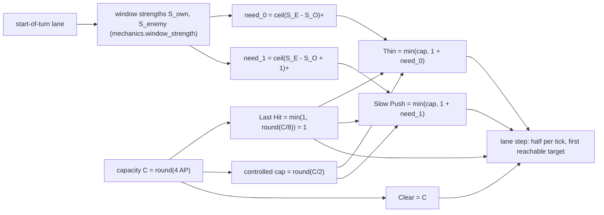

# M4.3c — Four-Action Wave Management Redesign

> **Terminology (M4.3c stabilization, [m4_3c_strategic_economics_calibration.md](m4_3c_strategic_economics_calibration.md)).**
> The fourth action this report calls **Clear** (`CL`) is named **Shove** (`SH`, `config.W_SHOVE`) in the finalized
> four-action model: the same slot, the same codes, the same budget $C$. This report and its result files keep the name
> they were written with.

**Status: EXPERIMENTAL, implemented and validated; not adopted.** The research preset `m4_lasthit()`, every other preset
and every trained agent are unchanged. The new opt-in preset `GameConfig.m4_four_actions()` gives the champion four
wave actions — **Last Hit, Thin, Slow Push, Clear** — through the real environment (61-code action space, legal masks,
PPO). Every number below comes from deterministic scripted play through the M4 resolver, from engine-level invariant
checks, or from a small PPO smoke run. No research training was done. Rules are cited from the
[mathematical reference](laning_game_mathematical_reference.md) ("Reference §n"). The new model is described there in
§4.10, marked EXPERIMENTAL.

Branch `development/m4-3b-validation` (working tree on top of `26f8c83`, uncommitted). Reproduction:
`python -m lanegame.experiments.m43c four_actions` (≈35 s) → `results/m43c/four_actions.{json.gz,md,log}`;
`python -m pytest tests/test_m43c_four_actions.py`.

---

## 0. Answer

**Champion power now sets how large a correction a champion *can* make per turn, not how much damage it *must* deal.**
The two controlled actions spend only what a local target needs, on top of a one-HP last hit:

| action | per-turn damage on enemy minions | intention |
|---|---|---|
| **Last Hit** | $1$ | farm; never pushes because of power |
| **Thin** | $\min\bigl(\lfloor C/2\rceil,\ 1+\lceil S_E-S_O\rceil^+\bigr)$ | remove only the enemy's excess strength over ours |
| **Slow Push** | $\min\bigl(\lfloor C/2\rceil,\ 1+\lceil S_E-S_O+1\rceil^+\bigr)$ | the least damage that puts our wave 1 HP ahead |
| **Clear** | $C$ | everything (unchanged) |

$C=\mathrm{round}(4\,AP^\ast)$ is the champion's wave-clear capacity (unchanged), $\lfloor\cdot\rceil$ rounds half up,
$x^+=\max(0,x)$. $S$ is the **window strength** of a wave (§2.3): the average minion HP that will fight at its front over
the next reinforcement cycle, with reinforcements weighted by when they arrive. Weighting by arrival is what makes the
balance depend on where the waves meet.

| question (Part E) | answer |
|---|---|
| 1. Are the four actions distinct? | **Yes, in what they can do; often not in a given state.** Last Hit never pushes. Thin never creates a push: 0 own crashes in every test, and 0 HP above its need. Slow Push builds a lead that compounds: first crash at turn 16, crashes of 14–17 HP on average. Clear crashes at turn 2–6 and keeps crashing. But whenever our wave is already ≥ 1 HP stronger, Last Hit, Thin and Slow Push spend the same 1 HP. That is 44% of uniformly sampled states (§5.5). |
| 2. Can weak champions manage the wave without controlling everything? | **Yes.** At C = 4 (level 1), Thin corrects 8v12 only partly (B still crashes once). Against 8v20 or 8v24 it fails (B crashes 3 times), as does Last Hit (4). At C = 6, 8v16 is held. |
| 3. More control without forced damage? | **Yes.** Last Hit is 1 HP at every power. In the neutral lane, Thin is identical to Last Hit at every tier, and Slow Push spends 1.02–1.15 HP per turn at every tier. Over 2,400 sampled states × every capacity 4–23, no budget ever fell when capacity rose and none exceeded 1 + need (0 violations). |
| 4. Can Thin stop a push without shoving? | **Yes, when capacity allows.** Against 8v24, B's crashes in 12 turns fall from 3 (C = 4) to 2 (C 5–8), 1 (C 9–14) and 0 (C ≥ 15). A's own crashes are 0 at every C. At C = 22 Thin removes 11, 11, 3, 1 HP and then last-hits at the lane cell. The three-action Thin with the same budget removes 21 HP more than needed and crashes 5 times. |
| 5. Can Slow Push build an advantage naturally? | **Yes.** From the balanced lane it adds 1 HP once and then only last-hits. A's lead grows 1, 2, 2, 3, 3, 4, 5, 7, 9, 11, 13, 16, 20 HP (about ×1.25 per turn, the Lanchester rate of §2.2) and crashes with 22 HP at turn 16. The timing is identical from C = 5 to 23. Against a larger enemy wave it often cannot establish the lead (8v12 at C = 4: first crash at turn 26 instead of 16). |
| 6. Can Clear overwhelm the slower strategies? | **Yes, and more than enough.** In the deterministic 60-turn matrix Clear is A's best gold response to Last Hit, Thin and Slow Push at every tier (A gains +1.5 to +4.6). Against Clear it is also best everywhere except L10 A+, where Last Hit loses 0.34 less. Clear dominance (M4.3b) is unchanged: it is an economic property, outside this redesign. |
| 7. Can a freeze still be broken? | **Yes.** Clear breaks it within 1–4 turns at every tier. Against a walk-up, the freeze erodes on its own after 18 turns, and after 6 against a step-back or retreat, exactly as with Last Hit. It lasts the whole window only if the frozen-on player itself Thins or Slow Pushes, i.e. cooperates (§5.3). |
| 8. Degenerate or redundant actions? | **No action is dominated or useless, but there is state-dependent redundancy.** Thin = Last Hit when the enemy is not stronger (56% of sampled states). Slow Push = Thin in 51–89%, either because both are capped or because both are Last Hit. All three equal Last Hit when we are ahead (44%). All four budgets differ in 0% of states at C = 4 and 38% at C = 22. |
| 9. Practical for PPO? | **Yes.** 61 codes, at most 33 legal. The observation is unchanged (88 entries) and env throughput is unchanged (2,030 vs 1,957 turns/s for `m4_lasthit()`). PettingZoo API tests pass. A 32k-transition PPO smoke run trains with finite losses and never samples an illegal action. A 46-output checkpoint is refused with a clear error. |

**Recommendation:** the four-action system is mechanically ready for a separate PPO experiment. It does **not** change
the incentive that makes Clear dominant (§6), and it leaves one design question open: whether a champion should be able
to withhold even its last hit to maintain a freeze (§7.2).

---

## 1. What was wrong with the three-action model

`m4_lasthit()` (Reference §4.5) makes every wave action a fixed share of the capacity: Hold $\lfloor C/8\rceil$, Thin
$\lfloor C/2\rceil$, Clear $C$. The same scenarios run under those budgets (`results/m43c/four_actions.md`, "Comparison
with the CURRENT three-action model") show the four problems listed in the brief:

| symptom (three-action, `m4_lasthit()`) | measured | four-action |
|---|---|---|
| Hold grows with power (2 HP at $C\ge12$, 3 at $C\ge20$): a strong last-hitter pushes | L18 A++ Hold v Hold: A crashes 11 times in 60 turns; L13 A+: 5 | Last Hit = 1: 0 crashes at every tier |
| Thin = $\lfloor C/2\rceil$ is a push, harder with power | Thin v Hold from the neutral lane: A crashes 5 (L1), 11 (L6, L10), 14 (L14), 16 (L18, L10 A+), 29–30 (L13 A+, L18 A++, L18 +64) times in 60 turns | Thin v Last Hit: 0 crashes at every tier (identical to Last Hit) |
| Thin overshoots a correction more with power | 8v12 … 8v24, 4v20: 15–34 HP removed above the need at C = 11–22; A crashes 1–5 times | 0 HP above the need; A crashes 0 times |
| a freezer that Thins (or Holds at high power) breaks its own freeze | longest hold against a walk-up: Thin 6 (L1), 2 (L6–L14), 0–1 above; Hold 9 (+64), 6 (L13 A+), 2 (L18 A++) | 18 for Last Hit and for Thin at every tier |

The M4.3c wave-control screen fixed the first row (Hold1). Its adaptive Thin fixed the overshoot, but it had three
side effects. It dealt 0 HP in a balanced lane, which at low capacity let a last-hitting opponent creep ahead. It
ignored reinforcements still walking to the front, so it over-corrected near its own tower and gave strong champions
the *shorter* freeze (12 against 25 turns). And it left no action that builds a push except Clear. This redesign
addresses those three points (§4 compares the formulations).

---

## 2. Mathematical investigation

### 2.1 The flows

Each side's front receives $R=4$ HP per turn on average (one 8-HP wave every two turns, Reference §4.1). In contact, each
front loses the other blob's firepower $f(h)=\max(1,\lfloor 2h/8\rfloor)\approx h/4$ HP per turn (Reference §4.3) plus
the other champion's damage $c$:

$$
h_A'=h_A+R-f(h_B)-c_B,\qquad h_B'=h_B+R-f(h_A)-c_A .
$$

### 2.2 Lanchester structure: one stable mode, one unstable mode

With $f(h)\approx h/4$, the sum $\Sigma=h_A+h_B$ and the difference $\Delta=h_A-h_B$ separate:

$$
\Sigma'=\tfrac34\Sigma+2R-(c_A+c_B)\ \Rightarrow\ \Sigma^\ast=4\,(2R-c_A-c_B)\quad\text{(stable)},
\qquad
\Delta'=\tfrac54\Delta+(c_A-c_B)\quad\text{(unstable)}.
$$

Three consequences drive the whole design.

1. **There is no static balance.** The difference mode grows by about ×1.25 per turn, so the doubling time is about
   3 turns. A balanced lane is a knife edge that two last-hitters only keep by symmetry. Any action that "holds" the
   wave must be a feedback rule on the current state.
2. **A small lead is enough to push.** Once $\Delta>0$ it compounds with no further damage. A *slow push* needs only
   to create a lead, not to sustain extra damage. The Slow Push trace confirms the rate: lead 7 → 9 → 11 → 13 → 16 → 20.
3. **A constant extra damage is worth a wave advantage.** The stationary difference is $\Delta^\ast=-4(c_A-c_B)$. One
   extra HP per turn is equivalent to a 4-HP wave lead, which is why the share-based Thin, a constant
   $\lfloor C/2\rceil-1$ above the opponent, is a push.

### 2.3 Where the waves meet matters: window strength

Equal HP is not balance. In the calibrated freeze (turn 51) A's front has 8 HP in its tower cell and B's has 5 HP at
A's −1. B's next wave stands 3 cells behind B's front. A's next wave spawns at the end of this turn, 2 cells behind A's
front. With both champions last-hitting, A's front then swings between 5 and 13 HP and B's between 7 and 13. B's front
is the larger on every other turn, until A's next wave merges, and on those turns it is larger by 4–6 HP. The contact
stays at A's tower for 18 turns (trace in §5.3). The side whose reinforcements arrive sooner is stronger than its
front's HP says.

**Definition** (`mechanics.window_strength`). For one side on turn $k$, with $\tau$ = the spawn interval in ticks (4:
one wave per side) and $n$ = ticks per turn (2):

$$
S=\frac1\tau\sum_{p}h_p\,\rho_p,\qquad
\rho_p=\begin{cases}\tau & d_p\le1\ \text{(the front and the packets queued behind it)}\\
\max(0,\ \tau-d_p+2) & d_p\ge2\ \text{(a rear packet $d_p$ cells behind: it merges in tick $d_p-1$)}\end{cases}
$$

plus, if a wave spawns at the end of this turn, $8\cdot\max\bigl(0,\min(\tau-n,\ \tau-n-d+2)\bigr)$ with $d$ its walk
from the base to the front. $\rho$ is the number of ticks of the window in which the packet fights at the front,
assuming the front holds its cell. A side with no packet has $S=0$. Crashed masses are not counted, because towers and
defenders fight them.

| packet | at the front / queued | 2 cells behind | 3 | 4 | 5 | ≥ 6 | spawn, front at ≤ −2 | at −1 | ≥ 0 |
|---|---|---|---|---|---|---|---|---|---|
| ticks fighting of 4 ($\rho$) | 4 | 4 | 3 | 2 | 1 | 0 | 2 | 1 | 0 |

Worked values (engine, `tests/test_m43c_four_actions.py`):

| state | own front | $S_A$ | $S_B$ | Thin need of A / of B | Slow Push need of A / of B |
|---|---|---|---|---|---|
| neutral (turn 9): A8 v B8 at the lane cell, a rear at each tower | 8 / 8 | 16 | 16 | 0 / 0 | 1 / 1 |
| the same with B's front at 24 | 8 / 24 | 16 | 32 | 16 / 0 | 17 / 0 |
| calibrated freeze (turn 51): A8 at −2, B5 at A's −1 | 8 / 5 | **12** | **11** | 0 / 1 | 0 / 2 |

In the freeze, the freezer is the *stronger* side although its front is smaller. That is why a Thin that compares
window strengths leaves the freeze alone, while one that compares fronts or one-turn windows does not (§4).

### 2.4 The need, and what a champion actually spends

$$
\text{need}_m=\max\bigl(0,\ \lceil S_E-S_O+m\rceil\bigr),\qquad m=0\ \text{(Thin)},\quad m=1\ \text{(Slow Push)},
$$

computed once on the start-of-turn lane (`mechanics.strength_need`), to first order: an HP removed now lowers the
enemy's strength by one HP. The opponent's action this turn is unknown (simultaneous moves). The rule therefore assumes
both champions last-hit, and those last hits cancel. So the champion must deal its own last hit **plus** the need:

$$
D_{\text{Thin}}=\min\bigl(\lfloor C/2\rceil,\ 1+\text{need}_0\bigr),\qquad
D_{\text{Slow Push}}=\min\bigl(\lfloor C/2\rceil,\ 1+\text{need}_1\bigr).
$$

The floor is not cosmetic. Without it, Slow Push's 1-HP nudge only matches the opponent's last hit and never builds a
lead: 0 crashes in 60 turns (§4, `strength_nofloor`). The budget is spent like every other wave budget: half per tick,
the earlier tick rounding up, on the first reachable target, with overkill lost (Reference §4.5).

### 2.5 Answers to the brief's questions (Part B)

| # | question | answer |
|---|---|---|
| 1 | effective wave strength under the Lanchester law | window strength $S$ (§2.3): HP times the ticks it will fight in the next reinforcement cycle. Firepower is about $h/4$, so $S$ is proportional to the damage a wave deals over that cycle. |
| 2 | a locally balanced wave | $S_E\le S_O$: the enemy is not the stronger wave over the next cycle, counting reinforcements by when they arrive. That is not equal HP: at the freeze, the balance has B's front 4–6 HP larger than A's on every other turn. |
| 3 | a small sustainable advantage | $S_O\ge S_E+1$. Because the difference mode is unstable (§2.2), any lead compounds. One HP is the smallest lead, and it reaches a crash in 16 turns at every power level. A one-firepower-class margin (4 HP) is faster (10–12 turns), but its damage grows with power (§4). |
| 4 | reinforcements | through $\rho$. A reinforcement two cells behind counts fully; one five cells behind counts a quarter; the wave spawning at the end of this turn counts only near the own tower. |
| 5 | how power limits precision and control | precision is exact: integer HP, never above the need. Power bounds only the per-turn correction, $\lfloor C/2\rceil$: 2 at level 1 up to 11 at the attack-power supremum. Clear keeps all of $C$. |
| 6 | strong champions dealing less without an overpowered controller | the controller is local and myopic. It uses one start-of-turn number per side, has no forecast of the opponent or of later turns, and has no positional goal. It only corrects the enemy's present excess, or creates a 1-HP lead. It is beaten by a Clear on the same turn, and Thin vs Slow Push simply cancel (§5.1). |
| 7 | consistency across levels | the targets do not depend on level. Last Hit is 1 HP everywhere, Thin equals Last Hit in the balanced lane at every tier, and Slow Push reaches its first crash at turn 16 for every C ≥ 5. Only Clear and the size of a possible correction scale with power. |

**Mechanical execution vs strategic decision.** The action decides *how much* to hit this turn to reach a local,
physically defined balance: the abstraction of a player who sees which minions to kill. It never decides *when* to
thin, slow push or freeze, where the wave should be, or whether a crash is worth it. Those remain the agent's choices,
which it makes every turn from the observation.

---

## 3. The four-action model

### 3.1 Equations and implementation



| property | holds by construction |
|---|---|
| ordering | $1=D_{\text{LH}}\le D_{\text{Thin}}\le D_{\text{SP}}\le\lfloor C/2\rceil<C=D_{\text{Clear}}$ |
| no forced damage | $D_{\text{Thin}}\le1+\text{need}_0$, $D_{\text{SP}}\le1+\text{need}_1$: power never raises the damage above the target |
| monotone in power | every budget is non-decreasing in $C$, and once the need fits, more capacity changes nothing |
| feasible corrections | the set $\{1,\dots,\lfloor C/2\rceil\}$ of reachable corrections grows with $C$ |

Code: `config.GameConfig.m4_four_actions()` (`wave_hold_cap=1`, `wave_thin_rule="strength"`, `wave_slowpush=True`);
`mechanics.window_strength / strength_need / strength_budget / start_packets`; `champions_m4.M4Context.state_budget`,
called by `resolve_turn_m4` for the probe and the authoritative lane step; the budgets are recorded in
`M4Turn.wave_budget` and `info["wave_budget"]`.

### 3.2 Action encoding

| codes | meaning | in which presets |
|---|---|---|
| 0–44 | (Hold/Last Hit, Clear, Thin) × 5 behaviours × 3 objectives, $a=w+3b+15o$ | all, unchanged |
| 45 | ABSENT | all, unchanged |
| 46–60 | Slow Push × 5 behaviours × 3 objectives, $a=46+b+5o$ | `wave_slowpush` only |

No existing code changes meaning in any configuration. Legacy models and `m4_lasthit()` keep their 46-code space,
masks, labels and digests. The helpers `champ_act / champ_wave / champ_behavior / champ_objective` decode both ranges.
Legality adds the Slow Push twin of every legal Hold-slot code except the Recall code 12 (code 50 is never legal), so a
present champion has 16–33 legal codes. Labels in the new preset: `LH-H`, `TN-T`, `SL-H+P`, `CL-H`, …

---

## 4. Choosing the formulation (Part B experiment)

The CURRENT budgets, the screen's adaptive Thin and seven new candidates on one scenario set
(`results/m43c/four_actions.md`, Part B; the `share` row there, Hold1 with Thin = C/2, equals `lasthit` in every
column). A's capacity C ∈ {4, 6, 11, 22}, B last-hits. The columns are: Thin from the neutral lane; Thin against five oversized waves; Thin every turn from the
freeze (Last Hit holds 18 turns against a walk-up and 6 against a step-back); Slow Push from the neutral lane; and Slow
Push against Thin.

| rule | Thin neutral crashes | Thin: B crashes by C (4/6/11/22) · own | freeze walk-up L1/L10/A+/A++ | step-back | Slow Push first crash · crashes by C | HP/turn |
|---|---|---|---|---|---|---|
| `lasthit` (CURRENT, Thin = C/2) | 64 | 12/6/2/0 · **38** | 6/2/1/0 | 4/2/1/0 | — | — |
| `adaptive` (wave-control screen) | 5 | 14/9/2/0 · 0 | 19/25/**12/12** | 11/11/7/7 | — | — |
| `class1` (one-turn window, firepower class) | 0 | 12/7/2/0 · 0 | **8/6/6/6** | 6/6/6/6 | 16 · 4/3/11/12 | 1.22–1.85 |
| **`strength` (selected)** | **0** | **12/6/2/0 · 0** | **18/18/18/18** | **6/6/6/6** | **16 · 5/7/7/7** | **1.02–1.15** |
| `strength_tol3` (Thin tolerates 3 HP) | 0 | 12/7/2/0 · 0 | 18/18/18/18 | 6/6/6/6 | 16 · 5/7/7/7 | 1.02–1.15 |
| `strength_sp4` (Slow Push margin 4 HP) | 0 | 12/6/2/0 · 0 | 18/18/18/18 | 6/6/6/6 | 10–12 · **3/8/13/14** | **1.38–2.23** |
| `strength_nofloor` (no last-hit floor) | 0 | 12/6/2/0 · 0 | **40/40/40/40** | **21/21/21/21** | never · 0/0/0/0 | 1.00 |
| `strength_capC` (cap C, not C/2) | 0 | **5/2/0/0** · 0 | 18/18/18/18 | 6/6/6/6 | 16 · 8/7/7/7 | 1.02–1.08 |
| `flat_sp` (Slow Push = 2 every turn) | 0 | 12/6/2/0 · 0 | 18/18/18/18 | 6/6/6/6 | 10 · 5/5/5/5 | 1.62 |

Why `strength`:

- **One-turn windows are phase-biased.** At the freeze, B's reinforcement joins in the second tick while A's had already
  merged. A one-turn comparison sees a false excess, thins it, and pushes A's own wave out (`class1`: 6–8 turns). Its
  Slow Push also scales with power (3 → 12 crashes).
- **Start-of-turn blobs ignore reinforcements** (`adaptive`). Strong champions over-correct near the own tower: 12
  turns instead of 25.
- **A Slow Push margin of a whole firepower class** (`strength_sp4`) brings back power dependence: crashes grow from 3
  to 14 and damage from 1.4 to 2.2 HP per turn. The 1-HP margin is the smallest lead, and it is level-consistent.
- **A fixed +1 Slow Push** (`flat_sp`) pushes faster (turn 10) but is blind to the lane. It keeps adding damage when
  already far ahead, and it cannot help against a larger wave beyond 2 HP. It is not target-based.
- **Thin tolerance 3 HP** changes almost nothing (one crash at C = 6). Parity ($m=0$) is the plain definition.
- **Cap $C$ instead of $\lfloor C/2\rceil$** (`strength_capC`) gives weak champions much more control (B's crashes 12 → 5
  at C = 4). It makes Thin = Slow Push = Clear whenever the need exceeds $C$, and it makes level 1 able to hold 8v16.
  The $\lfloor C/2\rceil$ cap keeps the M4.2e-C share (precise damage is half the throughput of area damage), keeps Clear
  strictly the strongest, and leaves weak champions unable to stop a large stack. **This is the main tunable
  tradeoff** (§7.3).
- **The last-hit floor** decides whether the freezer can withhold damage. That is a separate question (§7.2).

---

## 5. Validation (Tests 1–6)

All tables in full: `results/m43c/four_actions.md`. Power tiers (capacity of A / B): L1 4/4, L6 5/5, L10 6/6, L14 8/8,
L18 9/9, L18 +64 17/17, and the gaps L10 A+ 11/6, L13 A+ 13/7, L18 A++ 22/9 (A+ = 50 resources invested; A++ ≈ the
attack-power supremum). The starts are the calibrated `neutral` (turn 9) and `freeze` (turn 51) states of the earlier
screens. Coordinates are global.

### 5.1 Test 1 — neutral lane

A's action against B's Last Hit, 60 turns. Cells: A/B crashes · A's first crash · A's damage per turn.

| tier | Last Hit | Thin | Slow Push | Clear |
|---|---|---|---|---|
| L1 | 0/0 · – · 1.00 | 0/0 · – · 1.00 | 5/3 · 16 · 1.15 | 14/0 · 6 · 2.27 |
| L6, L10 | 0/0 · – · 1.00 | 0/0 · – · 1.00 | 7/0 · 16 · 1.10 | 16/0 · 4 · 2.53 |
| L14 | 0/0 · – · 1.00 | 0/0 · – · 1.00 | 8/0 · 16 · 1.08 | 29/0 · 3 · 2.82 |
| L18 … L18 A++ (5 tiers) | 0/0 · – · 1.00 | 0/0 · – · 1.00 | 7/0 · 16 · 1.02 | 29–30/0 · 2–3 · 2.82–3.08 |

**Action matrix at L10** (A in rows; A/B crashes · A − B gold over 60 turns). The L1, L18 and gap tiers have the same
structure, except that at L10 A+ Last Hit is A's best reply to Clear:

| A \ B | Last Hit | Thin | Slow Push | Clear |
|---|---|---|---|---|
| Last Hit | 0/0 · 0.00 | 0/0 · 0.00 | 0/7 · −0.75 | 0/16 · −1.91 |
| Thin | 0/0 · 0.00 | 0/0 · 0.00 | **0/0** · −0.11 | 0/15 · −2.17 |
| Slow Push | 7/0 · +0.75 | **0/0** · +0.11 | 0/0 · 0.00 | 0/15 · −2.10 |
| Clear | 16/0 · +1.91 | 15/0 · +2.17 | 15/0 · +2.10 | 0/0 · 0.00 |

Thin neutralizes Slow Push at every capacity pair tested, including (22, 4) and (4, 22). The two controllers cancel:
each turn one nudges and the other removes the nudge (trace in `four_actions.md`, "neutral SL v TN"). A strong
champion cannot slow push past an opponent who keeps thinning; it must Clear.

Neutral lane, L10, A Slow Push v B Last Hit (selected turns; A/B damage on the right). The only nudge is turn 1 (SL2);
A crashes with 22 HP at turn 16:

```
turn -4         -3         -2         -1         +0         +1         +2         +3         +4           A/B damage
0    .          .          A8         .          A8 B8 a b  .          B8         .          .
1    A8         .          .          .          A12 B11 a b.          .          .          B8           SL2/LH1
5    A8         .          .          .          A14 B11 a b.          .          .          B8           SL1/LH1
9    A8         .          .          .          A17 B8 a b .          .          .          B8           SL1/LH1
13   A8         .          .          .          A23 B3 a b .          .          .          B8           SL1/LH1
14   .          .          A8         .          .          A21 a      B6 b       .          .            SL0/LH0
16   .          .          A8         .          .          a          [A22] b    B3         .            SL0/LH1
```

### 5.2 Test 2 — oversized enemy wave

A's 8 (or 4) HP against B's 12–24 HP at the lane cell, B last-hits with C = 6, 12 turns. Cells: A's damage in turns
1–4 · B/A crashes · contact after turn 12.

| start | C = 4 | C = 6 | C = 11 | C = 22 |
|---|---|---|---|---|
| 8v12 | 2,2,2,2 · 1/0 · −2 | 3,3,3,3 · 0/0 · lane | 5,2,2,1 · 0/0 · lane | 5,2,2,1 · 0/0 · lane |
| 8v16 | 2,2,2,2 · 2/0 · −2 | 3,3,3,3 · 0/0 · lane | 6,6,3,1 · 0/0 · lane | 9,3,3,1 · 0/0 · lane |
| 8v20 | 2,2,2,1 · 3/0 · −1 | 3,3,3,1 · 2/0 · −1 | 6,6,6,4 · 0/0 · lane | 11,6,3,1 · 0/0 · lane |
| 8v24 | 2,2,2,1 · 3/0 · −2 | 3,3,3,1 · 2/0 · −2 | 6,6,6,0 · 1/0 · −1 | 11,11,3,1 · 0/0 · lane |
| 4v20 | 2,1,2,2 · 3/0 · −1 | 3,1,3,3 · 2/0 · −2 | 6,0,6,6 · 1/0 · −2 | 11,11,3,2 · 0/0 · lane |

For reference, Last Hit lets every stack of 12 HP or more through (B crashes 1–4 times). Clear pushes A's wave into
B's tower (A crashes 1–6 times), except at C = 4 against stacks of 20 HP or more, where B's stack still crashes 1–2
times. Thin never removed an HP above $1+\text{need}$ in any run (0 HP in total). Over the full sweep C = 4…23, B's
crashes never rose with A's capacity and A never crashed.

8v24, A Thin with C = 22 against B's Last Hit. Thin removes 11, 11, 3, 1 HP, and then the lane is stationary at 1/1:

```
turn -4         -3         -2         -1         +0         +1         +2         +3         +4           A/B damage
0    .          .          A8         .          A8 B24 a b .          B8         .          .
1    A8         .          .          .          A8 B18 a b .          .          .          B8           TN11/LH1
2    .          .          A8         .          A4 B6 a b  .          B8         .          .            TN11/LH1
3    A8         .          .          .          A8 B8 a b  .          .          .          B8           TN3/LH1
4    .          .          A8         .          A6 B6 a b  .          B8         .          .            TN1/LH1
5    A8         .          .          .          A10 B10 a b.          .          .          B8           TN1/LH1
```

The same start with C = 4: a partial correction. B's stack reaches A's tower at turn 6:

```
turn -4         -3         -2         -1         +0         +1         +2         +3         +4           A/B damage
0    .          .          A8         .          A8 B24 a b .          B8         .          .
1    A8         .          .          .          A8 B19 a b B8         .          .          B8           TN2/LH1
2    .          .          A8         .          A1 B16 a b B8         B8         .          .            TN2/LH1
3    A8         .          .          .          A1 B21 a b B8         .          .          B8           TN2/LH1
4    .          .          A5 a       B18 b      B8         .          B8         .          .            TN1/LH0
5    A8         .          a          B23 b      B8         .          .          .          B8           TN2/LH1
6    .          A2         [B25] a    b          .          .          B8         .          .            TN2/LH0
```

### 5.3 Test 3 — established freeze

A plays one action every turn from the calibrated freeze for 40 turns. Cells: longest hold / first turn not held
(held = B's front at A's −1 or deeper, both fronts alive). The rows for L6 … L18 A++ are the same except for Clear.

| A | B walks up | steps back | retreats (stays in its tower cell) | Thins | Clears |
|---|---|---|---|---|---|
| Last Hit, every tier | 18/19 | 6/7 | 6/7 | 17/18 | 0–4 / 1–4 |
| Thin, every tier | 18/19 | 6/7 | 6/7 | **40/–** | 0–3 / 1–4 |
| Slow Push, every tier | 12/13 | 6/7 | 6/7 | **40/–** | 0–4 / 1–4 |
| Clear | 0–2 / 1–3 | 0–2 / 1–3 | 0–2 / 1–3 | 0–2 / 1–3 | 0–2 / 1–3 |

- **Last Hit no longer breaks a freeze at high power.** 18 turns at every tier, against 2 under the three-action Hold
  at L18 A++.
- **Thin keeps the freeze exactly as long as Last Hit.** The freezer is the stronger side (§2.3), so Thin's need is 0.
  The freeze erodes on its own minion flow after 18 turns against a walk-up and 6 against a step-back. Nothing
  guarantees it.
- **Clear breaks it in 1–4 turns at every tier.**
- **It lasts the whole window only if B cooperates.** If B Thins or Slow Pushes, the two controllers hold each other at
  the freeze line (40/–; still 120/– over 120 turns). The frozen-on side chose not to break the freeze, which costs it
  0.15–0.45 gold over 40 turns at L10.

**Oversized wave at the freezer's tower.** B's held front is raised to 13 or 21 HP and B walks up. Cells: longest hold ·
A/B crashes. B's crashes are a non-increasing function of A's capacity.

| A's C (tier) | B13, Last Hit | B13, Thin | B21, Last Hit | B21, Thin |
|---|---|---|---|---|
| 4–6 (L1–L10) | 4 · 3/7 | 7 · 3/1–2 | 5 · 4/4 | 7 · 3/3 |
| 8–9 (L14, L18) | 4 · 3/7 | **22–24 · 3/0** | 5 · 4/4 | 7–9 · 3–5/2 |
| 11–13 (A+) | 4 · 3/7 | 22 · 3/0 | 5 · 4/4 | 11 / **2** · 4/2 |
| 17–22 (+64, A++) | 4 · 3/7 | 22 · 3/0 | 5 · 4/4 | **24 · 3/0** |

Thin saves a freeze threatened by a 13-HP stack from C = 7 on, and one threatened by a 21-HP stack from C = 15 on. In
between it fails: C = 11–14 cannot remove a 15-HP excess fast enough, and B crashes twice either way. After the crash,
the contact settles one cell further out at C = 13–14 (longest hold 2) than at C = 11–12 (11). This is the only
non-monotone number found. It is a phase of the post-crash lane, not a loss of control: B's crashes stay at 2, and
Thin's damage never exceeds its need.

The freeze with B's front raised to 21 HP, L18 A++ (C 22 / 9), A Thin against B's walk-up. Thin removes 11, 10, 3 HP
and the freeze band then holds for 24 turns:

```
turn -4         -3         -2         -1         +0         +1         +2         +3         +4           A/B damage
0    .          .          A8 [B6] a  B21 b      .          .          B8         .          .
1    A8         .          A2 a       B17 b      .          .          .          .          B8           TN11/LH1
2    .          .          A6 a       B6 b       .          .          B8         .          .            TN10/LH1
3    A8         .          A3 a       B10 b      .          .          .          .          B8           TN3/LH1
9    A8         .          A7 a       B13 b      .          .          .          .          B8           TN1/LH1
16   .          .          A14 a      B10 b      .          .          B8         .          .            TN1/LH1
```

The same start with A on Last Hit: B's stack enters A's tower at turn 3.

```
turn -4         -3         -2         -1         +0         +1         +2         +3         +4           A/B damage
0    .          .          A8 [B6] a  B21 b      .          .          B8         .          .
1    A8         .          A1 a       B19 b      B8         .          .          .          B8           LH1/LH1
2    .          .          A2 a       B17 b      B8         .          B8         .          .            LH1/LH1
3    A8         .          [B23] a    b          B8         .          .          .          B8           LH1/LH0
```

The standard freeze, L10, A Thin against B's walk-up. Thin is 1 HP throughout, identical to Last Hit, because the
freezer is never the weaker side:

```
turn -4         -3         -2         -1         +0         +1         +2         +3         +4           A/B damage
0    .          .          A8 [B6] a  B5 b       .          .          B8         .          .
1    A8         .          A5 a       B11 b      .          .          .          .          B8           TN1/LH1
2    .          .          A10 a      B7 b       .          .          B8         .          .            TN1/LH1
5    A8         .          A8 a       B13 b      .          .          .          .          B8           TN1/LH1
9    A8         .          A10 a      B13 b      .          .          .          .          B8           TN1/LH1
13   A8         .          A12 a      B12 b      .          .          .          .          B8           TN1/LH1
16   .          .          A19 a      B4 b       .          .          B8         .          .            TN1/LH1
```

**Economics at L10** (40 turns; B − A gold / gold + XP/8). Against B's best response, A's guaranteed result is −1.95
with Last Hit (B walks up), −0.75 with Thin or Slow Push (B Clears), and **+0.45 with Clear** (B Clears). Clear remains
A's best guaranteed play here, as in the wave-control screen. The new actions do not make freezing profitable. Thin
does punish a conceding opponent harder than Last Hit: B is 4.75 gold behind when it steps back and 6.04 behind when
it retreats, against 3.86 and 4.31 with Last Hit.

### 5.4 Test 4 — Slow Push

40 turns from A's 8 HP against B's 8–14 HP at the lane cell (all tiers in `four_actions.md`). Cells: A's first crash ·
A/B crashes · mean HP of A's crashes.

| start | Slow Push v Last Hit | Clear v Last Hit | Last Hit v Last Hit | Slow Push v Thin |
|---|---|---|---|---|
| 8v8 | 16 · 3–6/0 · 13.8–14.3 | 2–6 · 9–20/0 · 6.2–10.7 | – · 0/0 | – · 0/0 |
| 8v10 | 16–18 · 3–6/0 · 14.0–15.0 | 2–6 · 10–20/0 · 6.2–10.5 | – · 0/0 | – · 0/0 |
| 8v12 | 18–26 · 3–5/0–1 · 14.3–17.0 | 2–8 · 9–20/0 · 6.1–9.9 | 36 · 3/4 · 13.7 | – · 0/0–1 |
| 8v14 | 16–26 · 3–4/0–1 · 14.7–17.0 | 2–8 · 9–20/0 · 6.6–10.2 | 24 · 3/3 · 18.3 | – · 0/0–1 |

Slow Push is distinct from both neighbours. Unlike Last Hit, it turns a balanced or slightly unfavourable lane into
crashes. Unlike Clear, it crashes later with stacks about twice as large (14–17 against 6–11 HP), the slow-push
signature. It also spends about 1.1 HP per turn against Clear's 2.3–3.1. From an unfavourable start it is often
capacity-bound: at C = 4 the first crash moves from turn 16 (8v8) to 26 (8v12, 8v14). Gold results of single
deterministic trajectories swing with the phase of the crash cycle by ±2–3 resources (e.g. L1 8v8: A is −3.2 after 40
turns but +0.75 after 60), so they are not read as a ranking.

### 5.5 Test 5 — power levels

**Budget invariants** (`stage_power`). 2,400 (state, side) pairs from uniform legal play with chance events, each
evaluated at every capacity 4–23. There were 0 violations of: Last Hit = 1; the ordering
LH ≤ Thin ≤ Slow Push ≤ C/2 < Clear; non-decreasing in C; Thin ≤ 1 + need and Slow Push ≤ 1 + need; the 1-HP floor.

| C | 4 | 6 | 8 | 11 | 14 | 17 | 22 |
|---|---|---|---|---|---|---|---|
| Thin cap binds | 36.0% | 27.2% | 21.8% | 13.3% | 11.0% | 7.9% | 5.6% |
| Slow Push cap binds | 44.4% | 36.0% | 27.2% | 16.3% | 13.3% | 9.5% | 6.6% |
| mean Thin / Slow Push budget (HP) | 1.44 / 1.56 | 1.80 / 2.00 | 2.08 / 2.36 | 2.46 / 2.85 | 2.59 / 3.01 | 2.79 / 3.26 | 2.94 / 3.43 |
| Thin = Last Hit | 55.6% | 55.6% | 55.6% | 55.6% | 55.6% | 55.6% | 55.6% |
| Thin = Slow Push | 88.7% | 80.3% | 71.6% | 60.7% | 57.6% | 53.9% | 51.0% |
| all four budgets distinct | 0% | 8.4% | 17.2% | 28.0% | 31.1% | 34.8% | 37.8% |

**Outcome sweeps over A's capacity C = 4…23** (B last-hits with C = 6). Last Hit gives identical results at every C in
all seven scenarios. Thin and Slow Push have non-increasing B crashes in every imbalance scenario, for example 8v24:
3 (C 4), 2 (5–8), 1 (9–14), 0 (≥ 15). Thin never caused an own crash. Slow Push from the neutral lane gives its first
crash at turn 16 for every C, with 5 crashes at C = 4 and 7–8 for C ≥ 5. No case was found where a stronger champion
loses precision. The one non-monotone number (the B21 freeze hold, §5.3) is a post-failure phase.

### 5.6 Test 6 — integration and regression

| check | result |
|---|---|
| soak, 3 × 400 turns of uniform legal play with chance, resolver level | 0 failures of HP conservation, mirror equivariance (lane, champions, reward and recorded budgets), masks (legal ⊂ 0..60, mask = legal set, never-legal codes absent), Slow Push twins and recorded budgets; Slow Push chosen 509 times |
| spaces | 61 codes, observation 88 entries (unchanged), PettingZoo `parallel_api_test` passes, `Discrete(61)` |
| PPO smoke (32,768 transitions, 8 envs, shared self-play) | 61 outputs, 16 updates, finite losses and gradients, entropy 2.84 → 1.86; sampled wave mix after training: Last Hit 8%, Thin 7%, Slow Push 8%, Clear 77% (this already reflects Clear dominance; not a result); 0 illegal actions; 2,030 env turns/s against 1,957 for `m4_lasthit()` |
| old checkpoints | a 46-output network on the 61-code space raises a clear `ValueError`; on `m4_lasthit()` it acts as before |
| old presets | `m4_lasthit()`: 46 codes, labels byte-identical, budgets identical (`state_budget` = share model), digest pins of `test_m4_wave_actions.py`, `test_m4_zoning_natural.py`, `test_legacy_pins.py` unchanged |
| test suite | `python -m pytest tests`: 974 passed, 4 skipped, 2 xfailed (the same skips and xfails as before the change; 16 of the passes are the new `test_m43c_four_actions.py`) |

---

## 6. Evaluation (Part E)

1. **Distinct?** Yes, in what each action can do: Last Hit never pushes, Thin only corrects, Slow Push builds a
   compounding lead, Clear shoves. Not always in a given state: the three gentle actions coincide whenever our wave is
   at least 1 HP stronger (§5.5). That is the physics, not a defect. When your wave already wins, there is nothing to
   correct and nothing to establish. The only remaining choice is to let it push (any gentle action) or to shove
   (Clear). The one thing the model cannot do is *slow down* a winning wave (§7.2).
2. **Weak champions** do basic management: at C = 4–6, Thin holds 8v12 and 8v16 and keeps a freeze. They do not control
   every wave: Thin fails against 20–24-HP stacks below C ≈ 9–15.
3. **More control without forced damage:** confirmed by construction (§3.1) and by measurement (§5.5): 0 violations,
   and identical Last Hit and Slow Push outcomes over the whole capacity range.
4. **Thin stops pushes without shoving:** 0 own crashes and 0 HP above the need in every test.
5. **Slow Push builds advantages naturally:** one nudge, then Lanchester compounding (§2.2, §5.1). It is
   capacity-limited against larger waves.
6. **Clear still overwhelms:** yes. It is also still the best gold response everywhere in the deterministic matrix. The
   redesign gives the agent precise alternatives but does not change Clear's economic dominance (an objective and
   economy question, out of scope).
7. **Freeze counterplay:** Clear breaks it in 1–4 turns. A walk-up or step-back lets it erode in 18 or 6 turns.
8. **Degenerate or redundant actions:** none is dominated or useless. The state-dependent coincidences are quantified in
   §5.5. Thin vs Thin and Thin vs Slow Push produce a mutually held, stationary lane, both from the neutral lane and at
   the freeze line. Either side can end it with Clear.
9. **PPO:** practical. The action space is 33% larger (61 vs 46), legal sets have at most 33 entries, and there is no
   throughput cost. Coinciding actions give equal values to equivalent codes, which costs a little entropy but no
   correctness. Old checkpoints must be retrained.

---

## 7. Limitations, unintended consequences, open questions

### 7.1 Limitations of the formulation

- **First-order, start-of-turn targets.** The need is computed once per turn and assumes the opponent last-hits. It does
  not model the minion attrition during the window, tower fire, crashed masses, or the opponent's actual action. A Clear
  on the same turn defeats any correction.
- **Stationary-front assumption.** $\rho$ assumes the front holds its cell. For walking waves, for example after a
  crash, $S$ is only an estimate. A side with no packet has $S=0$, so Thin and Slow Push then try to remove the whole
  enemy wave up to their cap, and both are the same action in that case.
- **Spending order unchanged.** Without a lane fight in a tick, the budget goes first to an enemy crashed mass under the
  own tower (Reference §4.5), even if the need was computed from the approaching front.
- **Deterministic single trajectories** with fixed power per window and no chance events. Effects below about ±2–3
  resources of crash-cycle phase noise are not read.
- **Sampled-state census** (§5.5) uses uniform random play, not learned play. The shares of coinciding budgets in real
  play will differ.

### 7.2 The freeze question (unresolved, not in scope)

Removing the 1-HP floor from Thin (`strength_nofloor`) lets the freezer deal **0** when it is the stronger side. The
freeze then holds for 120 of 120 turns against a walk-up and Slow Push, and 21 turns against a step-back, instead of
18 and 6. Clear still breaks it in 2–3 turns. Mechanically this is the only lever that slows a winning wave (wave-control
screen §4). But it turns an established freeze into a permanent state against any non-clearing opponent, and it also
makes Slow Push inert (§2.4). The brief's Last Hit is "at most 1 HP", and Thin is "farming plus correction", so the
floor is kept. Whether a champion should be able to *withhold its last hits*, for example a fifth action or a Last Hit
of 0 when ahead, belongs to the freeze-stability investigation together with the economic objective.

### 7.3 The capacity share of the controlled actions

$\lfloor C/2\rceil$ (the M4.2e-C Thin share) caps Thin and Slow Push. With the full $C$ (`strength_capC`) weak
champions control much more: B's crashes against the five stacks are 5/2/0/0 instead of 12/6/2/0 at C = 4/6/11/22. But
Thin, Slow Push and Clear would then coincide whenever the need exceeds C. This is a calibration choice that changes
how much control levels 1–10 have. It should be decided with gameplay goals, not tuned to make freezing pay.

### 7.4 Strategic consequences to watch in PPO

- Thin and Slow Push cancel each other at every power (§5.1). With Clear the best gold response everywhere, PPO may
  ignore the gentle actions as it ignored Thin in M4.3b. Telling whether that is a game property or a learning issue
  needs the wave-only intervention tools of M4.3b, extended to four actions (`experiments/rl/m43b/behavior.py`
  and `intervene.py` are written for three wave slots and must be generalized first).
- Thin punishes conceding harder than Last Hit (§5.3), while walking up to a freeze still costs nothing measurable.

---

## 8. Files, reproduction, preservation

| file | change |
|---|---|
| `lanegame/config.py` | `W_SLOWPUSH`, codes 46–60 (`CHAMP_SLOWPUSH_BASE`, `N_CHAMP_ACTIONS_FOUR`), the decoding helpers for both ranges, `FOUR_WAVE_NAMES/SHORT`, field `wave_slowpush`, `wave_thin_rule = "strength"`, validation, preset `m4_four_actions()` + `M4_FOUR_ACTIONS_FIELDS`, 61-code `action_codes()`, labels |
| `lanegame/mechanics.py` | `wave_actions` adds Slow Push; `STRENGTH_MARGIN`, `start_packets`, `window_strength`, `strength_need`, `strength_budget` |
| `lanegame/champions_m4.py` | `M4Context.state_budget`; the resolver computes the budgets from the start-of-turn lane under "capacity"; `M4Turn.wave_budget` |
| `lanegame/env/core.py` | `info["wave_budget"]` |
| `lanegame/env/agents_m4.py` | the Freeze-legal check decodes with `champ_wave` (identical for codes 0–45) |
| `lanegame/rl/agent.py` | `NetAgent` refuses an action space of another size with a clear error |
| `lanegame/__main__.py` | `m4_four_actions` added to the `rl-shared --model` choices |
| `lanegame/experiments/m43c/four_actions.py`, `__main__.py` | this study (stage `four_actions`, `--no-ppo`) |
| `tests/test_m43c_four_actions.py` | encoding and compatibility, validation, legality, window strength and need, budgets, resolver guarantees, RL interfaces, pins of §5 |
| `tests/test_m4_config.py` | the new field in the legacy/m2c rejection test |
| `results/m43c/four_actions.{json.gz,md,log}` | every run, all tables and traces |
| `docs/m4/laning_game_mathematical_reference.md` | §3.1 and §4.5 pointers, §4.10 EXPERIMENTAL four-action model, glossary, §13 log |
| `docs/README.md` | index entry |

Not changed: the Streamlit debugger (`lanegame/viewer/`) does not list the new preset, and its manual-action panel offers
three wave slots. The M4.3b behaviour and intervention diagnostics are written for three wave slots (§7.4).

**Preservation.** Every preset other than `m4_four_actions()` keeps its defaults (`wave_slowpush=False`,
`wave_thin_rule="share"`), its 46-code space and its digests. `M4Turn` gained one optional field and `info` one key.
Nothing else in the transition, reward or observation changed. The existing checkpoints and result files are untouched.

**Readiness.** The environment is ready for a PPO experiment on `m4_four_actions()`, for example the M4.3b `base`
settings with fresh networks of 61 outputs (`python -m lanegame rl-shared --model m4_four_actions …` works). Before reading the results strategically, the M4.3b behaviour and
intervention diagnostics need a fourth wave slot (§7.4).
