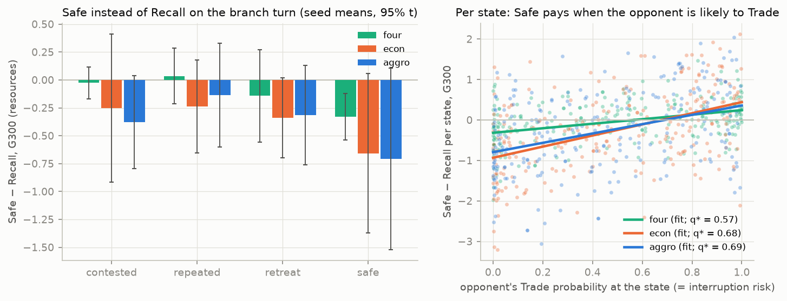
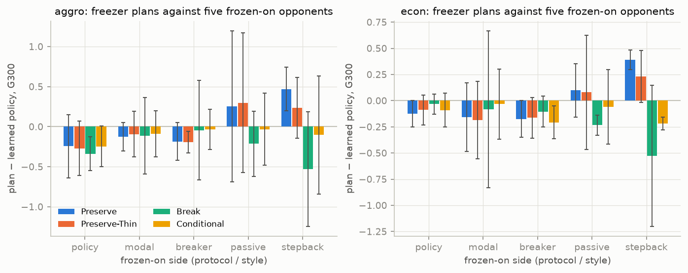
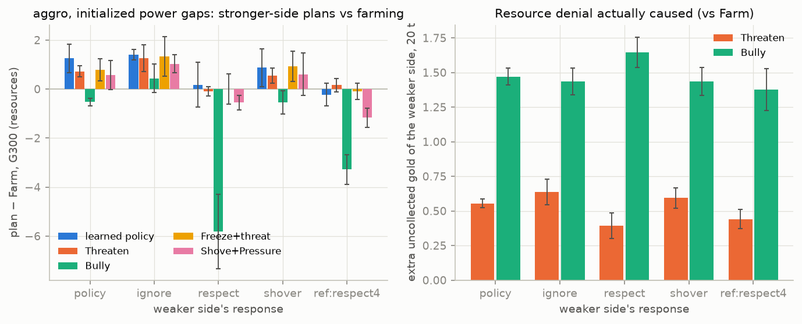
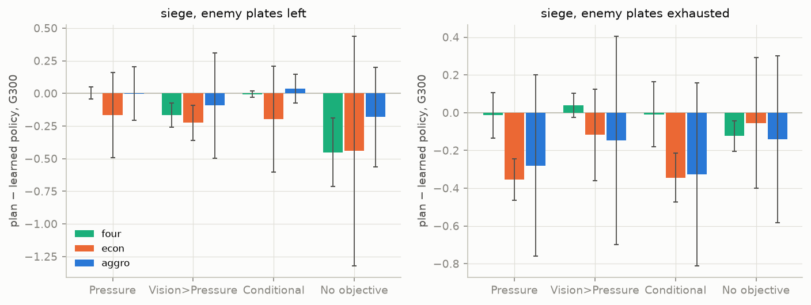
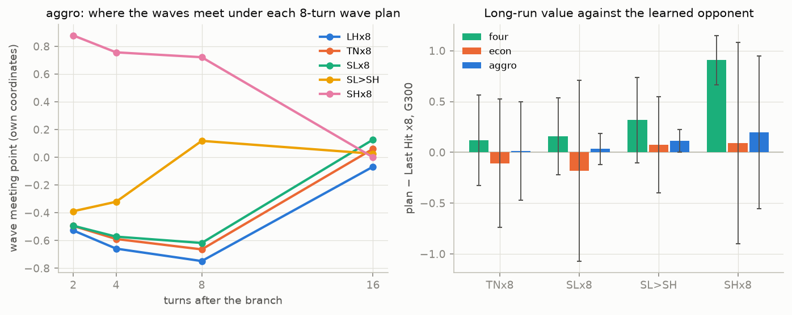

# M4.4c — Strategic Behaviour Investigation and Multi-Turn Counterfactual Analysis

*2026-10-14. Branch `main` (on f4bcb7d; nothing staged or committed). Empirical study only: **no game rule, preset,
reward, observation, action, Recall, gank, tower or PPO setting was changed, and no network was trained.** Generated
tables: [`results/m44c/report.md`](../../../results/m44c/report.md); figures `results/m44c/figures/`; summary
`results/m44c/summary.json`; viewer recordings `results/m44c/trajectories/`; code `lanegame/experiments/rl/m44c/`;
tests `tests/test_m44c_strategic.py`. Background: [M4.4b report](m4_4b_ppo_training_report.md),
[M4.4a readiness](m4_4a_ppo_readiness.md), [mathematical reference](../laning_game_mathematical_reference.md),
[roadmap](../../rl_research_roadmap.md).*

---

## 1. Executive summary

**Question.** M4.4b found PPO policies that condition Shove on the lane, freeze and break freezes, and respond to the
tower correction, but it also found apparent gaps: frequent interrupted Recalls, freezes that deny little, a stronger
champion that does not zone, rare Vision before Pressure, and Last Hit / Thin / Slow Push barely distinguished. Its
one-turn counterfactuals (8 states × 16 rollouts) were mostly inconclusive. M4.4c asks, for each gap: **is it a failure
of PPO learning, a weakness of the evaluation, or a consequence of the simulator's actual incentives?**

**What was run.** A multi-turn counterfactual framework on top of the M4.4a engine (plans over existing legal actions
with stop conditions and fallbacks; paired common-random-number rollouts; episode ledgers plus discounted returns over
5–300 turns), applied to the 4.10M finals of all three economies and seeds (the 2.05M finals as replication for Recall
and freezes): 5,982 starting states (natural and initialized, never pooled), 24–48 paired 300-turn rollouts per
candidate, the learned opponent plus modal and style opponents, ≈ 5.3 hours of simulation. Every job left the network
weights unchanged; common random numbers held in every state; a re-run is bit-identical.

**What we learned.**

1. **Interrupted Recall is not a learning failure.** It is a simultaneous guessing game: Recall wins if the enemy does
   not Trade, Safe wins if it does. Recalling now is the best or tied-best of five legal alternatives on average (Safe
   −0.14 to −0.38, Hold −0.6 to −0.8, Safe-then-Recall −0.35 to −0.72 resources over 300 turns in econ / aggro), and the
   learned policy is within ±0.07 of always recalling. Safe pays only when the opponent is more than ≈ 69% likely to
   Trade (q* = 0.69 [0.58, 0.86] in aggro); there the policy still Recalls ≈ 65% of the time, a small conditional gap
   worth ≈ 0.1 resources per affected decision. The deaths after interruptions are mostly the price of being at 20% HP
   next to a diver: the alternatives die more (Safe 37% vs Recall 27% before leaving the lane).
2. **A freeze is worth exactly what the opponent concedes.** Preserving a freeze beats breaking it by ≈ 1 resource
   (G300) when the frozen-on side steps back (+0.92 [+0.27, +1.56] econ, +1.00 [+0.54, +1.46] aggro) and by +0.6 to +1.4
   against a passive last-hitter (initialized), but by ≈ 0 against the learned opponent and against one that breaks it,
   because breaking is cheap: forcing the freeze-keeping wave extends a learned freeze by only ≈ 0.5 turns. Against its
   own opponent no plan beats the learned policy. Damaged opponents (+0.53) and exhausted plates (+0.4 to +0.6) are where
   preserving pays even against the learned opponent.
3. **Strong-side zoning is learned; M4.4b's "not learned" is withdrawn.** From initialized power gaps and natural HP
   edges, no scripted plan (farm, threaten, bully, freeze+threat, shove+pressure) beats the learned stronger side; most
   are 0.4–2.2 resources worse, and in natural states every plan is worse on every seed. It converts its edge through selective trades into **deaths and
   forced Recalls** (weaker side died 45% vs 24% under farming, XP lost doubled), not through missed last hits, which is
   why M4.4b's metrics did not see it. Pure threat without fighting is mechanically weak: a Safe defender with room to
   retreat is never connected and pays only ≈ 0.08 resources of farm per turn.
4. **Vision before Pressure does not pay in typical sieges** (Vision>Pressure − Pressure ≈ 0 in every economy with
   plates left), because natural sieges are short (6–7 HP crashes, 2–4 turns) while Vision protects for 6 turns. Vision
   works as designed (gank damage −25%, deaths 32% → 25%) but costs ≈ 0.27 plates. The policy's objective choices are
   unbeaten, including its switch from Pressure to Vision once the plates are gone (forcing Pressure there costs
   0.28–0.35). Long sieges show a positive but unresolved trend.
5. **The four-action model offers essentially two economically distinct wave choices in most states.** Thin is the same
   action as Last Hit whenever the own wave is not weaker; Last Hit, Thin and Slow Push leave the lane in exactly the same
   state in 68–77% of natural turns. The actions do move the waves differently over 8 turns, but 8-turn sequences are
   within ≈ ±0.2 resources of each other against the learned opponent, a difference that needs 80–255 rollouts per state
   to resolve. PPO's mix among the three barely depends on whether they differ; no fixed sequence beats it. Slow Push
   matters against a passive last-hitter (+2.65 over 16 turns in the clean lane).

**Overall.** No profitable strategy was found that PPO consistently misses against its own opponent. The imperfections
are consequences of the simulator's incentives (C), of self-play's opponent distribution (D: nobody concedes a freeze or
respects a threat, and power gaps never arise), and of M4.4b's measurement choices. The value the policies leave is
against *other* opponents (conceding or passive ones), an adaptation and robustness question.

**Recommendation: CONDITIONAL GO for M4.4d** (§10): robustness and exploitability (best-response attackers, conceding
and passive opponent styles) of the `aggro` and `econ` policies, after a review of four well-posed design questions
(redundant wave actions, the strength of threat-only zoning, voluntary retreat into the own tower cell, Vision duration
versus siege length). No further training sweep and no mechanics change are indicated before that review.

---

## 2. Experimental methodology

### 2.1 Checkpoints, environments and seeds

| | primary (4.10M) | replication (2.05M) |
|---|---|---|
| files | `results/rl/checkpoints/m44/ext/<env>_s<seed>/final.pt` | `results/rl/checkpoints/m44/main/<env>_s<seed>/final.pt` |
| training | 4,096,000 agent transitions, learning rate annealed over the whole run (not a continuation of the 2.05M run) | 2,048,000 transitions (the pre-registered M4.4b finals) |
| used for | every experiment | Recall (contested and repeated states) and freezes (natural states), `econ` and `aggro`, protocol `policy` |

Weights digests (sha256, first 16 hex; verified by the M4.4a loader on every load and re-computed after every job):

| env | 4.10M s0 / s1 / s2 | 2.05M s0 / s1 / s2 |
|---|---|---|
| `aggro` | `3828973fcea7fc75` / `0392b6fb06bfe6dc` / `789e33db5f480dcd` | `f7d0b0e5f523cd03` / `fef46d6bb38fe5da` / `f3a5e02efd2ca547` |
| `econ` | `3eb3caa330c15715` / `563ffd195bd99ce7` / `1113f09dda3300aa` | `1cb17645e4e1b667` / `4054b50cb2f26dfd` / `521d3138b8e9412c` |
| `four` | `a8c1db1b9787e863` / `f4449163bf999c15` / `c83b52c68efc7d11` | `1d4695942ac7a2bb` / `d5864c494aeea894` / `2b274f8dada28c51` |

Environments: `aggro` = `GameConfig.m4_four_actions_econ_aggro()` (primary candidate), `econ` =
`m4_four_actions_econ()` (economic control without the full tower retaliation on busy dives), `four` =
`m4_four_actions()` (original economy, Shove-dominance control). Every policy is evaluated only in its own environment.

Evaluation seeds: SeedSequence roots 81,000–81,999 (state collection 81,000 + 10 × investigation, paired rollouts 81,100
+ …, initialized states 81,200 + …, mechanics 81,300 + …, viewer traces 81,500–81,559), disjoint from training (seeds 0–3),
from M4.4a / M4.4b evaluation (80,000–80,999) and from every earlier study. Evaluation never updates a network: every
job records the weights digest before and after (unchanged in all jobs).

### 2.2 Starting states

| kind | how | used in |
|---|---|---|
| **natural** | recorded self-play games of the evaluated final from s0 (500 turns), state selected by a predicate on the decision state only (start of the turn and the policy's distribution there); within a game the matching (turn, seat) pairs are shuffled with a seeded generator and at most 2–3 are taken, games are added until the quota is met | Recall (4 strata), freezes, zoning (duel-edge states), vision (3 strata), waves |
| **initialized** | the M4.3c harness starts (`neutral` k 9, `freeze` k 51, `siege` k 24) with a power gap (A's investment / level lead), a level, an HP or the plate state changed; one state per grid cell, outside the training distribution | freezes (24-cell grid), zoning (16 cells + a 6-cell behaviour matrix), vision (4 cells) |

Nothing is selected on outcomes. Natural and initialized results are reported separately and never pooled; scripted
opponents and opponent styles are reported as their own rows.

### 2.3 Plans (interventions)

A **plan** is a multi-turn rule over existing legal actions (`m44c/plans.py`): on every turn while it is active it plays
a complete legal code (e.g. Recall), or reshapes the policy's distribution so that one or more components take given
values while every other component keeps the policy's own conditional distribution (the M4.4a "conditional" rule), or
lets the policy act. It has a precondition (its first decision must be legal at the branch state, else the candidate
is not built), stop conditions (the freeze ended, the siege is over, the champion left the lane), a maximum duration,
and a fallback (a decision that is illegal on a later turn gives that turn to the policy and is counted). No plan ever
plays an illegal or invented action; every rollout's decisions are logged. The plans of each investigation are listed in
its section.

### 2.4 Opponents and continuation

| protocol / style | the opponent's branch-turn action | the opponent's continuation |
|---|---|---|
| `policy` | sampled from its own policy, own observation, own stream (identical for every candidate) | the learned policy |
| `modal` | its most probable action, committed | the learned policy |
| styles (`breaker`, `passive`, `stepback`, `ignore`, `respect`, `shover`) | as its continuation | the learned policy with ONE component forced in a stated situation (e.g. `breaker`: Shove while frozen on); everything else the network's own |
| opponent plans (`opp_LH` … `opp_SH`, `B_Hold` …) | as the plan | a wave or behaviour forced for the first 8–10 turns, then the learned policy |
| `ref:respect4` | the scripted conceding farmer | scripted |

The focal side follows the plan and then the learned policy. After the branch, both seats keep sampling their own
policies from their own observations; later actions are never forced to match across candidates.

### 2.5 Pairing, outcomes and windows

Rollout m of every candidate uses the same three streams (environment chance, focal sampling, opponent sampling;
`diagnostics.branch.rollout_seed`), one uniform per seat per turn whatever the plan does. The chance vector of every turn
does not depend on the actions, so it is identical across candidates for the whole window (checked in every state:
first and last turn), and the opponent's branch-turn action is identical across candidates (checked in every state).
Outcomes per rollout (`m44c/engine.summarize`): the focal discounted return G_h = Σ_{t<h} 0.99^t r_t for h = 5, 10, 20,
50, 100, **300** (the M4.4b window; headline), and episode ledgers over the first 3–40 turns for both sides: gold, XP,
XP lost for good, uncollected available gold, HP lost (bars of max HP), deaths, Recalls, interruptions, crashes, plates,
tower damage, gank probability and ganks, trade attempts / connections / damage, Pressure and Vision turns, investment
and the freeze state. Short-horizon ledgers are reported next to the long-run return: a small G300 difference does not
mean the plan had no immediate effect.

### 2.6 Statistics

Within one network the states are the units: each state gives a paired mean difference over its rollouts (and a
standard error); the across-state mean carries a 95% t interval. Across training seeds, the three per-seed means are the
units (95% t interval, 2 degrees of freedom, t = 4.30); this is the headline uncertainty of every table ("mean [interval]
(s0 / s1 / s2)"). Hundreds of rollouts from one network are never treated as independent training runs. Stratified
tables (by HP, power, plates, …) pool the states of all seeds and are labelled descriptive.

### 2.7 Sizes and runtime

| experiment | states per policy | candidates | rollouts per candidate | opponents | policies |
|---|---|---|---|---|---|
| Recall | 32 contested + 24 repeated + 24 retreat + 16 safe | 6 | 24 | policy, modal (safe: policy) | 9 (+6 at 2.05M) |
| freeze, natural | 24 | 5 | 24 | policy, modal, breaker, passive, stepback (`four`: policy) | 9 (+6 at 2.05M) |
| freeze, initialized | 24 grid cells | 5 | 24 | policy, breaker, passive, stepback | 6 (econ, aggro) |
| zoning, initialized | 16 grid cells | 6 | 24 | policy, ignore, respect, shover, ref:respect4 (`four`: policy) | 9 |
| zoning, natural | 24 | 6 | 24 | policy, respect (`four`: policy) | 9 |
| zoning, behaviour matrix | 6 grid cells | 3 | 32 | B Hold / Yield / Safe | 9 |
| vision | 24 plates + 24 exhausted + 12 active; 4 initialized | 5 | 24 (initialized 48) | policy, modal (plates, initialized) | 9 |
| waves, sequences | 24 | 6 | 16 | policy, opp LH / TN / SL / SH (`four`: policy) | 9 |
| waves, mechanics | ≈ 400 decision states | — | deterministic | — | 9 |

Every rollout runs 300 turns.

---

## 3. Interrupted Recall



### 3.1 The mechanics: a simultaneous guessing game

Recall (code 12) is legal at the own −1 or −2. It is interrupted iff the enemy chooses **Trade** this turn and ends in
contact with the recaller's cell; the interrupted champion channels (no farm, no wave damage) and is hit with the full
probability (0.55, or 0.40 in its own tower cell), i.e. like a Hold. The enemy's action is simultaneous: the recaller
cannot see it. Exact one-turn resolutions (no chance; full table in `results/m44c/report.md` §7):

| A (30% HP) at | enemy at (own cell) | A Recalls, enemy Trades | A plays Safe, enemy Trades | A Recalls, enemy Holds | A plays Safe, enemy Holds |
|---|---|---|---|---|---|
| −1 | 0 or +1 | interrupted, hit p 0.55 | evades to −2, not hit | leaves | stays at −1, farms at 0.6 |
| −1 | +2 (already in A's tower cell) | interrupted, hit p 0.55 | caught at −2, hit p 0.05 | leaves | stays at −1 |
| −2 (tower cell) | 0 or +1 | interrupted by a dive, hit p 0.40; the diver takes the tower shot (p 1.0) | not connected | leaves | stays |
| −2 | +2 (a diver in the cell) | interrupted, hit p 0.40 | hit p 0.05 | leaves | stays |

So Recall pays against an opponent that does not Trade, Safe against one that does. Two structural facts shape the
situation: **no behaviour moves a champion into its own tower cell by choice** (Safe targets min(spot, −1) and only
evades to −2 when a Trade threatens), and **in natural play the contested Recall happens mostly in the tower cell**:
61–74% of contested states have the recaller at −2, and in the *repeated* stratum 81–85% (econ / aggro) have the enemy
already standing in that cell, trading every turn while the tower shoots it.

### 3.2 States

Natural self-play of each 4.10M final; decision state only: present, Recall legal, HP ≤ 40%, the policy's Recall mass
≥ 0.20, split into **contested** (an enemy Trade can reach the champion this turn; 32 per final), **repeated**
(contested, previous turn an interrupted Recall; 24), **retreat** (contested at the own −1, where a Safe step back is
possible; 24) and **safe** (no enemy can reach; 16). Mean HP 0.18–0.26. The policy puts 61–75% of its mass on Recall in
the contested strata of `econ` / `aggro` (85–93% in `four`), 18–28% on Safe (`four`: ≈ 0%). The opponent policy's Trade
probability at the same states, which is exactly the interruption probability, averages 0.32–0.60.

### 3.3 Recall versus Safe versus Hold (paired, 24 rollouts per candidate, 300 turns)

Candidate minus "Recall now", G300, seed mean [95% t interval over seeds], opponent protocol `policy`:

| | learned policy | Safe | Hold | Safe>Recall | Retreat (Safe until −2 / out of reach, then Recall) |
|---|---|---|---|---|---|
| aggro, contested | −0.07 [−0.25, +0.11] | −0.38 [−0.80, +0.04] | **−0.67 [−1.23, −0.11]** | **−0.66 [−1.31, −0.02]** | −0.12 [−0.29, +0.04] |
| aggro, repeated | +0.04 [+0.00, +0.07] | −0.14 [−0.60, +0.33] | **−0.62 [−1.02, −0.23]** | **−0.72 [−1.34, −0.09]** | +0.09 [−0.10, +0.27] |
| aggro, retreat (at −1) | +0.02 [−0.11, +0.16] | −0.32 [−0.76, +0.13] | **−0.59 [−1.15, −0.03]** | −0.35 [−0.83, +0.13] | +0.05 [−0.18, +0.28] |
| econ, contested | −0.07 [−0.10, −0.04] | −0.25 [−0.92, +0.41] | **−0.68 [−1.05, −0.31]** | −0.49 [−1.08, +0.09] | −0.02 [−0.37, +0.33] |
| econ, repeated | −0.06 [−0.44, +0.32] | −0.24 [−0.65, +0.18] | −0.67 [−1.35, +0.02] | **−0.59 [−0.76, −0.41]** | −0.09 [−0.20, +0.02] |
| econ, retreat (at −1) | +0.03 [−0.06, +0.11] | −0.34 [−0.70, +0.02] | **−0.81 [−1.29, −0.33]** | **−0.50 [−0.95, −0.05]** | −0.20 [−0.68, +0.28] |
| four, contested | +0.01 [−0.05, +0.08] | −0.03 [−0.17, +0.12] | **−0.12 [−0.20, −0.04]** | **−0.21 [−0.31, −0.10]** | −0.08 [−0.19, +0.02] |

* **No alternative beats recalling on average.** Hold is clearly worse everywhere (−0.6 to −0.8 resources in the
  calibrated economies). Safe and Safe>Recall are worse or tied. Retreat-then-Recall ties with Recall (in the tower cell
  it *is* Recall).
* **The learned policy is within ±0.07 of always recalling** in every stratum (one small significant deficit, econ
  contested −0.07 [−0.10, −0.04]).
* **Against an opponent committed to its modal action** (protocol `modal`, usually a Trade in these states) the ranking
  shifts toward retreating: econ, retreat stratum: Retreat +0.41 [+0.05, +0.76], Safe>Recall +0.23 [+0.04, +0.42];
  aggro mostly n.s. Hold stays worst.
* **Horizons.** Safe's deficit is largest at once (G10: −0.63 [−1.08, −0.18] aggro contested; −0.55 econ) and shrinks
  by G50: Safe delays the reset, so the champion spends more low-HP turns in lane.
* **Who dies.** After a contested low-HP state the champion dies before leaving in 27% (Recall) / 31% (policy) / 37%
  (Safe) / 49% (Hold) of rollouts (aggro; econ 33 / 35 / 42 / 56%); Recall gets it out fastest (1.1 turns vs 3.5 for
  Safe) with the least HP lost (0.09 vs 0.14 bars). **The deaths that follow interrupted Recalls in M4.4b are mostly
  the price of being at 20% HP next to a diver, not of choosing Recall**: the alternatives die more.

**Replication on the 2.05M finals** (contested and repeated states, protocol `policy`, 6 networks): the same ranking.
Hold −0.61 [−0.86, −0.37] (aggro) / −0.69 [−0.84, −0.54] (econ) in contested states; Safe −0.26 [−0.41, −0.11] /
−0.20 [−0.51, +0.11]; Safe>Recall −0.42 / −0.39; Retreat and the learned policy within ±0.13 of Recall. One difference:
in the *repeated* stratum Safe beats Recall at 2.05M in econ (+0.28 [+0.13, +0.42]; aggro +0.17 [−0.04, +0.38]), where
the 4.10M finals show −0.24 / −0.14 (n.s.). This is a budget-dependent detail of the repeated-dive states that M4.4c
does not explain; the policy's Recall mass is the same at both budgets (67–72%), so the 2.05M policies left slightly
more value on the table there.

### 3.4 When does Safe pay? The guessing game, measured

| | fit of Safe − Recall on the opponent's Trade probability q | indifference q* (bootstrap 95%) | states above q* | policy P(Recall) above / below q* | P(Safe) above / below | Spearman (q, P(Recall)) | fitted regret per decision: policy / always Recall |
|---|---|---|---|---|---|---|---|
| aggro | −0.80 + 1.15 q | **0.69 [0.58, 0.86]** | 30% | 66% / 71% | 29% / 20% | −0.17 | 0.10 / 0.06 |
| econ | −0.93 + 1.37 q | **0.68 [0.59, 0.78]** | 39% | 64% / 71% | 30% / 19% | −0.23 | 0.12 / 0.09 |
| four | −0.32 + 0.56 q | 0.57 [0.45, 0.68] | 45% | 82% / 92% | 1% / 1% | −0.23 | 0.07 / 0.07 |

(contested + repeated + retreat states pooled, 240 per environment, protocol `policy`.) Safe beats Recall only when
the opponent is **more than about 69% likely to Trade** (aggro: +0.26 [+0.06, +0.46] for q ≥ 0.6; −0.67 [−0.86, −0.49]
for q < 0.3). The policy moves in the right direction (less Recall, more Safe as q rises, every environment, p ≤ 0.01)
but weakly: above q* it still Recalls 64–66% of the time. Within single states, Safe is significantly better than
Recall in only 8–9% of states and significantly worse in 14–16%.

### 3.5 Verdict

| question | answer |
|---|---|
| Is repeatedly choosing Recall in contact economically inferior? | **No, on average.** Recall is the best or tied-best of the tested alternatives in every stratum and environment; the learned policy is within ±0.07 resources of always recalling |
| Is there a learning gap? | **A small one.** The policy conditions on the interruption risk only weakly: at the ≈ 30–40% of contested states where the opponent's Trade probability exceeds q* ≈ 0.69, Safe would pay ≈ 0.1–0.3 resources per decision, and the policy still Recalls ≈ 65% of the time. Its Safe mass at low q costs about as much as it gains at high q (fitted regret 0.10–0.12 per decision vs 0.06–0.09 for always recalling) |
| Is there a mechanics limitation? | **Partly.** A champion cannot step into its own tower cell by choice, and a diver already standing there cannot be escaped (Safe only lowers its hit chance to 0.05). The decision is a pure simultaneous guess; "repeated interruption" is what a guessing game looks like when one conditions on the outcome |
| Classification | **A** (Recall is the economically right default and is learned), with a minor **B** component (weak conditioning on the opponent's Trade probability; worth ≈ 0.1 resources per affected decision) and a **C** context (no voluntary retreat into the tower cell) |
| Confidence | high for "no alternative is better on average" (1,584 states, 9 networks, consistent across environments and protocols); moderate for the size of the conditional gap (pooled-state fit; per-seed intervals wide) |

---

## 4. Freezing



### 4.1 Design

**States.** Natural: the focal side has held a freeze (the enemy front at its own −1 or deeper, fronts fighting) for
≥ 2 consecutive turns; 24 per final. In `econ` / `aggro` the run so far averages 3.3–3.8 turns (36–38% are already ≥ 4
turns, the M4.4a "established" threshold); the enemy is away in 17–19%, at ≤ 50% HP in 32–36%; enemy plates are left in
40–43%; **no natural freeze state had a power gap** (0–1% beyond the 1.25 / 0.8 classes). Initialized: the M4.3c
outside-tower freeze start on a 24-cell grid (power: equal / freezer ×1.76 / freezer ×0.57; level 4 / 10; frozen-on
HP 100% / 50%; plates left / exhausted).

**Freezer plans** (wave component only; behaviour and objective keep the policy's conditional choice; every plan stops
the moment the freeze state ends, at most 10 turns): **Preserve** (the documented threshold controller: Thin when the
held enemy front reaches 14 HP, else Last Hit), **Preserve-Thin** (Thin every held turn, the `thin4` keeper),
**Break** (Shove every held turn), **Conditional** (Preserve while the frozen-on champion is away, below 50% HP or
behind on the duel edge, else Shove), and the learned policy. **Frozen-on side**: the learned policy (protocols
`policy`, `modal`) and three styles of the same network: **breaker** (Shove while frozen on), **passive** (Last Hit while
frozen on), **stepback** (Safe while frozen on).

What the learned freezer does: Last Hit / Thin / Slow Push / Shove 28 / 23 / 23 / 25% (aggro; econ 24 / 27 / 27 / 22%).
The frozen-on learned policy Shoves 38–42% of the time at the same states.

### 4.2 Results (natural states, 4.10M)

Plan minus the learned policy, G300, seed mean [95% t over seeds]:

| frozen-on side | aggro Preserve | aggro Break | aggro Preserve − Break | econ Preserve | econ Break | econ Preserve − Break |
|---|---|---|---|---|---|---|
| learned policy | −0.24 [−0.64, +0.15] | **−0.34 [−0.55, −0.12]** | +0.09 [−0.42, +0.61] | −0.13 [−0.25, +0.00] | −0.03 [−0.13, +0.06] | −0.09 [−0.25, +0.06] |
| modal | −0.13 [−0.31, +0.05] | −0.11 [−0.59, +0.36] | −0.01 [−0.33, +0.30] | −0.16 [−0.48, +0.17] | −0.08 [−0.83, +0.67] | −0.07 [−0.59, +0.44] |
| breaker | −0.18 [−0.42, +0.05] | −0.05 [−0.67, +0.58] | −0.14 [−0.68, +0.40] | −0.17 [−0.35, +0.00] | −0.10 [−0.25, +0.04] | −0.07 [−0.30, +0.16] |
| passive | +0.26 [−0.69, +1.20] | −0.21 [−0.62, +0.19] | +0.47 [−0.08, +1.02] | +0.10 [−0.16, +0.35] | **−0.23 [−0.33, −0.14]** | +0.33 [−0.01, +0.68] |
| stepback | **+0.47 [+0.20, +0.74]** | −0.53 [−1.24, +0.18] | **+1.00 [+0.54, +1.46]** | **+0.39 [+0.30, +0.48]** | −0.53 [−1.20, +0.15] | **+0.92 [+0.27, +1.56]** |

At 20 turns the passive-opponent contrast is already significant (Preserve − Break +0.54 [+0.16, +0.92] aggro, +0.53
[+0.36, +0.70] econ). `four`: preserving is worse than the policy (−0.38 [−0.73, −0.03]) and than breaking (−0.37).

**Episode outcomes** (aggro, means over states and seeds; 20 turns unless stated):

| frozen-on side | plan | freeze turns | gold lead | enemy uncollected gold | enemy XP lost | enemy crash HP (broke through) | investment lead change, 40 t |
|---|---|---|---|---|---|---|---|
| learned policy | policy | 1.6 | +0.46 | 2.95 | 6.7 | 17.1 | +0.94 |
| learned policy | Preserve | 2.1 | +0.33 | 2.83 | 6.2 | 20.3 | +0.83 |
| learned policy | Break | 0.4 | +0.14 | 2.89 | 5.7 | 14.1 | +0.69 |
| stepback | policy | 2.9 | +1.35 | 3.61 | 7.2 | 5.3 | +2.71 |
| stepback | Preserve | **4.7** | **+1.68** | 3.82 | 7.2 | 3.7 | **+3.36** |
| stepback | Break | 0.4 | +0.82 | 3.25 | 6.3 | 6.6 | +2.25 |

* **Against the learned opponent a freeze cannot be kept.** Forcing the freeze-keeping wave extends the freeze by only
  ≈ 0.5 turns (1.6 → 2.1 aggro, 1.3 → 1.8 econ); 36–39% of preserved freezes end with the opponent's wave crashing in
  (23–26% under the policy), because the frozen-on side Shoves through. The freezer leads by ≈ 0.3–0.5 resources over 20
  turns whatever it does; preserving versus breaking changes nothing measurable at any horizon.
* **Against an opponent that respects the freeze, it pays.** If the frozen-on side steps back, preserving holds the
  freeze 4.7–5.5 turns, raises the 20-turn gold lead to +1.7–1.9 and the investment lead by +3.4–3.9 resources in 40
  turns, and beats breaking by ≈ 1 resource (G300). Against a passive last-hitter the freeze lasts 8–12 extra turns in the
  initialized states.
* **Stratified (descriptive)**: no natural stratum (plates, enemy HP, run length, level) shows a significant Preserve −
  Break contrast against the learned opponent.

### 4.3 Initialized grid: strength, level, HP and plates

Preserve − Break, G300, states of all seeds pooled (each factor averaged over the others; 24–36 states per row):

| factor | vs learned policy (aggro) | (econ) | vs stepback (aggro) | vs breaker (aggro) | vs passive (aggro) |
|---|---|---|---|---|---|
| equal power | **+0.61 [+0.18, +1.03]** | **+0.61 [+0.09, +1.13]** | +1.18 | −0.02 | +0.79 |
| stronger freezer (×1.76) | +0.07 [−0.34, +0.48] | −0.18 [−0.65, +0.28] | +0.65 | −0.10 | +0.56 |
| weaker freezer (×0.57) | +0.15 [−0.24, +0.54] | +0.16 [−0.15, +0.48] | +1.32 | −0.09 | +1.37 |
| level 4 / 10 | +0.46 / +0.09 | +0.28 / +0.11 | +0.91 / +1.19 | +0.07 / −0.20 | +0.96 / +0.85 |
| frozen-on HP 100% / 50% | +0.03 / **+0.53** | −0.14 / **+0.53** | +1.17 / +0.93 | −0.06 / −0.08 | +0.92 / +0.89 |
| plates left / exhausted | −0.04 / **+0.59** | −0.02 / **+0.41** | +1.20 / +0.90 | −0.26 / +0.13 | +1.07 / +0.74 |

(every stepback and passive entry is significant; every breaker entry covers 0.) Against the learned opponent,
preserving pays when the frozen-on champion is damaged (it cannot contest the held wave safely), when the plates are
gone (breaking into a crash then earns nothing at the tower) and at equal power; it does not pay against a healthy
opponent or while plates are left. A stronger freezer holds its freeze longer (+3.6 turns) but gains nothing extra from
it. **2.05M replication** (natural, `policy`): every plan within ±0.2 of the policy; Preserve − Break −0.02 (econ) /
+0.06 (aggro).

### 4.4 Does the policy recognise when breaking pays?

Rank correlation between the policy's Shove mass and the measured Break − Preserve per natural state: +0.28 (econ,
p = 0.017), +0.16 (aggro, p = 0.18), +0.19 (four, p = 0.11): weakly, in the right direction. The transparent
Conditional plan (preserve only while favourable) does **not** beat the learned policy in natural states (−0.09 to
−0.25), so a simple hand rule does not improve on what PPO learned.

### 4.5 Answers

| question | answer |
|---|---|
| Valuable against passive opponents? | **Yes**: +0.6 to +1.4 resources over breaking (initialized), +0.3 to +0.5 (natural); 8–12 extra freeze turns |
| Against opponents that break them? | **No**: Preserve − Break ≈ 0 at every horizon and grid cell |
| Does champion strength matter? | Little: a stronger freezer holds longer but earns no more; a weaker freezer profits as much as anyone if the opponent concedes |
| Do plates matter? | Against the learned opponent preserving pays only once the plates are exhausted (+0.4 to +0.6) |
| Is a 5–6-turn freeze genuinely valuable? | In self-play, no more than breaking it: the learned frozen-on side breaks it (Shove 38–42%), and the freezer's ≈ +0.4 lead appears whatever it does |
| Does PPO recognise when maintaining it pays? | Weakly (rank correlation +0.16 to +0.28); it is never beaten by a fixed plan against its own opponent |
| Classification | **C** against active opponents (the simulator lets the frozen-on side break a freeze cheaply, so maintaining it has no economic edge in self-play) and **A** in the learned behaviour (the freezer avoids Shove, the frozen-on side breaks, and no tested plan beats either); the value against conceding opponents is real but **D**: self-play never produces an opponent that concedes a freeze |
| Confidence | high for the opponent dependence (792 natural + 576 initialized states, consistent across seeds, economies and budgets); moderate for the natural-state magnitudes against passive opponents (wide seed intervals in aggro) |

---

## 5. Strong-side zoning



### 5.1 Why M4.4b concluded "no zoning", and what it missed

M4.4b measured zoning by the stronger side's trade attempts and the opponent's uncollected gold at power gaps, compared
with even turns, and found no increase. Zoning in this game can only work through actual or threatened trades
(reference §5.3: a champion's presence never reduces the other's collection). M4.4c asks the economic question
directly: from identical states, what do different stronger-side plans earn, and what do they cost the weaker side?

### 5.2 Design

**States.** Initialized: `neutral` (k 9, level 3; both champions and fronts at the lane cell) and `freeze` (k 51,
level 10; the stronger side holds the weaker side's wave), with the stronger side A at equal power, ×1.24, ×1.76 or ×2.04
(investment, investment + 3 levels), the weaker side B at 100% or 50% HP: 16 states per network. Natural: the focal
side has a large HP-aware duel edge (≥ 0.15; e.g. full HP against an enemy below ≈ 45%), both present, the enemy outside
its tower cell and catchable; 24 per network. Attack-power gaps are absent from natural play (M4.4b), **HP gaps are
common**, so the natural sample tests zoning by HP advantage.

**Stronger-side plans (20 turns, then the policy):** Farm (Last Hit + Hold), Threaten (Trade when the enemy can be
caught without a dive and the duel edge is positive, else Hold: the M4.3c "hunt" rule), Bully (Trade every turn, dives
included), Freeze+threat (freeze-keeping wave + Threaten), Shove+Pressure, and the learned policy. **Weaker-side
responses:** the learned policy; `ignore` (Hold while threatened and above 40% HP); `respect` (Safe whenever the enemy is
within reach); `shover` (Shove every turn); the scripted conceding farmer `respect4`. **Behaviour matrix:** neutral
states (equal, ×1.76, ×2.04; B at 100% / 50%), both behaviours fixed for 10 turns.

### 5.3 The mechanics in numbers

* A connected trade at equal power takes 0.12 bars from a Hold defender (0.21 at ×1.76, 0.24 at ×2.04) but 0.03–0.07 from
  a Safe one; a Safe or Yield defender with room to retreat **is not connected at all** (it evades to the cell behind).
  The defender's price is collection: 0.075 per HP at −1 and 0.05 at 0 in the Safe posture, against 0.1125 for Hold.
* Behaviour matrix (aggro; 10 turns; A's gold lead / B's uncollected gold / B's HP lost in bars / B died):

| A \ B | Hold | Yield | Safe |
|---|---|---|---|
| Hold, equal power | +0.11 / 0.85 / 0.39 / 23% | −0.31 / 0.95 / 0.21 / 6% | +2.50 / 1.71 / 0.04 / 0% |
| Trade, equal power | +0.49 / 1.50 / 1.20 / 91% | +0.81 / 2.27 / 0.87 / 80% | +2.36 / 2.34 / 0.09 / 2% |
| Hold, ×1.76 | +0.70 / 0.88 / 0.26 / 18% | +0.39 / 0.92 / 0.24 / 13% | +3.19 / 1.68 / 0.03 / 0% |
| Trade, ×1.76 | +1.65 / 1.70 / 1.56 / 98% | +2.74 / 2.17 / 1.03 / 98% | +2.83 / 2.40 / 0.15 / 6% |

  A defender that stands its ground against a trader is killed (91–98% within 10 turns when it may not Recall); one that
  plays Safe is almost never hurt (0.03–0.15 bars) but leaves about 0.85 resources more farm uncollected per 10 turns
  (≈ 0.08 per turn, a fifth of its income). Over 300 turns, trading into a Safe defender is the worst cell for A at equal
  power (G300 −0.61 vs +1.52 for Hold): the trader takes the risk and the tower shots. **The threat game is a genuine
  mixed game: Trade beats Hold, Safe beats Trade, Hold beats Safe.**

### 5.4 What stronger-side plans earn (paired, 24 rollouts, 300 turns)

Plan minus the learned policy, G300, seed means [95% t]:

| | Farm | Threaten | Bully | Freeze+threat | Shove+Pressure |
|---|---|---|---|---|---|
| aggro, initialized, weaker = policy | **−1.25 [−1.83, −0.68]** | −0.53 [−1.25, +0.20] | **−1.78 [−2.22, −1.33]** | **−0.47 [−0.91, −0.03]** | −0.67 [−1.84, +0.49] |
| econ, initialized, weaker = policy | −1.08 [−2.22, +0.06] | −0.45 [−1.21, +0.30] | **−1.62 [−2.42, −0.82]** | **−0.39 [−0.62, −0.15]** | −0.08 [−0.33, +0.17] |
| aggro, natural HP edge, weaker = policy | **−0.95 [−1.64, −0.27]** | **−1.64 [−2.17, −1.12]** | **−2.24 [−3.25, −1.23]** | **−1.96 [−2.73, −1.18]** | **−1.14 [−1.33, −0.95]** |
| econ, natural HP edge, weaker = policy | **−1.30 [−1.50, −1.10]** | **−1.50 [−1.71, −1.29]** | **−2.33 [−2.90, −1.76]** | **−2.11 [−2.56, −1.66]** | **−0.75 [−1.11, −0.38]** |
| four, initialized | **−3.82** | **−1.66** | **−3.98** | **−3.40** | +0.00 [−0.27, +0.28] |

**No scripted plan beats the learned stronger side against the learned weaker side.** In natural states every plan is
below the policy on every seed of every economy; in initialized states only Shove+Pressure matches it on single seeds
(within ±0.13). The exceptions are against the scripted conceding farmer `respect4`, which a fixed plan can exploit:
Threaten +0.39 [+0.19, +0.59] (aggro), Farm +0.16 [+0.03, +0.30] (econ).

**How the learned stronger side wins** (aggro, initialized, weaker = policy; 20 turns):

| stronger plan | lead | weaker uncollected gold | weaker XP lost | weaker HP lost | weaker died | weaker recalled | connected trades | stronger died |
|---|---|---|---|---|---|---|---|---|
| learned policy | **+2.19** | 2.93 | 6.5 | 0.93 | **45%** | 53% | 3.4 | 10% |
| Farm | +0.47 | 2.39 | 3.3 | 0.60 | 24% | 32% | 0.0 | 11% |
| Threaten | +2.24 | 2.94 | 8.5 | 1.38 | 61% | 63% | 6.4 | 35% |
| Bully | +0.08 | 3.86 | 13.3 | 1.97 | 95% | 27% | 11.8 | **81%** |
| Shove+Pressure | +2.50 | 2.46 | 3.8 | 0.50 | 21% | 58% | 1.6 | 31% |

The learned policy trades selectively (3.4 connected trades per 20 turns, half of Threaten's), kills or forces home
the weaker side about half the time, and almost never dies itself (10%, like farming). **The denial is real but it is
denial by absence** (deaths and forced Recalls: XP lost doubles, 6.5 vs 3.3), not by Safe-induced missed last hits (the
weaker side's uncollected gold rises only from 2.39 to 2.93). The natural HP-edge states show the same pattern (weaker
died 29% vs 4% under Farm; XP lost 8.5 vs 3.4; lead +1.2 vs 0.0).

**Threat value grows with the power gap** (Threaten − Farm, aggro, neutral start, states pooled): equal −0.41
[−1.06, +0.23], ×1.24 +1.92 [+0.82, +3.02], ×1.76 +1.13 [+0.55, +1.71], ×2.04 +1.76 [+0.24, +3.29]; the extra
uncollected gold of the weaker side rises from +0.29 to +0.88–1.02 per 20 turns. **Indiscriminate aggression loses**:
Bully − Farm −2.05 at equal power (the bully dies in 81% of rollouts).

**Respecting the threat is a real concession**: against a `respect` opponent even passive farming builds a +2.4 lead in
20 turns (the weaker side gives up the farm by itself), and Farm is then as good as the policy (−0.17 [−1.08, +0.74]).

### 5.5 Answers

| question | answer |
|---|---|
| Do profitable threats exist? | **Yes**, once the power gap is ≥ ×1.24 or the HP edge is large: threatening beats farming by 1.1–1.9 resources (G300) |
| Does PPO exploit them? | **Yes.** The learned stronger side beats Farm by 1.0–1.3 and beats every scripted threat plan; it converts its edge through selective trades into deaths and forced Recalls of the weaker side |
| Why did M4.4b see no zoning? | Its metrics counted trade attempts and uncollected gold; the conversion runs mainly through kills and absence (XP lost ×2, deaths ×2), and the comparison at "even" power mixed in HP-driven edges |
| Mechanical limits | Pure threat zoning (denial without fighting) is weak by design: a Safe or Yield defender with room to retreat is not connected at all, and its price is only ≈ 0.08 resources per turn of farm. Denial without kills therefore needs an opponent that *chooses* to concede. Contact geometry protects a defender in its tower cell (only a dive reaches it) |
| Training distribution | Attack-power gaps never arise naturally, so the policy's behaviour at ×1.76 is out of distribution; HP edges are common and the policy uses them well |
| Classification | **A** (zoning by threat and selective trades is emergent and profitable), with a **C** component (threat-only denial is mechanically cheap to answer, so "zoning" in this game means converting the threat into kills or Recalls) and **D** for power gaps (absent from self-play). The M4.4b "not learned" verdict is withdrawn |
| Confidence | high (528 states; against the learned weaker side every plan is below the policy on every seed in natural states; consistent across economies) |

---

## 6. Vision before sustained Pressure



### 6.1 The mechanics in numbers

A siege objective moves the champion to the enemy tower cell (+2). There, a Hold champion is ganked with probability
0.13 per turn (0.15 with Shove or Trade) for 3.2 HP units on average: 0.42 units (7% of a bar) of expected gank damage
per turn. Vision multiplies the gank occurrence by 0.25 for the next 6 turns (not the current one), saving ≈ 0.31 units
per protected turn. It costs the turn's Pressure: ⌊400 AP*⌉ centi-units of tower damage (≈ 460–940 at levels 4–7), i.e.
a third of a plate early, while plates remain. **Once the plates are exhausted, Pressure is worth nothing** (tower damage
is clamped at 6,000), so the only effect of standing at the tower is gank exposure.

### 6.2 Design

**States.** Natural siege states (objective legal, focal present): **plates** (no active vision, enemy plates left; 24
per network), **exhausted** (no active vision, plates gone; 24), **active** (vision already active; 12); initialized:
the M4.3c siege start (A's 14-HP crash under B's tower) with equal / ×1.76 power and 100% / 40% HP, 48 rollouts each.
**Natural sieges are short**: the own crashed mass averages 6–7 HP (12–18% of states ≥ 12 HP in econ / aggro) and the
siege lasts 3.4–3.7 of the next 20 turns. **Plans** (≤ 12 turns, each stops when no siege objective is legal):
Pressure every legal turn; Vision then Pressure; Conditional (Vision first only without active vision and with a crashed
mass ≥ 12 HP); No objective; the learned policy. What the policy chooses: with plates left Pressure 64–69%, Vision
13–15%, none 16–22% (econ / aggro); once exhausted Pressure 17–21%, Vision 45–54%, none 29–34%. `four`: Pressure 99%
with plates left, Vision 59% after.

### 6.3 Results

Plan minus the learned policy, G300, seed mean [95% t] (protocol `policy`):

| | Pressure | Vision>Pressure | Conditional | No objective | **Vision>Pressure − Pressure** |
|---|---|---|---|---|---|
| aggro, plates left | −0.00 [−0.21, +0.20] | −0.09 [−0.49, +0.31] | +0.04 [−0.08, +0.15] | −0.18 [−0.56, +0.20] | −0.09 [−0.32, +0.14] |
| aggro, plates exhausted | −0.28 [−0.76, +0.20] | −0.15 [−0.70, +0.41] | −0.33 [−0.81, +0.16] | −0.14 [−0.58, +0.30] | +0.13 [−0.60, +0.87] |
| econ, plates left | −0.17 [−0.49, +0.16] | **−0.22 [−0.36, −0.09]** | −0.20 [−0.60, +0.21] | −0.44 [−1.32, +0.44] | −0.06 [−0.38, +0.26] |
| econ, plates exhausted | **−0.35 [−0.46, −0.24]** | −0.12 [−0.36, +0.12] | **−0.34 [−0.47, −0.21]** | −0.05 [−0.40, +0.29] | +0.24 [−0.06, +0.53] |
| four, plates left | +0.00 [−0.04, +0.05] | **−0.17 [−0.26, −0.07]** | −0.01 [−0.03, +0.02] | **−0.45 [−0.71, −0.19]** | **−0.17 [−0.23, −0.11]** |

The `modal` protocol (plates left) gives the same picture (Vision>Pressure − Pressure +0.02 aggro, +0.06 econ).

**What Vision buys and costs** (aggro, plates left; 20 turns, means over states and seeds):

| plan | Pressure turns | protected Pressure turns | expected ganks | gank damage (bars) | died | plates | own gold |
|---|---|---|---|---|---|---|---|
| learned policy | 1.7 | 0.3 | 1.28 | 0.50 | 26% | 0.84 | 7.58 |
| Pressure | 2.2 | 0.1 | 1.36 | 0.54 | 32% | **1.04** | 7.72 |
| Vision>Pressure | 1.6 | **1.3** | **1.04** | **0.40** | **25%** | 0.77 | 7.57 |
| No objective | 0.6 | 0.1 | 1.28 | 0.46 | 19% | 0.33 | 7.00 |

* **Vision works as designed**: it turns 1.2 Pressure turns into protected ones, cuts the expected ganks by a quarter and
  the deaths from 32% to 25%.
* **It pays for itself only in long sieges.** The Vision turn and the shorter stay at the tower cost ≈ 0.27 plates in 20
  turns; the long-run difference is ≈ 0, so that cost and the avoided damage cancel. A typical crash keeps the siege
  alive for only 2–4 turns, so Vision's 6 turns of protection cover on average 1.3 Pressure turns and are otherwise
  unused. In the few long natural sieges (crash
  ≥ 12 HP) the contrast turns positive but is not resolved (aggro +0.22 [−0.25, +0.69], 12 states pooled); from the
  initialized 14-HP crash, Vision>Pressure − Pressure is +0.52 [+0.08, +0.96] in `four` and +0.0 to +0.7 (intervals
  covering 0) in `econ` / `aggro`.
* **After the plates are gone, Pressure is a mistake and the policy knows it**: forcing Pressure costs 0.28–0.35;
  Vision-first beats Pressure-first (+0.13 / +0.24, n.s. at the seed level; +0.24 [+0.08, +0.40] in econ's pooled small
  sieges), and the learned policy, which mostly sets vision or takes no objective there, is the best tested option.
* **Not sieging costs plates** while they remain (No objective −0.18 to −0.45).

### 6.4 Answers

| question | answer |
|---|---|
| Is Vision-before-Pressure profitable in selected states? | Only in long sieges (a large crash), where the trend is positive but unresolved; not in the typical 2–4-turn siege |
| Does PPO use it where it matters? | PPO uses Vision mostly when Pressure has no value left (after the plates) and Pressure while plates remain; no plan, including Vision-first and the conditional rule, beats its choice |
| Valuable but rarely learned? | No evidence: in the states where Vision-first would pay (long sieges) the sample is small and the effect unresolved |
| Do short sieges make it unnecessary? | **Yes**: the median crash keeps a siege alive for only a few turns, so 6 turns of protection are mostly unused |
| Are the Vision mechanics sensible but narrow? | Yes: Vision does exactly what it says (gank damage −25%, deaths −7 points) but trades one turn of tower damage for protection the siege rarely needs |
| Classification | **A** for the learned objective choice (no tested plan improves on it), **C** for Vision-first (not supported by the incentives of short sieges), **E** for long sieges (positive trend, unresolved) |
| Confidence | high for "no profitable deviation in typical sieges" (684 states); low for the long-siege case |

---

## 7. Last Hit, Thin, Slow Push and Shove



### 7.1 The equations: when are the actions the same action?

With capacity C and the start-of-turn window strengths S_own, S_enemy (reference §4.10):

    D_LastHit = 1,  D_Thin = min(round(C/2), 1 + need_0),  D_SlowPush = min(round(C/2), 1 + need_1),  D_Shove = C,
    need_m = max(0, ceil(S_enemy − S_own + m)).

So **Thin is literally Last Hit whenever the own wave is at least as strong** (need_0 = 0), and **Slow Push is Last
Hit whenever the own wave leads by at least 1**. Even where the budgets differ, the lane can end the turn identically (no
enemy minion in reach, or the enemy front dies to either budget, overkill being lost).

**Measured at natural decision states** (≈ 400 random present turns per network, the focal side's recorded behaviour
and objective and the opponent's recorded action kept, one-turn lane step without chance):

| state (share of turns, econ / aggro) | same budget Thin = Last Hit | Slow Push = Last Hit | same successor lane LH / TN | TN / SL | LH / SL |
|---|---|---|---|---|---|
| own wave stronger by ≥ 1 (43–44%) | 100% | 100% | 100% | 100% | 100% |
| even, |difference| < 1 (16%) | 100% | 0% | 100% | 45–47% | 45–47% |
| enemy wave stronger by ≥ 1 (40–41%) | 0% | 0% | 43–44% | 63% | 43% |
| **all turns** | **59–60%** | **43–44%** | **77%** | **76–77%** | **68–69%** |

In three of every four turns Thin and Last Hit produce the same lane, and in two of three all three non-Shove actions
do. Shove differs from Slow Push in 55–58% of turns. **The policy's mix does not track this**: in states where Last Hit
and Thin are identical the calibrated policies play Last Hit / Thin / Slow Push 22–23 / 21 / 21–22%; where they differ,
15–16 / 20 / 21–24% (Shove rises from 32% to 40–42%). There is no pattern for PPO to learn among identical actions, and
where they differ the shift is small.

**Deterministic 16-turn matrix** (`neutral` start, both Hold, no chance; the row player's gold lead; aggro):

| row \ column | Last Hit | Thin | Slow Push | Shove |
|---|---|---|---|---|
| Last Hit, level 3 / 10 | 0.00 / 0.00 | 0.00 / 0.00 | −2.65 / −2.65 | −0.54 / **+0.31** |
| Thin | 0.00 / 0.00 | 0.00 / 0.00 | −0.11 / −0.11 | −0.64 / −0.40 |
| Slow Push | **+2.65** / **+2.65** | +0.11 / +0.11 | 0.00 / 0.00 | −0.59 / −0.40 |
| Shove | +0.54 / −0.31 | **+0.64** / **+0.40** | **+0.59** / **+0.40** | 0.00 / 0.00 |

Thin against Last Hit or Thin is *exactly* Last Hit (0.00). Slow Push is the best reply to a last-hitter (+2.65 over 16
turns: the stack compounds and crashes once). Shove is the best reply to Thin and Slow Push. At level 10 the clean lane
has a cycle (Slow Push beats Last Hit, Shove beats Slow Push, Last Hit beats Shove); at level 3 Shove is never worse.
`four` is the same with Shove stronger (+0.86 to +1.61).

### 7.2 Multi-turn sequences from natural states

Natural states with the fronts in contact and both champions present (no freeze); focal wave forced for 8 turns
(behaviour / objective the policy's own), opponent: the learned policy or a wave forced to one action for the same 8
turns. 16 paired rollouts, 300 turns.

**Immediate effects** (aggro, opponent = policy; means; wave meeting point in own coordinates / window-strength lead):

| plan | after 2 turns | 4 | 8 | 16 | own crash HP in 16 turns | gold lead in 16 turns |
|---|---|---|---|---|---|---|
| Last Hit x8 | −0.53 / −1.6 | −0.66 / −2.2 | −0.75 / −2.2 | −0.07 / +0.3 | 5.6 | −0.33 |
| Thin x8 | −0.49 / −1.1 | −0.59 / −1.1 | −0.66 / +0.2 | +0.06 / +0.7 | 7.7 | −0.13 |
| Slow Push x8 | −0.49 / −0.7 | −0.57 / −0.7 | −0.62 / **+1.2** | +0.13 / +0.6 | 8.6 | −0.12 |
| Slow Push → Shove | −0.39 / −0.4 | −0.32 / −0.6 | +0.12 / +1.1 | +0.03 / −0.0 | 12.2 | −0.08 |
| Shove x8 | **+0.88** / **+2.9** | +0.76 / +2.0 | +0.72 / +1.5 | +0.00 / −1.3 | **24.8** | −0.16 |
| learned policy | +0.04 / +0.6 | +0.07 / +0.4 | +0.02 / +0.6 | +0.03 / −0.3 | 15.0 | +0.13 |

The actions do what they are designed to do: over 8 turns Slow Push builds a window-strength lead (+1.2 against −2.2
for Last Hit, +0.2 for Thin), Slow Push → Shove crashes twice as much as Last Hit, Shove pushes at once. **Their economic
consequences are small.** Plan minus Last Hit x8, G300, seed mean [95% t]:

| | Thin x8 | Slow Push x8 | Slow Push → Shove | Shove x8 | learned policy |
|---|---|---|---|---|---|
| aggro, opponent policy | +0.01 [−0.47, +0.49] | +0.03 [−0.12, +0.19] | +0.11 [+0.00, +0.23] | +0.20 [−0.56, +0.95] | +0.22 [−0.34, +0.79] |
| aggro, opponent Last Hit x8 | −0.08 [−0.43, +0.27] | +0.04 [−0.71, +0.79] | +0.10 [−0.20, +0.40] | +0.32 [−0.18, +0.82] | +0.38 [−0.40, +1.15] |
| aggro, opponent Thin x8 | +0.03 [−0.28, +0.34] | +0.03 [−0.26, +0.33] | **+0.13 [+0.02, +0.25]** | +0.39 [−0.21, +0.98] | +0.43 [−0.23, +1.08] |
| aggro, opponent Shove x8 | **+0.12 [+0.08, +0.16]** | +0.10 [−0.38, +0.57] | +0.24 [−0.35, +0.82] | +0.19 [−0.07, +0.46] | +0.26 [−0.09, +0.60] |
| econ, opponent policy | −0.11 [−0.74, +0.52] | −0.18 [−1.07, +0.71] | +0.07 [−0.40, +0.55] | +0.09 [−0.90, +1.08] | +0.12 [−0.86, +1.10] |
| four, opponent policy | +0.12 [−0.33, +0.56] | +0.16 [−0.22, +0.54] | +0.32 [−0.10, +0.74] | **+0.91 [+0.67, +1.15]** | **+0.97 [+0.82, +1.12]** |

In the calibrated economies every 8-turn sequence is within ≈ ±0.2 of Last Hit x8 against the learned opponent, and
the learned policy is at least as good as all of them (+0.12 to +0.43 over Last Hit x8). In `four`, Shove x8 matches the
policy (+0.91 vs +0.97), the Shove dominance of M4.3c.

### 7.3 Signal and noise: can PPO see the difference?

Per state, the paired difference between an 8-turn forced sequence and the policy has a per-rollout standard deviation
of ≈ 3.6–3.8 resources (G300) in `econ` / `aggro` (2.0 in `four`), against mean absolute differences of 0.6–0.9. Telling
an 8-turn plan from the policy at 2 standard errors in one state needs a median of **80–255 rollouts** (17–26 in
`four`). A single-turn choice between Last Hit, Thin and Slow Push changes the outcome far less than an 8-turn sequence,
and in 68–77% of turns it changes nothing at all. For PPO, whose advantage estimate of one decision is one noisy sample,
these distinctions are near the noise floor; Shove versus not-Shove (a crash, plates, a lost wave) is not.

### 7.4 Answers

| question | answer |
|---|---|
| When is Last Hit better than Thin? | Only when the enemy wave is stronger do they differ (40% of turns); then Thin restores parity. In the clean lane they are tied against Last Hit, Thin and Slow Push and Last Hit is better against a shover at level 10 (+0.31 vs −0.40) |
| When is Thin better than Slow Push? | Against a shover they are equal (−0.40 / −0.40 at level 10); against a last-hitter Slow Push wins (+2.65 vs 0); Thin never beats Slow Push in the clean matrix (−0.11) |
| When does Slow Push build an accumulating advantage? | Against a passive (Last Hit) opponent: +2.65 over 16 turns in the clean lane, a window-strength lead of +1.2 after 8 turns in natural states; it is erased by any opponent that answers with Thin / Shove |
| Is Slow Push → Shove profitable? | Marginally: +0.11 [+0.00, +0.23] over Last Hit x8 against the learned opponent (aggro), +0.13 [+0.02, +0.25] against Thin; the policy does at least as well |
| Distinguishable in common self-play? | **Mostly not**: identical lanes in 68–77% of turns; where they differ the long-run value differences are ≤ ≈ 0.2 resources |
| Does PPO recognise the differences? | Weakly: its mix among the three barely changes between identical and differing states; no fixed sequence beats it |
| Too small relative to reward noise? | **Yes**: 80–255 rollouts per state to resolve even an 8-turn plan; a single choice is near the noise floor |
| Classification | **C** (the current game supports essentially two economically distinct wave choices in most states: Shove and not-Shove; Slow Push matters against passive opponents), with **D** for the representation of the remaining differences (identical outcomes in most states give no learning signal); the policy's choice is **A** (no fixed sequence improves on it) |
| Confidence | high for the identity shares (exact, ≈ 3,700 states) and for "no fixed sequence beats the policy" (792 states); the small residual differences are unresolved by design of the noise |

---

## 8. PPO versus economic incentives

| Strategic question | Is the strategy profitable? | Does PPO learn it? | Evidence strength | Classification |
|---|---|---|---|---|
| **Recall while threatened** | Recalling is the best or tied-best option on average (Safe −0.14 to −0.38, Hold −0.6 to −0.8 vs Recall; econ / aggro). Safe beats Recall only when the opponent is > ≈ 69% likely to Trade (≈ 30–40% of contested states) | Yes as a default (policy within ±0.07 of always recalling); conditioning on the interruption risk is weak (P(Recall) 71% → 66% across q*) | high (1,584 states + 336 at 2.05M) | **A**, minor **B** (≈ 0.1 resources per affected decision), **C** context (no voluntary retreat into the tower cell) |
| **Maintain freeze** | Against an opponent that steps back or keeps last-hitting: yes (+0.6 to +1.4 over breaking). Against an opponent that breaks it (the learned one): no (≈ 0) | Its freeze handling is never beaten against its own opponent; it does not exploit conceding opponents (Preserve beats it by +0.4–0.5 against `stepback`) | high (792 natural + 576 initialized + 144 at 2.05M) | **C** in self-play (a freeze is cheap to break), **A** for the learned behaviour, **D** for conceding opponents (absent from self-play) |
| **Strong-side zoning** | Yes once the power gap is ≥ ×1.24 or the HP edge is large (threat beats farming by 1.1–1.9); pure threat without fighting is weak (a Safe defender loses only ≈ 0.08 / turn) | **Yes**: no scripted plan beats the learned stronger side (most are 0.4–2.2 worse); it converts its edge through selective trades into kills and forced Recalls. The M4.4b verdict "not learned" is withdrawn | high (528 states; every plan below the policy on every seed in natural states) | **A**, **C** (threat-only denial is mechanically cheap to answer), **D** (power gaps never occur naturally) |
| **Vision before Pressure** | Not in typical sieges (≈ 0: they last 2–4 turns); possibly in long sieges (positive trend, unresolved) | PPO uses Pressure while plates remain and Vision once they are gone; no plan beats its choice; forcing Pressure after the plates costs 0.28–0.35 | high for typical sieges (684 states); low for long ones | **A** (learned choice), **C** (short sieges make Vision-first unnecessary), **E** (long sieges) |
| **Last Hit / Thin / Slow Push distinctions** | Mostly no: identical lanes in 68–77% of turns; 8-turn sequences within ≈ ±0.2 of each other; Slow Push pays against a passive last-hitter (+2.65 / 16 turns in the clean lane) | PPO separates Shove from not-Shove; its mix among the other three barely depends on whether they differ; no fixed sequence beats it | high (exact identity shares; 792 states) | **C** (essentially two economically distinct choices in most states), **D** (identical outcomes give no learning signal; differences at the noise floor) |

**No profitable strategy was found that PPO consistently fails to exploit against its own opponent (no strong B).** The
imperfections M4.4b noticed are, in order of weight: consequences of the simulator's incentives (C: freezes are cheap
to break, threats are cheap to answer, sieges are short, three wave actions coincide in most states), of self-play's
opponent distribution (D: no opponent ever concedes a freeze or respects a threat by default, and no power gaps arise),
and of the evaluation (the M4.4b zoning metric missed absence-driven denial; the M4.4b "interrupted Recall" statistic
conditioned on the outcome of a guessing game). The learned policies match or beat every hand-designed alternative in
all five investigations against their own opponent; the value they leave is against *other* opponents (conceding or
passive ones), which is an adaptation question.

## 9. Visual demonstrations

`streamlit run lanegame/viewer/app.py` → "Recorded trajectory" → folder `results/m44c/trajectories`. Each pair branches
**inside one viewer-seeded game** of the aggro seed-0 4.10M final (or an initialized scenario the viewer knows): the game
is replayed to the branch turn, then each strategy plays 30 turns with identical chance and identical sampling streams.
Selection rule (pre-declared): the first 8 states matching the situation's decision-state predicate (one per game);
among those where the two branches' 30-turn gold leads differ, the one with the median absolute difference. Every file
replays exactly through the viewer's own session code (`m44.trace.verify`: 10 / 10). A single pair is one sample of a
noisy game (across the 8 candidates, the differences range over ±5 resources): it shows the mechanism, the tables show
the average.

| files | situation | branch | what happens (30 turns) |
|---|---|---|---|
| `m44c_recall_Recall.json` / `m44c_recall_Safe.json` | A at low HP next to a diver | seed 81503, turn 24, A | Recall: the enemy Trades, the Recall is interrupted and A dies at once (lead −2.04). Safe: A survives the turn, then the policy recalls three times, is interrupted three times and dies at turn 27 (lead −4.77). The guessing game in both directions; recalling first left A better off |
| `m44c_freeze_Preserve.json` / `m44c_freeze_Break.json` | B holds a freeze | seed 81506, turn 18, B | Preserve: B keeps the wave, A pushes into the tower, dies at 24; B later crashes 18 + 8 HP (lead +2.69). Break: B Shoves, the lane resets, both recall (lead −1.37) |
| `m44c_vision_Vision_then_Pressure.json` / `m44c_vision_Pressure.json` | B sieges with plates left | seed 81505, turn 13, B | Both branches crash the same waves and break a plate at 15. With Vision, B's four Pressure turns are protected and it recalls at 22 (lead −0.71); without it, B recalls at 21, A crashes 13 + 8 + 4 HP while B is away, and a later Recall of B is interrupted at 31 (lead −3.67) |
| `m44c_waves_SLx8.json` / `m44c_waves_LHx8.json` | fronts in contact, A healthy | seed 81507, turn 8, A | Slow Push x8 holds B's push to a 15-HP crash and later lands a 21-HP crash (lead −2.80); Last Hit x8 lets B crash 20 HP and lands 9 (lead −4.09) |
| `m44c_zoning_Threaten.json` / `m44c_zoning_Farm.json` | INITIALIZED neutral lane, A ×1.76 | seed 81504, turn 0, A | Threaten: after two Trade turns B recalls at turn 2; A crashes 18 HP and breaks a plate at 9 but dies at 10 (lead −0.54). Farm: A last-hits, B stays, A dies at 11 (lead −2.01). In this single game the stronger side dies in both branches |

## 10. Recommendation

**What is genuinely learned.** Conditional Shove; freezing and breaking freezes; recalling as the default reset;
objective choice by plate phase; and, contrary to M4.4b, converting a combat advantage into kills and forced Recalls.
In every investigation the learned policy matched or beat every tested hand-designed alternative against its own
opponent.

**What is valuable but poorly learned.** Two small items: conditioning Recall on the opponent's Trade probability
(worth ≈ 0.1 resources per affected decision), and exploiting opponents that concede (freezes against a stepping-back
or passive opponent, threats against a respecting one: +0.4 to +1.0). The second is not a PPO failure but the absence of
such opponents from self-play.

**What is structurally limited** (C): threat-only zoning (a defender with room to retreat is never connected and pays
only ≈ 0.08 resources per turn of farm), freezes (cheap to break), Vision (6 turns of protection for 2–4-turn sieges),
and the wave actions (Last Hit, Thin and Slow Push coincide in 68–77% of turns; their differences sit at the noise floor
of the reward). The contact geometry (no voluntary retreat into the own tower cell; a defender there is reachable only by
a dive) shapes both the Recall guessing game and the defender's safety.

**Further PPO training** is not justified for these questions: the 2.05M and 4.10M finals give the same conclusions in
every replicated experiment, and the learned behaviour already matches the best tested alternatives. The quantitative
budget dependence noted in M4.4b does not change any strategic conclusion here.

**A mechanics redesign** is not automatically justified, but four design decisions are now well-posed for review
(proposals only; nothing implemented): (1) whether the four-action wave model should keep three non-Shove actions that
coincide in most states (simplify, or re-differentiate Thin / Slow Push); (2) whether threat-only zoning should be
stronger (the Safe posture's collection cost, the evasion geometry); (3) whether a champion should be able to step into
its own tower cell by choice (it would change the Recall guessing game); (4) whether Vision's duration should match
typical siege length. Each would need its own scripted screen before any PPO run, as in M4.3c / M4.3d.

**M4.4d focus.** The open questions are about robustness and opponents, not about missing self-play strategies:
(a) four-action approximate best-response attackers (exploitability lower bounds per economy); (b) evaluation against
conceding, passive and aggressive opponent styles and scripted references, which is where the policies leave value;
(c) the long-siege Vision case with targeted initialized states and more rollouts; (d) a convergence criterion only if a
quantitative profile is needed for M6. Review the four design decisions above before M4.4d; they decide which economy
M4.4d evaluates.

**Recommendation: CONDITIONAL GO for M4.4d**, scoped to robustness and exploitability of the `aggro` (primary) and
`econ` policies, conditional on the review deciding whether any of the four design questions should be screened first.
No further training sweep and no mechanics change before that review.

## 11. Reproducibility and validation

### 11.1 Commands

```bash
python -m lanegame.experiments.rl.m44c recall recall_rep --workers 11            # 82 + 19 min
python -m lanegame.experiments.rl.m44c freeze --workers 11                       # 37 min
python -m lanegame.experiments.rl.m44c freeze_init --envs econ,aggro --workers 11   # 28 min
python -m lanegame.experiments.rl.m44c freeze_rep zoning zoning_nat zoning_mech --workers 11   # 7 + 36 + 28 + 6 min
python -m lanegame.experiments.rl.m44c vision waves_mech waves --workers 11      # 40 + 0.2 + 36 min
python -m lanegame.experiments.rl.m44c traces report                             # 1 min
sh results/m44c/queue.sh                                                          # all of the above, resumable
python -m pytest tests/test_m44c_strategic.py
```

Total ≈ 5.3 hours on 11 worker processes (12 logical CPUs, Windows, Python 3.13.9, torch 2.14.1 CPU, one thread per
process); 5,982 evaluated states, every rollout 300 turns. Every stage is resumable: each finished job is written to
`results/m44c/partial/<stage>/` and reused on a re-run until the stage's results file exists (added after the first
Recall run lost its results to a bug in the final save; that run's log is `results/m44c/recall_failed_save.log`).

### 11.2 Files

| path | content | git |
|---|---|---|
| `lanegame/experiments/rl/m44c/` | the package: `common`, `plans`, `engine`, `states`, `opponents`, `runner`, `recall`, `freeze`, `zoning`, `vision`, `waves`, `mechanics`, `traces`, `report`, `__main__` (new) | tracked |
| `tests/test_m44c_strategic.py` | 16 tests (new) | tracked |
| `results/m44c/report.md`, `summary.json`, `figures/` | generated tables (every number of this report), the machine-readable summary, five figures | tracked |
| `results/m44c/trajectories/`, `traces.json` | 10 viewer recordings and their verification | tracked |
| `results/m44c/MANIFEST.json` | sha256, size and regeneration command of every raw results file | tracked |
| `results/m44c/*.json.gz` | raw per-state results (≈ 50 MB) | **git-ignored** (regenerable; `.gitignore` updated) |
| `results/m44c/*.log`, `queue.sh` | stage logs, the stage queue, `repro_check.log`, `regression.log` | tracked |

### 11.3 Validation checklist

| check | result |
|---|---|
| checkpoints | 18 finals loaded through the M4.4a guard, digests verified on load; network weights digest re-computed after every job: unchanged in all 765 evaluation jobs |
| snapshot restore and pairing | chance vector identical across candidates on the first and last turn of every one of 5,982 states; the opponent's branch-turn action identical across candidates in every state |
| legal masks | plans only play legal codes or legal distribution slices (tested); every action accepted by `LaneEnv.step` (raises otherwise) |
| multi-turn plans | stop when their situation ends, fall back to the policy when a decision is illegal, never act after stopping (tested; logs in every result) |
| Recall comparisons | complete legal codes: Recall = code 12, Safe / Hold slices keep the policy's conditional wave (tested) |
| opponent protocols | reproducible (tested); the modal plan is the opponent's most probable action (tested) |
| ledgers | focal discounted return equals the rollout return; gold-lead ledger equals the summed zero-sum reward (tested) |
| reproducibility | a saved job re-run from scratch is bit-identical (8 states, 7,584 outcome means, max difference 0; `results/m44c/repro_check.log`) |
| seeds | evaluation roots 81,000–81,999, disjoint from training and from M4.4a / M4.4b evaluation (tested) |
| viewer traces | 10 / 10 replay exactly (actions and payoff) through `viewer.session` |
| regression suite | full suite **1099 passed, 4 skipped, 2 expected failures** (7.4 min; M4.4b's 1083 plus the 16 new tests of `tests/test_m44c_strategic.py`); log `results/m44c/regression.log` |
| no rule change | no file under `lanegame/` outside `experiments/rl/m44c/` changed; presets, rewards, actions, observations and PPO untouched; M4.4b results and checkpoints unchanged |

## 12. Limitations

* **Under the stated continuation and opponent policies.** Every value is the value of a plan against the learned
  opponent (or a named style) with the learned continuation; none is a best response or an equilibrium value.
* **Three training seeds** support only consistent effects; seed-level intervals are wide where the seeds disagree
  (several freeze and vision cells). Stratified tables pool states and are descriptive.
* **Opponent styles** force one component of the same network in one situation; they are probes of "what if the
  opponent concedes / breaks", not models of real opponents.
* **Initialized states** (power gaps, the freeze grid, the siege start) are outside the training distribution; natural
  states contain no attack-power gaps.
* **Horizons**: the 300-turn window carries most of the noise; short-horizon ledgers are reported next to it, but plan
  effects smaller than ≈ 0.2 resources are not resolved per cell.
* **Plan definitions** (the freeze controller, the hunt rule, the long-siege threshold of 12 HP) are transparent
  comparators chosen before the runs; other reasonable definitions could rank differently in single cells.
* **Demonstrations** are single samples selected by a pre-declared rule (the waves pair after one documented
  correction of its situation definition).
