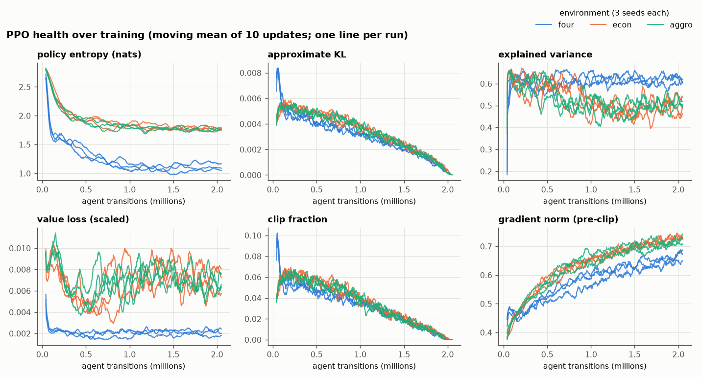
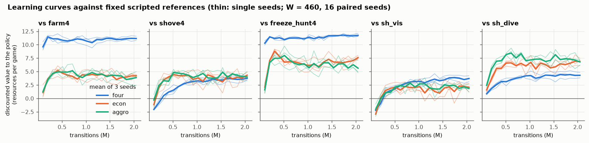
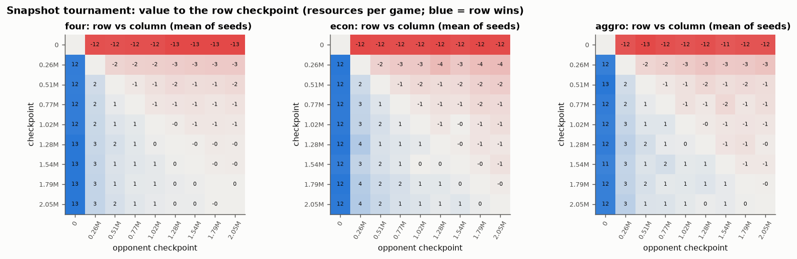
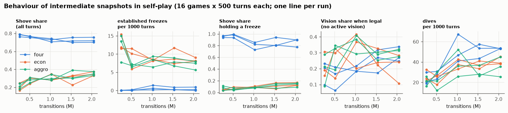
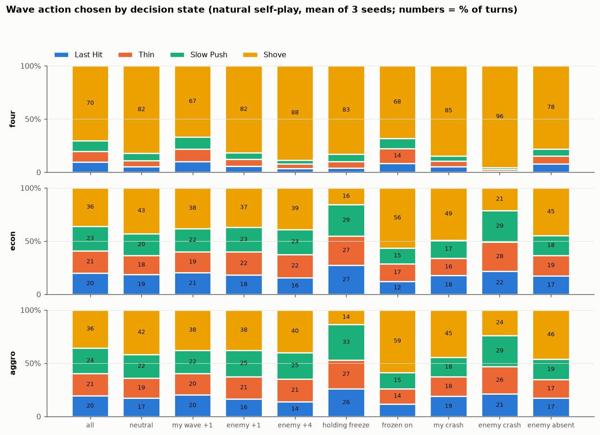
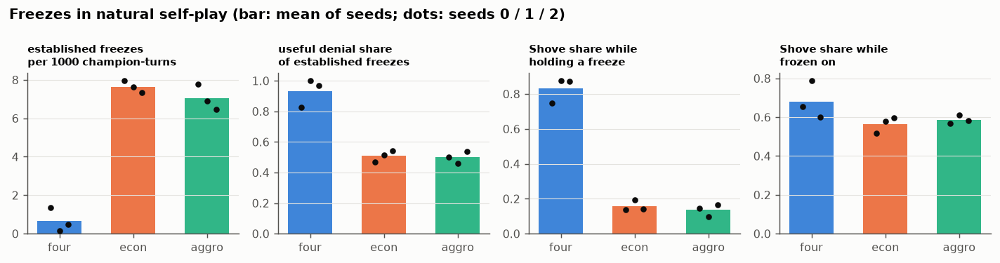
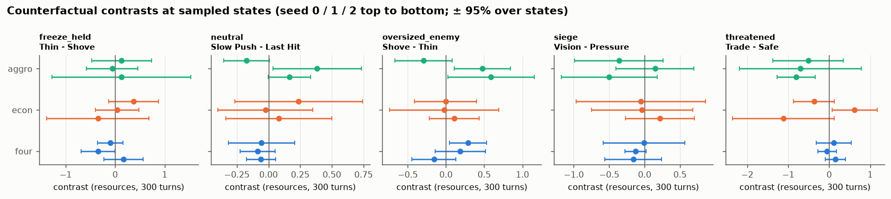

# M4.4b — Controlled PPO Self-Play Training and Initial Strategic Evaluation

*2026-10-13. Branch `main` (working tree on f931ae8 with the uncommitted M4.4a changes; nothing staged or committed).
Empirical study only: **no game rule, preset, reward, observation, action or PPO hyperparameter was changed** (§11.3).
Generated tables: [`results/m44b/report.md`](../../results/m44b/report.md); figures: `results/m44b/figures/`;
machine-readable results: `results/m44b/*.json(.gz)`; code: `lanegame/experiments/rl/m44/`; checkpoints (git-ignored):
`results/rl/checkpoints/m44/{main,ext}/`. Background: [M4.4a readiness](m4_4a_ppo_readiness.md),
[the PPO pipeline explained](../rl/ppo_training_explained.md), [roadmap](../rl_research_roadmap.md).*

---

## 1. Executive summary

**Question.** Do shared-policy PPO agents discover useful laning strategy from the mechanics and economic incentives of
the three four-action economies — `four` (original), `econ` (calibrated economy) and `aggro` (econ + full tower
retaliation on "busy" dives) — and does what they learn improve their economic outcome?

**What was run.** The pre-registered matrix (3 environments × seeds 0, 1, 2 × 2,048,000 agent transitions, identical
settings, paired initial weights) trained in 13.3 min; the pre-registered evaluation took 50 min. All 81 pipeline
checks passed, re-training at the full budget was bit-identical, and every final loaded with its verified digest.
Supplementary analyses (a snapshot tournament, more opponents, intermediate-snapshot behaviour, integrity checks, a
labelled transfer test, representative games, an interrupted-Recall follow-up) and a matched 2× budget extension were
added and are reported separately from the pre-registered results.

**What we learned (robust across all three seeds unless stated):**

1. **PPO is healthy and every run improved, but "converged" needs care.** Losses, gradients and critic outputs are
   finite and bounded; KL is small throughout. Every final beats its untrained network by +11.8 to +13.0 resources per
   game, beats every one of the ten scripted references, and beats every earlier checkpoint of its own run (no later
   checkpoint lost significantly to an earlier one in 324 pairings: no self-play cycling). Strength against fixed
   references is flat from ≈ 1M transitions. **Behaviour is not flat**: in `econ` and `aggro` the Shove share rose in
   every run from ≈ 20% at 0.26M to ≈ 35% at 2.05M, and was still rising over the last 0.5M in 5 of 6 runs, while the
   annealed learning rate makes the end of every run look stable by construction (§3, §4). A matched 2× extension
   (4,096,000 transitions, otherwise identical) is stronger still (+0.6 to +1.5 resources against the same seed's
   2.05M final, every run), but the aggregate Shove share stays at ≈ 35% (no collapse toward Shove), freezes deny
   more often (61–64%) and Vision is used more (38–43%): the qualitative profile is stable, the quantitative
   details are budget-dependent (§4.6).
2. **The economies produce different policies, and each economy rewards its own.** `four` Shoves 70% of the time in
   every lane state (83% even while holding its own freeze), replicating M4.3c. `econ` / `aggro` Shove 36% and
   condition on the lane: 14–16% while holding a freeze, 56–59% when frozen on, 21–24% when the enemy has crashed under
   their tower. In a labelled transfer test the `four` finals lose by 4.6–6.2 resources to the native finals in
   `econ` / `aggro`, and the `econ` / `aggro` finals lose by 7.7–8.6 in `four`, where `shove4` beats them: Shove
   dominance is a property of the `four` economy (M4.3c's outcome C), and the calibration removes it (§5.1, §8).
3. **Freezes emerge in the calibrated economies, but they are short and deny little.** 7.0–7.6 established freezes per
   1000 champion-turns (`four`: 0.66, ranging 0.14–1.36 by seed); mean length 5.5 turns; the freezer out-earns the
   frozen-on side in only ≈ 50% of episodes (61–64% at the 2× budget), by +0.5 resources and 3.7 XP on average. The
   freezer *acts* to preserve
   (Last Hit / Thin 55–57% of held turns, Shove 14–16%) and the frozen-on side *acts* to break (Shove 56–59%; it
   Shoved on the last two held turns of 70–72% of episodes). The pre-registered counterfactual finds no measurable value
   difference between Thin and Shove while holding a freeze (§5.2, §6).
4. **The tower-aggro correction does exactly what it targets and nothing else measurable.** Busy dives fall from 7.8
   to 3.1 per 1000 champion-turns (every `aggro` seed below every `econ` seed; busy share 18% → 8%), and the dived side
   Recalls more often on the dive turn (39% → 49%). Total dives, deaths, freezes, wave control, strength against the
   references and cross-environment play are indistinguishable between `econ` and `aggro` (§5.4, §8).
5. **Conditional defence exists; active zoning does not.** Natural power gaps are essentially absent (0–1% of turns).
   In the *initialized* ×1.76 power-gap scenario the weaker `econ` / `aggro` policy concedes (Safe 23% + Yield 27–29%
   of threatened turns versus Safe 4% for `four`), and in `aggro` the counterfactual confirms that Trading under a
   credible threat costs −0.67 [−1.04, −0.30] resources against Safe on every seed. The stronger side neither trades
   more nor causes extra uncollected gold: it does not convert the advantage (§5.5, §6).
6. **Vision is used, conditionally on the plate phase, but "Vision before extended pressure" is rare.** `four` switches
   from Pressure (96%) to Vision (57%) once the enemy plates are gone; `econ` / `aggro` use Vision on 24–34% of siege
   turns. Vision cuts the gank probability of a forward turn from 0.13 to 0.035, yet only 17–27% of the few ≥ 3-turn
   Pressure runs start with vision, and the one-turn Vision-versus-Pressure counterfactual is null (§5.3, §6).
7. **Counterfactuals are mostly inconclusive at the pre-registered power.** Four of the five situations give seed-mean contrasts
   within ±0.3 resources of zero in every environment (one tiny exception: Slow Push −0.07 in `four`); only
   `aggro`'s threatened contrast replicates. The critic's one-step sign agrees with the measurement about as often as chance (53% of states) (§6).
8. **A recurring, possibly inferior behaviour**: 22–38% of chosen Recalls are interrupted by an enemy Trade (at ≈ 28%
   HP), after which the champion dies within 3 turns 29–50% of the time; the policy still puts 70–80% of its mass on
   Recall there (§7, §9).

**Recommendation: CONDITIONAL GO** for M4.4c (§10). Retain `m4_four_actions_econ_aggro()` as the primary research
candidate with `econ` as its dive control; analyse the 4.10M extension finals as the primary checkpoints with the
2.05M finals as a replication; no reward or rule change is indicated.

---

## 2. Experimental setup

### 2.1 Environments

| key | preset | differs from the row above in | role |
|---|---|---|---|
| `four` | `GameConfig.m4_four_actions()` | — | control: the original four-action economy (M4.3c), where scripted analysis found Shove to be every side's best reply |
| `econ` | `GameConfig.m4_four_actions_econ()` | `collect_contest_own_tower` 0.6 → 0.8, `trade_farm_factor` 0.5 → 0.8, `kill_bounty` 0.5 → 2.0, `death_turns_by_level` constant → 3 / 4 / 5 turns by level band, `champion_absent_max` 3 → 5 | the calibrated economic candidate (M4.3c stabilization) |
| `aggro` | `GameConfig.m4_four_actions_econ_aggro()` | `tower_shot_p_busy` 0.5 → 1.0, `tower_adjacent_p_busy` 0.25 → 0.5 | econ + full tower retaliation on "busy" dives (M4.3d); the candidate for substantial training |

All three: 88-feature observation, 61 action codes (34 ever legal), state-dependent masks, γ = 0.99, continuing time
(no terminal state), zero-sum per-turn reward = the discounted gold lead.

### 2.2 Training

| setting | value (identical in every environment; equal to `results/m44a/m44b_plan.json`, checked before launch) |
|---|---|
| algorithm | PPO (`lanegame.rl.train_shared`): clipped surrogate 0.2, clipped value loss 0.5, 4 epochs, minibatch 256, Adam 3·10⁻⁴ annealed linearly to 0, max gradient norm 0.5, advantage normalization, reward scale 0.1 |
| self-play | one shared network plays both seats from its own perspective; 100% current-policy games; both seats' transitions trained |
| entropy coefficient | 0.03 (the M4.3b `ent03` condition) |
| γ / GAE λ | 0.99 (the game's) / 0.95 |
| rollout | 16 environments × 128-turn segments × 2 seats = 4,096 agent transitions per update |
| games | 512 turns with staggered seeded first lengths; truncated and bootstrapped, never terminated |
| network | 88 → 128 → 128 (tanh) → 61 masked logits + value head |
| budget | 2,048,000 agent transitions = 500 updates per run (1,024,000 environment turns); 18,432,000 in total |
| seeds | 0, 1, 2 per environment; a seed fixes the initial weights (`torch.manual_seed(seed)`) and the collector streams (seed + 1): run (env, s) and (env′, s) start from bit-identical weights (digests `dc35805b…`, `14d3cd5d…`, `2785185b…`), and diverge from the first environment interaction |
| snapshots | 80 per run (at the update that crosses each multiple of 25,600 transitions) plus `final.pt` |
| checkpoints | `results/rl/checkpoints/m44/main/<env>_s<seed>/` (git-ignored): `final.pt`, `snapshots/`, `history.jsonl`, `run.json`; full-budget re-runs in `<env>_s0_repeat/` |

### 2.3 Evaluation

| instrument | design | stage |
|---|---|---|
| references | each final vs the ten scripted four-action references (farm4, thin4, slowpush4, shove4, shove_hunt4, freeze_hunt4, grow_crash_recall4, respect4, sh_vis, sh_dive); 32 paired seeds (both seats on one chance stream), discounted window W = 1000 | `eval_main` (pre-registered) |
| cross-play | the three finals of one environment against each other; 32 paired seeds, W = 1000 | `eval_main` |
| history | each final vs 4 of its snapshots and its untrained network; 16 paired seeds, W = 460 | `eval_main` |
| learning curves | every 4th snapshot (20 per run, 0.10M → 2.05M) vs farm4, shove4, freeze_hunt4, sh_vis, sh_dive; 16 paired seeds, W = 460 | `eval_main` |
| behaviour | natural self-play 32 games × 1000 turns (both seats focal); vs farm4, shove4, sh_vis, sh_dive 12 seeds × 1000 turns, both seats; INITIALIZED scripted freeze and ×1.76 power gap, 16 games × 300 turns | `eval_main` |
| counterfactuals | 5 situations × 8 states × 16 paired rollouts × 300 turns per final; opponent protocol `policy`; continuation = the final in both seats | `eval_main` |
| snapshot tournament | 9 checkpoints per run (initial, ≈ 0.26 / 0.51 / 0.77 / 1.02 / 1.28 / 1.54 / 1.79M, final): all 36 pairs, 16 paired seeds, W = 460 | `extra_main` (added) |
| more opponents | thin4, freeze_hunt4, respect4: 12 seeds × 1000 turns, both seats | `extra_main` (added) |
| snapshot behaviour | self-play of the ≈ 0.26 / 0.51 / 1.02 / 1.54M snapshots and the final, 16 games × 500 turns | `extra_main` (added) |
| integrity | finite logits / values, \|V\| ≤ Ω, zero mass on masked codes, antisymmetric rewards: 4 self-play games × 500 turns per final | `extra_main` (added) |
| transfer test | each final in the two other environments (explicit `cross_env=True`) vs the native final of the same seed and vs shove4 / farm4; 16 paired seeds, W = 460 | `extra_main` (added; labelled) |
| representative games | pre-registered: self-play and vs shove4 per final (460 turns); added: a state-defined search over 24 self-play games and 12 ×1.76-gap games of each seed-0 final, one exported game per situation | `eval_main`, `traces_main` |
| interrupted Recalls | chosen Recalls, their interruption and what follows; the first 8 of the 32 behaviour games per final | `recall_main` (added) |
| 2× extension | the same 9 runs at 4,096,000 transitions and a pre-defined reduced evaluation | `train_ext`, `eval_ext` (added; §4.6) |

**Units of replication.** Between-environment claims treat the **three training seeds** as the replicates: tables
show "s0 / s1 / s2 (mean [t interval, 2 df, t = 4.30])". Intervals inside one seed (paired evaluation seeds,
counterfactual states) describe one trained network, not the training procedure. With three seeds, only large and
consistent differences can be called robust; "every seed of A beyond every seed of B" is used as the plain-language
criterion where intervals are wide.

**Seeds and contamination.** Training uses torch / numpy seeds 0–3. Every evaluation stream derives from SeedSequence
roots 80,000–80,999 (behaviour 80,000–80,002; scenarios 80,100; counterfactual states 80,200–80,240, rollouts
80,300–80,340; references 80,400–80,401; traces 80,500, search 80,510–80,561 as integer viewer seeds; cross-play,
history, tournament, transfer 80,600–80,603; integrity 80,750). Training never reads evaluation data; evaluation never
updates a network.

**Compute (this machine: 12 logical CPUs, Windows, Python 3.13.9, torch 2.14.1 CPU, one thread per process).**

| stage | wall clock | notes |
|---|---|---|
| `train_main` | 13.3 min | 9 processes; 2,603–3,045 agent transitions/s per process, 23,140/s aggregate; ≈ 1.9 CPU-hours |
| `eval_main` | 50.4 min | 9 workers (shared the machine with `repro_main` for its first 14 min); strength 33 min, behaviour + counterfactuals + traces 17 min |
| `repro_main` | 13.9 min | 3 runs at the full budget, 3 workers |
| `extra_main` | 41.8 min | 3 workers, concurrently with `eval_main` |
| `traces_main`, `recall_main` | 0.5 min, 0.4 min | |
| `train_ext`, `eval_ext` | 33.6 min, 14.3 min | 9 processes (sharing the machine with the 19-min regression suite); 11 workers |

---

## 3. PPO training health



| | `four` | `econ` | `aggro` |
|---|---|---|---|
| pipeline checks (finite, bounded critic, gradients, KL, both seats, budget, no termination) | 27 / 27 | 27 / 27 | 27 / 27 |
| entropy, start → last 10 updates (nats) | 2.85 → 1.05–1.17 | 2.85 → 1.75–1.78 | 2.85 → 1.76–1.79 |
| explained variance, last 10 updates | 0.60–0.62 | 0.46–0.54 | 0.50–0.52 |
| approximate KL, mean / max | 0.0030–0.0031 / 0.010–0.011 | 0.0033–0.0034 / 0.007 | 0.0033 / 0.007 |
| pre-clip gradient norm, max | 1.53–1.70 | 1.62–1.78 | 1.75–1.81 |
| V(s0), a symmetric state worth exactly 0 | +0.19 / −0.01 / −0.04 | +0.10 / +0.38 / +0.02 | −0.25 / +0.21 / +0.30 |
| integrity: \|V\| max / return bound Ω over 4,000 self-play observations | 2.6–2.8 / 107 | 4.0–4.4 / 145 | 3.6–4.1 / 145 |

* **Stability.** No non-finite loss, gradient, logit or value in any run or evaluation; no mass on a masked code
  (4,000 observations per final); rewards antisymmetric on every turn; every action legal (`LaneEnv.step` raises on an
  illegal code and every game completed). The largest |V| over training (13.5–15.5 resources) occurs at the untrained
  network in update 1; trained critics stay below 5.
* **Entropy.** `four` collapses quickly (below 1.7 nats within 0.1M) and settles near 1.1 nats; `econ` / `aggro` settle near
  1.75 nats, a much more mixed policy. Lower entropy is not evidence of better play: `four`'s low entropy is mostly a
  committed Shove (§5.1).
* **KL and clipping.** Both fall roughly linearly to ≈ 0 at the end of every run, tracking the learning-rate schedule
  (3·10⁻⁴ → 6·10⁻⁷). Late "stability" in these quantities is therefore guaranteed by the schedule and says nothing on
  its own about convergence.
* **Gradient norm** rises through training (0.4 → 0.65–0.75 pre-clip) and exceeds the 0.5 clipping threshold in the
  second half of every run, so late updates are norm-clipped. Normal for PPO with an entropy bonus; no spikes.
* **Critic.** Explained variance settles at 0.6 in `four` and 0.5 in `econ` / `aggro`, whose returns are about twice as
  variable (seat-A training-return standard deviation 4.8–5.7 vs 2.4: kill bounty 2.0 and longer deaths). |V(s0)| ≤ 0.38
  everywhere: the critic knows the symmetric start is worth ≈ 0.
* **Reproducibility.** Re-training `four_s0`, `econ_s0` and `aggro_s0` at the full budget gave identical weights
  digests (`1d469594…`, `1cb17645…`, `f7d0b0e5…`) and identical histories in every field except wall-clock time.

**No run is unhealthy.** The differences between environments are what the economies imply, not optimization failures.

---

## 4. Policy strength and convergence

### 4.1 Final versus initial, earlier checkpoints and scripted references

| | `four` | `econ` | `aggro` |
|---|---|---|---|
| final vs its untrained network (W = 460) | +11.9 to +12.3 | +12.1 to +13.0 | +11.8 to +12.5 |
| final vs its 28,672-transition snapshot | +8.8 to +9.5 | +11.0 to +13.2 | +9.8 to +11.7 |
| final vs its 0.69M snapshot | +0.8 to +1.6 | +0.6 to +1.8 | +1.0 to +1.8 |
| final vs its 2.02M snapshot | −0.2 to 0.0 (n.s.) | −0.4 to +0.1 (n.s.) | 0.0 to +0.5 (n.s.) |
| cross-play between seeds (6 pairs; value to the first) | +0.54 ± 0.35, +0.16, −0.23 | +0.11, +0.76 ± 0.56, +0.03 | +0.08, −0.08, −0.09 |

Against the ten references (W = 1000, 32 paired seeds; mean of the three seeds with the t interval):

| reference | `four` | `econ` | `aggro` |
|---|---|---|---|
| farm4 (Last Hit, Hold) | +11.62 [+10.45, +12.80] | +4.27 [+3.48, +5.07] | +4.48 [+1.32, +7.64] |
| thin4 (freeze keeper) | +9.38 [+8.77, +10.00] | +5.85 [+4.72, +6.97] | +5.33 [+0.84, +9.81] |
| slowpush4 | +9.24 [+8.57, +9.92] | +4.42 [+4.39, +4.45] | +4.09 [+0.56, +7.61] |
| shove4 | +3.65 [+2.02, +5.27] | +3.19 [+1.33, +5.06] | +3.50 [+1.62, +5.37] |
| shove_hunt4 | +6.58 [+5.28, +7.88] | +4.49 [+2.08, +6.90] | +4.17 [+1.11, +7.24] |
| freeze_hunt4 | +11.83 [+11.35, +12.30] | +7.21 [+6.13, +8.29] | +6.36 [+4.59, +8.12] |
| grow_crash_recall4 | +9.14 [+8.57, +9.71] | +5.40 [+3.81, +7.00] | +5.10 [+0.82, +9.37] |
| respect4 (concedes) | +10.88 [+9.73, +12.02] | +3.50 [+3.18, +3.83] | +3.66 [+1.65, +5.67] |
| sh_vis (Shove, Vision then Pressure) | +3.65 [+2.21, +5.10] | +2.25 [+0.52, +3.98] | +2.10 [+1.35, +2.86] |
| sh_dive (Shove, dives a tower farmer) | +4.39 [+2.54, +6.23] | +7.19 [+6.31, +8.06] | +7.06 [+5.35, +8.78] |

Every final beats every reference on every seed. Values are **not comparable across columns**: each economy pays out
differently (in `four` a passive farmer is worth much less, so beating farm4 by 11.6 is not "three times better" than
beating it by 4.3 in `econ`). Within `aggro`, seed 0 stands out: weaker against the passive references (farm4 +3.05
versus +5.48 / +4.92) and stronger against Shove (+4.36 versus +3.17 / +2.96), the largest seed difference in the study.

### 4.2 Learning curves



* `four` reaches its level against farm4 and freeze_hunt4 within 0.2M transitions; its value against the Shove-type
  references keeps rising until ≈ 1M. Over the last 0.8M (8 curve points) all 15 run × reference slopes are flat
  except one (four_s2 vs freeze_hunt4, +1.5 / M).
* `econ` / `aggro` rise until ≈ 0.3–0.5M and are flat afterwards on average (slopes by environment and reference
  between −1.1 and +1.4 resources per million, every t interval covering 0). Individual curves move by ±1–2 resources
  between points; per-run slopes have mixed signs (3 "falling", 2 "rising" of 30 tests, roughly the false-positive
  rate). Against freeze_hunt4 the value peaks near 0.3M (+9) and settles at +6.5 to +7.5: self-play drifts slightly away
  from what beats this fixed opponent best.

### 4.3 Snapshot tournament: persistent improvement, no cycling



In every run the later checkpoint has a positive value against the earlier one in 32–36 of 36 pairs, and **no later
checkpoint loses significantly to any earlier one** (0 of 324 pairs). The final beats its 0.26M snapshot by +2.1 to
+4.1 and its 1.02M snapshot by −0.1 to +1.4, and is indistinguishable from its 1.79M snapshot (−0.32 to +0.52, every
interval covering 0). Improvement against the policy's own past continued, with diminishing returns, until ≈ 1.5M;
there is no sign of rock-paper-scissors cycling.

### 4.4 Behaviour over training: not converged



| run | Shove share at 0.26 / 0.51 / 1.02 / 1.54 / 2.05M | Shove while holding a freeze, same points | established freezes per 1000, same points |
|---|---|---|---|
| econ_s0 | 0.17 / 0.24 / 0.35 / 0.23 / 0.33 | 0.04 / 0.05 / 0.09 / 0.06 / 0.12 | 11.5 / 11.5 / 8.3 / 11.7 / 9.1 |
| econ_s1 | 0.25 / 0.30 / 0.28 / 0.33 / 0.37 | 0.05 / 0.06 / 0.11 / 0.16 / 0.17 | 11.9 / 10.1 / 8.6 / 7.4 / 8.1 |
| econ_s2 | 0.19 / 0.31 / 0.28 / 0.32 / 0.35 | 0.05 / 0.09 / 0.09 / 0.11 / 0.13 | 15.4 / 5.9 / 8.1 / 8.6 / 8.1 |
| aggro_s0 | 0.24 / 0.28 / 0.30 / 0.30 / 0.35 | 0.11 / 0.07 / 0.09 / 0.15 / 0.16 | 7.8 / 6.8 / 9.4 / 8.9 / 7.9 |
| aggro_s1 | 0.18 / 0.25 / 0.34 / 0.30 / 0.33 | 0.08 / 0.04 / 0.08 / 0.07 / 0.09 | 15.0 / 7.2 / 6.4 / 7.8 / 7.5 |
| aggro_s2 | 0.21 / 0.31 / 0.28 / 0.39 / 0.38 | 0.03 / 0.05 / 0.08 / 0.13 / 0.15 | 13.5 / 6.4 / 8.5 / 6.8 / 5.6 |
| `four` (3 runs) | 0.76–0.79 → 0.70–0.76 | 0.94–0.99 → 0.78–0.90 | 0.0–1.4 throughout |

(16 games × 500 turns per point; the 2.05M point re-measures the final at this size.) In `econ` / `aggro` the Shove
share rises from ≈ 20% to ≈ 35% in every run, Shove while holding a freeze roughly doubles, established freezes fall
from 8–15 to 6–9 per 1000 turns and dives rise from 16–33 to 25–45 per 1000. Five of six runs were still Shoving more
at 2.05M than at 1.54M. **The strength plateau (§4.2) and the behaviour drift coexist**: the policy keeps moving toward
more Shove without becoming measurably stronger against fixed opponents, while staying at least as strong as its past.

### 4.5 Convergence assessment

| question | evidence | verdict |
|---|---|---|
| still improving against fixed references? | flat slopes over the last 0.8M (§4.2) | **no**: plateaued at this evaluation's resolution (≈ ±1 resource per point in `econ` / `aggro`) |
| regressing against earlier strategies / cycling? | 0 of 324 tournament pairs (§4.3) | **no** |
| behaviour stable? | Shove share, freeze rate and dives still trending in `econ` / `aggro` (§4.4) | **no** |
| seed-to-seed differences? | strength similar except aggro_s0 (§4.1); behaviour trends shared by all seeds | moderate, one outlier seed |
| optimization the cause? | KL, gradients, critic healthy (§3) | **no** |
| evaluation noise the cause? | the drift is monotone over five points in most runs | **no** |
| does more training still help? (matched 2× extension, §4.6) | 4.10M finals beat the 2.05M finals by +0.6 to +1.5 head-to-head (every run); aggregate Shove share unchanged (≈ 35%) | **yes, head-to-head**; the aggregate behaviour drift stops |

**Diagnosis:** inadequate training time, masked by the learning-rate annealing that forces every run to stop changing at
2.05M. This is what the training-extension policy addresses (§4.6).

### 4.6 Matched 2× budget extension

**Why.** §4.5 found the strength plateaued but the behaviour still moving, with the annealed learning rate forcing
every run to stop at 2.05M. The training-extension policy allows a modest, matched extension: the same 9 runs
(environments, seeds and therefore initial weights, every PPO setting) at **4,096,000** transitions (1,000 updates; the
learning rate now anneals over the longer run), in a separate directory (`results/rl/checkpoints/m44/ext/`), with a
reduced evaluation fixed before it ran (`eval_ext`: references and head-to-head at W = 1000 with 32 paired seeds, a
short curve against the core references, self-play behaviour on the same 32 × 1000-turn seeds). The 2,048,000 results
above are untouched and remain the pre-registered result; the two budgets are reported separately.

**Training.** 81 / 81 pipeline and 27 / 27 learning checks; exactly 4,096,000 transitions per run; identical initial
digests per seed; entropy at the end 0.97–1.08 (`four`), 1.68–1.75 (`econ`), 1.71–1.74 (`aggro`), slightly below the
2.05M runs; explained variance 0.47–0.63; |V(s0)| ≤ 0.42. 33.6 min wall clock (9 processes, sharing the machine with the
regression suite); evaluation 14.3 min.

| | `four` | `econ` | `aggro` |
|---|---|---|---|
| **4.10M final vs the 2.05M final of the same seed** (W = 1000, 32 paired seeds) | +0.71 / +1.17 / +1.08 (+0.99 [+0.37, +1.60]) | +1.05 / +0.62 / +1.54 (+1.07 [−0.07, +2.21]) | +1.45 / +1.13 / +0.95 (+1.18 [+0.55, +1.81]) |
| 4.10M final vs its own 2.05M snapshot (W = 460, 16) | +0.83 / +0.51 / +0.66 | +0.49 / +0.33 / +0.45 | +0.56 / +0.48 / +1.41 |
| against the ten references: change of the seed mean | −0.2 to +0.6 (none beyond the seed spread) | −0.7 to +2.1; largest against shove4 (+1.6, every seed up) and shove_hunt4 (+2.1) | −0.4 to +1.3; freeze_hunt4 +1.0 (every seed up) |

Natural self-play behaviour of the finals, 2.05M → 4.10M (seed means; the same 32 × 1000-turn seeds; per-seed values in
the generated report §13.4):

| measure | `four` | `econ` | `aggro` |
|---|---|---|---|
| Shove share, all turns | 70% → 68% | **36% → 36%** | **36% → 34%** |
| Shove while holding a freeze | 83% → 91% | 16% → 22% (every seed up) | 14% → 23% (every seed up) |
| Shove while frozen on | 68% → 69% | 56% → 52% | 59% → 50% |
| Shove with an enemy crash under my tower | 96% → 77% | 21% → 21% | 24% → 18% |
| established freezes per 1000 | 0.66 → 0.42 | 7.6 → 8.5 | 7.0 → 8.2 |
| useful denial of established freezes | 93% → 90% | **51% → 61%** (every seed up) | **50% → 64%** (every seed up) |
| Vision when legal (no active vision) | 41% → 44% | **24% → 38%** (every seed up) | 34% → 43% |
| dives / busy dives per 1000 | 53 / 9.0 → 55 / 9.2 | 44 / 7.8 → 52 / 7.6 | 38 / 3.1 → 41 / 2.7 |
| deaths per 1000 | 18.0 → 20.3 | 8.8 → 8.7 | 8.4 → 8.1 |

**Reading.**

1. **The 2.05M policies had not converged in strength**: doubling the budget gives a policy that beats the same seed's
   2.05M final by about one resource per game in every run, while changing values against the fixed references only
   within (mostly) their resolution. Improvement shows up head-to-head before it shows up against scripted opponents.
2. **The aggregate Shove drift stops.** The calibrated policies Shove ≈ 35% at both budgets (snapshots of the extension
   runs fluctuate between 0.25 and 0.42 from 1M on): no collapse toward Shove dominance.
3. **Some conditional behaviour keeps changing.** The freezer Shoves its own freeze more (22–23%), the frozen-on side a
   little less (50–52%): the preserve / break contrast narrows from ≈ 40–45 to ≈ 27–30 points but remains large. At the
   same time freezes deny more often (61–64%) and Vision is used more (38–43%). More training sharpened some
   economically sensible choices and weakened another; none of the qualitative findings of §5 reverses.
4. **The econ–aggro busy-dive difference persists** (every `aggro` seed again below every `econ` seed: 1.9–3.8 versus
   6.5–8.8 per 1000), and the `aggro` seed-0 outlier of §4.1 disappears at 4.10M (farm4 +3.87 / +4.17 / +4.10).

**Assessment.** At 4.10M the qualitative strategic profile is stable (the same conclusions as at 2.05M), but the
quantitative details are budget-dependent and head-to-head strength still grows. A larger redesign is not needed; see
§10 for how M4.4c should use the two budgets.

---

## 5. Strategic behaviour

All numbers are natural self-play of the finals (32 games × 1000 turns, both seats focal: 64,000 champion-turns per
final) unless labelled INITIALIZED; full tables in `results/m44b/report.md` §6–§9b.

### 5.1 Wave management by lane state



| state (focal side, start of the turn) | `four` LH / TN / SL / SH | `econ` LH / TN / SL / SH | `aggro` LH / TN / SL / SH |
|---|---|---|---|
| all present turns | 10 / 10 / 10 / **70** | 20 / 21 / 23 / **36** | 20 / 21 / 24 / **36** |
| neutral (fronts meet at the lane cell) | 5 / 6 / 7 / 82 | 19 / 18 / 20 / 43 | 17 / 19 / 22 / 42 |
| my wave stronger (+1) | 10 / 11 / 11 / 67 | 21 / 19 / 22 / 38 | 20 / 20 / 22 / 38 |
| enemy wave stronger (+1) | 6 / 6 / 6 / 82 | 18 / 22 / 23 / 37 | 16 / 21 / 25 / 38 |
| enemy wave much stronger (+4) | 4 / 4 / 4 / 88 | 16 / 22 / 23 / 39 | 14 / 21 / 25 / 40 |
| **holding a freeze** | 4 / 6 / 7 / **83** | 27 / 27 / 29 / **16** | 26 / 27 / 33 / **14** |
| **frozen on** | 9 / 14 / 10 / 68 | 12 / 17 / 15 / **56** | 12 / 14 / 15 / **59** |
| my crash under the enemy tower | 5 / 6 / 5 / 85 | 18 / 16 / 17 / 49 | 19 / 18 / 18 / 45 |
| **enemy crash under my tower** | 1 / 2 / 2 / **96** | 22 / 28 / 29 / **21** | 21 / 26 / 29 / **24** |
| enemy champion absent | 8 / 7 / 7 / 78 | 17 / 19 / 18 / 45 | 17 / 17 / 19 / 46 |

(% of turns, mean of the three seeds; per-seed Shove shares in the generated report §6.3 agree within a few points:
holding a freeze `econ` 14 / 19 / 14%, `aggro` 15 / 10 / 17%; frozen on `econ` 52 / 58 / 60%, `aggro` 57 / 61 / 58%.)

* **Comparison A (`four` vs `econ`).** The calibrated economy turns a near-constant Shove (70%, ≥ 67% in every state)
  into a conditional one (36%, from 14% to 59% depending on the state). The conditioning is on *where the waves are*
  (freeze, crash under my tower, frozen on), the situations in which the M4.3c / M4.3d scripted analysis predicted
  that Shove is wrong (holding a freeze, defending an enemy crash) or right (being frozen on). All three seeds agree.
* **What is not conditional.** The window-strength classes barely move the choice in `econ` / `aggro` (Shove 37–40%
  whether my wave or the enemy's is stronger; an oversized enemy wave does not raise Thin or Shove), and away from
  Shove the three other actions are chosen almost uniformly (≈ 20% each). The policies distinguish Shove from
  not-Shove much more than they distinguish Last Hit, Thin and Slow Push.
* **Intent versus effect** (neutral lane, 4 turns later): in `econ` / `aggro` a Shove moves the meeting point toward the
  enemy in 48–50% of cases versus 25–27% for each other action; **Slow Push produces a window-strength lead no more
  often than Last Hit** (44–46% versus 44–45%). A chosen Slow Push is not a slow push: the opponent's simultaneous
  actions decide (as in M4.4a's demonstration).
* **Plates.** `four` Shoves 82% while enemy plates remain and 68% after; `econ` / `aggro` Shove 34–36% in both phases.
  Pressure, not Shove, carries the plate response (§5.3). Enemy plates are exhausted at a median turn of 125–154 in every
  run, so 83–86% of evaluation turns are in the exhausted phase.
* **Reply to a repeated opponent pattern.** After the opponent Shoved three turns in a row, `econ` / `aggro` Shove
  *less* (29–31% versus 36%); after it Thinned or Last-Hit three in a row, they Shove *more* (39–46%). Plausible as a
  response (a Thinning opponent is usually holding a freeze on me), but it is confounded with the lane state and is not
  claimed as adaptation.
* **Crashes.** `econ` / `aggro` crash more often than `four` (11.9–12.5 versus 8.3 per 100 turns) despite Shoving half as
  much: when both sides Shove, the waves cancel at the lane cell; asymmetric choices let one wave through.

### 5.2 Freezes



| (state-based definition of M4.4a §4.2) | `four` | `econ` | `aggro` |
|---|---|---|---|
| established freezes (≥ 4 turns) per 1000 champion-turns | 1.36 / 0.14 / 0.48 | 7.95 / 7.64 / 7.33 | 7.78 / 6.89 / 6.45 |
| share of turns in the freeze state (each side) | 3.7–4.8% | 9.8–10.2% | 8.4–9.3% |
| episodes (n); sustained ≥ 10 turns | 127; 0 | 1,467; 67 | 1,352; 59 |
| mean length (p90) | 4.4–5.1 (5–7) | 5.5–5.7 (8) | 5.4–5.7 (7–8) |
| **useful denial** (freezer out-earned the frozen-on side) | 93% [70%, 116%] | **51% [41%, 60%]** | **50% [40%, 60%]** |
| freezer's gold lead during the episode (resources) | +1.81 | +0.51 [+0.15, +0.86] | +0.57 [+0.22, +0.93] |
| frozen-on XP lost for good per episode | 5.6 | 3.7 | 3.7 |
| freezer's gold lead in the 20 turns after | −0.27 | +0.53 [+0.13, +0.93] | +0.36 [−0.29, +1.01] |
| freezer Last Hit / Thin share while holding | 29% | 57% | 55% |
| freezer Shoved on its last 2 held turns | 93% | 40% | 36% |
| frozen-on side Shoved on the last 2 held turns | 60% | 72% | 70% |
| end: crashed in / pushed out / own wave died / contact lost | 6 / 36 / 9 / 47% | 24 / 17 / 25 / 35% | 21 / 18 / 26 / 35% |
| freezer's power class at the start | even 127 of 127 | even 1,462 of 1,467 | even 1,336 of 1,352 |

* **Do freezes emerge?** Yes in `econ` / `aggro` (≈ 10× `four`'s rate, consistent across seeds). They are a natural
  part of play between equally strong champions, not a power-advantage strategy (only 21 of 2,819 episodes started with
  a power class other than "even").
* **Do they deny resources?** Weakly. On average the freezer gains +0.5 resources and the frozen-on side loses 3.7 XP
  per episode (with ≈ 0.4 resources per turn of income, +0.5 over 5.5 turns is a modest edge), and half of the
  established episodes deny nothing. **Persistence is not success**: the 93% "useful denial" in `four` comes from 127
  episodes that occur mostly when the opponent is low on HP or away (§7.1), not from deliberate freezing.
* **Preserving versus breaking.** The `econ` / `aggro` freezer keeps the wave with Last Hit / Thin on 55–57% of held
  turns and Shoves its own freeze away on its last two turns in only 36–40% of episodes (`four`: 93%). The frozen-on
  side breaks it: Shove 56–59% while frozen on, and 70–72% of episodes end with it having Shoved. 21–24% end with the
  held wave crashing in, i.e. the frozen-on side succeeded in pushing through.
* **Against scripted freezers** (supplementary; 12 seeds × 1000 turns, both seats): frozen on by thin4 or
  freeze_hunt4, `econ` / `aggro` Shove 44–54% (`four` 87–88%); when they hold a freeze against these opponents, their
  own freezes deny in 94–96% of episodes, and 99–100% against the conceding respect4. Freezes against a passive
  scripted opponent deny reliably; in self-play the opponent breaks them.
* **INITIALIZED freeze** (the M4.3c scripted outside-tower freeze start, 16 games × 300 turns, reported separately):
  the same picture: Shove while holding 15% (`econ` / `aggro`) vs 86% (`four`), useful denial 49–52% vs 93%.

### 5.3 Vision and tower pressure

| | `four` | `econ` | `aggro` |
|---|---|---|---|
| Pressure / Vision on siege turns, enemy plates **left** | 96% / 3% | 60% / 12% | 57% / 15% |
| Pressure / Vision on siege turns, plates **exhausted** | 39% / 57% | 27% / 25% | 21% / 34% |
| Vision when legal and no vision active (all phases) | 41% [30%, 51%] | 24% [5%, 42%] | 34% [26%, 43%] |
| ≥ 3-turn Pressure runs per 32 games; share starting with vision | 5–9; 0% | 15–34; 17% | 9–21; 27% |
| gank probability of a forward turn, without / with vision | 0.146 / 0.036 | 0.130 / 0.035 | 0.130 / 0.034 |
| death rate of a forward turn, without / with vision | 0.024 / 0.022 | 0.009 / 0.004 | 0.009 / 0.003 |
| ganks per 1000 champion-turns | 74 | 62 | 61 |
| Vision when legal against shove4 / sh_vis / sh_dive (both seats) | 26–47% | 23–37% | **43–49%** |

* **Is Vision learned?** It is chosen, and conditionally: every environment shifts from Pressure toward Vision once the
  enemy plates are gone (`four` most strongly), and Vision is used on a quarter to a third of siege turns in the
  calibrated economies. Vision does what the mechanics say (gank probability ÷ 4 on forward turns).
* **Vision before extended pressure** is rare: long Pressure runs are themselves rare (Pressure is mostly 1–2 turns
  per crash), and only 17–27% of them start with vision in `econ` / `aggro`. The representative game in §7.5 shows the
  ideal sequence; it was found once in 24 games.
* Against the scripted shovers, `aggro` uses Vision more than `econ` on every seed (43–49% versus 23–37%), the one
  vision difference between the two calibrated economies; in self-play the difference is within the seed spread.

### 5.4 Tower dives: `econ` versus `aggro` (Comparison B)

| per 1000 champion-turns | `four` | `econ` | `aggro` |
|---|---|---|---|
| dives (a connected trade ending in the enemy tower cell) | 53.2 [46.2, 60.3] | 44.1 [33.5, 54.8] | 38.0 [19.9, 56.1] |
| **busy dives** (own crash under that tower) | 9.0 | **7.8 (6.6 / 8.6 / 8.1)** | **3.1 (3.5 / 2.1 / 3.7)** |
| busy share of dives | 17% | 18% | 8% |
| tower-adjacent trades | 12.6 | 1.9 | 1.5 |
| tower shot probability on a busy dive (rule) | 0.5 | 0.5 | 1.0 |
| busy dive: diver died within 2 turns / dealt / taken (bars) | 9% / 0.14 / 0.09 | 1% / 0.09 / 0.08 | 2% / 0.08 / 0.12 |
| not-busy dive: diver died within 2 turns | 11% | 5% | 4% |
| dived side's reply on the dive turn: Recall / Trade / Safe / Hold+Yield | 13 / 25 / 1 / 61% | 39 / 24 / 19 / 17% | **49** / 29 / 13 / 9% |
| deaths per 1000 champion-turns | 18.0 | 8.8 | 8.4 |

* `aggro` changes only the busy dives, and the learned policy responds exactly there: **busy dives fall by 60%**, every
  `aggro` seed below every `econ` seed. Busy dives in `aggro` deal less (0.08 vs 0.09 bars) and take more (0.12 vs
  0.08) because the shot now always lands.
* Everything else is indistinguishable: total dives (overlapping intervals), not-busy dives (which every economy
  punishes with a certain shot), deaths, strength, freezes and wave control. In the transfer test (§8) an `econ` final
  plays `aggro` as well as `aggro`'s own final and vice versa (all differences within ±0.7, intervals covering 0).
* As M4.4a predicted from the pilots, busy dives are a minority (8–18%) of learned dives, so a small overall difference
  was the expected result; the targeted measure shows that the policy did learn the corrected price.

### 5.5 Zoning and combat strength

**Natural play** almost never contains a power gap: turns with an attack-power ratio ≥ 1.25 or ≤ 0.8 are 0–1% of
champion-turns in every final (credible-threat turns: 11–81 per 64,000), so natural zoning cannot be measured here.

**INITIALIZED ×1.76 gap** (neutral lane, A with 50 resources invested; self-play of the final, 16 games × 300 turns;
the policies never trained on such a gap, so this measures conditional behaviour in a constructed state, not whether
policies create or keep advantages):

| weaker side under a credible threat | `four` | `econ` | `aggro` |
|---|---|---|---|
| Safe / Yield / Trade | 4 / 18 / 20% | 23 / 27 / 14% | 23 / 29 / 11% |
| mean cell (own coordinates) | +0.21 | −0.15 | −0.26 |
| uncollected gold per turn | 0.096 | 0.117 | 0.119 |
| died / recalled within 4 turns | 23% / 13% | 12% / 12% | 12% / 13% |

| stronger side | `four` | `econ` | `aggro` |
|---|---|---|---|
| trade attempts: stronger vs even turns | 19% vs 36% | 27% vs 30% | 26% vs 27% |
| mean cell: stronger vs even | −0.09 vs −0.70 | −0.35 vs −0.69 | −0.34 vs −0.72 |
| opponent's uncollected gold per turn when stronger and near vs otherwise | 0.13–0.14 vs 0.11–0.13 | 0.13–0.15 vs 0.12–0.13 | 0.12–0.14 vs 0.12–0.13 |

* **The weaker side concedes** in the calibrated economies (half of its threatened turns are Safe or Yield, it stands
  further back and dies half as often as `four`'s weaker side). All three seeds agree (Safe 22–24%).
* **The stronger side does not zone.** It stands a little further forward than at even power but trades no more and
  creates no extra uncollected gold. The representative game in §7.7 shows why in this game: the weaker side keeps
  pushing and even takes plates by alternating Shove + Pressure with Safe, and Safe cuts the stronger side's hit
  chance from ≈ 0.55 to ≈ 0.15 (tower included), so the advantage is hard to cash in.
* In natural play, power never diverges enough for this to matter; the policies do not *create* power gaps (§5.6).

### 5.6 Recalls and investment

| natural self-play, per 1000 champion-turns | `four` | `econ` | `aggro` |
|---|---|---|---|
| low-HP Recalls (≤ 40% HP) / other Recalls | 20.3 / 11.9 | 14.1 / 29.8 | 12.9 / 29.9 |
| HP at a low-HP / other Recall | 20% / 58% | 22% / 65% | 23% / 67% |
| unspent gold at a Recall; bought on return | 7.6; all of it | 7.5; all of it | 7.6; all of it |
| came back with a higher attack-power ratio | 82% | 77–80% | 79–80% |
| opponent's gold lead while away (Recall / death) | 0.46–0.64 / 2.1 | 0.45–0.49 / 2.6 | 0.44–0.50 / 2.7 |
| deaths | 18.0 | 8.8 | 8.4 |

* Policies Recall when damaged (≈ 20% HP) and, in `econ` / `aggro`, more often when healthy (≈ 65% HP) to spend gold;
  every completed Recall converts all unspent gold into investment and returns the champion relatively stronger in
  ≈ 80% of cases, at a cost of ≈ 0.5 resources of opponent lead per Recall versus ≈ 2.6 per death.
* **With an investment lead** (≥ 5 resources ahead) the calibrated policies trade more (33–35% vs 25–27% when behind)
  and concede less (Safe / Yield 40–41% vs 44–46%); collection is higher (61% vs 57%). Consistent across seeds, modest
  in size.
* **Interrupted Recalls** (supplementary follow-up, §7, §9): of the Recalls chosen, 22–38% are interrupted by an enemy
  Trade in contact (`econ` / `aggro` 31–38%); the champion is then at ≈ 28% HP and dies within 3 turns in 39–45% of
  cases (`four` 29–50%). At those states the policy puts 70–80% of its mass on Recall and 4–26% on Safe.

---

## 6. Counterfactuals



Pre-registered protocol (M4.4a §5): per final and situation, 8 states sampled from the final's own natural self-play
(turn ≥ 8), the alternative component forced on the branch turn only, the opponent sampling its own policy from its
own observation with its own stream (identical across candidates: verified in all 359 states), both seats then
continuing with the final, 16 paired rollouts, 300 turns, γ = 0.99. No state was skipped; every intervention was
legal. Contrast = mean over states ± 95% (states as units); "seeds" = the mean of the three per-seed means with the t
interval.

| situation (contrast) | policy mass on the two sides | `four` | `econ` | `aggro` |
|---|---|---|---|---|
| holding a freeze (Thin − Shove) | `four` 3–14% / 61–91%; `econ`, `aggro` 21–31% / 9–20% | −0.09 [−0.73, +0.55] | +0.02 [−0.88, +0.92] | +0.07 [−0.20, +0.33] |
| neutral lane (Slow Push − Last Hit) | `four` 1–5% / 1–2%; others 12–23% / 7–20% | −0.07 [−0.11, −0.02] | +0.10 [−0.23, +0.43] | +0.12 [−0.57, +0.82] |
| oversized enemy wave (Shove − Thin) | `four` 82–96% / 1–5%; others 23–51% / 15–25% | +0.11 [−0.48, +0.69] | +0.03 [−0.15, +0.21] | +0.26 [−0.94, +1.45] |
| siege (Vision − Pressure) | 10–35% / 23–76% | −0.10 [−0.29, +0.10] | +0.04 [−0.33, +0.41] | −0.24 [−1.09, +0.61] |
| credible threat (Trade − Safe) | `four` 8–26% / 1–5%; `econ` 8–12% / 32–42%; `aggro` 1–6% / 38–49% | +0.07 [−0.20, +0.34] | −0.29 [−2.45, +1.88] | **−0.67 [−1.04, −0.30]** (−0.51 / −0.70 / −0.80) |

* **Freeze held: Thin versus Shove.** No measurable difference in any environment (per-state intervals ±0.3–1.4). The
  `econ` / `aggro` policies prefer Thin, the `four` policies Shove; neither preference is supported or contradicted.
* **Neutral lane: Slow Push versus Last Hit.** Null in `econ` / `aggro`. In `four` Slow Push is very slightly worse
  (−0.07, every seed negative) and the policy almost never plays either there.
* **Oversized enemy wave: Shove versus Thin.** Null everywhere, including `four`, whose policy Shoves there 82–96%: in
  these states Shove is at least not worse.
* **Siege: Vision versus Pressure.** Null as a one-turn objective swap (in `four` dropping the objective altogether
  costs 0.26–0.42, so *some* objective matters there).
* **Credible threat: Trade versus Safe.** In `aggro` Trading costs 0.51–0.80 resources on every seed and the policy
  favours Safe 38–49% to 1–6%: the defensive response is learned and is economically right against this continuation.
  In `econ` the seeds disagree (−0.37, +0.62, −1.12).
* **Critic.** Its one-step predicted contrast has the measured sign in 53% of states on average (range 12–88% per
  cell): the critic is not a usable shortcut for these state-level questions.
* **Power.** One-turn component swaps over 300 turns produce effects of a few tenths of a resource; 8 states × 16
  rollouts resolve ±0.1–1.5 (median ±0.43) per cell. This scorecard can detect only large single-decision effects. It does not show that
  the strategies are worthless; it shows that a single decision rarely matters much in this game.

None of these numbers is an optimality claim: each is the value of one decision under the stated continuation policies
against this opponent.

---

## 7. Representative games

Found by a state-defined search over 24 self-play games (460 turns) and 12 ×1.76-gap games (300 turns) of each seed-0
final, one game per (situation, environment), the highest-scoring candidate (which favours long or extreme episodes).
All 19 recordings replay exactly in the debugger (actions and payoffs verified):
`streamlit run lanegame/viewer/app.py` → "Recorded trajectory" → folder `results/m44b/trajectories`
(files `m44b_<env>_s0_<situation>.json`; the pre-registered `main_<env>_s<seed>_{selfplay,vs_shove4}.json` are there
too). Positions are each side's own coordinates (own tower −2, the lane cell 0, enemy tower +2).

### 7.1 A freeze that denies, and why (`m44b_aggro_s0_freeze_denies.json`, seed 80522, A holds, turns 31–47)

B Recalls at turn 30; its wave keeps walking into A's half and stops at A's −1 next to A's tower: the freeze state. A
holds it for 17 turns with Last Hit / Thin / Slow Push from its tower cell, its own wave growing from +5 to +12 window
strength without moving. B returns at 32, tries to break the freeze with Shoves from the lane cell, gets ganked at 36
(HP 20%), stays in lane and is killed by A at 40 (bounty 2.0), away until 44. A ends the freeze with a Shove at 47.
Episode: A +5.31 gold, +24 XP; B loses 12 XP for good. **Most of this "denial" is a kill**: B playing on at 20% HP
next to a freezer. In the M4.3d sense the freeze created the opportunity (B had to walk up to contest the wave); the
gold came from the death.

### 7.2 A freeze that is broken (`m44b_econ_s0_freeze_broken.json`, seed 80527, A holds, turns 41–53)

A holds B's wave at its −1 for 13 turns, its Shove probability between 0.01 and 0.12 throughout (it does not break its
own freeze). B returns from a Recall at 44 and alternates Shove (probabilities 0.35 → 0.57 → 0.53 → 0.90, on every
second turn, in step with the two-turn wave cadence) with Thin / Slow Push, collecting 1.12 per Shove turn, until its
wave crashes through at 53. The freeze cost B 6 XP and gave A +1.0 gold: a textbook preserve-and-break exchange with
little economic weight, the typical episode of §5.2.

### 7.3 A freeze that fails (`m44b_econ_s0_freeze_fails.json`, seed 80533, A holds, turns 27–38)

A (×1.23 attack power) holds B's wave but leaves its tower to dive B under B's tower (turns 28–29: a certain tower shot,
then a gank, A at 6% HP). Its Recall at 33 is interrupted by B's Trade and A dies at 34. The held wave crashes into A's
tower while A is away. Episode: A −4.72 gold, −15 XP. The freeze was never the plan: in learned play freezing coexists
with aggressive trading, and the freezer often leaves the position.

### 7.4 A slow push that lands (`m44b_aggro_s0_slow_push_lands.json`, seed 80517, B, turns 216–225)

B Slow Pushes four turns in a row from turn 216 while A is low (65%) and Recalls; B's stack grows to 14–24 HP held next
to B's own tower (the freeze state from B's side) with a window-strength lead rising from +3 to +17. A Recalls at 224
with 31% HP; B Shoves and the 20-HP stack crashes into A's tower at 225 while A is away. A returns at 226 and farms the
crashed wave under its tower (2.40), so the crash costs A less than it looks: the M4.3d design choice (own-tower
collection 0.8 makes a crash nearly farm-neutral) at work.

### 7.5 Vision before Pressure (`m44b_aggro_s0_vision_then_pressure.json`, seed 80517, A, turns 17–20)

A's 17-HP crash sits under B's tower; A chooses Vision (gank probability 0.15 that turn), then Pressure for four turns
with vision active (gank probability 0.04) and breaks a plate at 20. At 23, with one turn of vision left, A Pressures
once more and is ganked anyway (a 4% event; HP 73% → 30%), then retreats with Safe. The textbook sequence and its counterpart, in one game; but it was the only
such sequence in 24 games (§5.3).

### 7.6 Dives and their consequences (`m44b_aggro_s0_busy_dive.json`, seed 80525; `m44b_aggro_s0_freeze_broken.json`, seed 80511)

* Busy dive (turn 147): B at 11–15% HP, its crash under A's tower, Trades into A's tower cell with Vision: the tower
  shot is certain in `aggro` (0.17 bars) and A's trade lands (0.55): B dies, A collects the bounty (+2.48). The `econ`
  example (`m44b_econ_s0_busy_dive.json`) ends the same way one turn later with a 0.5 shot that landed.
* Repeated dive into a recalling defender (seed 80511, turns 60–66): B at 42% → 7% HP stands in its tower cell and
  chooses Recall on six of seven turns (probability 0.84–0.97); A, in contact, Trades every turn, which interrupts every
  Recall. A takes a (not busy, certain) tower shot each turn; its trades miss five times in a row at a hit probability
  of ≈ 0.4–0.55 (a 2–5% event; the search picks extreme games). A dies at 66 to tower and gank; B finally leaves at 67.
  Both sides repeat a choice that keeps failing: the diver keeps paying a tower shot, and the defender keeps choosing a
  Recall that cannot succeed while it is in contact with a trading enemy, where Safe would cut A's hit chance to
  ≈ 0.05–0.15. §5.6 shows that interrupted Recalls are common in every final.

### 7.7 The weaker side under a credible threat (`m44b_aggro_s0_weak_side_threatened.json`, seed 80556, INITIALIZED ×1.76, B weak, turns 42–57)

At ×0.72–0.80 power, B does not retreat: it sieges A's tower, alternating Shove + Hold + Pressure at the lane cell with
Last Hit / Thin / Slow Push + Safe in A's tower cell, and breaks two plates (turns 49, 55). A, stronger, alternates
Trade from its tower cell with Yield at −1; its trades connect but land nothing against Safe. B Recalls at 58 with
55% HP after collecting 0.79–1.79 per Pressure turn. The credible-threat measure counts B's Safe turns as concession;
the game shows that here "concession" is a defensive behaviour that lets the weaker side keep pushing.

### 7.8 For contrast: a `four` freeze (`m44b_four_s0_freeze_denies.json`, seed 80526, B holds, turns 411–419)

A at 25% HP tries to Recall twice while B Trades (both interrupted), then succeeds at 419; B holds the freeze meanwhile
and gains +5.23 gold. The 93% "useful denial" of `four`'s rare freezes is this kind of episode: the opponent is
damaged and cannot contest the wave.

---

## 8. Unexpected behaviour and exploits

| observation | classification | evidence |
|---|---|---|
| `four` Shoves ≈ 70–96% in every state, including its own freeze and an enemy crash under its tower | **valid strategy of the `four` economy** (not a PPO failure) | M4.3c scripted analysis; transfer test: `shove4` beats the `econ` / `aggro` finals in `four` (−3.3 to −4.5) while `four`'s finals beat it (+2.6 to +3.7); counterfactuals: Shove never worse than Thin in `four` |
| the calibrated policies drift toward more Shove over training (≈ 20% → 35%) | **unresolved: PPO / training-length** | §4.4; not cycling, not optimization; whether it continues is the extension's question (§4.6) |
| chosen Recalls interrupted by an enemy Trade (22–38%), often repeatedly, followed by death in ≈ 40% | **possible PPO learning issue** (an action that keeps failing in a recognisable state) | §5.6, §7.6; whether Safe or Hold would be better there is not yet measured (no counterfactual for it) |
| diving a defender in its tower cell for several turns at a certain tower shot | **valid but costly; possibly a learning issue** | §7.6 (one game); dives per 1000 rose over training (§4.4) |
| the stronger side does not zone; the weaker side sieges behind Safe | **valid in this game** (Safe's −0.4 hit modifier; contact geometry at the tower, M4.3d §9); a structural limit, not tuned here | §5.5, §7.7 |
| Slow Push chosen ≈ 23% but its effect is indistinguishable from Last Hit 4 turns later and in the counterfactual | **measurement / game property**: the opponent's simultaneous wave choice decides; inconclusive whether Slow Push has value the instruments miss | §5.1, §6 |
| "useful denial" 93% in `four` | **measurement artifact of rare, low-HP-driven episodes** | §5.2, §7.8 |
| zero damage from trades that "connect" (§7.6) | **not a simulator issue**: ordinary misses (hit probability vs a recaller in its tower cell ≈ 0.4–0.55) | resolver step 9a, verified on the recorded turns |

No simulator defect was found. No rule was changed.

---

## 9. Research conclusions

1. **Did PPO learn to use all four wave actions conditionally?** Partly. In `econ` / `aggro` the Shove-versus-rest
   choice depends strongly and reproducibly on the lane state (14–59%); Last Hit, Thin and Slow Push are each used
   ≈ 20% of the time but are barely distinguished from one another, and none depends on wave strength. In `four` there
   is no meaningful conditioning (Shove ≥ 67% everywhere).
2. **Did meaningful freezing emerge?** Freezes emerge as a recurring lane state in `econ` / `aggro` (7–8 per 1000
   champion-turns, every seed), preserved by the freezer and broken by the frozen-on side; they are short (5.5 turns).
   In `four` they are rare and incidental.
3. **Did freezing actually deny resources?** Weakly: +0.5 resources and 3.7 XP per episode on average, and only half of
   the episodes deny anything. Against passive scripted opponents the policies' freezes deny 94–100% of the time.
4. **Did agents learn to respond to freezes?** Yes in `econ` / `aggro`: Shove 56–59% when frozen on (vs 36% overall),
   70–72% of episodes end with the frozen-on side Shoving, 21–24% crash through. Whether that response is economically
   better than the alternatives is not resolved by the counterfactual.
5. **Did they learn useful vision management?** Vision is used conditionally (plate phase) and does reduce gank
   exposure, but the strategic sequence "Vision, then sustained Pressure" is rare and the one-turn counterfactual is
   null. Partial.
6. **Did the tower-aggro correction affect learned aggression?** Yes, precisely where it applies: busy dives −60%
   (every seed), more defender Recalls on the dive turn; nothing else changes measurably.
7. **Did stronger champions induce useful defensive responses?** In the initialized ×1.76 gap the weaker side concedes
   (Safe / Yield ≈ 50% of threatened turns), and in `aggro` the counterfactual confirms Safe beats Trade on every seed.
   The stronger side does not press its advantage; natural play never produces such gaps.
8. **Which conclusions replicate across seeds?** All of (and, qualitatively, across both budgets): Shove level and its state dependence; freeze rate, length,
   preserve / break pattern and weak denial; plate-phase objective switch in `four`; the busy-dive reduction in `aggro`;
   concession under an initialized threat; recall timing and interrupted Recalls; the Shove drift over training;
   strength against references (with aggro_s0 as the one outlier). Not replicated: the `econ` threatened contrast; any
   vision difference in self-play between `econ` and `aggro`.
9. **Did training stabilize?** In strength, yes (flat against fixed references from ≈ 1M, monotone tournament, no
   cycling). In behaviour, no (the calibrated policies were still moving toward Shove at 2.05M). The matched 2× extension
   settles the aggregate (Shove ≈ 35% at 4.10M, no collapse) but still changes conditional details (more Shove while
   holding a freeze, more denial, more Vision) and adds ≈ +1 resource head-to-head: approximately stable in its
   qualitative profile, not converged in its quantitative details (§4.6).
10. **What should M4.4c investigate next?** §10.

**Outcome classification (Part 6 of the brief).**

| strategy | classification |
|---|---|
| Shove dominance in `four` | **C**: the economy's incentive (behaviour, transfer test and counterfactuals agree) |
| conditional Shove (preserve own freeze, break enemy freeze, do not Shove into an enemy crash) in `econ` / `aggro` | **emerges (A-like behaviour)**, but its economic value is **inconclusive** (freezes deny weakly; Thin vs Shove null) |
| Safe under a credible threat (`aggro`) | **A**: chosen and supported by the counterfactual on every seed (initialized scenario; natural play rarely tests it) |
| Vision before extended pressure | **inconclusive**: rare; null counterfactual; mechanically valuable per forward turn |
| Slow Push | **inconclusive**: used, but indistinguishable from Last Hit in effect and value |
| active zoning by the stronger side | **not learned**; possibly a game limitation (Safe modifier, tower geometry) rather than a learning gap (**unresolved**) |
| Recall in contact with a trading enemy | **candidate B** (repeated, apparently inferior choice): needs a counterfactual |

---

## 10. Recommendation

**CONDITIONAL GO** for M4.4c, with `m4_four_actions_econ_aggro()` as the primary research candidate and `econ` as its
dive control (`aggro` costs nothing elsewhere and the policy learned its corrected price), and `four` kept only as the
Shove-dominance control.

Conditions and the specific questions for M4.4c (in priority order):

1. **Use the 4.10M finals, and fix a convergence criterion.** The 2× extension stopped the aggregate Shove drift but
   not the conditional changes, and still added ≈ +1 resource head-to-head. M4.4c should analyse the 4.10M finals
   as its primary checkpoints with the 2.05M finals as replication, report which findings differ between the two,
   and treat quantitative freeze / vision rates as budget-dependent. If a stable quantitative profile is required,
   one more matched doubling (8,192,000 transitions, ≈ 70 min of training, the same reduced evaluation) with the
   explicit criterion "head-to-head change within its interval and key measures within the seed spread" decides it.
2. **Is the interrupted Recall an inferior action?** At states where a damaged champion (≤ 40% HP) in contact with an
   enemy chose Recall: paired counterfactual Recall vs Safe vs Hold (behaviour component), opponent protocols `policy`
   and `modal`, ≥ 24 states per final. Outcome B if Safe pays and the policy keeps choosing Recall.
3. **Do freezes pay over their whole duration?** Replace the one-turn Thin-vs-Shove swap by a *multi-turn* intervention
   (hold the wave component for the episode, `ComponentPlan(turns = N)`), ≥ 24 states per final, both opponent
   protocols; report denial by episode end type. This decides whether preserving freezes is valuable (A) or neutral
   (C) in `econ` / `aggro`.
4. **Why does the stronger side not zone?** In the initialized gap: counterfactual Trade vs Hold for the *stronger* side
   when the weaker is within reach; compare against the scripted M4.3d results. If trading does not pay, record it as a
   game limitation (Safe modifier, tower geometry) rather than a learning gap.
5. **Vision before sustained Pressure.** Multi-turn objective interventions (Vision then N Pressure turns versus N
   Pressure turns) at siege states with plates left; the one-turn swap cannot capture the sequence.

Not recommended now: changing rewards or rules (nothing here shows a simulator defect), new opponents for training,
or reading the M4.4b counterfactual nulls as evidence that these strategies are worthless.

---

## 11. Reproducibility and validation

### 11.1 Commands

```bash
python -m lanegame.experiments.rl.m44 train_main --confirm-m44b --workers 9   # 13 min; results/rl/checkpoints/m44/main/
python -m lanegame.experiments.rl.m44 eval_main --workers 9                   # 50 min; results/m44b/eval_main.json.gz
python -m lanegame.experiments.rl.m44 repro_main --workers 3                  # 14 min; bit-identical re-training
python -m lanegame.experiments.rl.m44 extra_main traces_main recall_main --workers 9
python -m lanegame.experiments.rl.m44 train_ext --confirm-m44b --workers 9    # the 2x extension; .../m44/ext/
python -m lanegame.experiments.rl.m44 eval_ext --workers 9
python -m lanegame.experiments.rl.m44 report_main                             # results/m44b/report.md + figures/
python -m pytest tests/test_m44a_readiness.py tests/test_m44b_analysis.py
```

### 11.2 Files

| path | content |
|---|---|
| `results/m44b/train_main.json` | per-run training summary (health curves, digests, configuration, checks, reproducibility) |
| `results/m44b/eval_main.json.gz` | the pre-registered evaluation (load, strength, behaviour, counterfactuals, traces) |
| `results/m44b/extra_main.json.gz`, `traces_main.json`, `recall_main.json` | supplementary analyses |
| `results/m44b/train_ext.json`, `eval_ext.json(.gz)` | the 2× extension |
| `results/m44b/report.md`, `results/m44b/figures/` | generated tables (§1–§13) and the seven figures |
| `results/m44b/trajectories/` | 18 pre-registered and 19 representative viewer recordings |
| `results/m44b/*.log` | stage logs, `regression.log` |
| `results/rl/checkpoints/m44/main/`, `.../ext/` (git-ignored) | 9 + 3 repeat + 9 extension run directories |
| `lanegame/experiments/rl/m44/supplement.py`, `report_b.py` | the M4.4b supplementary stages and the report generator (new) |
| `tests/test_m44b_analysis.py` | 10 tests of the new analysis code (new) |

### 11.3 Validation checklist

| check | result |
|---|---|
| checkpoint digests | every final verified on load and equal to the training record (9 / 9) |
| transition budget | all 9 runs exactly 2,048,000 (500 updates); the 9 extension runs exactly 4,096,000 (1,000 updates) |
| evaluation coverage | every environment and seed in every pre-registered instrument (load 9, strength 1,044 matchups, behaviour 63 cells, counterfactuals 45 cells, traces 18) |
| legal masks | no mass on masked codes; every action accepted by `LaneEnv.step` (raises otherwise) |
| finite actor / critic | no non-finite loss, gradient, logit or value; \|V\| far below Ω |
| reward symmetry | antisymmetric on every training turn (pipeline check) and every integrity turn (0 asymmetries in 18,000) |
| checkpoint compatibility | each final refused by the other two environments without the opt-in; the transfer test used the explicit opt-in and is labelled |
| evaluation / training separation | disjoint seed roots (§2.3); evaluation never updates a network |
| counterfactual legality and pairing | 359 states (one cell found 7 of 8), 0 skipped, opponent's first action identical across candidates in every state |
| natural vs initialized | reported separately everywhere (initialized: the scripted freeze and the ×1.76 gap) |
| reproducibility | full-budget re-runs bit-identical (3 / 3 environments) |
| regression tests | full suite **1083 passed, 4 skipped, 2 expected failures** (19 min; M4.4a's 1073 plus the 10 new tests of `tests/test_m44b_analysis.py`); log `results/m44b/regression.log` |
| no rule change | `git diff` touches no file under `lanegame/` outside `experiments/rl/m44/` beyond the M4.4a changes; the three presets equal their definitions (the guard's configuration check passed for all 9 finals) |

### 11.4 Changes made in M4.4b (all analysis or labelling)

* `m44/common.py`: phase `ext` and `EXT_BUDGET` for the matched extension (the pre-registered phases and spec unchanged).
* `m44/train.py`, `m44/stages.py`: the `study` label of the metadata follows the phase (was always "M4.4a"); the
  extension budget.
* `m44/metrics.py`: a `recalls` metric family (recalls, deaths, investment; brief Part 4.5) included in `all_metrics`.
* `m44/records.py`: `play_record(viewer_seed=True)` records a game with the viewer's seed convention so that it can be
  exported and replayed exactly (default behaviour unchanged).
* `m44/supplement.py` (new): `extra_main`, `traces_main`, `recall_main`, `eval_ext`; `m44/report_b.py` (new);
  `m44/__main__.py`: the new stages.
* `tests/test_m44b_analysis.py` (new, 10 tests).

### 11.5 Deviations from the M4.4b plan

* Additions (supplementary, labelled, never mixed with the pre-registered tables): the snapshot tournament, three more
  behaviour opponents, intermediate-snapshot behaviour, integrity checks, the transfer test, the trace search, the
  interrupted-Recall follow-up, the recall / investment metric, the 2× extension.
* `eval_main` ran concurrently with `repro_main` and `extra_main`, so its wall-clock time (50 min) is not comparable with
  M4.4a's 37-min estimate for an unshared machine.
* The pre-registered counterfactual sizes (8 states × 16 rollouts × 300 turns) were kept; their resolution is the main
  limitation of §6.

---

## 12. Limitations

* **Three seeds** support only large, consistent differences; the per-seed intervals in the tables describe one
  network each.
* **Convergence** is assessed at the resolution of the evaluation (±1 resource per curve point in the calibrated
  economies); small continued improvement cannot be excluded, and behaviour was still drifting at 2.05M.
* **Counterfactual power**: one-turn interventions with 8 states per cell detect only effects of roughly half a
  resource or more; most contrasts are null at that resolution.
* **Initialized scenarios** (scripted freeze, ×1.76 gap) are outside the training distribution; they show conditional
  behaviour in a constructed state, not what the policy creates.
* **Metric conventions** (established freeze ≥ 4 turns, power classes 1.25 / 0.8, catch distance 3, the 4-turn effect
  window, the 20-turn after-window) are fixed as in M4.4a and not varied here.
* **Representative games** are selected for extremeness by the search score; they explain mechanisms and are not
  typical in magnitude.
* **Structural limits** documented in M4.3d (contact geometry at the tower, opponent-independent ganks) shape zoning
  and dives; they were not tuned.
