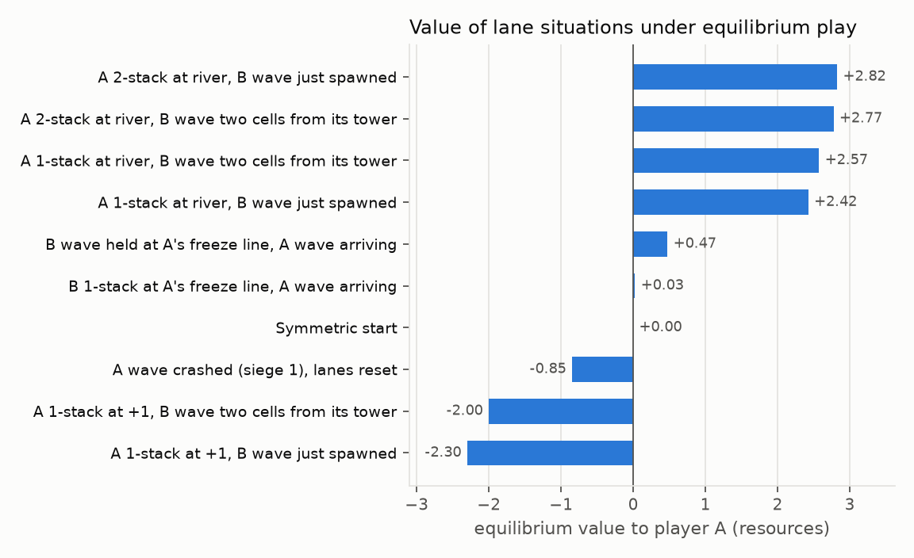
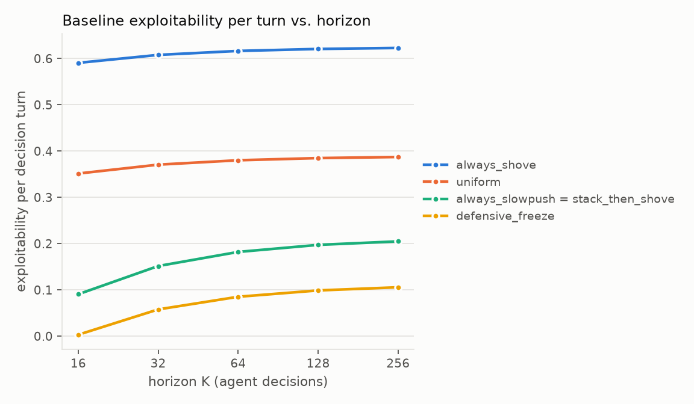

# Phase 1 Implementation Report: Laning Stochastic Game and Exact Equilibrium Solver

*Status: Phase 1 complete. 68/68 tests pass; every number in this report is regenerated by `python -m lanegame experiments all` (about 90 s on a laptop).*

---

## A. Executive summary

**What Phase 1 delivers.** A small, fully specified, finite-horizon, two-player, zero-sum stochastic game of League of Legends wave management. It comes with an exact, independently verified equilibrium solver, plus exact best-response and exploitability tooling. The code is a new Python package, `lanegame/`. The original Q-learning project is preserved unchanged in `legacy/`.

**The model in one paragraph.** Minion waves are explicit *packets* that spawn every 4 movement ticks, walk one cell per tick, merge with friendly packets, fight opposing packets, and crash into towers. Each player picks Slow Push, Shove or Freeze once every 2 ticks (one *decision turn*). The legal action set depends on the state: Freeze is only available when enemy minions are on your half. Fights use a discrete Lanchester-type attrition law in which bigger waves hit harder. Crashes put packets in a tower queue that consumes one packet per turn, which produces wave bounces. After a crash the crasher chooses between resources and vision. Every turn each player faces a gank risk that depends on exposure, action, relative wave size and vision. The payoff is A's resources minus B's.

**Solver.** Backward induction over reachable states, with each stage game solved exactly (pure saddle detection, otherwise a HiGHS linear program). Crash-reward decisions are separate choice nodes. Every stage solution carries an a-posteriori optimality certificate (duality gap). Best responses to any fixed time-dependent Markov policy are computed exactly, and exploitability is defined relative to the equilibrium value.

**Verification.**
- Matrix solver: checked against known games (matching pennies, RPS, closed-form 2×2) and against an LP-free support-enumeration solver on 1,200 random games and on all 905 stage games of the 32-turn game (max difference 8.9e-16).
- Backward induction: agrees exactly with a naive tree-recursion minimax on 15 root/horizon combinations.
- Equilibrium policies: zero exploitability (computed by best response) from every reachable state.
- Monte Carlo: simulation with sampled gank outcomes agrees with exact values (|z| < 1.8). A 100,000-game equilibrium self-play run gives −0.03 ± 0.05 against an exact value of 0.

**Computation is not a constraint.** From the standard start only 71 distinct lane states are reachable, at most 43 per decision index. Cost is linear in the horizon: 32 turns solve in 0.3 s, 64 in 0.6 s, 256 in 2.4 s, with peak Python memory of 10 MB at K = 256.

**Main findings** (default parameters; all hand-specified, see section I):
1. **The symmetric equilibrium is passive and almost pure.** On the equilibrium path both players Slow Push and Freeze, the waves annihilate near the river, and **no crash ever occurs**. The value is 0, as symmetry requires. Crash-free equilibrium play survives every collision-model variant and every one-at-a-time parameter perturbation tested. The cause is structural: the defender's reinforcements reach its own tower before an attacker's single-wave surplus can, a slow push can be neutralized by shoving each incoming wave, and pushing raises your own gank exposure.
2. **Off-path play is rich.** 52 of 905 decision nodes have strictly mixed equilibria. One-cell differences in position, and the timing of the next enemy reinforcement, change both values and actions. A 1-stack wave at the river is worth +2.4 to A, but the same wave one cell further forward is worth −2.0 to −2.3. With that wave at +1, A shoves with probability 0.86 if B's reinforcement has just spawned and slow-pushes if it is already near B's tower.
3. **The resource-vs-vision choice is live but threshold-like.** Vision is taken after small and large crashes and never after medium ones, which follows from the prices in the reward table, and never in the last two turns, where vision has no future value. Whether vision is ever taken flips sharply with the gank-loss scale.
4. **Predictable policies are exploitable, mainly through gank exposure.** At K = 32, a best-responding opponent extracts 19.45 resources from always-Shove, 11.86 from uniform random, 4.85 from always-Slow-Push and 1.85 from defensive-Freeze. Exploitability per turn grows with the horizon and saturates (Figure 1). Most of what the best response extracts comes from the exploited player's extra gank exposure, not from extra crashes.
5. **Realized outcomes are very noisy.** A single 32-turn game has a payoff standard deviation of about 15.7 resources, against exploitation edges of 2–19 resources per game. This is the starting point for the Phase 2 question of how much evidence justifies deviating from the unexploitable baseline.

**Important honesty notes.**
- The model went through several corrections during this phase, all documented in section D: a merge-range asymmetry, a damage-rounding artifact, under-counted defender exposure, a "trapped wave" pathology and a degenerate vision decision.
- The gank parameters were calibrated to explicit targets (section C.8). They were not tuned to produce mixing or crashes, and the headline result (crash-free equilibrium) did not change under any calibration tried.
- Value *magnitudes*, and sometimes their signs, depend materially on the hand-specified gank and shove parameters (section I).

---

## B. Audit of the original repository

The original project (now in `legacy/src`, notebook in `legacy/LoL_Laning.ipynb`) trained a tabular Q-learning agent against a pool of scripted opponents. The defects below were found by code review and quantified by `lanegame/experiments/audit_legacy.py`, which runs the unmodified legacy environment with random actions (2,000 episodes; output in `results/audit_legacy.md`).

| # | Issue in the original code | Evidence | How Phase 1 addresses it |
|---|---|---|---|
| 1 | **Floating-point state keys.** The observation includes the gold difference `g`, a clipped float accumulated from float rewards, so the tabular Q-function is keyed on floats. `g` has no effect on dynamics or rewards. | 13,291 distinct observation keys and 420 distinct float `g` values in 2,000 random episodes. | States are integer tuples (enforced by a test). Accumulated payoff is not part of the state: it is irrelevant to future transitions in an additive-payoff game. |
| 2 | **No time index in a finite-horizon problem.** The episode ends at T = 40, but `t` is not observed, so values and policies are not Markov in the observation. | 61,282 cases of the same observation key at a different time step. | Values and policies are indexed by `(k, state)`; backward induction runs over k. |
| 3 | **Incorrect terminal update.** `QLearningAgent.update(s, a, r, s_next)` has no terminal flag and always bootstraps from `max Q(s_next)`, including after the last step. | Signature recorded in the audit output. | Exact backward induction with V_K ≡ 0. A test checks the one-turn game equals its immediate matrix game. |
| 4 | **Not zero-sum.** Each player's reward is computed independently (both can collect bonuses; ganks are independent), and the agent maximizes its own reward. | r_A + r_B ≠ 0 on 53.8% of steps; mean \|r_A + r_B\| = 0.885. | A single payoff to A, with B receiving its negative. Tested on every reachable transition. |
| 5 | **Fixed rock-paper-scissors payoff matrix** (SH beats SP, F beats SH, SP beats F) added every turn regardless of the lane. | Code inspection. | Removed. Outcomes emerge from packet movement, attrition, towers and timing. |
| 6 | **Rewards collected repeatedly without a new event.** The crash bonus `1[w'=2]·1[m=2]` pays every turn the wave stays at the tower with two stacks. The plates and deny bonuses pay every turn a position condition holds. | 532 of 2,211 crash-bonus payments came immediately after another crash bonus with no new crash. Random play collects 2.19 freeze "deny" bonus per episode. | A crash reward requires a packet to *newly* enter the siege queue, and each packet can do so once. A test checks this on every reachable transition. |
| 7 | **Freeze works anywhere.** Freeze moves the wave −1 even from the enemy tower. | Freezing from w = +2 against Slow Push moves the wave to w = 0. | Freeze is legal only when enemy minions are on your half, and freeze effects are geometric (hold lines). |
| 8 | **Vision is a coin flip each turn** (`v ~ Bernoulli(0.6)`), unrelated to play. | Code inspection. | Vision is acquired only by choosing it after a crash, lasts exactly two turns, and is tracked in the state. |
| 9 | **Deterministic greedy policies** in a simultaneous-move game where equilibria may require mixing. | Code inspection. | The equilibrium solver returns mixed strategies; 52 of 905 nodes mix at K = 32. |
| 10 | **Evaluation only against three scripted opponents**, with "win rate" against them. | Code inspection. | Exact exploitability (worst case over *all* opponent policies) for any policy. |
| 11 | **Documentation/code mismatches.** The notebook describes alternating training of both sides against frozen copies; the code trains one side against a pool. The objective is described as finite-horizon but uses discounted, non-terminating Q-learning. The README advertises "self-play". | Notebook vs. `train.py`. | Rewritten README and this report. The legacy notebook is kept for history. |
| 12 | **Gank risk uses only the pre-move position and one shove indicator**; the "large wave" concept affects nothing except the crash bonus. | Code inspection. | Gank risk depends on exposure along the turn, action, relative wave size and vision (section C.8). |

Housekeeping: compiled `__pycache__` files were tracked in git. They are now untracked and covered by `.gitignore`. The legacy code was moved, not modified.

---

## C. Mathematical specification

### C.1 Coordinates, time and symbols

- **Lane:** cells x ∈ {−4, …, +4} (global coordinates). A's base is −4 and A's tower cell is −2. B's base is +4 and B's tower cell is +2. A's minions move toward +, B's toward −.
- **Own-perspective coordinates.** For player A own = global; for player B own = −global. In own coordinates every player's base is at −4, own tower at −2, river at 0, enemy tower at +2. The implementation stores each side in its own coordinates, so the mirror symmetry (swap players, reflect the lane) is just "swap the two side records".
- **Time.** Movement ticks τ = 1, 2, …. Decision turn k ∈ {0, …, K−1} covers ticks 2k+1 and 2k+2. The decision for turn k is made at tick 2k from the state at that instant, and the chosen actions persist for both ticks.
- **Spawns.** A fresh packet spawns at each base at every tick τ ≡ 0 (mod 4), i.e. at the end of every odd turn (so it is part of the decision state of every even turn), plus the initial pair at τ = 0. Spawn phase = k mod 2, which follows from k, so no extra state is needed.
- **Unobstructed travel.** A wave spawned at tick 0 is at −4+τ. The two initial waves meet at the river at tick 4, exactly when the next pair spawns. This is checked by a test.

| Symbol | Meaning | Default |
|---|---|---|
| W | HP of a freshly spawned packet (one wave) | 2 |
| H = 3W | HP cap of a packet (base wave + 2 stacks) | 6 |
| T | tower cell distance from the river | 2 |
| K | horizon (decision turns) | 32 |
| κ_sh | extra damage per tick from a shoving champion | 1 |
| d_T | tower damage per tick to a *contested* attacker in its cell | 1 |
| θ | freeze-break threshold | 5 |
| L | resources lost when ganked | 5 |
| ρ | vision risk reduction | 0.5 |

### C.2 Packets and stacks (precise definitions)

A **packet** is one physically distinct group of minions belonging to one side, with an integer position and integer HP h ∈ {1, …, H}. Every packet starts as one spawned wave (h = W).

The **stacks** carried by a packet are the number of complete extra waves of minions it holds:

  σ(h) = min(2, ⌈h/W⌉ − 1),  so h ∈ {1,2} → 0 stacks, {3,4} → 1 stack, {5,6} → 2 stacks.

**Packets versus stacks.** A stack exists only *inside* a packet. It is the surviving minions of an earlier wave that physically joined the current one (a merge). Two stacks in one packet are **not** interchangeable with two separate packets:
- separate packets occupy different cells and arrive at contacts and towers at different times;
- they fight one at a time (only the leading packet fights);
- the tower consumes them one per turn;
- each one that reaches the tower is a separate crash event.

A merged packet fights as one body: its firepower grows with its size, see C.5. The crash *size* is determined by σ.

### C.3 Markov state

The state at decision time k is s = (A-side, B-side, v_A, v_B), with per side (own coordinates):

| Field | Domain | Meaning |
|---|---|---|
| `fx, fh` | position, HP ∈ {0..6} (`fh = 0` means none) | the **front**: the leading non-sieging packet |
| `rears` | tuple of positions | packets behind the front. They never fight, so their HP is always W; only positions are stored. |
| `siege` | {0,1,2,…} | number of this side's packets queued under the enemy tower. Their HP is never used again, so only the count is stored. |
| `v` | {0,1,2} | remaining decision turns of vision protection |

The decision index k is not part of `State`. Values and policies are indexed by (k, s), and k enters the dynamics only through the spawn phase k mod 2. **Sufficiency:** every rule below depends only on these fields, the actions, and k mod 2. The omitted information (accumulated payoffs, HP of sieging packets, past actions) affects nothing in the future, because payoffs are additive and sieging packets interact with nothing except the consumption counter. Every field is an integer (tested), so no floating-point state equality is ever used.

### C.4 Actions and legality

A_s ⊆ {SP (Slow Push), SH (Shove), F (Freeze)}:
- SP and SH are always legal.
- **F is legal for side i iff the enemy front exists and stands at own position ≤ 0**, i.e. enemy minions are at the river or on i's half. A player whose wave is pushed toward the enemy tower cannot freeze, and Freeze is not offered when there is no enemy wave to hold.

Illegal actions are excluded from the matrix games and rejected by `LaneGame.transition` (tested). Stage games are therefore 2×2, 2×3, 3×2 or 3×3, and choice nodes are 1×2, 2×1 or 2×2.

Each action sets the champion's behavior during the turn:

| Action | Own free front may advance … | Champion damage in a fight | Effect on enemy front | Gank term |
|---|---|---|---|---|
| **SH** | all the way into the enemy tower cell | +κ_sh = 1 per tick | none | +0.05 |
| **SP** | to the river (own x = 0), then **holds** | 0 (last hits only) | none | 0 |
| **F** | to own x = −1 (one cell in front of own tower), then holds | 0 | **held**: cannot advance past the freezer's freeze line (own x = −1 of the freezer) unless h_enemy + β(a_enemy) ≥ θ, with β(SH) = 2, β(SP) = β(F) = 0 | −0.02 |

Slow Push "holds at the river" so that friendly reinforcements catch up and merge. Stacks then build when the opponent does not contest (section C.5, scenario `slowpush_stacks`). Alternatives (half speed, creeping) were tested and rejected (section D).

### C.5 One movement tick

Let P_i be side i's non-sieging packets sorted from most to least advanced; the front is P_i[0]. The fronts are **in contact** iff both exist and their global distance is ≤ 1 (in own coordinates: fx_A + fx_B ≥ −1). Each tick applies, in order:

1. **Movement.** Rear packets always advance one cell. A front does *not* move if:
   - it is in contact (as of the start of the tick); or
   - it is **waiting**: the enemy has packets sieging at its own tower and the front is within distance 1 behind that tower cell; or
   - its action's advance limit (table above) or an enemy freeze hold stops it.

   Otherwise it advances one cell. Fronts are never in contact while moving, so their distance is ≥ 2, and two moving fronts close by at most 2 per tick. They therefore end up in the same cell or adjacent, and **opposing packets can never pass through each other** (tested on every tick of every reachable transition).
2. **Merging.** A packet within distance 1 behind a friendly packet merges into it: h ← min(H, h₁ + h₂), at the position of the leading one. Merging uses the same reach (1 cell) at which enemy fronts engage. This symmetry matters (section D.2).
3. **Fight.** If the fronts are in contact, both take simultaneous damage:

   D_A→B = δ(h_A) + κ_sh·1[a_A = SH] + d_T·1[B's front is in A's tower cell]
   D_B→A = δ(h_B) + κ_sh·1[a_B = SH] + d_T·1[A's front is in B's tower cell]

   with minion firepower **δ(h) = max(1, ⌊h/W⌋)** (each complete wave adds one unit of firepower; a discrete Lanchester square law). Packets with h ≤ 0 are destroyed and the next packet becomes the front.
4. **Crash check.** If a side's front stands in the enemy tower cell and no enemy front is within distance 1, the packet leaves the lane and joins that side's **siege queue**. This is a **crash event** with crash HP equal to its h. An attacker that reaches the tower cell while an enemy front is adjacent is *contested*: it fights with the tower helping the defender, and it crashes only if it wins.

At the **end of the turn**:

5. **Tower consumption.** Each tower removes one queued packet, and only a packet that was already queued at the start of the turn (so a crash is never erased in the same turn). Two queued packets take two turns (tested).
6. **Spawns**, if the next decision tick is ≡ 0 (mod 4): a fresh packet (h = W) at each base, merging if a friendly packet is within reach.
7. **Vision countdown:** v ← max(0, v − 1). Choices then apply (C.7).

The turn's lane dynamics are **deterministic** given the two actions. In Phase 1 the only randomness is the ganks, which do not affect the lane.

**Worked reference scenario** (the brief's example). A has a 2-stack packet (h = 6) at +1, B's fresh wave arrives at +2, A Slow Pushes and B Shoves. In the first tick of contact, A takes δ(2) + 1 = 2 damage and B takes δ(6) = 3. B's wave is destroyed; **A keeps h = 4 (one stack) and the frontline stays at +1**. If the next B wave also shoves, A drops to h = 2, and a third pushes the wave back toward A, because A's own reinforcements keep merging but cannot outpace repeated shoves. With an unstacked A wave (h = 2) the same matchup destroys A's wave at once and B's survivor walks toward A. Traces for this and ten other scenarios are printed by `python -m lanegame scenarios`.

### C.6 Crashes, tower and bounce

- A crash happens only through movement plus winning any contest at the tower. Standing near the enemy tower pays nothing.
- **Bounce.** While the queue is non-empty, the defender's front waits behind its tower, where its own next spawn merges into it. When the queue empties, the (possibly stacked) defender wave walks out and pushes back.
  - A one-packet crash is consumed in about a turn, so the defender's wave leaves unstacked: the lane resets and there is no bounce (scenario `one_packet_siege_no_bounce`).
  - A two-packet siege lasts two turns, so the defender merges its next spawn (h = 4) and bounces past the river (scenario `two_packet_siege_bounce`).

  Bounce strength therefore grows with siege length, which is mechanical rather than hard-coded.
- No teleporting or lane resets. Packets are created only by spawning and removed only by merging, dying or consumption. A conservation identity is tested on every reachable transition:

  packets_after = packets_before + spawned − merged − died − consumed  (per side; queued packets counted)

### C.7 Crash rewards (CHOICE stage)

If side i crashed during turn k with total crash HP c_i (several packets of one side crashing in the same turn, which is rare, are aggregated into one event of size σ(min(c_i, H))), it picks one option from:

| Crash size σ | Option 1 | Option 2 |
|---|---|---|
| small (0) | +1 resources | vision |
| medium (1) | +2 resources | vision |
| large (2) | +3 resources | +2 resources and vision |

- **Timing and information.** The choice is made after the turn's movement and before turn k+1. If both players crashed in the same turn, the choices are simultaneous. Choices are publicly observed.
- **Vision.** Choosing vision sets v_i ← 2. It therefore protects the gank checks of turns k+1 and k+2 only, never the current turn, and re-choosing refreshes rather than adds.
- Formally, each choice is a separate stage of the game and is solved as a 2×1, 1×2 or 2×2 matrix game (section E).

### C.8 Gank model

Once per decision turn, each player i is ganked with probability

  p_i = clip(b₀ + b_pos·(e_i + T)/(2T) + b_act[a_i] − b_str·Δσ_i, 0, p_max) · (1 − ρ·1[v_i > 0]),

with b₀ = 0.15, b_pos = 0.10, b_act = (SP 0, SH +0.05, F −0.02), b_str = 0.02, p_max = 0.4 and ρ = 0.5. The inputs are:
- **Exposure e_i ∈ [−T, T]**, the furthest own position the champion's leading wave reaches during the turn, including the start of the turn. The champion travels with its wave. If the side has packets queued under the enemy tower at the start of the turn, e_i = +T (the champion stays to hit the tower). With no packets, e_i = −T.
- **Δσ_i = σ(own front) − σ(enemy front)** at the start of the turn.

A successful gank costs L = 5 resources and, per the Phase 1 brief, does not change the lane. Because ganks do not affect future states, the solver uses the expected loss L·p_i. The simulator samples the Bernoulli outcomes.

The qualitative properties are tested: deeper exposure is riskier; SH > SP > F; a bigger own wave is safer; vision halves the risk; and 0 ≤ p ≤ p_max.

**Calibration targets.** These numbers are modelling choices, not data. They were set to satisfy:
1. Standing at the enemy tower instead of your own costs about half a small crash per turn: L·b_pos = 0.5.
2. Vision immediately after a crash is worth roughly one resource. The brief's reward table implicitly prices vision at +1 resource for small and large crashes, and at L = 5 this requires b₀ ≈ 0.15.
3. All probabilities stay ≤ 0.4.

L = 5 is the original project's value. The position-independent part b₀ cancels exactly in the zero-sum *expected* payoff, except through vision. It does, however, add variance to realized outcomes (section F.5).

### C.9 Payoff, objective and terminal condition

The stage payoff to A for turn k with actions (a, b) and choices (o_A, o_B) is

  r_k = L·(p_B − p_A) + ρ_A(o_A) − ρ_B(o_B),

where ρ_i(o) is the resource part of the chosen option. B receives −r_k. The game is **exactly zero-sum**: the payoff is A's resources minus B's, with expected gank losses. Each player's objective is the expected sum Σ_{k<K} r_k, undiscounted, with **zero terminal bonus: V_K ≡ 0**. Initial state s₀: one fresh wave at each base, no queues, no vision, k = 0.

---

## D. Modelling decisions and alternatives

### D.1 Collision and pressure models considered

All variants run on the same engine (`model_comparison.py`; full output in `results/model_comparison.md`). Each was checked against 11 qualitative scenarios (section G) and solved at K = 32.

| Variant | Scenarios passed | Reachable nodes | Mixed nodes | Crashes on eq. path | Value of a 1-HP surplus / 2-stack at the river | Verdict |
|---|---|---|---|---|---|---|
| **Lanchester floor δ = max(1, ⌊h/W⌋), SP holds at river (chosen)** | **11/11** | 905 | 52 | 0 | −3.55 / +2.82 | adopted |
| Lanchester ceil δ = ⌈h/W⌉ | 11/11 | 879 | 28 | 0 | −3.18 / +2.82 | rejected: a 1-HP surplus doubles firepower (rounding artifact, D.2) |
| Linear attrition δ = 1 | 9/11 | 653 | 26 | 0 | −6.32 / −3.60 | rejected: no slow-push stacking (annihilation preserves surpluses exactly), 2-stack loses two stacks in the reference |
| Pressure comparison (lower h + κ loses 1 HP/tick) | 8/11 | 1,326 | 368 | 0 | +0.15 / +6.37 | rejected: a fresh shove cannot contest a slow push; stacked waves are untouchable |
| SP half speed past the river | 9/11 | 503 | 122 | 0 | −5.22 / −6.63 | rejected: the slow-pushed wave reaches the tower before reinforcements merge (no stacking), stacks become liabilities |
| SP creep (1 cell per spawn interval) | 10/11 | 503 | 122 | 0 | −5.22 / −6.63 | rejected: same pathology, slower |
| No tower damage to contested attackers | 10/11 | 937 | 6 | 0 | −3.55 / +2.89 | rejected: a 1-HP wave crashes through a fresh defender |
| Posture caps (SP champion stays at river, F at −1) | 11/11 | 905 | 40 | 0 | −3.55 / +2.82 | equivalent here; kept as an option (`posture_cap`) |

The **additive-pressure** and **tug-of-war** formulations (net pressure moves a contact point) were analysed on paper first. In that family, ties or uniform losses either annihilate fresh waves in a single step, so fronts are never stationary long enough to merge, or let capped waves stall forever. The "pressure comparison" variant above is the representative that was implemented. The chosen model is the simplest one that reproduces every behavior the brief asks for:
- small waves are pushed back, large waves resist shoves;
- a strong shove breaks a freeze;
- Slow Push takes time and can be contested;
- reinforcement timing decides interceptions;
- the same action pair has different effects in different states.

### D.2 Artifacts found and fixed during development (bug vs. consequence)

1. **Merge-range asymmetry (bug).** Initially enemies engaged at distance 1, but friendly reinforcements merged only in the same cell. A wave parked at the river was therefore always hit by the enemy's reinforcement one tick before its own arrived. Fix: merge reach = engagement reach = 1.
2. **Damage-rounding artifact (modelling flaw).** Under ⌈h/W⌉ a packet with h = 3 deals as much damage as a full 2-wave packet. A 1-HP surplus at the river then survived even a contested shove and sustained itself forever. Fix: δ = max(1, ⌊h/W⌋), so a surplus must be a whole wave to add firepower. Consequence, documented in the `slowpush_stacks` scenario: a slow push grows only from a full-wave surplus; a sub-wave surplus is preserved but does not grow.
3. **Defender exposure under-counted (modelling flaw).** Exposure was first measured only at the start of the turn. A defender whose wave started at its tower but shoved forward into a fight was treated as safe. Fix: exposure is the furthest point the leading wave reaches during the turn.
4. **Post-crash exposure "teleport" (modelling flaw).** With path-max exposure, the turn after a crash used the next wave far behind, as if the champion had teleported home. Fix: a side with packets still queued under the enemy tower is exposed at the tower. This is also what makes vision after a crash worth anything.
5. **Trapped-wave pathology (consequence of the gank calibration).** With a steep exposure slope (b_pos = 0.25, L = 5), a single surplus wave at the river was worth about −8.5 to −12 to its owner, and up to −22 under the creep rule. Its champion was tied to the wave, the opponent defended from its tower, and no action could release the wave cheaply. With the final calibration the same state is worth −3.55: still a liability (the champion must stand at the river while the opponent sits home), but bounded. The underlying asymmetry is genuine in this model and is listed as a limitation (I.3).
6. **Degenerate vision decision (consequence of parameter scale).** With the first gank parameters (L = 2) vision was never chosen anywhere, because two turns of 50% risk reduction were worth under 0.6 resources. The calibration in C.8 is the documented fix; section F.3 shows the decision is now state-dependent.

### D.3 Other decisions

| Decision | Alternatives | Reason for choice |
|---|---|---|
| Strength unit W = 2 HP per wave | W = 3 (tested: 1,629 nodes, same qualitative results) | Smallest granularity that represents partial waves and the reference scenario |
| Contact at distance ≤ 1 | same-cell only; half-cell frontline | Packets moving toward each other at odd distance would otherwise cross. Distance-1 engagement is stateless and symmetric. |
| Fights resolved per tick | per turn | Keeps reinforcement timing exact at tick resolution |
| Rear packets stored as positions only | full (x, h) | They never fight, so h ≡ W (asserted in code) |
| Siege queue stored as a count | list of HPs | Queued HP never affects anything |
| Crash choice as a separate stage | merged into next turn's action set (3×2 = 6 actions) | Matches the decision's timing; keeps stage games small; the opponent observes the choice |
| Freeze legality: enemy front at own x ≤ 0 | own front behind river; contact on own half | Simplest rule meaning "enemy minions are on my side" |
| Freeze also holds own front at −1 | Freeze only holds the enemy | Keeps the fight next to the freezer's tower, which is the point of freezing |
| Expected gank losses in the solver | stochastic transitions | Exact, because ganks do not affect the state (brief, section 5); the simulator keeps realized draws |
| Horizon default K = 32 | 16, 64 | See section H |

**Subjective vs. established.**
- *Subjective modelling assumptions:* all numerical parameters, the action semantics (hold lines, freeze legality, shove damage), the discrete Lanchester law, the exposure definition, and aggregating same-turn crashes.
- *Mathematically established within the model (tested or proven):*
  - zero-sum structure; mirror equivariance;
  - V(s₀) = 0, because s₀ is its own mirror image and V(mirror s) = −V(s);
  - packet conservation; no crossing; Markov sufficiency of the state;
  - the solver's optimality (certified gaps, independent recomputation);
  - exactness of the best responses.

---

## E. Equilibrium mathematics

**Notation.** S_k is the set of states reachable at decision index k. A_s and B_s are the legal action sets. For joint action (a, b) at (k, s):
- g(s, a, b) = L·(p_B − p_A) is the expected gank payoff to A;
- n = n(k, s, a, b) is the resulting CHOICE node, with post-turn lane s̃, option menus O_A(n) and O_B(n) (a single null option for a side that did not crash), and successor s'_ij = s̃ with vision updated by options (i, j).

**Recursion.**

  V_K(s) = 0
  C_k(n)[i, j] = ρ_A(o_i) − ρ_B(o_j) + V_{k+1}(s'_ij)
  W_k(n) = val C_k(n)
  Q_k(s, a, b) = g(s, a, b) + W_k(n(k, s, a, b))
  V_k(s) = val Q_k(s) = max_{x∈Δ(A_s)} min_{y∈Δ(B_s)} xᵀ Q_k(s) y

where val M is the value of the zero-sum matrix game M. With transitions that are deterministic given actions, this is exactly the Shapley recursion E[r + V_{k+1}(s')]. The code handles the general expectation form, so stochastic lanes in later phases need no new solver. A Markov perfect equilibrium of the finite-horizon game is obtained by playing any equilibrium (x*_k(s), y*_k(s)) of each stage game, and V*_0(s₀) is the game value.

**Matrix-game solution** (`matrix_game.py`). For an m×n matrix M:
1. If m = 1 or n = 1: pure optimization.
2. If max_i min_j M_ij = min_j max_i M_ij: a pure saddle point. This is exact; no LP is needed.
3. Otherwise solve the row LP with SciPy `linprog` (HiGHS) on M − mean(M) (value-invariant shift):

   max v  s.t.  Mᵀx ≥ v·1,  1ᵀx = 1,  x ≥ 0.

   The column strategy y is read from the inequality duals. If y fails the certificate, the column LP (min u s.t. My ≤ u·1) is solved instead.

**Certificate.** For any returned (x, y), with lower = min_j (xᵀM)_j and upper = max_i (My)_i:
- gap = upper − lower ≥ 0;
- (x, y) is an equilibrium iff gap = 0;
- |value − val M| ≤ gap/2.

Every stage and choice game stores its gap. The maximum over the K = 32 game is 6.7e-16 and over K = 256 is 7.1e-15. Results are therefore *numerically* exact to about 1e-14, not symbolically exact.

**Best response** (`best_response.py`). Fix A's time-dependent Markov policy π = (π_k(·|s), χ_k(·|n)) for moves and crash choices. B then faces a finite-horizon MDP, and Markov policies suffice for optimality there, so

  V^π_k(s) = min_{b∈B_s} Σ_a π_k(a|s)·Q^π_k(s, a, b),

with Q^π built from V^π_{k+1} and the same rule at CHOICE nodes (B minimizes over its options; A's choice follows χ). Symmetrically for a fixed B policy σ. With both policies fixed, the same code evaluates V(π, σ) exactly.

**Exploitability.** With v* = V*_0(s₀):

  Expl_A(π) = v* − min_σ V(π, σ | s₀) ≥ 0,  Expl_B(σ) = max_π V(π, σ | s₀) − v* ≥ 0.

Their sum is the NashConv of the profile (π, σ). Tests check:
- non-negativity for baselines and random policies;
- that the best response weakly beats every scripted reply;
- indifference of the equilibrium across its support;
- **subgame perfection**: the computed equilibrium has zero exploitability from every reachable (k, s), not just s₀.

**Complexity.** One stage game per (k, s) with at most 3×3 entries, plus at most one 2×2 choice game per distinct (k, s̃, menus). Transitions are cached by (s, k mod 2, a, b), because the dynamics are time-homogeneous apart from the spawn phase. Total work is O(Σ_k |S_k|·9).

---

## F. Experiments and results

All at default parameters and K = 32 unless stated.

### F.1 The symmetric equilibrium

- **Value and path.** V*_0(s₀) = 0 at every horizon (as symmetry requires; verified numerically). The equilibrium path is pure: both play SP at k = 0. Each turn the waves meet at the river and annihilate, with Freeze used when the enemy wave sits at the river.
- **No crashes on the equilibrium path at any horizon.** Expected gank loss along the path is 0.95 per turn per player, equal for both, so it cancels.
- **Structure off the path.** Averaged over all 905 reachable nodes, equilibrium probabilities are SP 0.52, SH 0.17, F 0.31 (identical for A and B, by symmetry). One action weakly dominates in 663 nodes (SP 416, F 227, SH 20); 52 nodes are strictly mixed.
- **Interpretation.** In this lane the defender wins unforced exchanges:
  - The defender's reinforcements reach its tower 2 ticks after spawning, while an attacker's surplus from a river fight needs 2 or more ticks to walk there. A single-wave surplus is therefore intercepted at the tower (`small_wave_intercepted`).
  - Building a stack requires winning fights repeatedly, but one shove per incoming wave holds a parked 1-wave surplus at constant size (`shove_contests_slowpush`).
  - Pushing raises your exposure.

  Under the default calibration, a symmetric opponent can always deny crashes at a lower exposure cost than the pusher pays. This conclusion is robust across all seven alternative collision models (D.1) and all 23 one-at-a-time parameter settings (F.6). It is a property of this stylized geometry, not a claim about real League of Legends.

### F.2 Situations off the equilibrium path

`equilibrium_structure.py` solves the game from constructed roots, here k = 10/11 of a 32-turn game. Lane rows are in global coordinates.

| Situation | V* to A | Equilibrium A / B |
|---|---|---|
| A 2-stack (h = 6) at river, B wave just spawned | +2.82 | SP / F |
| A 2-stack at river, B wave two cells from its tower | +2.77 | SP / SH |
| A 1-stack (h = 4) at river, B wave just spawned | +2.42 | SP / F |
| A 1-stack at river, B wave two cells from its tower | +2.57 | SP / SH |
| A 1-stack at +1, B wave two cells from its tower | −2.00 | SP / SH |
| A 1-stack at +1, B wave just spawned | −2.30 | **SP 0.14, SH 0.86 / SH 0.92, F 0.08** |
| B fresh wave held at A's freeze line, A wave arriving | +0.47 | F / SP |
| B 1-stack at A's freeze line, A wave arriving | +0.03 | SH / SH |
| A just crashed (one packet queued), lanes reset | −0.85 | SP / SP |



Observations:
- **A stack at the river is an asset, the same stack one cell further is a liability.** At +1, the champion is exposed and B's reinforcements meet the wave before A's do (the reinforcement-proximity effect emerges from movement).
- **Reinforcement timing changes the best action.** With a 1-stack at +1, A mixes heavily toward Shove (0.86) when B's next wave has just spawned, racing the reinforcement, but slow-pushes when B's wave is already two cells from its tower. B's reply to a river stack switches between Freeze and Shove with the timing of its own wave.
- **A fresh freeze is worth about +0.5 to the freezer.** Against a 1-stack the freeze is worth only +0.03, and both players shove: the freezer trims the wave, the attacker tries to break the hold.
- **Crashing a single wave has a negative continuation value for the crasher** (−0.85). The champion remains exposed under the enemy tower for a turn while the lane resets.

### F.3 Resource versus vision

The probability that the equilibrium takes vision, by crash size and turns remaining (from `results/equilibrium_structure.md`):

| crash size | turns remaining 1–2 | turns remaining ≥ 3 |
|---|---|---|
| small (+1 vs vision) | 0 (resources) | 1.00 (vision) |
| medium (+2 vs vision) | 0 | 0 |
| large (+3 vs +2 & vision) | 0 | 1.00 |

The decision trades immediate resources against future protection. With two or fewer turns left, vision protects at most the final turn, so the resource option wins (a test checks that the final-turn choice is resources). Vision is worth about 1.1 resources right after a crash: 0.5 × 5 × (p at the tower + p next turn). That beats +1 and the extra +1 of the large option, but not +2. The decision is therefore **threshold-type**: the sensitivity analysis shows the vision share jumping between 0 and about 0.9 when L, b₀ or ρ move one step (F.6).

### F.4 Baselines and exploitability

**Baseline policies** (all take the resource option after crashes, except uniform, which randomizes its choices too):
- **uniform:** uniform over legal actions;
- **always_shove;**
- **always_slowpush;**
- **defensive_freeze:** Freeze when legal, otherwise Slow Push;
- **stack_then_shove:** Slow Push until the front has h ≥ 5, then Shove.

Exact head-to-head values (payoff to row player A, K = 32):

| A \ B | equilibrium | uniform | always_shove | always_slowpush | defensive_freeze | stack_then_shove |
|---|---|---|---|---|---|---|
| equilibrium | 0 | 11.71 | 17.07 | 1.50 | 0 | 1.50 |
| uniform | −11.71 | 0 | 13.19 | −7.31 | −10.16 | −7.31 |
| always_shove | −17.07 | −13.19 | 0 | −19.25 | −14.68 | −19.25 |
| always_slowpush | −1.50 | 7.31 | 19.25 | 0 | −1.50 | 0 |
| defensive_freeze | 0 | 10.16 | 14.68 | 1.50 | 0 | 1.50 |
| stack_then_shove | −1.50 | 7.31 | 19.25 | 0 | −1.50 | 0 |

Exploitability as A, and where the best response's gain comes from (exact expected totals along the best-response path):

| Baseline | Expl. | Per turn | BR crash resources (A / B) | Gank losses (A / B) |
|---|---|---|---|---|
| always_shove | 19.45 | 0.61 | 0 / 0 | 43.5 / 24.1 |
| uniform | 11.86 | 0.37 | 0 / 0 | 37.8 / 25.9 |
| always_slowpush | 4.85 | 0.15 | 0 / 2 | 30.9 / 28.1 |
| stack_then_shove | 4.85 | 0.15 | 0 / 2 | 30.9 / 28.1 |
| defensive_freeze | 1.85 | 0.06 | 0 / 2 | 27.9 / 28.1 |

Findings:
- **Exploiting a predictable opponent here mostly means making it stand in the wrong place.** For always-Shove and uniform, the entire exploitation value is the gap in gank exposure: the best response simply defends (SP 0.94 against always-Shove) and lets the shover overextend. Against the passive baselines the best response additionally earns one medium crash (+2).
- **stack_then_shove ≡ always_slowpush against a best responder.** The best response never lets the stack reach h = 5.
- **defensive_freeze earns exactly the equilibrium value against the equilibrium,** yet it is exploitable by 1.85. A policy that is optimal against equilibrium play can still be exploitable, which is exactly the distinction Phase 2 needs.
- **The equilibrium earns +1.5 against always_slowpush but 0 against defensive_freeze,** although both are exploitable. Equilibrium play does not automatically exploit mistakes; that requires an opponent model (Phase 2).

**Per-turn exploitability grows with the horizon and saturates.** Longer games give the best response more opportunities to set up a crash. End effects (zero terminal bonus) matter most at short horizons.



### F.5 Realized outcome distributions

5,000 sampled games per matchup, with sampled gank outcomes:

| Matchup | Mean | Std | 5% | 50% | 95% | Mean ganks A / B |
|---|---|---|---|---|---|---|
| equilibrium vs equilibrium | 0.54 ± 0.22 | 15.7 | −25 | 0 | +25 | 6.05 / 6.16 |
| always_shove vs best response | −19.3 | 16.1 | −45 | −20 | +5 | 8.68 / 4.81 |
| always_slowpush vs best response | −4.69 | 15.6 | −32 | −2 | +23 | 6.16 / 5.62 |
| defensive_freeze vs best response | −1.78 | 15.3 | −27 | −2 | +23 | 5.58 / 5.62 |

- The standard deviation of a single game (about 15.7) dwarfs most exploitation edges. Distinguishing an exploitable defensive_freeze (edge 1.85) from equilibrium play needs on the order of (2 × 15.7 / 1.85)² ≈ 290 games at two standard errors.
- Most of this variance comes from the position-independent gank rate b₀, which does not affect expected values (C.8). Variance results are therefore *more* calibration-dependent than expectations.
- The equilibrium self-play mean (+0.54, z = 2.4) is a statistical fluctuation. A 100,000-game rerun gives −0.03 ± 0.05, and the variance-reduced estimator (expected gank losses along sampled paths) gives exactly 0, because the equilibrium path is pure.

### F.6 Parameter sensitivity (one at a time)

`results/sensitivity.md` re-solves the game for 23 settings around the default. Summary:
- **Robust:** zero crashes on the symmetric equilibrium path in every setting. always_shove is the most exploitable baseline and defensive_freeze the least in every setting; the order of uniform and always_slowpush flips when the exposure slope is small (b_pos = 0.05).
- **Threshold-type:** the vision decision is either taken in about 90% of small and large crash nodes or never. It switches off for L = 3, b₀ = 0.10 or ρ = 0.25.
- **Sensitive:** the value of a river 2-stack ranges from −3.57 (shove damage 2) to +5.01 (b_pos = 0.05). The value of a lone river wave even changes sign: +2.37 with shove damage 0, −4.89 with b_pos = 0.15. Probe-state values should therefore not be quoted without their parameters.
- **Degenerate corner:** with shove damage 0, fights are symmetric annihilations and only 32 decision nodes are reachable.
- **Finer HP units (W = 3)** keep every qualitative conclusion (1,629 nodes, zero equilibrium-path crashes, same vision pattern).

---

## G. Correctness and verification

`python -m pytest`: **68 tests, all passing (about 7 s).**

| Area | Tests (file) |
|---|---|
| Matrix solver | matching pennies; RPS; weighted RPS (known x = (¼, ½, ¼)); closed-form 2×2; saddle detection; dominated strategy gets weight 0; 1,200 random games of 6 shapes vs support enumeration; affine invariance; all-zero game; primal/dual feasibility and certified gap ≤ 1e-9 on every solution (`test_matrix_game.py`) |
| Mechanics | initial state; spawn every 4 ticks only; waves meet at the river at tick 4; determinism; packet conservation on every reachable transition; no crossing and HP/position bounds on every tick of every reachable transition; integer-only state keys; one-packet-per-turn consumption; same-turn arrivals not consumed; crash rewards not duplicated; vision expiry (2 → 1 → 0); vision halves risk; gank monotonicity and bounds; freeze legality; illegal actions rejected; reinforcement arrival emerges from position; 11 behavioral scenarios (`test_mechanics.py`) |
| Invariants | zero-sum on every transition; mirror equivariance of dynamics, legal sets and payoffs; V(mirror s) = −V(s) for all reachable states and V(s₀) = 0; K = 1 terminal handling; final-turn choice takes resources; valid distributions everywhere (`test_invariants.py`) |
| Solver | backward induction = naive tree recursion with support enumeration (5 roots); certified gaps ≤ 1e-9; zero exploitability of equilibrium policies; subgame perfection from every reachable state; exploitability ≥ 0 for baselines and random policies; best response beats every scripted reply; support indifference; heterogeneous action-set sizes exercised (`test_solver.py`) |
| Simulation | Monte Carlo within 4.5 standard errors of exact values for 4 matchups; forward exact path statistics equal backward values; seed reproducibility; with ganks switched off, every episode equals the exact value to 1e-12 (`test_simulation.py`) |

**Behavioral scenarios** (`lanegame/scenarios.py`, all passing; traces via `python -m lanegame scenarios`):
- `reference`: the brief's example; A keeps one stack and the frontline holds.
- `small_wave_pushed_back`
- `freeze_holds`: a fresh shove cannot break a freeze.
- `freeze_broken`: a 1-stack shove breaks it into a crash.
- `slowpush_stacks`: 2 → 5 HP against passive play.
- `shove_contests_slowpush`
- `large_wave_crashes_through`: a 2-stack crashes through a fresh defender.
- `small_wave_intercepted`
- `two_packet_siege_bounce`
- `one_packet_siege_no_bounce`
- `tower_consumes_one_per_turn`

**Additional verification** (`results/verification.md`):
- All 905 stage games of the K = 32 game re-solved by support enumeration (no LP): max |difference| 8.9e-16.
- Backward induction vs. tree recursion for 2–4 turns from 5 roots: 15/15 exact matches.
- Equilibrium exploitability: 0.0 for K = 16, 32, 64.
- Monte Carlo z-scores: −1.43 to +1.74 across 6 matchups.

**Tolerances.**
- Probability entries below 1e-12 are zeroed.
- The certified duality gap must be ≤ 1e-9; observed ≤ 7.1e-15.
- Equality checks on values use 1e-8.
- Monte Carlo agreement uses 4.5 standard errors per test, a per-test false-alarm probability below 1e-5.

---

## H. Computational performance

From `results/horizon_benchmark.md`. Timings cover reachable-state enumeration plus solving, single-threaded Python 3.13 on Windows. Peak memory is the Python allocation peak (tracemalloc).

| K | Ticks | Spawn intervals | Decision nodes | Max nodes per k | Distinct lane states | Stage games | LPs solved | Mixed nodes | Seconds | Peak MB | Max gap |
|---|---|---|---|---|---|---|---|---|---|---|---|
| 16 | 32 | 8 | 337 | 43 | 71 | 337 + 40 choice | 22 | 20 | 0.14 | 0.6 | 2.2e-16 |
| **32** | 64 | 16 | 905 | 43 | 71 | 905 + 120 | 54 | 52 | 0.28 | 1.1 | 6.7e-16 |
| 64 | 128 | 32 | 2,041 | 43 | 71 | 2,041 + 280 | 118 | 116 | 0.58 | 2.4 | 1.8e-15 |
| 128 | 256 | 64 | 4,313 | 43 | 71 | 4,313 + 600 | 246 | 244 | 1.20 | 4.9 | 1.8e-15 |
| 256 | 512 | 128 | 8,857 | 43 | 71 | 8,857 + 1,240 | 502 | 500 | 2.45 | 10.1 | 7.1e-15 |

- **Why it is cheap.**
  - The lane dynamics are deterministic given actions, and from the standard start they reach only 71 distinct lane/vision configurations.
  - About 94% of stage games have pure saddle points (no LP).
  - Transitions are cached across k by spawn phase.

  All requested horizons, and 4× the longest, are trivially feasible. A safety cap (`max_states = 2,000,000`) aborts enumeration before any uncontrolled run; it was never approached.
- **Horizon dependence.** Because the dynamics are time-homogeneous up to spawn phase, V_k depends on k only through the turns remaining K − k and the phase. Probe-state values with 16 turns remaining are identical for every K (verified in the benchmark). V*(s₀) = 0 at every K. Per-turn exploitability rises from K = 16 to 64 and then flattens (Figure 1).
- **Unfinished waves at the horizon.** With zero terminal bonus:
  - stacks not cashed in by K are worth nothing;
  - vision is never chosen with ≤ 2 turns left;
  - in short games a larger share of turns is spent in these end effects (exploitability per turn at K = 16 is visibly lower).
- **Default horizon K = 32** (64 ticks, 16 spawn intervals, about 8 minutes of laning at 30-second waves). Per-turn exploitability of always-Shove and uniform is within 2–4% of its K = 256 level. For the passive baselines it is still rising (always_slowpush 0.15 vs. 0.21 per turn; defensive_freeze 0.06 vs. 0.11), because a best response needs time to build and cash in a stack. End effects cover only the last 2–3 turns, and the solve takes 0.3 s. Computation does not constrain the choice: Phase 2 can use K = 64 or more at negligible cost.

---

## I. Known limitations

1. **Hand-specified parameters.** Every number in C.1 and C.8 is a stylized choice. Qualitative conclusions (crash-free symmetric equilibrium, always-Shove most and defensive-Freeze least exploitable, end effects) are robust across the tested variants. Value magnitudes, and sometimes their signs, are not (F.6).
2. **The resource economy is thin.** Resources come only from crashes and ganks; there is no last-hitting gold, experience or plate timers. In real laning, freezing denies farm and pushing earns it. Here neither exists, so the push-versus-safety tradeoff is carried almost entirely by gank exposure. This largely explains why equilibrium play is passive and why exploitation value is mostly exposure (F.4). Adding a farm term is the most consequential extension to consider.
3. **The champion is tied to its wave.** Exposure follows the leading wave (or the enemy tower while a crash is being consumed). A player cannot "let a wave go" without standing next to it. The default model has no option to concede a wave without standing with it; the `posture_cap` option partially models one. This produces mild liabilities, e.g. a lone surplus wave at the river is worth −2.8 to −3.6.
4. **Stylized actions.** Slow Push parks the wave at the river (real minions keep walking; creeping variants were worse, D.1). Freeze also holds the freezer's own wave, its legality is a simple geometric rule, and the break rule is a threshold on one packet's HP.
5. **Coarse strength units** (2 HP per wave, cap 6) create threshold effects: a sub-wave surplus never grows under the floor law. W = 3 was tested and did not change conclusions.
6. **Small reachable state space.** Only 71 lane states are reachable from the standard start. Two-packet sieges, and therefore strong bounces, are not reachable from s₀ under any play; they exist only from constructed roots. The game is analytically convenient but strategically narrow.
7. **Phase 1 ganks do not change the lane.** No death timers, lost waves or champion respawns; a successful gank is a pure payoff transfer. Vision is risk reduction only (not information).
8. **Same-turn crash aggregation.** Multiple packets of one side crashing in the same turn are merged into a single reward choice. This is rare and does not arise from s₀.
9. **Equilibrium selection.** Many stage games are degenerate (ties; 663 nodes with a weakly dominant action). The solver returns *one* equilibrium (the first maximin row, or the HiGHS vertex). Values are unique; strategies are not. Phase 2 comparisons against "the equilibrium agent" should fix this selection, or use a refinement such as maximum entropy or a perfect equilibrium.
10. **Risk-neutral objective, zero terminal bonus.** End-of-horizon behavior (vision worthless, stacks unrealized) is an artifact of the zero bonus.
11. **Variance is driven by an unidentified parameter.** The base gank rate b₀ cancels in expectations but dominates realized variance (F.5). Distributional conclusions in Phase 2 need sensitivity analysis over b₀.

---

## J. Phase 2 handoff

**Reusable as is:**
- `LaneGame` (transitions, legality, payoffs);
- `solve_equilibrium`, which accepts any root and start index;
- `induct` / `evaluate` / `best_response_value` / `exploitability` for any `Policy`;
- `path_statistics` (exact occupancy and decomposition of payoffs);
- `simulate`, with seeded realized gank outcomes;
- `GameConfig.with_(...)` for sweeps;
- the JSON solution format (`lanegame/io.py`).

The `Policy` interface (`move(k, s, side, legal)`, `choose(k, pre_state, side, opts_self, opts_opp)`) is all a new agent has to implement.

| Phase 2 topic | Path from here | New work needed |
|---|---|---|
| **Bayesian opponent-type inference** | Opponent types = parameterized `Policy` objects (e.g. ε-mixtures of baselines with the equilibrium, or "freeze-prone with probability q"). Actions are observed after each turn, so the posterior over a finite type set updates by Bayes' rule with likelihood π_type(b \| k, s). | Type library and posterior update. Because the posterior depends on history, the exact best response to a *prior* is a best response in the belief-augmented MDP over (k, s, posterior). With a few types and short horizons this is enumerable from the same layer structure. |
| **Posterior-based best response** | Best response to the posterior-weighted mixture policy at each turn (myopic in beliefs) uses `induct` unchanged with a mixture `Policy`. | A mixture-policy wrapper, plus the full belief-MDP best response for comparison. |
| **Exploitation vs. exploitability** | For any candidate policy, `evaluate` gives the payoff against the assumed opponent and `exploitability` gives the worst case. Both are exact. | Frontier experiments (e.g. tracing ε-mixtures of best response and equilibrium). |
| **Risk-constrained exploitation** | The restricted Nash response (Johanson et al. 2008) is a standard tool: the opponent is forced to play the model with probability p and is free otherwise; sweeping p traces the exploitation/exploitability frontier. It reduces to solving a modified zero-sum game with the existing solver, by solving the game where B's stage strategy is p·model + (1−p)·y. | A small modification to `solve_equilibrium` (a fixed component in B's mixture), or an LP with an exploitability constraint per stage. |
| **Adaptation and misspecification** | `simulate` with an adaptive `Policy` (it receives k and s each turn and can keep internal state) against a different true opponent; exact evaluation for fixed true types. | An online learner interface (history-dependent policies are not Markov, so evaluation should use simulation, or a tree when short). |
| **Parameter sensitivity** | `GameConfig.with_` plus `experiments/sensitivity.py` as the template. Whole-grid solves cost about 0.3 s each. | Joint (not one-at-a-time) designs; the distributional metrics in I.11. |

**Before Phase 2, consider:**
- whether to add a farm/denial resource (I.2);
- fixing an equilibrium-selection rule (I.9);
- whether stronger stochasticity in the lane (e.g. ganks that remove the champion and let the opponent's wave advance) is wanted. The solver already supports stochastic transitions through the expectation in Q.

---

## K. Reproduction

```bash
# 1. environment (Python >= 3.10; tested with 3.13.9, numpy 2.5.3, scipy 1.18.1, matplotlib 3.11.2, pytest 9.1.1)
python -m venv .venv
.venv/Scripts/activate            # Windows;  source .venv/bin/activate on macOS/Linux
pip install -r requirements.txt   # or: pip install -e .[test]

# 2. tests (68 tests, ~7 s)
python -m pytest

# 3. solve the game and export the equilibrium (values, mixed strategies, Q matrices, choices)
python -m lanegame solve --horizon 32 --out results/solution_K32.json

# 4. inspect mechanics, exploitability and simulation
python -m lanegame scenarios                       # 11 traced scenarios with PASS/FAIL
python -m lanegame exploit --horizon 32            # baseline exploitability
python -m lanegame simulate --a always_shove --b equilibrium --episodes 5000 --seed 1

# 5. regenerate every table and figure in this report (~90 s; writes results/*.md, *.json, *.png)
python -m lanegame experiments all
#    or individually: audit_legacy model_comparison horizon_benchmark baselines
#                     equilibrium_structure sensitivity verification figures
```

Each experiment writes a JSON file (machine-readable, including software versions and a timestamp) and a Markdown file with the tables quoted here. All randomness uses seeded `numpy.random.Generator` instances, so reruns are bit-for-bit identical apart from timings and timestamps.
