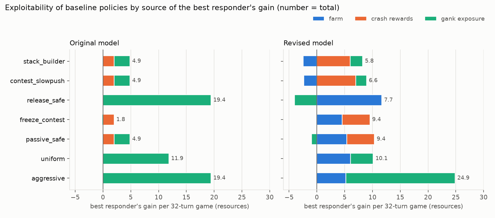
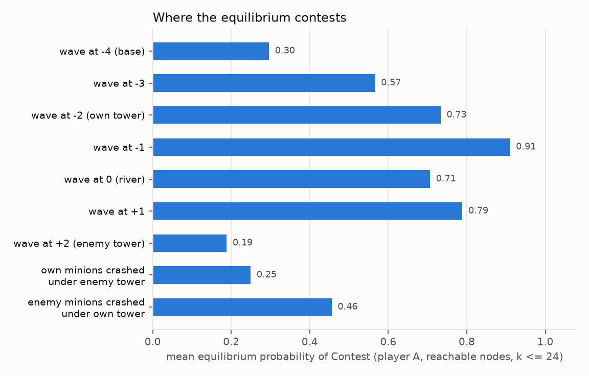
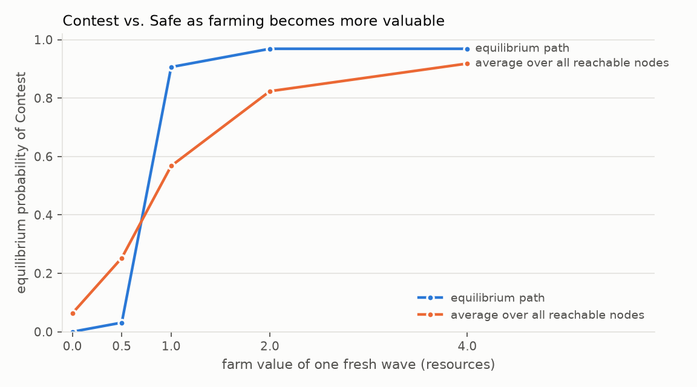
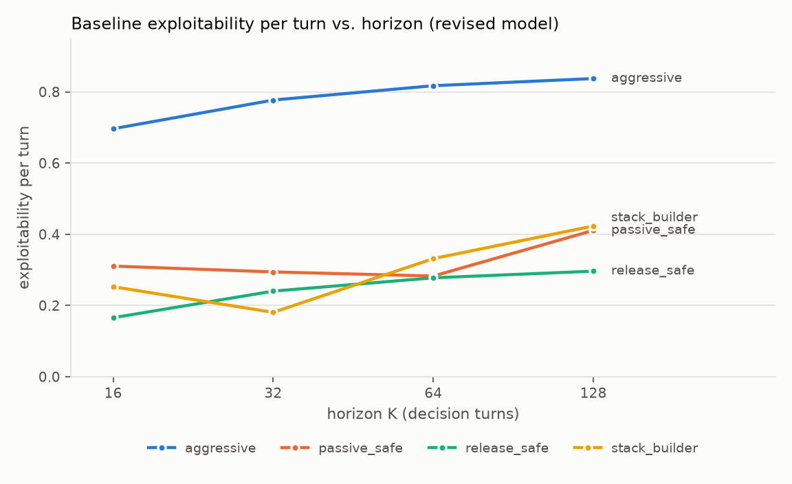

# Phase 1 Revision Report: Farming Economy, Positioning and Strategic Depth

*Status: revision complete. Every number below is regenerated by `python -m lanegame experiments all` (output in `results/revision/`). The original Phase 1 model and its report ([phase1_implementation_report.md](phase1_implementation_report.md)) are preserved: `GameConfig.v1()` reproduces it bit-for-bit, and `python -m lanegame experiments-v1 all` regenerates its tables in `results/`.*

---

## A. Executive summary

**What changed.**
1. **Event-based farming economy.** Every HP of minions killed in a fight or by a tower is a farm opportunity for the killer's side, worth `farm_per_hp` resources. It is collected with an efficiency that depends on *where* the minions died, the collector's posture and whether the opponent contests. Nothing pays merely for choosing an action. Minions killed by a tower are farmable by the defender.
2. **A second decision: Contest vs. Safe.** Each player chooses a combined action (wave management × positioning), so up to 6 actions. Positioning changes the champion, not the minions:
   - Contest follows the wave: full collection, zoning of the opponent, shove damage everywhere, higher exposure.
   - Safe stays at its tower's edge: lower exposure and lower collection away from its tower, champion damage only near its tower, no zoning.
3. **Reworked wave mechanics.**
   - Finer HP units: 4 HP per wave, so fights last about a spawn interval.
   - A new Slow Push rule: an unstacked wave waits at the river for reinforcements; a stacked wave creeps forward one cell every two spawn intervals.
   - A stricter Freeze rule: legal only with enemy minions at or inside your freeze line.
   - Mass-based tower fire: crashed minions stay under the tower as HP mass, removed at 1 HP per tick, so bigger crashes last longer and feed bigger bounces.
   - No minion is ever deleted by the HP cap: extra waves queue behind a full stack and fight with it.
4. **Infrastructure.** Reachability analysis with replayable witness sequences from the standard start, payoff decomposition (farm / crash / gank) along any policy pair, and 15 new behavioral scenarios. The test suite grew from 68 to 188 tests covering both models, and every experiment (A–F) is reproducible.

**What did not change.** The solver (backward induction, exact stage games, certificates), best responses and exploitability needed only one change: the stage payoff now includes farm. Every guarantee was re-verified (section I).

**Overall outcome.**
- **Strategic choices are now economic.**
  - In the original model, nearly all exploitability came from gank exposure. Now best responses against passive, freezing and stack-building baselines gain mainly through farm and crash differences (section G.4).
  - Contest vs. Safe is genuinely state-dependent. Contest is chosen with probability 0.91 when your wave fights one cell in front of your tower, 0.19 when it is inside the enemy tower cell, and 0.25 after you have crashed (section G.2).
- **Previously unreachable mechanics are reachable.** From the standard start, legal play now produces crashes of every size, crashes onto an existing siege, wave bounces, held and broken freezes, multi-turn sieges and tower farming. The original model could produce neither bounces nor stacked sieges (section F, Experiment D).
- **The symmetric equilibrium is still crash-free,** but it is no longer passive avoidance. It is an even, continuously contested river fight in which both players farm about 62% of the available minions (section G.1).

**Important negative and unexpected findings** (reported, not tuned away):
- **Two mechanics could not stay as I first wrote them.**
  - Letting stacks queue reinforcements without fighting, and letting the defender idle behind its tower, made the reachable state space grow without bound with the horizon. A front frozen at 9 HP (just under the break threshold) accumulated an unbounded queue behind it. The fix (queued packets fight and push with the front) is physically motivated and makes the state space bounded (2,518 distinct states at every horizon ≥ 64).
  - A cache-key bug briefly made creeping Slow Push transitions wrong. It was caught by a test written for this purpose, and every number here postdates the fix (section E.6).
- **Freeze is rarely *chosen* but often *optimal*.** In contact, Freeze and Slow Push have identical consequences, and the solver's deterministic tie-breaking prefers Slow Push. Freeze + Contest is a best response at 66% of nodes where the player's wave is at its own −1 with Freeze legal, and Freeze + Safe at none (section G.3).
- **Crashing a big wave is a liability for the crasher** under the default prices. The defender farms the crashed minions under its tower, and the crash reward (+3 for a 3-wave crash) does not compensate the bounce that follows (section G.2).
- **Persistent lane priority.** Some asymmetric states lead to equilibrium cycles that never return to symmetry: the waves keep meeting one cell from one player's tower, worth 0.125 resources per turn to that player forever (section G.6).
- **Vision is a marginal option.** Positioning is a substitute for vision: a Safe champion is already well protected. Vision is chosen at 45 of 401 crash-choice nodes, and at about half of all such nodes the two options are within 0.25 resources (section G.5).

**Is the project ready for Phase 2?** Yes, with caveats listed in sections K and L. The most important is equilibrium selection: values are unique, strategies are not, and tie-breaking materially affects reported action frequencies.

---

## B. Diagnosis of the original implementation

All claims of the original report were re-verified against the code before any change: 68/68 tests pass; K = 32 has 905 decision nodes, 71 distinct states and 52 mixed nodes; exploitability is 11.86 / 19.45 / 4.85 / 1.85 / 4.85 for uniform / always_shove / always_slowpush / defensive_freeze / stack_then_shove. The revised code reproduces the original equilibrium exactly (max difference 0 over all 905 nodes and 120 choice nodes; a regression test pins the numbers).

**Why the original equilibrium was passive and its exploitation was all gank exposure** (rung 0 of Experiment A, `results/revision/before_after.md`):

| Weakness | Evidence (original model, K = 32) | Consequence |
|---|---|---|
| No farming: resources came only from crashes and ganks | farm 0 on every path | Contesting a wave had no economic value. The only reason to act was to crash, and crashes were rare and small. |
| The champion was tied to its leading wave | exposure = furthest position of the leading wave | Pushing meant standing forward. A forward wave was a liability (a lone river wave was worth −2.8 to −3.6). |
| Coarse HP units (2 HP per wave), fights over in 1–2 ticks | surpluses of 1–2 HP only | Few distinct outcomes: 71 reachable lane states. The only asymmetry source was the +1 shove damage. |
| Tower removed one packet per turn regardless of size | — | Crash size did not change siege length. No bounce and no crash onto an existing siege was reachable from s₀ (verified: 0 reachable transitions). |
| HP above the cap was deleted at merges | 126 reachable transitions delete minions | Minions disappeared without anyone killing them (a hidden form of denial). |
| Exploitation was mostly exposure | decomposition of the best-response gains: 100% gank exposure for uniform and always_shove; always_slowpush 2.0 from one medium crash + 2.85 exposure; defensive_freeze one medium crash (2.0) slightly offset by exposure (−0.15) | Little for an opponent model to learn about the *economy*. |

---

## C. Revised mathematical specification

Notation follows the original report; only what changed is spelled out in full. Coordinates: cells x ∈ {−4, …, +4}, towers at ±T with T = 2, bases at ±4. Each side is stored in its own coordinates (own tower −2, river 0, enemy tower +2). A decision turn is 2 movement ticks; a fresh packet spawns at each base every 4 ticks (every 2 turns).

### C.1 Parameters (defaults; all hand-specified)

| Group | Symbol / field | Default | Meaning |
|---|---|---|---|
| Waves | W = `wave_hp` | 4 | HP of a fresh wave (original: 2) |
| | H = 3W | 12 | HP cap of one packet |
| | δ(h) | max(1, ⌊h/W⌋) | minion damage per tick (discrete Lanchester; unchanged) |
| | κ = `shove_damage` | 1 | extra damage per tick from a shoving champion present at the fight |
| Slow Push | `slowpush_mode` | stack_creep | see C.3 |
| | `slowpush_creep_period` | 2 | spawn intervals per creep step |
| Freeze | θ = `freeze_break_threshold` | 10 | hold breaks if pushing HP + push ≥ θ (2.5 waves; original 5 = 2.5 × 2) |
| | β(SH) | 4 | push bonus of a present shoving champion (one wave; original 2) |
| | `freeze_legal_max` | −1 | Freeze legal iff the enemy front is at own x ≤ −1 (original 0) |
| Tower | d_T | 1 | tower damage per tick to a contested attacker in its cell |
| | d_S = `tower_siege_damage` | 1 | tower fire per tick on crashed mass |
| | `siege_cap` | 48 | cap on crashed HP under a tower (never reached from s₀) |
| Farming | φ = `farm_per_hp` | 0.25 | resources per HP of minions killed (1 per fresh wave) |
| | c_C, c_C(T) | 0.9, 0.5 | Contest collection (elsewhere / in the enemy tower cell) |
| | c_S, s | 0.8, 0.2 | Safe collection at own tower, drop per cell forward |
| | z_C, z_T | 0.3, 0.15 | zoning by a contesting opponent (elsewhere / under the collector's own tower) |
| Ganks | L, b₀, b_pos | 5, 0.15, 0.10 | gank loss, base rate, exposure slope (unchanged) |
| | b_act | (0.02, 0.05, 0.02, 0, 0, 0) | per combined action SP-C, SH-C, F-C, SP-S, SH-S, F-S |
| | safe line | −1 | furthest own position of a Safe champion |
| | b_str, p_max, ρ | 0.02, 0.4, 0.5 | strength term, cap, vision reduction (unchanged) |
| Crashes | options | small: +1 or vision; medium: +2 or vision; large: +3 or (+2 and vision) | unchanged; vision lasts 2 turns |

### C.2 Actions and legality

A player's action is a = w + 3p with wave management w ∈ {SP = 0, SH = 1, F = 2} and posture p ∈ {Contest = 0, Safe = 1}. SP and SH are always legal with both postures. F (with either posture) is legal iff the enemy front exists at own position ≤ −1, i.e. in front of or inside the player's tower. The legal sets therefore have 4 or 6 actions.

Under this rule both players can never freeze at once: that would require each enemy wave to be on the other's half, i.e. crossed fronts. So the largest stage game is 6 × 4. The solver handles full 6 × 6 games; a test solves the variant with the original Freeze rule, where they occur.

Both players choose simultaneously; the choice is not observed before the turn resolves.

### C.3 One movement tick

For each side, the packets are a *front* (the leading packet, position and HP) and *rears* (fresh 4-HP packets behind it). Crashed minions are an HP mass `siege` under the enemy tower. Fronts are in contact iff their distance is ≤ 1. Each tick, in order:

1. **Movement.**
   - A rear advances one cell unless that would put it into the cell of a front it cannot join (cap); queued rears wait one cell behind the front.
   - A front does not move if it is in contact, or if it is waiting: the enemy has crashed mass under its tower and the front is within one cell behind that tower.
   - Otherwise its wave action decides:
     - **SH**: always advances.
     - **SP**: walks to the river at full speed. Past the river an unstacked front (h ≤ W) waits for reinforcements; a stacked front advances one cell on the first tick of every turn k with k ≡ 0 (mod 4), i.e. one cell per two spawn intervals.
     - **F**: own front advances only up to own −1.
   - **Freeze hold.** A front that wants to cross the enemy's freeze line (the freezer's −1) is held unless h_blob + β ≥ θ. Here h_blob is the front's HP plus any packets queued within one cell behind it, and β = β(SH) only if the pushing champion is present (Contest, or Safe with the front at or behind the safe line).
2. **Merging.** A rear within one cell of the front merges into it if h_front + W ≤ H; otherwise it stays queued.
3. **Fight.** In contact, each side deals δ(h_blob) + κ·[SH and champion present] + d_T·[enemy front contesting inside this side's tower cell]. HP removed is capped at the target's HP (no overkill credit).
4. **Crash.** A front in the enemy tower cell with no enemy front in contact leaves the lane: siege += h. This is a crash event of size σ(h) = min(2, ⌈h/W⌉ − 1).
5. **Tower fire.** Each tower removes min(d_S, mass already present before this tick's crash) HP from the crashed mass under it.

At the end of the turn: spawns, then the vision countdown. The dynamics depend on k only through k mod 4 (`phase_period`), which is what the transition cache keys on.

**Positioning does not move minions.** With SP or F, the lane evolves identically under Contest and Safe (tested on every reachable transition). Posture changes only the champion's damage, the freeze push, collection, zoning and exposure.

### C.4 Farming

Every HP of side j's minions removed in a fight or by tower fire at position x (in the collector i's own coordinates; x = −T for minions killed under i's tower) creates a farm opportunity of φ for the opponent i. Player i collects

  F_i = φ · Σ_x kills_i(x) · c_i(x),  c_i(x) = base(p_i, x) · (1 − zone(p_j, x)),

with
- base(Contest, x) = 0.9 for x < T and 0.5 in the enemy tower cell;
- base(Safe, x) = clip(0.8 − 0.2·(x + T), 0, 1), i.e. 0.8 at own tower, 0.6, 0.4, 0.2, 0.0 at the enemy tower;
- zone(Contest, x) = 0.3 (0.15 at x = −T, where zoning means standing in the defender's tower range);
- zone(Safe, ·) = 0.

The realized efficiencies range from 0 to 0.9 (14 distinct values occur from s₀). Under the collector's own tower every posture combination collects at least 0.68.

### C.5 Gank risk and exposure

  p_i = clip(b₀ + b_pos·(e_i + T)/(2T) + b_act[a_i] − b_str·Δσ_i, 0, p_max) · (1 − ρ·[v_i > 0]).

- **Contest exposure** e_i is the furthest position the own front reaches during the turn (+T if own crashed mass is under the enemy tower at the start of the turn, i.e. the champion stays to pressure the tower; −T with no own packets).
- **Safe exposure** is min(e_i, −1).

So a player can let a wave walk into the enemy tower without following it: the "trapped champion" limitation of the original model is gone. Contest adds a flat 0.02 (trading and harassment), Shove + Contest 0.05 in total.

### C.6 Payoff and recursion

  r_k = (F_A − F_B) + (ρ_A(o_A) − ρ_B(o_B)) − L·(p_A − p_B),

zero-sum, risk-neutral, undiscounted, V_K ≡ 0. The recursion is unchanged:
- Q_k(s, a, b) = E[r_k + V_{k+1}(s')], with crash choices as separate simultaneous 2×1 / 1×2 / 2×2 games;
- V_k(s) = max_x min_y xᵀQ_k(s)y.

The lane dynamics are deterministic given actions; ganks enter through expected losses. Farm is an expected (fractional) reward and the simulator adds it deterministically.

### C.7 State

The state is (front x, front h, rear positions, siege) per side plus vision timers (v_A, v_B). The meaning of `siege` changed from a packet count to crashed HP; `State` is otherwise identical to the original, all integers.

- **Markov sufficiency.** Every rule depends only on these fields, the actions and k mod 4. Positioning is re-chosen every turn and has no persistent effect, so it needs no state. Farm and crash rewards are paid immediately. Queued rears are fresh 4-HP packets by construction (asserted in code).
- **Bounded state space.** The number of distinct reachable states saturates at 2,518 (no new state appears after turn 64 of a 96-turn game; tested). Cost therefore grows linearly in the horizon.

---

## D. Farming and economic accounting

**Conservation identity.** For each side and every transition,

  HP_alive(before) + HP_spawned = HP_alive(after) + HP_killed_in_fights + HP_killed_by_tower + HP_deleted,

where HP_alive includes crashed mass under the enemy tower. HP_deleted is identically 0 in the revised model (the "block" cap rule). The original model deleted HP at merges on 126 reachable transitions. The identity is tested on every reachable transition (`test_hp_conservation_on_every_transition`).

**One HP, one opportunity, credited to the right player.** Fights and tower fire record each removed HP once, keyed by the collector and the position where the minions died. Tests check on every reachable transition that:
- Σ_x kills_i(x) = HP of i's opponent removed this turn;
- available farm = φ × that HP;
- 0 ≤ collected ≤ available.

A separate whole-game test checks that the HP a side farms plus the opponent's surviving HP equals the HP the opponent ever spawned. So no minion is farmed twice and none vanishes.

**What does not create farm.**
- Choosing an action or a position: every transition without a kill pays exactly 0 farm (tested).
- Merging: tested on a constructed merge and implied by the identity.
- Crashed mass that merely sits under a tower: only the HP the tower actually removes pays, one tick at a time.
- A packet surviving several turns under a tower does not re-trigger the crash reward: crash events require a packet to newly enter the siege (tested).

**Farming under tower** (the explicit requirement).
- When A crashes a 3-wave packet into B's empty tower, tower fire removes it over 6 turns (12 ticks). Each removed HP is a farm opportunity for B at its own tower.
- B collects 80% with Safe if A leaves, 90% with Contest if A leaves, and 76.5% with Contest if A stays to zone (scenarios `tower_farm_safe`, `tower_farm_contested`).
- Meanwhile A receives its crash reward, a separate choice that B's farming cannot reduce (tested), and may stay forward (exposure +T) to zone B.
- Both players can therefore gain on the same turn, which is fine because the objective is the difference.

**Denial is never a bonus.** The only farm term in the payoff is collected_A − collected_B (tested: `payoff == farm_A − farm_B + gank` on every transition). Denial is the gap between available and collected farm. It changes the opponent's collected farm and enters the relative payoff exactly once, through the opponent's term. Example (`freeze_denial`): A freezes at its −1 and A's next wave kills B's held minions there. A collects 90% of that farm. B, standing Safe far forward, collects 3% of the farm from A's minions dying at B's +1.

**Ablation-only mode.** In the original "packet" tower mode the queue does not store HP, so the defender's farm opportunity on crashed minions is credited when they enter the tower: same total, earlier timing. This mode is used only on rung 1 of Experiment A and in the "packet tower" variant.

---

## E. Modelling decisions and alternatives

All comparisons are in `results/revision/model_comparison.md` (every variant changes one mechanic of the default and is solved at K = 32) and `results/revision/before_after.md`.

### E.1 HP resolution: W = 4 instead of 2

At W = 2 every fight ends within 1–2 ticks and surpluses are 1–2 HP. From the symmetric start the only source of asymmetry is the +1 shove damage, so the lane has 107 distinct states under the revised economy and large crashes are unreachable. At W = 4 with the *same per-wave firepower* (δ = max(1, ⌊h/W⌋), so a fresh wave deals 1 HP per tick), a fresh-vs-fresh fight lasts 4 ticks, about one spawn interval. Reinforcement timing then decides fights (reinforcements merge mid-fight) and the meeting point can drift. A scaled W = 4 (shove 2, tower 2: the same timings as W = 2) was also tried; it is a pure refinement with fewer distinct dynamics. All W-dependent thresholds were rescaled (θ = 2.5W, β = W, φ = 1/W).

### E.2 Slow Push (Experiment "model_comparison")

| Rule | Scenarios (of 15) | Distinct states K = 32 → K = 64 | Large crashes reachable | Bounces reachable | Verdict |
|---|---|---|---|---|---|
| **stack_creep, period 2 (adopted)** | 15 | 2,480 → 2,518 (saturates) | yes (1,840) | yes (8,176) | waits while weak, advances gradually once stacked; bounded |
| hold at river (original) | 14 | 9,354 → **99,928** | yes | yes | never advances on its own; parked capped stacks accumulate queues, so the state space grows without bound |
| creep, 1 cell / spawn interval | 10 | 684 → 684 | no | yes | the wave reaches the tower after 2 intervals, too soon to build |
| creep, 1 cell / 2 intervals | 15 | 1,326 → 2,142 | yes (360) | yes | close second; fresh waves also creep and stack less; still growing at K = 64 |
| stack_creep, period 1 | 13 | 924 → 924 | no | yes | as creep/1 once stacked |
| half speed past the river | 10 | 670 → 670 | no | yes | as creep/1 |
| free (no line; pacing only from fight duration) | 10 | 40 → 40 | no | no | collapses to a handful of symmetric states |

Two findings guided the choice:
- The short lane (two cells from the river to the enemy tower) means any rule that advances every spawn interval reaches the tower before reinforcements can build a large wave. The creeping wave is phase-locked with the defender's spawns, so it always arrives as a fresh defender wave reaches the tower.
- "Pacing from fight duration alone" sounds the most physical, but makes Slow Push a Shove without champion damage. From the symmetric start almost nothing then happens.

A third finding came only from the boundedness check. Under "hold" a full stack can park at the river indefinitely while reinforcements queue behind it, so the reachable state space grows without bound: 99,928 distinct states at K = 64, about 10 times the K = 32 count. The original model avoided this only by deleting the excess HP.

The adopted rule satisfies the brief's list: it advances gradually, prioritizes building, lets reinforcements catch up, has less clearing power than Shove (no champion damage) and remains contestable (`shove_contests_slowpush`).

The choice matters quantitatively. Under "hold", passive baselines are about twice as exploitable (passive_safe 19.7 vs. 9.4) because the best responder can build a full stack at the river and cash it in.

### E.3 Freeze legality and strength

- **Legality.** The original rule (enemy front at the river or closer) let a player "freeze" a wave at the river. The adopted rule requires the enemy wave to be at the freezer's −1 or inside its tower cell, "just outside tower range". The original rule reaches the same events, with more held freezes (14,164 vs. 3,392 transitions) and lower exploitability of freeze_contest (6.8 vs. 9.5).
- **Breaking.** A freeze breaks when the pushing *blob* (front plus queued packets) plus a present champion's shove push reaches 2.5 waves. A lone fresh wave plus a shove (8) cannot break it; a two-wave stack with a shove (12), or a three-wave stack alone, does (`freeze_holds`, `freeze_broken`).
- **Champion presence.** The push requires the pushing champion to be present, so Shove + Safe cannot break a freeze from a distance.
- **Considered and rejected:** a separate break threshold for a Safe freezer. The freeze line (own −1) coincides with the Safe position, so the freezer is present either way. Posture changes the freezer's collection and exposure instead.

### E.4 Tower: mass-based fire, waiting defenders

| Variant | Distinct states | Bounces | Large crash lasts ≥ 5 turns | Verdict |
|---|---|---|---|---|
| **mass, 1 HP/tick, defender waits behind its tower (adopted)** | 2,480 | 8,176 | yes | crash size ↔ siege length ↔ bounce size |
| packet: 1 packet per turn (original) | 284 | 0 | no | crash size irrelevant to siege length; no bounces |
| mass, 2 HP/tick | 1,002 | 1,488 | no (3 turns) | weaker bounces; a sensitivity setting |
| defender minions engage the crashed mass | 612 | **0** | no | Lanchester attrition from a large crashed mass destroys arriving defender waves, so no bounce ever forms |
| engage + 2 HP/tick | 476 | 0 | no | as above |

- **Waiting vs. engaging.** "Defender minions fight the crashed minions" is arguably the more literal picture of League. In this model, though, it eliminates bounces entirely (0 reachable), and the brief explicitly requires that surviving defender reinforcements push back out. So the adopted rule keeps the original stylization: the defender's wave waits one cell behind its tower and contests any *new* attacker arriving in the tower cell (with tower help). That wave fights the new arrival rather than the crashed mass.
- **What a bounce looks like** (scenario `bounce`, constructed start). A 3-wave crash keeps the defender waiting for 6 turns, during which two reinforcements merge (12 HP). The stacked wave then walks back past the river.
- **Rate.** d_S = 1 HP/tick makes a one-wave crash last 2 turns and a three-wave crash 6 turns. With d_S equal to the spawn rate (1 HP/tick per side), the reachable state space is bounded only thanks to the queue rule of E.5; 2 HP/tick is reported in the sensitivity analysis.

### E.5 The HP cap: "block" and "queued packets fight" (found by debugging, not designed up front)

- **The original rule.** It deleted HP above the cap at merges (`min(H, h₁ + h₂)`). That is an accounting artifact: minions vanished unfarmed (126 reachable transitions in the original model, 612 under the revised economy).
- **First fix, and why it failed.** Waves that cannot merge stay as separate fresh packets queued behind the leading packet, so the state remains compact (rears are always fresh waves). This alone made the reachable state space **unbounded**. A front frozen at 9 HP (one below the break threshold) could not absorb a 4-HP reinforcement under the 12-HP cap, and a periodically repeated freeze kept it there forever. The queue grew by one packet every 4 turns: 3,838 distinct states at K = 32, 37,822 at K = 64, 1.95 million decision nodes at K = 128.
- **Adopted fix.** Packets queued within one cell behind the leading packet are physically standing there, so they now fight and push with it (their HP counts toward Lanchester firepower and toward breaking a freeze). With this rule the distinct-state count saturates: 2,480 at K = 32 and 2,518 at K = 64, K = 96 and K = 128. The mechanics comparison shows that the variants with idle queues (3,838 → 37,822), the "hold" Slow Push rule (9,354 → 99,928) and linear attrition (2,760 → 13,302) are all still growing at K = 64.
- **Variant kept for comparison.** "Queued packets stand idle" is kept as a model-comparison variant.

### E.6 Bugs found during the revision

1. **Transition-cache phase bug.** The transition cache keyed the dynamics phase on k mod 2, but a creep period of 2 makes the dynamics depend on k mod 4. Early experiment numbers for those Slow Push variants were wrong (e.g. 19,027 instead of 18,293 nodes before the queue fix). It is fixed with `GameConfig.phase_period`, and a test now checks every cached transition against a direct `step_turn` call.
2. **Unbounded queues** (E.5): a modelling flaw, not a coding error.
3. **Test-design errors.**
   - "Contest must collect ≥ 75% under tower in every posture combination" was stricter than the brief: the worst case, Safe while being zoned, is 68%.
   - "6 × 6 stage games occur" is impossible under the adopted Freeze rule.
   - Both tests were corrected, with the reasons written into the tests.

### E.7 Other decisions

| Decision | Alternatives | Reason |
|---|---|---|
| Collection efficiency = base(posture, location) × (1 − zoning) | per-action efficiencies; efficiency depending on wave strength | the smallest form with the required qualitative behavior (C.4); depends only on events and positions |
| Champion damage and freeze push require presence (Contest, or Safe at/behind its line) | Safe never shoves; Safe shoves at half strength (integer HP makes halves impossible) | makes Shove + Safe meaningful and state-dependent: it releases the wave far forward but still helps clear next to its own tower |
| Positioning chosen each turn, no persistent champion state | a champion position in the state | 2 ticks per turn is enough to cross the lane; no rule needs history, so the state stays Markov without growing |
| Crash reward independent of posture | require Contest to collect it | the reward stands for tempo (recall, ward, roam), which does not need presence; zoning the defender's tower farm does need presence and pays through z_T |
| Crash reward table unchanged (1 / 2 / 3) | rescale with farming | the brief allowed rescaling; keeping it isolates what farming does. Experiment E rescales it (×0.5, ×2) |
| Gank action terms: Contest +0.02, Shove + Contest +0.05, Safe 0; Freeze no bonus | the original (0, +0.05, −0.02) | location now carries "freezing near your tower is safe"; a flat Freeze bonus would hard-code Freeze's attractiveness |
| Expected farm in the simulator | Binomial last hits | risk-neutral objective; ganks remain the sampled randomness |

---

## F. Before-and-after comparison (Experiment A)

The ablation ladder adds one change per rung to the original model (rung 0) until it reaches the revised default (rung 7). Each rung is solved exactly at K = 32 (`results/revision/before_after.md`).

| Rung | Nodes | Distinct states | Mixed | Eq path (A) | Eq farm (collected / available) | Vision taken S/M/L | Bounces reachable | Minions deleted |
|---|---|---|---|---|---|---|---|---|
| 0 original | 905 | 71 | 52 | SP 0.53, F 0.47 | 0 / 0 | 0.93 / 0 / 0.90 | 0 | 126 |
| 1 + farming | 905 | 71 | 54 | SP 0.50, F 0.47, SH 0.03 | 10.1 / 16.0 | 0.93 / 0 / 0.90 | 0 | 126 |
| 2 + Contest/Safe | 1,017 | 79 | 62 | SP-C 0.94 | 10.1 / 16.0 | 0 / 0 / 0 | 0 | 504 |
| 3 + Freeze rule | 801 | 61 | 30 | SP-C 0.94 | 10.1 / 16.0 | 0 / 0 / – | 0 | 176 |
| 4 + mass tower | 1,495 | 127 | 26 | SP-C 0.94 | 10.1 / 16.0 | 0 / 0 / – | 320 | 176 |
| 5 + no deletion (block + queue) | 3,969 | 755 | 146 | SP-C 0.94 | 10.1 / 16.0 | 0.03 / 0 / 0.05 | 1,200 | 0 |
| 6 + W = 4 | 37,245 | 9,354 | 1,983 | SP-C 0.84, SP-S 0.09 | 9.7 / 15.5 | 0 / 0 / 0 | 31,092 | 0 |
| 7 + stack_creep = revised | 14,849 | 2,480 | 1,030 | SP-C 0.84, SP-S 0.09, SH-C 0.06 | 9.7 / 15.5 | 0.10 / 0 / 0.30 | 8,176 | 0 |

Exploitability of the revised baselines (as A) with the decomposition of the best responder's gain. Rungs 0–1 have no Safe actions; Safe baselines fall back to the Contest action with the same wave management.

| Rung | aggressive | passive_safe | freeze_contest | stack_builder | release_safe | uniform |
|---|---|---|---|---|---|---|
| 0 original | 19.45 (gank 100%) | 4.85 (crash 2.0, gank 2.8) | 1.85 (crash 2.0, gank −0.2) | 4.85 | 19.45 | 11.86 (gank 100%) |
| 1 + farming | 24.78 | 8.39 (farm 5.0, gank 3.3) | 5.39 | 8.39 | 24.78 | 13.97 |
| 2 + Contest/Safe | 23.18 | 15.96 (farm 10.7, crash 2.0, gank 3.3) | 12.25 | 12.13 | **4.23** | 11.71 |
| 4 + mass tower | 23.18 | 17.32 | 17.32 | 13.66 | 4.23 | 11.58 |
| 5 + no deletion | 23.18 | 18.38 (farm 9.6, crash 6.0, gank 2.8) | 18.51 | 14.75 | 4.23 | 14.05 |
| 6 + W = 4 | 24.86 | 19.69 | 20.40 | 17.15 | 7.69 | 10.09 |
| 7 revised | 24.86 (farm 5.2, gank 19.6) | **9.42** (farm 5.4, crash 5.0, gank −0.9) | 9.45 (farm 4.5, crash 5.0, gank −0.1) | 5.78 (farm −2.5, crash 6.0, gank 2.2) | 7.69 (farm 11.7, gank −4.0) | 10.08 (farm 6.1, gank 4.1) |



*Figure 1. Where a best responder's gain comes from, original model (rung 0) vs. revised model (rung 7). On rung 0 the Safe baselines fall back to Contest, so release_safe = aggressive there.*

**Which change caused what.**
- **Farming (rung 1)** is what makes exploitation economic: every passive baseline loses about 5 resources of farm to its best responder. It does not change the equilibrium path's structure.
- **Positioning (rung 2)**
  - It makes exposure a choice, so being forward is no longer automatically punished. It also creates a new archetype: release_safe, which lets waves go without following them. It is cheap to play (exploitability 4.2) because it trades farm for safety.
  - It also removes vision's value: the crasher retreats to Safe instead of buying vision (vision share 0.9 → 0). This is the most surprising single-change effect.
- **Mass-based tower fire (rung 4)** makes bounces and multi-turn sieges reachable. **Ending minion deletion (rung 5)** multiplies the reachable crash sizes: large crashes go from 0 to 4,184 transitions, because stacks are no longer silently trimmed.
- **W = 4 (rung 6)** and the **Slow Push rule (rung 7)** set the state-space size and the exploitability of passive play. The "hold" rule lets a best responder build a full stack at the river against a passive opponent; stack_creep forces the stack to advance into the defender's reinforcements. That halves the exploitability of passive_safe (19.7 → 9.4).
- **The symmetric equilibrium path never crashes on any rung.** That result is structural (G.1), not an artifact of the original model.

---

## G. Equilibrium and strategic findings (revised default, K = 32)

Observed results are stated first in each subsection; interpretation follows and is marked as such.

### G.1 The symmetric equilibrium

**Observed.**
- V*(s₀) = 0.
- On the equilibrium path both players play Slow Push + Contest 84% of turns, Slow Push + Safe 9% and Shove + Contest 6%.
- The waves meet at the river and keep fighting: each fresh-vs-fresh fight lasts until the next waves arrive and merge, so the lane never empties.
- Per player over 32 turns: 15.5 resources of farm available, 9.65 collected (62%: both contest, so each is zoned, 0.9 × 0.7 = 0.63), expected gank loss 34.7.
- No crashes, no vision choices.

**Interpretation.** In a symmetric state the solver finds a pure saddle point, so realized play stays symmetric: equal waves annihilate symmetrically and cannot produce a crash. A crash on the equilibrium path would require mixing at symmetric states. With farming the river fight is worth contesting: Contest gains 0.31 in farm difference per turn (its own higher collection plus zoning of the opponent) for 0.225 extra expected gank loss (decomposition in `contest_safe.md`). The equilibrium is no longer passive avoidance; it is an even, contested lane.

### G.2 Contest vs. Safe (Experiment C)

**Observed** (equilibrium probability of Contest for A over reachable nodes, k ≤ 24; "advantage" = best Contest action minus best Safe action against B's equilibrium strategy):

| A's situation | P(Contest) | Contest strictly better | Safe strictly better |
|---|---|---|---|
| wave at −4 (just spawned) | 0.30 | 22% | 62% |
| wave at −2 (own tower) | 0.73 | 65% | 25% |
| wave at −1 (fight in front of own tower) | **0.91** | 91% | 9% |
| wave at the river | 0.71 | 70% | 29% |
| wave at +1 | 0.79 | 74% | 16% |
| wave inside the enemy tower cell | **0.19** | 16% | 75% |
| own crashed minions under the enemy tower | **0.25** | 22% | 72% |
| enemy crashed minions under own tower (defending) | 0.46 | 32% | 51% |

- **Opponent pressure.** If B contests with probability > 0.5, A contests with probability 0.81; otherwise 0.25.
- **Gank severity** (whole game re-solved). Average P(Contest) is 0.85 at L = 2, 0.57 at L = 5 and 0.25 at L = 10. The equilibrium path flips from mostly Contest (0.91) at L = 5 to mostly Safe (0.04) at L = 7.
- **Vision.** For "A 2-wave stack at +1", vision raises Contest's advantage from 0.03 to 0.34. Across all nodes the vision split is confounded: vision states are mostly post-crash states, where Safe is preferred anyway.



*Figure 2. Mean equilibrium probability of Contest for player A by situation (reachable nodes, k ≤ 24, K = 32).*

**Interpretation.**
- **Near your own tower** the extra exposure of Contest is small (0.02 flat). Collecting 0.9 instead of 0.6 and zoning the opponent outweighs it.
- **Under the enemy tower or after crashing**, Contest means exposure +2. The only gain is zoning the defender's tower farm (−15%), which is not worth 0.12 extra gank probability.
- **Contest is a strategic complement of the opponent's Contest.** When the opponent contests, a Safe player is zoned and collects little, while contesting back denies the opponent's farm.

Representative decompositions (k = 12; Q split into immediate farm + immediate gank + continuation):

| Situation | Best Contest: Q (farm / gank / continuation) | Best Safe: Q (farm / gank / continuation) |
|---|---|---|
| even river fight | SP-C 0.00 (0 / 0 / 0) | SP-S −0.09 (−0.31 / +0.23 / 0) |
| B wave at A's freeze line, fighting A's wave | SP-C = F-C 0.95 (0.45 / 0.03 / 0.48) | SP-S = F-S 0.90 (0.30 / 0.13 / 0.48) |
| A's 3-wave crash under B's tower | SP-C −6.20 (−0.34 / −0.60 / −5.26) | **SP-S −5.79** (−0.40 / −0.13 / −5.26) |
| B's 3-wave crash under A's tower (A defends) | SP-C 5.74 (0.45 / 0.03 / 5.26) | **SP-S 5.79** (0.40 / 0.13 / 5.26) |

The crash rows show the economics of crashing.
- After crashing a 3-wave packet, the crasher's continuation value is −5.3. The defender farms most of 12 HP under its tower, and the defender's waves bounce.
- Including the +3 crash reward, building and crashing a big wave does not pay against a competent defender at the default prices.
- A stack one cell from the enemy tower is worth −3.0 to its owner (`farm_economy.md`). It gets worse as farming becomes more valuable: −10.1 at 4 resources per wave.
- With farming off, it is worth +0.2.

### G.3 Freeze, and Freeze + Contest near one's own tower

**Observed.**
- Freeze is legal at 2,108 reachable nodes of A with k ≤ 24. The returned equilibrium plays it with probability 0.07 on average (over all nodes where it is legal).
- Freeze is a best response to B's equilibrium strategy far more often: at 66% of nodes with A's wave at its own −1, 73% at −2, 93% at −3 and 95% while defending a siege.
- At A's own −1, **Freeze + Contest is optimal at 66% of nodes and Freeze + Safe at 0%.** At −2 the split is 63% / 20%.
- In the probe "B wave at A's freeze line, fighting A's wave", F-C and SP-C have *identical* Q (0.95), as do F-S and SP-S (0.90).
- Freeze use is insensitive to zoning strength and to Safe's collection fall-off (P(Freeze) 0.066–0.074 over a 3 × 3 grid).

**Interpretation.** The freeze hold only matters when a wave would otherwise move; in contact, Freeze and Slow Push have the same consequences. The solver resolves exact ties toward the lower action code (Slow Push), so equilibrium *frequencies* understate Freeze.

The economic content is in the posture. Near its own tower the freezer collects 0.9 with Contest vs. 0.6 with Safe, for 0.02 extra gank probability. The opponent's minions die far forward for the opponent (its +1), where it collects 0.63 if it contests, at high exposure, or 0.14 if it plays Safe. This is the denial dilemma the brief describes, and it emerges from the collection function and exposure, not from a freeze bonus. Freeze + Contest emerges as the right way to freeze; Freeze as such is weakly, not strictly, preferred.

### G.4 Baselines and exploitability (Experiment F)

| Baseline (as A) | Exploitability (per turn) | Best responder's gain from farm / crash / gank | Equilibrium captures |
|---|---|---|---|
| aggressive (SH-C always) | 24.86 (0.78) | 5.2 / 0 / 19.6 | 98% |
| uniform | 10.08 (0.32) | 6.1 / −0.1 / 4.1 | 98% |
| freeze_contest | 9.45 (0.30) | 4.5 / 5.0 / −0.1 | 30% |
| passive_safe (SP-S always) | 9.42 (0.29) | 5.4 / 5.0 / −0.9 | 30% |
| release_safe (SH-S always) | 7.69 (0.24) | 11.7 / 0 / −4.0 | 36% |
| contest_slowpush (SP-C always) | 6.59 (0.21) | −2.4 / 7.0 / 1.9 | 5% |
| stack_builder | 5.78 (0.18) | −2.5 / 6.0 / 2.2 | 6% |

"Captures" = what the equilibrium earns against the baseline divided by the exploitability.

**Observed.**
- How the best response exploits each baseline:
  - **Passive opponents:** it Slow Pushes to build a stack and crashes a medium and a large wave (one of each per game), contesting 44–47% of turns.
  - **aggressive:** it simply defends (SP-C 94%).
  - **release_safe:** it out-farms it (13.7 vs. 2.1 farm) while accepting more ganks.
- Baselines that are optimal against the equilibrium can still be exploitable: freeze_contest and passive_safe both lose only 2.87 to the equilibrium but 9.4 to a best responder.
- Realized outcomes are noisy: a single equilibrium-vs-equilibrium game has a standard deviation of 16.5 resources. The 5th–95th percentiles of passive_safe against its best response are −34.6 and +15.5, against a mean of −9.7.

**Interpretation.** The economy now lets a best responder exploit *how* a passive or predictable player manages its wave, not just where it stands. The large uncaptured gap against passive, freezing and stack-building play (64–95% of the exploitable value) is the room Phase 2's opponent modelling must earn, and the noise sets how much evidence that needs.

### G.5 Resource vs. vision

**Observed.**
- Vision is taken with mean probability 0.10 after small crashes, never after medium crashes, and 0.30 after large crashes (401 A choice nodes; vision at 45 of them).
- Median |value(resources) − value(vision)| is 0.17 resources; 53% of choice nodes are within 0.25.
- Vision is never taken in the last two turns (tested: final-turn choices always take resources).

**Interpretation.** The tradeoff is live but close. Positioning substitutes for vision: a crasher who retreats to Safe is already at low risk, so two turns of 50% risk reduction are worth about 0.9, below the +1 / +2 resource options. The original model's frequent vision (0.9) came from the crasher being forced to stand under the enemy tower.

### G.6 Timing, persistence and other structure

- **Timing changes strategy.**
  - Solved at K = 128 and compared at least 48 turns before the horizon: 1,972 lane states are reachable in more than one dynamics phase (k mod 4), and 243 of them have a different equilibrium support for A in different phases.
  - Example: B has an 11-HP stack at A's freeze line and A's fresh wave has just spawned. When the phase makes B's stack creep into A's tower now (phase 0), A contests and the state is worth +14.9 to A: A will farm the crash under its tower, bounce and take lane priority. Two turns earlier in the cycle (phase 2), the stack keeps fighting at the freeze line; A retreats to Safe and the state is worth −8.6.
  - Most of these magnitudes is the persistent lane-priority gain accumulated over the remaining ~110 turns (next bullet). The horizon difference between the two phases (2 turns) accounts for at most 0.25, so the sign flip is a timing effect.
- **Persistent lane priority.**
  - Values far from the horizon still drift by up to 0.125 resources per turn. The cause is equilibrium cycles in which the waves keep meeting one cell from one player's tower: equal waves never move the meeting point.
  - In the traced cycle (`B` held at A's −1, A freezing on alternate turns), farm is equal, but B fights beside A's tower: gank probability 0.225–0.265 vs. 0.175–0.215.
  - B's shoving to reset the lane is mixed (0.4) and break-even in equilibrium.
  - Consequence: values of asymmetric states grow linearly with the remaining horizon, and long-horizon exploitability includes these persistent edges.
- 

  *Figure 3. Equilibrium probability of Contest as a function of the farm value of a wave (Experiment B).*
- **The Contest threshold in the farm price.** With farming off, the equilibrium path is entirely Slow Push + Safe and the average node contests with probability 0.06. Contest takes over between 0.5 and 1 resource per wave. Higher farm value does *not* make play more aggressive in the sense of crashing (crashes stay at 0 on the path); it makes it more *contested*.
- **6 × 4 at most.** No state lets both players freeze (C.2). 7% of stage games need an LP; the rest have pure saddle points.

---

## H. Sensitivity and robustness (Experiment E)

`results/revision/sensitivity.md` re-solves the game exactly for 61 settings: the baseline, 27 one-at-a-time perturbations of 14 parameter groups, and 33 points of four joint sweeps (farm × gank loss, Safe fall-off × zoning, crash-reward scale × farm, tower rate × farm). For each setting, six qualitative claims are checked automatically.

| Claim | Holds in | Fails where |
|---|---|---|
| C1 the symmetric equilibrium path never crashes | **61 / 61** | — |
| C3 aggressive (Shove + Contest) is the most exploitable baseline | **61 / 61** | — |
| C4 against passive_safe, the best responder's gain is mostly economic (farm + crash), not ganks | **61 / 61** | — |
| C5 a 3-wave crash under the enemy tower has negative continuation value for the crasher | **61 / 61** | — |
| C6 at own −1 with Freeze legal, Freeze + Contest is optimal more often than Freeze + Safe | 58 / 61 | shove damage 0 (degenerate: only 32 nodes); farm 0.125 with L = 7; farm 0.125 with tower fire 2 |
| C2 Contest is the majority posture on the equilibrium path | **47 / 61** | farm 0.125 (any L, crash scale or tower rate); L = 7 at farm 0.25; flat Contest risk 0.04; safe line −2; weak zoning (0.15) with a flat Safe fall-off (0.1) |

**Robust** (survive every tested change):
- crash-free symmetric play;
- aggressive play being the most exploitable;
- passive play being exploited economically;
- big crashes being liabilities for the crasher.

**Threshold-type: the equilibrium path's posture.** P(Contest) on the path is either about 0.9–1.0 or about 0.0–0.04, never in between. Which side of the threshold the model sits on depends on the balance of farm value (0.125 vs. 0.25 per HP), gank loss (5 vs. 7), the flat Contest risk (0.02 vs. 0.04) and how far forward Safe reaches (−1 vs. −2). The default sits on the Contest side, but not by a wide margin: the path value of contesting the river fight is +0.08 per turn at the default (G.2). *Any claim about how contested the equilibrium lane is must be quoted with its parameters.* The average over all nodes moves smoothly (0.16–0.94), so off-path structure is less fragile than the path.

**Threshold-type: vision.** The share of crash choices taking vision is 0–0.1 at the default. It jumps to about 0.8 when vision is stronger (ρ = 0.75), the base gank rate is higher (b₀ = 0.2), the gank loss is higher (L = 7) or crash rewards are halved. It drops to 0 when crash rewards are doubled.

**Magnitudes are sensitive.**
- Exploitability of passive_safe ranges from 4.6 (farm 0.125, crash ×0.5) to 22.6 (farm 0.5, crash ×2).
- The value of a 3-wave crash to the crasher ranges from −2.4 (tower fire 2, farm 0.125) to −9.6 (shove damage 0).
- Below the most exploitable baseline, the ranking is not stable: release_safe moves from least to second most exploitable as farm value rises.

**Degenerate corner.** With shove damage 0 all fights are symmetric annihilations and only 32 decision nodes are reachable, as in the original model.

**Structural choices** (Slow Push rule, Freeze legality, tower mode, cap rule, HP units) are compared in the mechanics comparison (section E). The quantity most sensitive to them is the exploitability of passive play: it roughly doubles under the original "hold" Slow Push rule.

---

## I. Tests and verification

`python -m pytest`: **188 tests, all passing** (about 60 s). The suite runs every generic invariant on both the original and the revised model.

| Area | Tests |
|---|---|
| Matrix solver | known games (matching pennies, RPS, weighted RPS, closed-form 2×2, a known 6×6), saddle detection, dominated strategies, affine invariance, degenerate ties; random rectangular games of 13 shapes up to 6 × 6 against support enumeration; integer-valued 6 × 6 games with ties |
| Invariants (both models) | zero-sum (farm, gank, crash terms) on every transition; the stage payoff is exactly farm + gank; mirror equivariance of dynamics, legal sets, farm, kills and gank risk; V(mirror s) = −V(s) and V(s₀) = 0; K = 1 terminal game; final-turn choices take resources; valid distributions; periodicity of the dynamics in k; **cached transitions equal direct computation** |
| Mechanics (both models) | spawn timing; determinism; packet conservation (packet-queue and HP-mass forms); no crossing and bounds; integer state keys; crash events ⇔ crash rewards; vision expiry and halving; gank bounds and monotonicity; reinforcement timing; 26 scenarios; scenario start-reachability flags; the original rules (one packet per turn, original Freeze legality, action gank terms) pinned on v1; **v1 reproduces the original solution and exploitability** |
| Economy (revised) | HP conservation on every transition (zero deletion); every removed HP is exactly one opportunity for the opponent; 0 ≤ collected ≤ available; tower kills farmed under the defender's tower; siege-mass accounting; merging creates no farm; no-kill turns pay no farm; full stacks queue instead of deleting; whole-game no-double-farming; collection-efficiency properties (Contest ≥ Safe, state-dependent gap, zoning lowers, ≥ 0.6 under own tower); crash reward separate from tower farm; denial not double-counted; farm off ⇒ zero farm; the engaging-defender variant keeps every identity |
| Positioning (revised) | legal sets (4 or 6; Freeze with both postures, only near own tower); action encoding; simultaneous full matrices; Safe never riskier than Contest; Safe exposure capped, Contest stays under the enemy tower; minions move and fight identically under both postures for SP/F; Contest adds pressure beyond the safe line; Safe still shoves next to its tower; symmetry; flat Contest risk term |
| Wave mechanics (revised) | bigger crashes occupy the tower longer; tower fire rate and timing; defenders wait and absorb reinforcements; unstacked Slow Push waits, stacked creeps one cell per period; Shove + Safe releases the wave; queued packets push with the front; **bounded state space** (no new state after turn 64 of 96); all 11 events reachable from s₀ with replayed witnesses; the original model cannot reach bounces or stacked sieges |
| Solver (both models) | backward induction = plain tree recursion with support enumeration (5 + 5 roots); certified gaps ≤ 1e-9; zero exploitability; subgame perfection from every reachable state; exploitability ≥ 0 for baselines and random policies, both sides; best response beats every scripted reply; support indifference; stage shapes; a 150-game sample re-solved without LP; 6 × 6 stage games under the original Freeze rule |
| Simulation (both models) | Monte Carlo within 4.5 standard errors of exact values (5 matchups per model); forward path statistics equal backward values and decompose exactly into farm + crash − gank; seed reproducibility (payoffs, ganks, farm); with ganks off, every episode equals the exact value and records exactly the path's farm and crash resources |

**Independent verification** (`results/revision/verification.md`):
- All 14,849 stage games and 802 crash-choice games of the K = 32 solution re-solved by support enumeration (no LP): max |difference| 8.9e-16.
- Backward induction vs. tree recursion from 5 roots (depth 2–3): exact agreement (≤ 8.9e-16).
- Equilibrium exploitability exactly 0.0 for K = 16, 32, 64 (both players).
- Monte Carlo (4,000 games each, 8 matchups): z-scores between −1.06 and +1.14.
- Maximum certified duality gap 1.8e-15 (K = 32), 2.7e-15 (K = 64).

**Tolerances** (unchanged): probabilities below 1e-12 are zeroed; certified gaps must be ≤ 1e-9; value equalities use 1e-8; Monte Carlo agreement uses 4.5 standard errors.

**Outstanding correctness concerns:** none known. The equilibrium-selection issue (G.3, K.6) is a property of the solution concept, not an error.

---

## J. Computational performance

From `results/revision/horizon_benchmark.md`. All runs are single-threaded Python 3.13 on Windows. Timings come from an untraced run; peak memory is the Python allocation peak (tracemalloc) of a separate run of enumeration plus solve.

| K | Ticks | Decision nodes | Max per k | Distinct states | Cached transitions | Stage / choice games | LPs | Mixed | Enumerate s | Solve s | One best response, s | Peak MB | Max gap |
|---|---|---|---|---|---|---|---|---|---|---|---|---|---|
| 16 | 32 | 1,799 | 384 | 604 | 21,552 | 1,799 / 112 | 154 | 152 | 1.1 | 0.7 | 0.06 | 23 | 4.4e-16 |
| **32** | 64 | 14,849 | 1,302 | 2,480 | 91,744 | 14,849 / 802 | 1,044 | 1,030 | 5.1 | 3.3 | 0.6 | 108 | 1.8e-15 |
| 64 | 128 | 50,769 | 1,344 | 2,518 | 94,112 | 50,769 / 2,498 | 3,717 | 3,683 | 7.6 | 9.8 | 1.8 | 153 | 2.7e-15 |
| 128 | 256 | 122,609 | 1,344 | 2,518 | 94,112 | 122,609 / 5,890 | 9,098 | 9,038 | 11.5 | 20.9 | 4.1 | 240 | 5.0e-14 |

For comparison, the original model at K = 32 had 905 nodes and solved in 0.3 s.

- **State growth is bounded.** The set of distinct states stops growing at 2,518 by K = 64 (no new state after turn 64 of a 96-turn game; tested), and the largest layer is 1,344 states. Decision nodes then grow linearly in K (about 1,340 per turn) and so does solve time. The transition cache saturates at 94,112 entries (state × phase × joint action).
- **Where time goes.**
  - Transition generation runs at about 8,000–20,000 joint actions per second in pure Python.
  - About 93% of stage games have pure saddle points (no LP).
  - The remaining LPs are dominated by SciPy/HiGHS per-call overhead (about 7 ms per call, mostly option validation), not by the LP itself.
  - A full sensitivity setting (solve, 7 best responses, path statistics and 2 probe solves) takes about 50 s.
- **Memory.** 240 MB at K = 128, dominated by the cached Q matrices and transitions.
- **Horizon effects.**
  - V*(s₀) = 0 at every K.
  - Probe values with 16 turns remaining are identical for K = 16, 32, 64, 128, as time-homogeneity up to the phase requires (tested in the benchmark).
  - Exploitability per turn grows with K and has *not* saturated by K = 128 for the passive and stack-building baselines (contest_slowpush: 0.21 per turn at K = 32, 0.43 at K = 128): longer games let a best responder set up and cash in stacks and persistent lane priority. aggressive saturates at about 0.8 per turn.
- 

  *Figure 4. Exploitability per turn of four baselines by horizon.*
- **Default horizon K = 32 is retained.** It is about 8 minutes of laning at 30-second waves and solves in under 10 s including enumeration. Its end effects (vision and stacks are worthless in the last turns; zero terminal bonus) cover only the last 2–3 turns. Phase 2 can use K = 64 (about 17 s) or K = 128 (about 32 s) when long-run exploitation matters, which the per-turn growth above suggests it may.

---

## K. Remaining limitations

1. **All parameters are hand-specified.** None is calibrated to League data. Several conclusions are threshold effects in these parameters (section H): the Contest/Safe balance flips between L = 5 and 7, and farming dominates the economy only from about 0.5 resources per wave.
2. **The defender waits behind its tower during a siege** instead of fighting the crashed minions (E.4). This stylization is what produces bounces; the more literal alternative eliminates them. Bounce *sizes* should not be over-interpreted.
3. **The lane is short** (two cells from the river to each tower). Every rule that advances each spawn interval reaches the tower too early, which is why Slow Push needs a creep period of two intervals. Stacks of more than three waves are represented as a capped front plus queued waves rather than a single larger body.
4. **Slow Push and Freeze remain stylized.** Slow Push still waits at the river while unstacked. Freeze's holding effect matters only when a wave would move, so Freeze and Slow Push tie in contact (G.3). Champion presence is binary (Contest everywhere, Safe up to own −1).
5. **The economy has one resource.** Farm, crash rewards and gank losses are all "resources". There is no experience, level or item threshold, no plate timer, and no cannon wave; a gank does not remove the champion from the lane.
6. **Equilibrium selection.** Many stage games are degenerate: 93% have pure saddle points, and exact ties are common (Freeze vs. Slow Push in contact, Contest vs. Safe when nothing dies). The solver returns one equilibrium with deterministic tie-breaking toward lower action codes, so *equilibrium action frequencies are selection-dependent*; values and exploitability are not. Section G reports weak optimality alongside frequencies wherever it matters.
7. **Persistent asymmetric cycles** (G.6) make long-horizon values of asymmetric states grow with the horizon. That is not an error, but Phase 2 comparisons from asymmetric roots should fix the horizon.
8. **Vision is weak** in the default economy (G.5). The crash-reward tradeoff is preserved mechanically, but the vision option is chosen rarely.
9. **Crashes are rarely profitable at default prices** (G.2). The symmetric equilibrium path never crashes, so crash-related behavior appears only off the path and in exploitation.
10. **Constructed scenarios.** 11 of 15 revised scenarios start from constructed states. Every event they illustrate is separately shown to be reachable from s₀ (Experiment D), but the exact start states are not.

---

## L. Phase 2 handoff

**Reusable as is:**
- `LaneGame` (combined actions, farming, gank risk; any `GameConfig`);
- `solve_equilibrium` (any root and start index);
- `induct` / `evaluate` / `best_response_value` / `exploitability` for any `Policy`;
- `path_statistics` (exact occupancy and the farm / crash / gank decomposition);
- `simulate` (seeded, realized ganks, expected farm);
- `explore_events` (reachability with witnesses);
- the JSON solution format (version 2; action codes 0–5).

A new agent implements the same `Policy` interface (`move(k, s, side, legal)`, `choose(...)`). `lanegame.baselines.prefer(legal, ...)` handles Safe→Contest fallbacks.

**Suggested use of the revised game:**
- **Opponent types.** The seven baselines span distinct archetypes, with exploitability from 5.8 to 24.9 and very different exploitation sources: exposure (aggressive), farm (release_safe), crashes (passive, freezer, stacker). Parameterized families (e.g. "freeze-prone with probability q", "contests with probability q") are natural Bayesian type spaces. Actions are observed every turn, so the likelihood of a type is the product of its action probabilities.
- **Exploitation vs. exploitability.** The equilibrium already captures 98% of the value against aggressive and uniform opponents but only 5–36% against passive, freezing and stack-building ones. Restricted-Nash-response or ε-mixture frontiers should be studied mainly for the latter.
- **Evidence and risk.** A single game's standard deviation is about 16 resources against edges of 6–10 per game for the economically exploitable baselines. Detecting them with confidence needs on the order of tens of games, which is the quantitative core of "how much evidence justifies deviation". Farm is deterministic given actions, so the noise comes entirely from ganks and mixing.

**Fix or decide before Phase 2:**
1. **An equilibrium-selection rule** (K.6), e.g. maximum-entropy or uniform tie-breaking among optimal actions, so that "the equilibrium agent" and its action frequencies are well defined.
2. **Whether the persistent lane-priority cycles (G.6) are wanted.** If not, a small drift rule for the meeting point would make long-run values stationary.
3. **Whether to rescale crash rewards and vision** (Experiment E shows how the conclusions move) so that crashing and vision matter on the equilibrium path. This is a modelling choice to make deliberately, not to tune for interesting charts.

---

## M. Reproduction

```bash
# 1. environment (Python >= 3.10; tested with 3.13.9, numpy 2.5.3, scipy 1.18.1, matplotlib 3.11.2, pytest 9.1.1)
python -m venv .venv
.venv/Scripts/activate            # Windows;  source .venv/bin/activate on macOS/Linux
pip install -r requirements.txt   # or: pip install -e .[test]

# 2. tests (188 tests, both models, ~1 min)
python -m pytest

# 3. solve and export the revised equilibrium (values, mixed strategies, Q matrices, choices)
python -m lanegame solve --horizon 32                    # -> results/revision/solution_K32.json
python -m lanegame solve --horizon 32 --model v1         # the original model -> results/solution_K32.json

# 4. inspect mechanics, reachability, exploitability and simulation
python -m lanegame scenarios                             # 15 revised scenarios with traces and PASS/FAIL
python -m lanegame reach --horizon 32                    # event reachability from s0 with witness sequences
python -m lanegame exploit --horizon 32
python -m lanegame simulate --a passive_safe --b equilibrium --episodes 5000 --seed 1

# 5. regenerate every table and figure of this report (results/revision/*.md, *.json, *.png)
python -m lanegame experiments all
#    or individually: before_after model_comparison reachability farm_economy contest_safe
#                     baselines sensitivity horizon_benchmark verification figures

# 6. regenerate the original Phase 1 report's tables (results/*.md, *.json, *.png)
python -m lanegame experiments-v1 all
```

All randomness uses seeded `numpy.random.Generator` instances, so reruns are identical apart from timings and timestamps. Each experiment writes a JSON file (with software versions and a timestamp) and a Markdown file.

Expected running time of `experiments all` on a laptop: about 80 minutes. The sensitivity sweep (61 exact re-solves with best responses, about 50 minutes) and the mechanics comparison (17 variants, each also enumerated at K = 64, about 10 minutes) dominate. Every other experiment takes 1–6 minutes; `experiments-v1 all` takes about 90 seconds.
