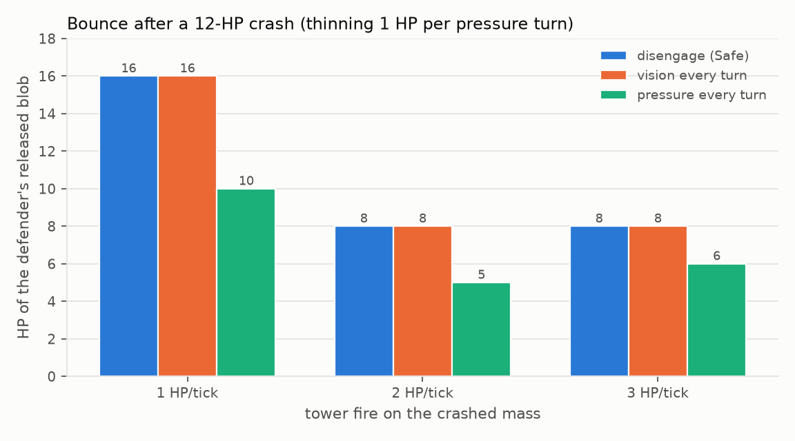
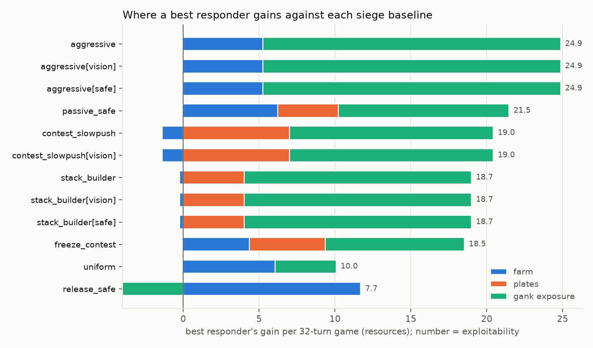
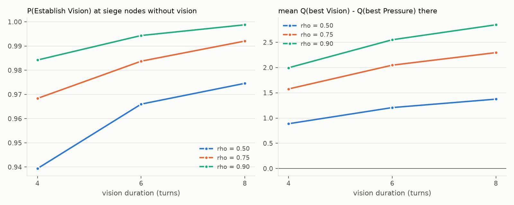
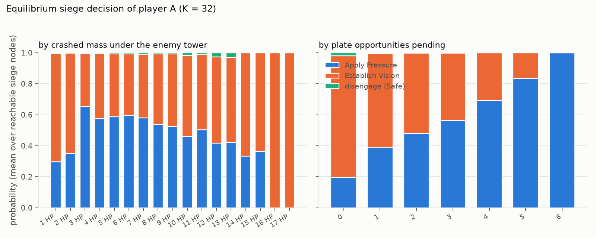
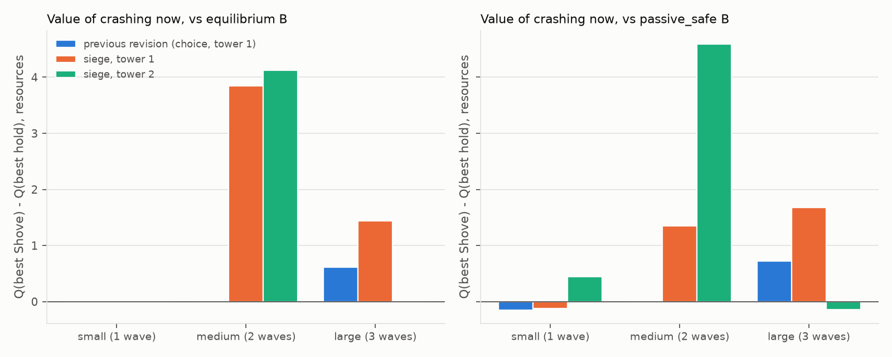

# Phase 1 Siege and Vision Study: Apply Pressure, Establish Vision and Tower Clearing

*Status: study complete. Every number below is regenerated by `python -m lanegame experiments-siege all` (output in `results/siege/`). The two earlier reports are preserved unchanged: `GameConfig.v2()` reproduces the farming revision ([phase1_revision_report.md](phase1_revision_report.md), `results/revision/`) and `GameConfig.v1()` the original model ([phase1_implementation_report.md](phase1_implementation_report.md), `results/`), both bit-for-bit. Terminology: the midpoint cell x = 0 is called "the lane" in this document and in the current code (the earlier reports call it the river).*

---

## A. Executive summary

**What changed.**
1. **Siege objectives.** A player whose crashed minions are under the enemy tower at the start of a turn chooses, with its Contest action and simultaneously with everything else, between **Apply Pressure** and **Establish Vision**; Safe during a siege means disengaging. Crashes themselves pay nothing any more; the old post-crash resource/vision choice stage is gone.
2. **Apply Pressure = finite plates + thinning.** Each crash opens 1 / 2 / 3 plate opportunities (small / medium / large), worth one resource each, claimable one per pressure turn only while that siege lasts; unclaimed ones lapse. The pressuring champion also removes 1 HP per turn from the defender's wave gathering directly behind its tower, while the tower is still busy with the crashed minions; the thinned HP is ordinary farm for the attacker.
3. **Persistent vision.** Establish Vision gives a 75% gank-risk reduction for the next 6 turns (previously 50% for 2), starting the turn after it is established, surviving every later decision, refreshed rather than stacked.
4. **State.** Two integers per side were added (vision timer 0–6, plate opportunities 0–6); the game is still an exact finite-horizon zero-sum stochastic game solved by the same backward induction.
5. **Tower clearing** was compared at 1, 2 and 3 HP per tick and **kept at 1 HP/tick**.

**Overall outcome.**
- **The attacker can now capitalize on a crash, and the solver uses both tools.** In the state the previous report singled out (a 3-wave crash under the enemy tower, 20 turns left) the crasher's value moved from −5.79 to **+6.05**. The first decision there is Establish Vision; with vision in place it is Apply Pressure (section E.3, G.3).
- **Vision first, pressure second.** At siege nodes without active vision the equilibrium establishes vision with probability 0.98 (0.94–1.00 across 50–90% effectiveness and 4–8 turns); with vision active it applies pressure at 60% of nodes and refreshes vision at 40%; disengaging is chosen at under 1% (G.3). The two objectives are complements in time, not substitutes.
- **The Vision → Shove → Crash → Pressure sequence is reachable from the standard start**, with the protected pressure 3 turns after the vision for any second crash and 4 turns after it for a full-wave or a medium second crash, in every vision setting tested; six turns are more than enough, eight are needed only for a *large* second crash (D). In the solved game the sequence is the equilibrium's own choice in the post-crash state (Vision beats immediate Pressure by 1.01) and the best responder against passive play executes it three to four times per game.
- **Thinning weakens bounces without erasing them**: continuous pressure on a 3-wave crash cuts the defender's released blob from 16 HP (a capped 12-HP wave plus a queued reinforcement) to 10 HP; with 2 HP per turn it would erase it (4 HP), which is why 1 HP per turn is the default (E.5, F). In solved play the large-bounce problem disappears for a different reason: best responders prefer small and medium crashes that they can siege, and the baselines never bounce (E.4).
- **Tower fire stays at 1 HP/tick.** At 2 and 3 HP/tick a siege lasts one turn, every siege decision collapses to vision, and Apply Pressure is never used by a best responder (0 plates, 0 thinning); the state space is 6–10× smaller, which makes 2 HP/tick the right cheap variant for Phase 2 sweeps but not the default (E.5).
- **The symmetric equilibrium is unchanged** in every configuration: an even, contested, crash-free lane fight (Slow Push + Contest 84%, farm 9.65, gank loss 34.7). Everything new acts off the path and in exploitation (E.2, G.1).
- **Exploitation of predictable play roughly tripled and changed nature.** Exploitability of passive_safe rose from 9.4 to 21.5, stack_builder from 5.8 to 18.7, contest_slowpush from 6.6 to 19.0; the best responder now crashes small and medium waves repeatedly, sieges them for 4–7 plates and 4–7 HP of thinning, and is vision-protected for 19–24 of 32 turns, contesting 84–92% of the time under vision against 62% without. aggressive (24.9) and release_safe (7.7) are untouched (G.1).
- **Crashing is now a gain for medium waves and a tie or small gain for large ones** against the equilibrium opponent (+3.8 and +1.4 with 16 turns left), where before only the large crash gained (+0.6) and all post-crash states were liabilities (G.4).

**Important negative and unexpected findings** (reported, not tuned away):
- **Most of vision's value is unconditional.** With the default risk parameters 0.56 of the 0.6–0.9 resources a protected turn is worth comes from the base threat b₀ = 0.15 that every player suffers wherever it stands; only the rest depends on how aggressively the protected player then plays. That is why Establish Vision is a near-reflex on the first siege turn and why its value scales so cleanly with duration (G.2, H).
- **The first plate design had to be replaced.** A per-tower budget of 5 plates (a counter that never resets) multiplied the reachable state space by 3–4 (683k decision nodes at K = 32, 46× the previous revision) before any solve; per-crash opportunities that lapse with the siege keep the economics and cost a quarter of that (J).
- **The state space is still 12× larger** than the farming revision's (172,907 decision nodes, 2.7M transitions, 3 GB, about 4 minutes per K = 32 solve), mainly because of the 6-turn vision timer, and it has not saturated by K = 32 (J).
- **Remnant crashes count.** A 1-HP remnant of a lane fight that walks into the tower is a legal small crash with one plate opportunity and one siege turn; against passive opponents the best responder exploits exactly that. Whether remnants should open sieges is a modelling question this study leaves open (K).

**Is the revised model better suited to Phase 2?** Yes, with the caveats of sections K and L. Siege use is now an observable, type-defining behaviour (pressure / vision / disengage), exploitation has a genuine risk dimension (the siege turns are exposed, the protected turns are not), and the exploitable surplus against predictable play is large and mostly uncaptured by the equilibrium (2–15%). The costs are computational and one modelling reflex (vision first) that Phase 2 may want to soften by lowering b₀.

---

## B. The siege problem in the previous revision

Facts re-verified on `GameConfig.v2()` before any change: 188/188 tests; K = 32: 14,849 decision nodes, 2,480 distinct states, 1,030 mixed; exploitability uniform 10.08, aggressive 24.86, freeze_contest 9.45, passive_safe 9.42, stack_builder 5.78, release_safe 7.69, contest_slowpush 6.59, all as reported (`results/siege/verification.md` repeats the check).

**How a siege unfolded.** Tower fire removed 1 HP per tick from the crashed mass, so a 4 / 8 / 12-HP crash occupied the tower for 2 / 4 / 6 agent turns (measured: a crash landing on either tick of a turn gives exactly those numbers). While the mass was there, the defender's leading wave waited one cell behind its tower and absorbed every reinforcement up to the 12-HP cap; the next reinforcement queued behind it and fought with it. From the constructed `bounce` start (12 HP under B's tower, B's fresh wave waiting) B released a capped 12-HP wave with another 4-HP wave queued behind it: 16 HP of blob against A's next 4-HP wave.

**What the attacker could do about it: nothing.** After the crash the attacker had one decision, the post-crash reward (resources or two turns of 50% vision), independent of its posture. During the six siege turns its Contest action meant "stand under the enemy tower at exposure +2" with no effect on the lane beyond zoning 15% of the defender's tower farm. The defender's accumulation could not be slowed, the tower paid nothing more, and the crash reward was paid once whatever happened next.

**Consequences in the solved game** (revision report G.2, G.5, H):
- the 12-HP crash state was worth −5.79 to the crasher with 20 turns left (negative in 61 of 61 sensitivity settings);
- the defender farmed most of the 12 HP under its tower (76.5–80%) and then bounced;
- vision was taken at 45 of 401 crash-choice nodes: a Safe crasher was already well protected, and two turns of protection were worth about 0.9 resources against +1 / +2 / +3 alternatives;
- the symmetric equilibrium never crashed, and crash-related behaviour appeared only in the exploitation of passive opponents.

The brief's question was whether this reflects a strategic fact (a big crash hands the defender a free bounce) or a modelling gap (the attacker has no way to capitalize on the crash). The revision gives the attacker the tools and lets the solver decide.

---

## C. Revised mathematical specification

Notation follows the revision report (section C). Cells x ∈ {−4, …, +4}, towers at ±T with T = 2, each side stored in its own coordinates (own tower −2, the lane 0, enemy tower +2). A decision turn is 2 movement ticks; a fresh 4-HP wave spawns at each base every 4 ticks (every 2 turns). Only what changed is spelled out.

### C.1 State

  s = (x_A, h_A, rears_A, m_A, v_A, π_A ; x_B, h_B, rears_B, m_B, v_B, π_B)

| Field | Meaning | Range |
|---|---|---|
| x, h, rears | leading packet position and HP, positions of fresh packets behind it | as before |
| m | this side's crashed minions under the ENEMY tower (HP mass) | 0 … `siege_cap` |
| v | vision turns remaining, counting the turn about to be played | 0 … `vision_turns` (6) |
| π | **new**: plate opportunities this side can still claim on the enemy tower | 0 … `plates_cap` (6) |

π is nonzero only while m > 0 ("crash" plate mode, the default): it is opened by crashes and lapses when the siege ends. The state is Markov: every rule below depends only on s, the joint action and k mod 4. Mirror symmetry is still "swap the two side records" (V(mirror s) = −V(s) is re-verified in section I).

### C.2 Actions

  a = w + 3·p + 6·o,  w ∈ {SP, SH, F}, p ∈ {Contest, Safe}, o ∈ {None, Pressure, Vision}

*Siege eligibility*: side i may choose a siege objective in turn k iff m_i > 0 at the start of turn k. A crash during turn k makes the siege eligible from turn k+1 (no retroactive siege decisions).

Legal set of side i:
- no eligible siege: {SP, SH, (F)} × {Contest, Safe}, objective None (4 or 6 actions, unchanged);
- eligible siege: {SP, SH} × ({Contest + Apply Pressure, Contest + Establish Vision} ∪ {Safe}) (6 actions). Freeze is never legal while one's own siege exists (the enemy's leading wave is behind its tower, not at the freezer's line).

Contest without an objective is not offered during a siege: Apply Pressure has the same exposure and zoning and adds plates and thinning, so it weakly dominates it; dropping it removes a tie. Safe during a siege is *disengaging*: the champion stays at its safe line (own −1), claims nothing, thins nothing.

Both players choose simultaneously; nothing about the opponent's current action is observed before the turn resolves. There is no separate post-crash choice stage: a crash pays nothing by itself. Stage games are 4 × 4 up to 6 × 6 (both players sieging, or a sieger against a freezer).

### C.3 Resolution of one turn

Within the turn the lane evolves tick by tick as before (movement, merging, contact fight, crash check, tower fire), with one new step after the fights:

**Thinning (3c).** If side i chose Apply Pressure, the enemy's leading packet is *accessible* (enemy own position in [−T−1, −T]: standing directly behind or inside its tower cell), the tower is still occupied by i's crashed mass at the start of the tick (m_i > 0, "tower aggro"), and no lane fight involved that packet this tick, then i's champion removes min(`thin_damage`, remaining budget, packet HP) from it. The budget is `thin_damage` = 1 HP **per turn** (the champion splits its two ticks between the tower and the minions). Removed HP dies where the packet stands (i's own +3 or +2) and is a farm opportunity for i at the "under the enemy tower" efficiency (0.5 with Contest, zoned ×0.7 if the defender contests). Minions at the enemy base (−4) are not accessible until they walk up; nothing is damaged before it exists.

At the end of the turn, after spawns:

**Plates (8).** If side i chose Apply Pressure, it claims c_i = min(`plates_per_turn` = 1, π_i) plates and earns `plate_value`·c_i = 1.0·c_i resources (the claim is resolved on the opportunities available at the start of the turn). Each crash of a packet with HP h during the turn opens `plate_grant`[σ(h)] = 1 / 2 / 3 new opportunities (small / medium / large), capped at `plates_cap` = 6 in total. If m_i = 0 at the end of the turn, π_i := 0: unclaimed opportunities lapse with the siege.

**Vision (9).** If side i chose Establish Vision, v_i := `vision_turns` = 6 (a refresh, never a sum); otherwise v_i := max(0, v_i − 1).

### C.4 Exposure and gank risk

  p_i = clip(b₀ + b_pos·(e_i + T)/(2T) + b_act[w, p] − b_str·Δσ_i, 0, p_max) · (1 − ρ·[v_i > 0 at the START of turn k])

with ρ = `vision_reduction` = 0.75. Exposure e_i is unchanged: a Contest champion stands at the enemy tower (+T) while its crashed mass is there, a Safe champion at most at own −1. Both siege objectives therefore carry the full +T exposure; the objective itself adds no risk term (b_act depends only on wave management and posture). Vision established in turn k first applies in turn k+1.

### C.5 Payoff and recursion

  r_k = (F_A − F_B) + (P_A − P_B) − L·(p_A − p_B),  P_i = plate_value · c_i

zero-sum, risk-neutral, undiscounted, V_K ≡ 0; the crash-reward term of the previous revision is identically 0 in this mode and the old CHOICE stage is skipped. The recursion is the plain simultaneous-move one:

  Q_k(s, a, b) = r_k(s, a, b) + V_{k+1}(s'(s, a, b)),  V_k(s) = max_x min_y xᵀ Q_k(s) y.

The lane is deterministic given actions; ganks enter as expected losses. Best responses, exploitability and path statistics work unchanged on the enlarged action sets; path statistics additionally decompose plates, thinning, pressure / vision / disengage turns, protected turns and bounces, and the exact total still decomposes as farm + plates + crash − gank (tested).

### C.6 Parameters introduced or changed

| Field | Default | Meaning |
|---|---|---|
| `siege_mode` | "objective" | siege objectives in the action set ("choice" = previous revision) |
| `plate_mode` | "crash" | plate opportunities per crash, lapsing with the siege ("tower" = finite budget per tower; measured and rejected, section J) |
| `plate_grant` | (1, 2, 3) | opportunities opened by a small / medium / large crash |
| `plates_cap`, `plates_per_turn`, `plate_value` | 6, 1, 1.0 | cap on pending opportunities; plates per pressure turn; resources per plate |
| `thin_damage`, `thin_reach` | 1, 1 | HP thinned per pressure turn; cells behind the tower cell that are accessible |
| `vision_turns`, `vision_reduction` | 6, 0.75 | previously 2, 0.5 |
| `tower_siege_damage` | 1 | HP of crashed mass removed per tick (section E compares 1, 2, 3) |

Everything else (farming, collection efficiencies, gank model, wave mechanics) is the previous revision's. `GameConfig.v2()` sets `siege_mode="choice"`, `vision_turns=2`, `vision_reduction=0.5`, no plates and no thinning.

### C.7 Timing: a worked turn-by-turn example

The trace below is the shortest Vision → Shove → Crash → Pressure witness from the standard start with a full-wave second crash (`python -m lanegame strategy --horizon 24 --vision-turns 6 --min-crash-hp 4`; `results/siege/timing.md`). B cooperates (it keeps Slow Pushing and never defends the tower); the point of the trace is the *timing*, not B's play. Lanes are global (A pushes toward +), `A*n` = A's crashed mass under B's tower.

| k | A | B | A siege mass | objective | vision | plates (avail → after, +claimed) | B front before → after | thinned | A crash HP | A exposure | p gank (unprotected) | lane after |
|---|---|---|---|---|---|---|---|---|---|---|---|---|
| 0 | SP-C | SP-C | 0→0 | (no siege) | 0→0 | 0→0 (+0) | (−4, 4)→(−2, 4) | 0 | 0 | −2 | 0.170 (0.170) | `     .      .     a4      .      .      .     b4      .      .` |
| 1 | SP-C | SP-C | 0→0 | (no siege) | 0→0 | 0→0 (+0) | (−2, 4)→(0, 3) | 0 | 0 | +0 | 0.220 (0.220) | `    a4      .      .      .   a3b3      .      .      .     b4` |
| 2 | SP-C | SP-C | 0→0 | (no siege) | 0→0 | 0→0 (+0) | (0, 3)→(0, 1) | 0 | 0 | +0 | 0.220 (0.220) | `     .      .     a4      .   a1b1      .     b4      .      .` |
| 3 | SH-C | SP-C | 0→0 | (no siege) | 0→0 | 0→0 (+0) | (0, 1)→(0, 1) | 0 | 0 | +0 | 0.250 (0.250) | `    a4      .      .      .   a3b1      .      .      .     b4` |
| 4 | SP-C | SP-C | 0→0 | (no siege) | 0→0 | 0→0 (+0) | (0, 1)→(−2, 4) | 0 | 0 | +0 | 0.220 (0.220) | `     .      .     a4      .     a2      .     b4      .      .` |
| 5 | SH-C | SP-C | 0→0 | (no siege) | 0→0 | 0→0 (+0) | (−2, 4)→(−4, 4) | 0 | 0 | +1 | 0.275 (0.275) | `    a4      .      .      .      .     a4      .      .     b4` |
| 6 | SH-C | F-C | 0→0 | (no siege) | 0→0 | 0→0 (+0) | (−4, 4)→(−2, 2) | 0 | 0 | +1 | 0.275 (0.275) | `     .      .     a4      .      .     a3     b2      .      .` |
| 7 | SH-C | SP-C | 0→2 | (no siege) | 0→0 | 0→1 (+0) | (−2, 2)→(−4, 4) | 0 | **2** | +2 | 0.300 (0.300) | `    a4      .      .      .     a4      .    A*2      .     b4` |
| 8 | **SP-C+V** | SP-C | 2→0 | **Vision** | 0→**6** | 1→0 (+0) | (−4, 4)→(−3, 4) | 0 | 0 | +2 | 0.270 (0.270) | `     .      .     a4      .     a4      .      .     b4      .` |
| 9 | SP-C | SP-C | 0→0 | (no siege) | 6→5 | 0→0 (+0) | (−3, 4)→(−1, 2) | 0 | 0 | +0 | **0.055** (0.220) | `    a4      .      .      .     a7     b2      .      .     b4` |
| 10 | SH-C | SP-C | 0→0 | (no siege) | 5→4 | 0→0 (+0) | (−1, 2)→(−2, 2) | 0 | 0 | +1 | 0.064 (0.255) | `     .      .     a4      .      .     a5     b2      .      .` |
| 11 | SH-C | SP-C | 0→4 | (no siege) | 4→3 | 0→1 (+0) | (−2, 2)→(−4, 4) | 0 | **4** | +2 | 0.070 (0.280) | `    a4      .      .      .     a4      .    A*4      .     b4` |
| 12 | **SP-C+P** | SP-C | 4→2 | **Pressure** | 3→2 | 1→0 (**+1**) | (−4, 4)→(−3, 3) | **1** | 0 | +2 | **0.068** (0.270) | `     .      .     a4      .     a4      .    A*2     b3      .` |

Reading the timing rules off the trace:
- turn 7: A's 2-HP remnant crashes → m_A = 2 and π_A = 1 at the END of turn 7; no siege decision is possible during turn 7 itself;
- turn 8: the siege is eligible; A chooses Establish Vision. Its gank probability this turn (0.270) equals Apply Pressure's (no retroactive protection). v_A = 6 at the end of the turn; the 2 HP of mass is cleared, so π_A lapses to 0;
- turns 9–11: v_A counts down 6 → 5 → 4 → 3 at the START of each turn; A's risk is 0.055–0.070 instead of 0.22–0.28 while it builds a 7-HP wave and shoves it forward (B, cooperating, lets a fresh 4-HP wave crash on turn 11);
- turn 12: Apply Pressure under the vision established on turn 8: a plate (+1.0) and 1 HP thinned from B's waiting wave at p = 0.068 instead of 0.270. Vision persisted through Slow Push and Shove + Contest decisions in between; applying pressure did not cancel it (v_A = 2 afterwards).

### C.8 Design decisions (and the alternatives measured)

| Decision | Alternatives considered | Why |
|---|---|---|
| **Siege objective inside the simultaneous action** (a = wave + 3·posture + 6·objective) | a separate post-move siege stage (like the old crash choice); an objective chosen before the wave action | One stage keeps the game a plain simultaneous-move stochastic game: no player observes anything about the other's current turn, pressure resolves within the same turn as positioning and ganks (mandatory principles A, B and D of the brief), and the backward induction is unchanged. |
| **Eligibility = own crashed mass > 0 at the start of the turn** | eligibility from the crash tick onward | A crash in turn k becomes a siege decision in turn k+1; eligibility is a function of the state. |
| **Both objectives require Contest; Safe during a siege disengages** | Establish Vision with Safe ("cheap vision") | Vision with Safe would be a free add-on to every disengagement, so disengaging and warding would never be distinct. Requiring presence makes the three siege uses (pressure, vision, disengage) the brief asks the solver to compare. |
| **Contest without an objective is not offered during a siege** | keep it as a fourth option | Apply Pressure has identical exposure and zoning and adds plates and thinning (never harmful to the attacker), so it weakly dominates it; the redundant action only adds exact ties. |
| **Crashes pay nothing by themselves; the old choice stage is removed in this mode** | keep a reduced crash reward | Mandatory principle C: no duplicate crash rewards. The value of a crash is now entirely what the attacker does with the siege. |
| **Plates as per-crash opportunities** (1 / 2 / 3 by size, one per pressure turn while the siege lasts) | a finite per-tower budget (`plate_mode="tower"`, 5 plates); unlimited plates while the siege lasts | A persistent per-tower counter multiplied the reachable state space by about 3 at K = 20 and 3.5 at K = 24 (J), because once a plate is taken the state differs for the rest of the game. Per-crash opportunities live only while the siege lasts, keep the old 1 / 2 / 3 scale, are event-based (opened by crashes, claimed by pressure actions) and lapse when the mass is gone, so a persistent siege-state condition never pays by itself. The budget variant is kept as a measured alternative. |
| **Thinning 1 HP per turn, first accessible tick, tower occupied, no lane fight** | 1 HP per tick (2 per turn) | 2 HP per turn equals the defender's spawn rate, so continuous pressure would erase every bounce by construction (F: thinning 2 makes the crash state worth +11.7); the brief asks that pressure weaken bounces without guaranteeing their disappearance. 1 HP per turn halves the accumulation; "the champion splits its two ticks between the tower and the minions" matches Apply Pressure combining both. |
| **Accessible = the defender's leading packet within one cell behind, or inside, its tower cell** | any defender packet | Only minions the champion can reach from the enemy tower cell; waves at the enemy base are untouched until they walk up. |
| **Vision: timer set at the end of the turn, protects the next `vision_turns` turns, refresh resets** | stacking | The brief's timing rules; stacking would make repeated vision an accumulator. |
| **`vision_turns` = 6, `vision_reduction` = 0.75** | 4 / 8 turns, 50% / 90% | The brief's candidate; Experiment B shows the sequence works at 4 turns and that 8 turns add 0.25 of value and 27% of state space (G.2, J). |
| **Objective adds no gank term** | a pressure-specific risk term | Exposure (+2) and the base action already carry the risk; a separate term would hard-code the attractiveness of one objective. |

---

## D. The Vision → Shove → Crash → Pressure strategy

### D.1 What was searched

`find_vision_strategy` (lanegame/reachability.py) runs a breadth-first search from the standard start over (turn, state, flag), where the flag records whether A has established vision and not refreshed it since (1), and whether A has crashed since that vision (2). It returns the first turn on which A applies pressure and claims a plate while flag = 2 and its vision is still active: a protected pressure on a siege opened *after* the vision, under that same vision. Every joint action is explored, so B may cooperate or deviate from equilibrium; the result is a statement about legality and timing, not about profitability (that is section G.4). `--min-crash-hp` requires the post-vision crash to have at least a given size; the witness is replayed and every claimed property re-checked (`tests/test_siege.py`).

### D.2 Results (K = 24; `results/siege/timing.md`, `python -m lanegame strategy`)

| vision duration | tower HP/tick | post-vision crash of at least | found | vision turn | crash turn | protected pressure turn | turns after vision |
|---|---|---|---|---|---|---|---|
| 4 / 6 / 8 | 1 | any (1 HP) | yes | 8 | 10 | 11 | 3 |
| 4 / 6 / 8 | 1 | a full wave (4 HP) | yes | 8 | 11 | 12 | 4 |
| 4 / 6 / 8 | 1 | medium (8 HP) | yes | 14 | 17 | 18 | 4 |
| 4 / 6 | 1 | large (12 HP) | **no** within 24 turns | – | – | – | – |
| 8 | 1 | large (12 HP) | yes | 14 | 20 | 21 | 7 |
| 4 / 6 / 8 | 2 | any / full wave | yes | 8 | 10 / 11 | 11 / 12 | 3 / 4 |
| 4 / 6 / 8 | 2 | medium or large | no within 24 turns | – | – | – | – |
| 4 / 6 | 3 | full wave | yes | 12 | 15 | 16 | 4 |
| 8 | 3 | full wave | yes | 8 | 14 | 15 | 7 |
| 4 / 6 / 8 | 3 | medium or large | no within 24 turns | – | – | – | – |

**The sequence exists and fits comfortably inside six turns.** The protected pressure comes 3 turns after the vision for any crash and 4 turns after it for a full-wave or a medium second crash, in every vision setting of Experiment B; even a 4-turn vision suffices for it.

**What limits it is the second crash, not the timer.** A medium second crash first becomes possible on turn 17 (vision on turn 14): A has to win the lane fight, stack two waves and walk them in while B's waiting wave is away, about 9 turns of set-up after the first crash. A *large* second crash under a 6-turn vision is not reachable within 24 turns: building a third wave onto a stack takes two more spawn intervals, by which time the vision has expired or B's waves have engaged the stack. With 8 turns of vision it is reachable (vision turn 14, crash turn 20, pressure turn 21: 7 turns after the vision). **Is eight turns the more defensible default?** Only if the large-crash version of the sequence is required; for full-wave and medium second crashes six turns leave two turns of slack, eight turns raise vision's value by about 0.25 and the state space by 27% (G.2, J), and vision is already the near-reflex first siege choice at six. Six is retained. At 2 and 3 HP/tick the medium version is unreachable at any duration: the first siege ends after one turn, B's bounce comes back at once, and the window closes.

**Timing rules visible in the trace** (C.7): no siege decision on the crash turn itself; the vision turn's own gank probability equals Apply Pressure's (no retroactive protection); the timer reads 6 at the start of the next turn and counts down through Slow Push and Shove + Contest decisions; the pressure turn under vision has p = 0.068 instead of 0.270 and does not cancel the vision. The exhaustive checks of section I confirm these properties on every one of the 894,272 reachable transitions at K = 24.

### D.3 Is it strategically useful?

Reachability is one thing; the solved game answers the other (G.2–G.4):
- In the representative post-crash state the equilibrium chooses Establish Vision first with probability 1.0, and Vision beats immediate Pressure by 1.01 resources at 1 HP/tick (0.6–0.8 at 2 HP/tick), at 12, 16 and 24 turns left.
- Along best-response paths against passive opponents the exploiter establishes vision 4 times per game and spends 4–7 further siege turns applying pressure under it: it executes the sequence repeatedly, and 45% of all equilibrium vision choices are made while the player's own next wave is still being built behind the lane (proactive use).
- The equilibrium path from the symmetric start never gets there, because it never crashes.
- Against a best-responding opponent the first step (a crash) is a tie for small packets, a clear gain for medium ones (+2.8 to +3.8) and a small gain or a tie for large ones, so "vision first, then pressure" is the right use of a crash whenever a crash is available; a competent defender rarely allows one.

---

## E. Tower clearing speed: the controlled comparison (K = 32)

`results/siege/controlled.md`. Six exact solves: {previous siege rewards ("choice"), new siege objectives} × {1, 2, 3 HP/tick}. Siege durations by crash size (measured on the engine): 2 / 4 / 6 turns at 1 HP/tick, 1 / 2 / 3 at 2 HP/tick, 1 / 1–2 / 2 at 3 HP/tick.

### E.1 State space and cost

| configuration | nodes | distinct states | transitions | enumerate s | solve s | mixed |
|---|---|---|---|---|---|---|
| choice, 1 HP/tick (previous revision) | 14,849 | 2,480 | 91,744 | 7.7 | 3.0 | 1,030 |
| choice, 2 | 7,275 | 1,002 | 35,952 | 2.3 | 1.5 | 542 |
| choice, 3 | 5,047 | 630 | 22,688 | 1.4 | 1.3 | 412 |
| **objective, 1 (default)** | **172,907** | **60,372** | **2,697,760** | **150** | **72** | 8,042 |
| objective, 2 | 30,501 | 5,550 | 219,304 | 12.4 | 5.6 | 2,060 |
| objective, 3 | 16,639 | 2,488 | 89,184 | 5.0 | 2.8 | 1,186 |

### E.2 The symmetric equilibrium is the same in all six

V*(s₀) = 0; A plays SP-C 0.84, SP-S 0.09, SH-C 0.06 on the path; farm 9.65, gank loss 34.7, P(Contest) 0.91, no crashes, no siege turns, in every configuration. Neither the siege objectives nor the tower rate changes play from the symmetric start: whatever they change is off the path, in siege states and in exploitation.

### E.3 Siege decisions and the value of a crash

| configuration | siege nodes (A) | P(Apply Pressure) | P(Establish Vision) | P(disengage) | V(12-HP crash state, 20 turns left) | … with vision already active |
|---|---|---|---|---|---|---|
| choice, 1 | – | – | – | – | −5.79 (A plays SP-S) | −4.91 |
| choice, 2 | – | – | – | – | −3.74 | −2.87 |
| choice, 3 | – | – | – | – | −3.30 | −2.42 |
| objective, 1 | 55,160 | 0.68 | 0.31 | 0.01 | **+6.05** (SP-C+V) | +7.91 (SP-C+P) |
| objective, 2 | 2,635 | 0.48 | 0.52 | 0.00 | +2.52 (SP-C+V) | +4.25 (SP-C+P) |
| objective, 3 | 853 | 0.27 | 0.73 | 0.00 | +2.59 (SP-C+V) | +3.60 (SP-C+V) |

The 12-HP crash state is the probe the previous report used (the brief's "strongly negative continuation value"). Faster tower fire alone raises it to −3.7 / −3.3; the siege objectives alone raise it to +6.1. In the siege model the first decision in that state is Establish Vision in every tower setting; with vision already active it is Apply Pressure at 1 and 2 HP/tick and still Vision (a refresh) at 3 HP/tick, where the siege is too short for pressure to pay.

### E.4 Exploitation: where the best responder's gain comes from

Exploitability of the crash-prone baselines (as A) with the decomposition of the baseline's value against its best response [farm / plates / crash resources / gank]:

| configuration | passive_safe | stack_builder | contest_slowpush | freeze_contest | aggressive | release_safe |
|---|---|---|---|---|---|---|
| choice, 1 | 9.42 [−5.4 / 0 / −5.0 / +1.0] | 5.78 [+2.5 / 0 / −6 / −2.3] | 6.59 | 9.45 | 24.86 | 7.69 |
| choice, 2 | 10.92 [−5.5 / 0 / −6 / +0.6] | 7.18 | 7.95 | 10.61 | 24.86 | 7.69 |
| choice, 3 | 10.84 | 7.32 | 7.88 | 10.53 | 24.86 | 7.69 |
| **objective, 1** | **21.47 [−6.2 / −4 / 0 / −11.2]** | 18.74 [+0.3 / −4 / 0 / −15.0] | 19.03 [+1.4 / −7 / 0 / −13.4] | 18.52 [−4.4 / −5 / 0 / −9.2] | 24.86 | 7.69 |
| objective, 2 | 17.63 [−6.4 / 0 / 0 / −11.3] | 14.43 [+0.7 / 0 / 0 / −15.2] | 14.43 | 15.90 | 24.86 | 7.69 |
| objective, 3 | 17.63 | 14.43 | 14.43 | 15.90 | 24.86 | 7.69 |

The best responder's sieges along those paths (per 32-turn game):

| configuration | vs passive_safe: BR crashes S/M/L | siege turns | pressure / vision / disengage | plates | thinned HP | baseline bounces (HP) | BR protected turns |
|---|---|---|---|---|---|---|---|
| choice, 1 | 0 / 1 / 1 | – | – | – | – | 1 (8) | 0 |
| choice, 2 | 0 / 0 / 2 | – | – | – | – | 1 (8) | 0 |
| choice, 3 | 0 / 0 / 2 | – | – | – | – | 0 | 0 |
| objective, 1 | 3 / 1 / 0 | 8 | 4 / 4 / 0 | 4 | 4 | 0 | 24 |
| objective, 2 | 4 / 0 / 0 (4 HP in total) | 4 | 0 / 4 / 0 | 0 | 0 | 0 | 23 |
| objective, 3 | 4 / 0 / 0 (4 HP in total) | 4 | 0 / 4 / 0 | 0 | 0 | 0 | 24 |

(vs contest_slowpush at 1 HP/tick: 2 / 2 / 1 crashes, 12 siege turns, 7 pressure + 4 vision + 1 disengage, 7 plates, 7 HP thinned, protected 24 turns.)

**Observed.**
- In the previous revision the exploiter crashed one medium and one large wave per game and cashed the crash rewards (5–7 resources); the baseline bounced once (8 HP). It never contested from under the enemy tower.
- With siege objectives at 1 HP/tick the exploiter crashes *smaller* waves more often (3 small + 1 medium against passive play), spends 8 turns sieging (4 Apply Pressure, 4 Establish Vision), claims 4 plates, thins 4 HP, and is protected by vision for 24 of 32 turns. The baseline never bounces. Exploitability of passive play rises from 9.4 to 21.5, and the new gain is gank exposure (−11.2): the protected exploiter contests freely.
- At 2 and 3 HP/tick the exploiter crashes four 1-HP remnants per game, each worth one siege turn, and uses every one of them for vision; it never applies pressure, claims no plate and thins nothing. The pressure mechanic is inert in exploitation, and the vision mechanic becomes "crash anything to get 6 protected turns".
- aggressive (24.86) and release_safe (7.69) are unchanged in every configuration: their best responses never siege.
- The baselines' own siege tendency ([vision] / [safe] variants) does not change their exploitability: a best responder denies them every siege (G.1).

### E.5 Is thinning enough, or should the tower clear faster?

Three questions, answered separately (bounce numbers from `results/siege/timing.md`, constructed `bounce` start: 12 HP under B's tower, B's wave waiting, B plays Slow Push + Contest; "blob" = B's leading wave plus any reinforcement queued directly behind it):

| tower HP/tick | A during the siege (A's own waves wait at the lane) | siege turns | thinned | plates | B's released blob |
|---|---|---|---|---|---|
| 1 | disengage or vision | 6 | 0 | 0 / 0 | 12 + 4 queued = **16** |
| 1 | pressure every turn, thinning 1 (default) | 6 | 6 | 3 | **10** |
| 1 | pressure every turn, thinning 2 | 6 | 12 | 3 | 4 |
| 1 | pressure every turn, A also shoves waves in | 6 | 5 | 3 | 4 (A's waves die under the tower) |
| 2 | disengage or vision | 3 | 0 | 0 | 8 |
| 2 | pressure every turn | 3 | 3 | 3 | 5 |
| 3 | disengage or vision | 2 | 0 | 0 | 8 |
| 3 | pressure every turn | 2 | 2 | 2 | 6 |

1. **Does the attacker now control the accumulation?** Yes, within limits: at 1 HP/tick continuous pressure turns a 16-HP blob into a 10-HP wave with nothing queued. The bounce is weakened, not erased; erasing it requires either 2 HP per turn of thinning (rejected, C.8) or feeding one's own waves into the tower (which costs those waves).
2. **Do big bounces still happen in solved play?** Not on best-response paths in the siege model at any tower rate: the exploiter prefers small and medium crashes and sieges them, so the baseline never releases a stacked wave (0 bounces, against 1 bounce of 8 HP in the previous revision). The large-crash liability is gone because the attacker has something to do with the siege, not because the defender's wave clears faster.
3. **Does faster tower fire add anything?** It shrinks the state space 6–10× and shortens sieges, but at 2 and 3 HP/tick single-turn sieges make Establish Vision the only siege action ever used in exploitation (P(Pressure) on best-response paths = 0, plates 0, thinning 0). The two-objective design exists on paper but not in play.

**Decision: the default stays at 1 HP/tick.** Coherence (both objectives are used, the siege lasts long enough for the pressure-vs-vision timing to matter, thinning acts), interpretability (a 6-turn siege of a 3-wave crash is the situation the mechanics were designed for) and the fact that thinning plus the new incentives already remove the large-bounce problem in solved play all point the same way. The cost is computational: 173k nodes, 2.7M transitions, about 3 GB and 4 minutes per K = 32 solve, against 30k nodes and 20 seconds at 2 HP/tick (J). The 2 HP/tick setting is the recommended cheap variant for Phase 2 parameter sweeps, with the caveat above that it removes Apply Pressure from play.



*Figure 1. B's released blob after a 12-HP crash by tower rate and A's siege behaviour (thinning 1 HP per turn, A's own waves waiting).*

---

## F. Mechanic ablations (Experiment F, K = 24, 1 HP/tick unless stated)

`results/siege/ablations.md`. Each row enables one effect inside the siege-objective architecture, starting from the previous revision (row 0). The two probes are the value of the 12-HP crash state to the crasher (mass under B's tower, B's wave waiting, 16 turns left) and the *crash gain*, Q(best Shove) − Q(best hold), for a 12-HP packet one cell from B's empty tower against B's equilibrium strategy.

| Ablation | V(12-HP crash state) | crash gain (12 HP) | P(Pressure) / P(Vision) at siege nodes | expl. passive_safe | BR vs passive: pressure / vision turns, plates, thinned |
|---|---|---|---|---|---|
| 0 previous revision | −6.35 | +0.61 | – | 7.26 | – (no siege decisions) |
| 1 plates alone (vision 2 / 50%) | −1.06 | 0.00 | 0.53 / 0.44 | 5.52 | 2 / 2, 2, 0 |
| 2 thinning alone | −3.00 | 0.00 | 0.16 / 0.65 | 4.71 | 1 / 2, 0, 1 |
| 3 Apply Pressure (plates + thinning) | −0.50 | +0.65 | 0.65 / 0.34 | 6.13 | 3 / 2, 3, 3 |
| 4 stronger vision alone (75%, 2 turns) | −0.79 | 0.00 | 0.13 / 0.68 | 5.62 | 0 / 2, 0, 0 |
| 5 longer vision alone (6 turns, 50%) | −0.56 | 0.00 | 0.18 / 0.44 | 7.57 | 0 / 3, 0, 0 |
| 6 faster tower alone (2 HP/tick, previous revision) | −4.24 | +0.85 | – | 7.19 | – |
| **7 proposed system (default)** | **+6.14** | **+1.44** | 0.69 / 0.30 | 13.80 | 3 / 3, 3, 3 |
| 8 proposed + 2 HP/tick | +2.78 | −0.01 | 0.52 / 0.48 | 11.90 | 0 / 3, 0, 0 |
| 9 proposed, thinning 2 HP/turn | +11.74 | +4.59 | 0.72 / 0.27 | 14.02 | 7 / 3, 7, 14 |
| 10 proposed, no plates | +3.14 | 0.00 | 0.49 / 0.42 | 11.99 | 0 / 3, 0, 0 |

**Which changes drive the results.**
- **The symmetric equilibrium path is unchanged on every rung** (SP-C 0.79, SP-S 0.12, SH-C 0.08 at K = 24; farm 7.13; gank loss 25.9; no crashes). Nothing in the siege revision touches play from the symmetric start. Every effect below is off the equilibrium path, in the values of siege states and in exploitation.
- **No single mechanic rescues the big crash.** Plates alone bring the 12-HP crash state from −6.35 to −1.06, thinning alone to −3.0, their combination to −0.5; stronger vision alone and longer vision alone each to about −0.6 to −0.8. Each piece removes most of the liability; none makes the crash profitable.
- **Vision strength and duration interact multiplicatively.** 75% for 2 turns is worth about as much as 50% for 6 turns (both ≈ +5.6 over the previous revision); 75% for 6 turns adds about +9.5 (row 10) and makes the crash state positive on its own.
- **Plates and thinning matter mainly as the second siege use.** Compare rows 7 and 10: with plates the best responder against a passive opponent spends 3 siege turns applying pressure (3 plates, 3 HP thinned) after 3 vision turns; without plates it never applies pressure (thinning alone is not worth the exposure once vision is in place) and crashes three small waves purely for vision. Plates make Apply Pressure the *follow-up* to Establish Vision rather than a dominated option.
- **Thinning at 2 HP per turn would be a different game.** The crash state jumps to +11.7 and the crash gain to +4.6; the best responder sieges for 10 turns, thins 14 HP and claims 7 plates. This is the "pressure erases the bounce" regime the brief asked to avoid; 1 HP per turn keeps thinning a mitigation.
- **Faster tower fire alone does little** (row 6: −4.24 with the previous revision's mechanics); combined with the new objectives (row 8) it halves the value of the crash state (+2.8 vs +6.1) and removes Apply Pressure from the best responder's play entirely: one-turn sieges are spent on vision.
- **Exploitation of passive play roughly doubles** (7.3 → 13.8 at K = 24), and the new gain comes from gank exposure: the exploiter buys 6-turn vision three times per game and contests under it (G.1, G.2).

---

## G. Equilibrium, best responses and the value of siege decisions

### G.1 Equilibrium, best responses and exploitability (Experiment D, K = 32)

`results/siege/equilibrium.md`. 172,907 decision nodes, 8,042 mixed, max certified gap 4.4e-15.

**The symmetric equilibrium.** V*(s₀) = 0. On the path both players play Slow Push + Contest 84%, Slow Push + Safe 9%, Shove + Contest 6%; farm 9.65 of 15.5 available per player, gank loss 34.7, P(Contest) 0.91, no crash, no siege turn, no vision. Identical to the previous revision's path to the last digit: the symmetric lane fight is a pure saddle point in every stage game it visits and no siege is ever reached.

**Siege decisions off the path.** Over the 55,160 reachable siege nodes of A, the equilibrium applies pressure with probability 0.68, establishes vision with 0.31 and disengages with 0.008 (split by vision status in G.3).

**Exploitability of the siege baselines** (as A; "captured" = what the equilibrium earns against the baseline divided by its exploitability; decomposition = the baseline's farm / plates / gank payoff along the best-response path, which sums to its value against the best response):

| baseline (as A) | exploitability (per turn) | farm | plates | gank | vs equilibrium B | captured | best response's siege play per game |
|---|---|---|---|---|---|---|---|
| aggressive (SH-C), [vision], [safe] | 24.86 (0.78) | −5.2 | 0 | −19.6 | −24.5 | 98% | none (SP-C 0.94, SP-S 0.06) |
| passive_safe (SP-S) | 21.47 (0.67) | −6.2 | −4 | −11.2 | −2.9 | 13% | crashes 3 S + 1 M; 8 siege turns: 4 pressure, 4 vision; 4 plates, 4 HP thinned; protected 24 of 32 turns |
| contest_slowpush (SP-C), [vision] | 19.03 (0.60) | +1.4 | −7 | −13.4 | −0.3 | 2% | 2 S + 2 M + 1 L; 12 siege turns: 7 pressure, 4 vision, 1 disengage; 7 plates, 7 HP thinned; protected 24 |
| stack_builder, [vision], [safe] | 18.74 (0.59) | +0.3 | −4 | −15.0 | −0.3 | 2% | 3 S + 1 M; 8 siege turns: 4 / 4 / 0; 4 plates, 4 thinned; protected 24 |
| freeze_contest | 18.52 (0.58) | −4.4 | −5 | −9.2 | −2.9 | 15% | 1 S + 1 M + 1 L; 10 siege turns: 5 / 4 / 1; 5 plates, 4 thinned; protected 19 |
| uniform | 10.04 (0.31) | −6.1 | 0 | −4.0 | −9.6 | 96% | none |
| release_safe (SH-S) | 7.69 (0.24) | −11.7 | 0 | +4.0 | −2.8 | 36% | none |

Previous revision, same baselines: aggressive 24.86, passive_safe 9.42, contest_slowpush 6.59, stack_builder 5.78, freeze_contest 9.45, uniform 10.08, release_safe 7.69.



*Figure 2. Where a best responder's gain comes from against each siege baseline (K = 32).*

**Observed.**
- **The three crash-prone-opponent exploits roughly tripled** (5.8–9.5 → 18.5–21.5) and changed nature. Before, the best responder cashed in one medium and one large crash (5–7 crash resources) and the baseline bounced once. Now it crashes small and medium waves repeatedly, sieges them (8–12 siege turns per game), and converts the sieges into 4–7 plates, 4–7 HP of thinning and, above all, 19–24 protected turns out of 32, in which it contests 84–92% of the time against 62% unprotected. The gank term of the decomposition (−9 to −15) is the exploiter's own reduced exposure plus the baseline's unchanged exposure.
- **The baseline never gets to siege.** Along every best-response path the baseline's own crash count is 0.0: the best responder denies it every crash. That is why the [vision] and [safe] variants of aggressive, stack_builder and contest_slowpush have exactly the same exploitability as the pressure variants, and why the equilibrium earns the same against them (its path never reaches a siege either). Siege tendencies differentiate opponents only when the opponent lets them reach a siege.
- **Shove-based baselines are untouched:** aggressive (24.86, 98% captured) and release_safe (7.69, 36%) have the same exploitability and best responses as before; their exploiters never need a siege.
- **The equilibrium captures far less of what is available against predictable play:** 2–15% for the crash-prone baselines (5–36% before). Its guarantee is unchanged (it still earns 0.3–2.9 against them), but the exploitable surplus grew by 10–13 resources per game.
- **Noise.** A single equilibrium-vs-equilibrium game has a standard deviation of 16.6 resources (5th–95th percentile −25 to +25); passive_safe against its best response averages −21.1 with a standard deviation of 13.5 (−45 to −0.2). The exploiter suffers 3.3 ganks per game against the baseline's 5.5: vision shows up directly in realized gank counts.

**Interpretation.** The revision moved the exploitable value of passive play from "cash in crashes" to "control the map": a protected exploiter farms and contests at a quarter of the gank risk. For Phase 2 this is the richer opponent-exploitation problem, with a clear risk dimension (the siege turns are the exposed ones), and a stronger temptation: the equilibrium leaves 85–98% of the exploitable value on the table against the passive, freezing and stack-building archetypes.

### G.2 Vision effectiveness and duration (Experiment B, K = 24)

`results/siege/vision_sweep.md`; 3 effectiveness levels × 3 durations, each an exact re-solve.

| ρ | turns | P(Vision) at siege nodes without vision | P(Pressure) at siege nodes with vision | value of Vision over Safe / over Pressure (no-vision nodes) | expl. passive_safe | BR vs passive: protected turns of 24, P(Contest | protected / unprotected) |
|---|---|---|---|---|---|---|
| 0.50 | 4 | 0.94 | 0.77 | 1.60 / 0.89 | 8.1 | 12, 1.00 / 0.67 |
| 0.50 | 6 | 0.97 | 0.81 | 1.93 / 1.21 | 9.4 | 15, 0.93 / 0.67 |
| 0.50 | 8 | 0.98 | 0.78 | 2.10 / 1.37 | 10.5 | 15, 0.87 / 0.67 |
| 0.75 | 4 | 0.97 | 0.77 | 2.34 / 1.58 | 12.2 | 14, 0.93 / 0.70 |
| **0.75** | **6** | **0.98** | **0.83** | **2.81 / 2.05** | **13.8** | **15, 0.93 / 0.67** |
| 0.75 | 8 | 0.99 | 0.81 | 3.06 / 2.30 | 14.6 | 15, 0.93 / 0.67 |
| 0.90 | 4 | 0.98 | 0.69 | 2.80 / 2.00 | 14.8 | 14, 0.93 / 0.70 |
| 0.90 | 6 | 0.99 | 0.80 | 3.35 / 2.55 | 16.5 | 15, 0.93 / 0.67 |
| 0.90 | 8 | 1.00 | 0.79 | 3.65 / 2.85 | 17.1 | 15, 0.93 / 0.67 |



*Figure 3. Equilibrium use and value of Establish Vision by effectiveness and duration (K = 24).*

**Observed.**
- **Vision first, pressure second.** In every setting, a player who sieges without active vision establishes vision with probability 0.94–1.00; once vision is active, Apply Pressure is chosen with probability 0.69–0.83 at the remaining siege nodes.
- **The value of vision is large and monotone** in both parameters: at the default, the best Vision action is worth 2.8 resources more than disengaging and 2.0 more than the best Pressure action, averaged over siege nodes without vision. Doubling the duration from 4 to 8 adds about 0.7; raising ρ from 0.5 to 0.9 adds about 1.2–1.6.
- **Vision is used as a persistent resource.** Against passive_safe the best responder is protected for 15 of 24 turns at the default, re-establishing vision three times per game, and contests in 93% of protected turns against 67% of unprotected ones. About 45% of all equilibrium vision choices are made while the player's own next wave is still at or behind the lane, before the next push (proactive use).
- **The Vision → Shove → Crash → Pressure sequence is reachable in all nine settings,** with the protected pressure 4 turns after the vision for a full-wave and for a medium second crash, inside even the 4-turn window.
- **Preferable to immediate pressure in the representative state:** after a first 12-HP crash (mass 11, 3 plates, 12 turns left), Vision beats Pressure by 0.39 (50% / 4), 0.68 (50% / 6), 0.80 (75% / 4), **1.01 (75% / 6)**, 1.05 (90% / 4), 1.22 (90% / 6); with 12 turns left the 8-turn duration adds nothing over 6.
- **Exploitability of passive play scales with vision strength** (8.1 → 17.1) because the exploiter's own gank losses fall under vision; aggressive stays at 18.0 (K = 24) in all settings: its best response never needs a siege.

**Interpretation.** Vision's value has two parts: an unconditional part, ρ·b₀·L = 0.56 resources per protected turn from the base threat b₀ = 0.15 that every player suffers wherever it stands, and a conditional part from the exposure a protected player then accepts (ρ·b_pos·L·(e + T)/(2T) ≤ 0.375 per turn, plus the action term). At the default the unconditional part is the larger one, which is why vision is taken almost whenever it is available and why duration matters more than how the player then plays. Section H varies b₀ to show how much depends on it.

### G.3 Apply Pressure vs. Establish Vision vs. disengage across siege states (Experiment A, K = 32)

`results/siege/siege_options.md`. Two views: the equilibrium's choice at every reachable siege node of A (24,879 nodes with k ≤ 28), grouped; and 36 constructed siege probes solved exactly.

**Equilibrium choices at reachable siege nodes.** "P − V" = Q(best Pressure) − Q(best Vision) against B's equilibrium strategy; "P − S", "V − S" likewise against the best Safe (disengage) action.

| grouping | nodes | P(Pressure) | P(Vision) | P(disengage) | P − V | P − S | V − S |
|---|---|---|---|---|---|---|---|
| **no active vision** | 5,671 | 0.02 | **0.98** | 0.00 | −1.83 | +0.88 | +2.71 |
| **active vision** | 19,208 | **0.60** | 0.40 | 0.01 | −0.18 | +1.19 | +1.37 |
| siege mass 1–2 HP (last siege turn) | 11,743 | 0.30–0.35 | 0.65–0.70 | 0.00 | −1.1 to −1.3 | +1.2 | +2.3 to +2.5 |
| siege mass 3–8 HP | 12,096 | 0.54–0.65 | 0.34–0.46 | 0.01 | −0.13 to +0.15 | +0.8 to +1.2 | +0.9 to +1.1 |
| siege mass 9–13 HP | 1,015 | 0.42–0.52 | 0.47–0.56 | 0.01–0.03 | −0.16 to −0.28 | +0.6 to +0.7 | +0.8 to +0.9 |
| plates left 0 | 3,026 | 0.20 | 0.78 | 0.02 | −1.75 | +0.47 | +2.22 |
| plates left 1 / 2 / 3 | 6,140 / 7,391 / 5,825 | 0.39 / 0.48 / 0.56 | 0.61 / 0.52 / 0.43 | 0.00 | −0.81 / −0.43 / −0.18 | +1.1 to +1.2 | +1.9 / +1.7 / +1.4 |
| plates left 4 / 5 | 2,283 / 205 | 0.69 / 0.83 | 0.31 / 0.17 | 0 | +0.19 / +0.68 | +1.25 / +1.19 | +1.06 / +0.51 |
| accessible defender wave: none | 2,192 | 0.42 | 0.55 | 0.02 | −0.54 | +0.77 | +1.31 |
| accessible defender wave 1–7 HP | 15,095 | 0.31–0.50 | 0.49–0.69 | ≤ 0.01 | −0.45 to −0.99 | +0.6 to +1.3 | +1.6 to +1.9 |
| accessible defender wave 8–12 HP | 3,992 | 0.53–0.68 | 0.32–0.48 | 0.00 | −0.37 to +0.32 | +1.2 to +2.1 | +1.5 to +1.8 |
| turns remaining 0–7 / 8–15 / 16–23 | 16,908 / 7,498 / 468 | 0.50 / 0.41 / 0.29 | 0.50 / 0.59 / 0.71 | ≤ 0.01 | −0.44 / −0.78 / −1.37 | +1.1 / +1.2 / +1.2 | +1.5 / +2.0 / +2.6 |



*Figure 4. Equilibrium siege decision of A by crashed mass and by pending plate opportunities (K = 32).*

**Observed.**
- **The decisive variable is whether vision is already active.** Without it, Establish Vision is chosen at 98% of siege nodes and is worth 1.83 more than the best Pressure action and 2.71 more than disengaging. With vision active, Apply Pressure is chosen at 60% of nodes; Pressure and a refresh are then within 0.18 of each other on average and both beat disengaging by 1.2–1.4.
- **Disengaging is almost never optimal** during a siege (0.4–0.8% of nodes): a siege turn is worth about one resource more than walking away whichever objective is chosen. The exceptions are the last turn of a siege with no plates and no target.
- **Plates left shifts the balance smoothly.** With 0 plates left, pressure is chosen at 20% (thinning and zoning alone); with 3 at 56%; with 4–5 (two crashes' worth of opportunities pending) at 69–83%; P − V crosses zero between 3 and 4 pending plates.
- **A large accessible defender wave favours pressure**: with 11–12 HP waiting behind the tower, Apply Pressure is chosen at 66–68% and is worth +0.3 more than Vision; with 1–4 HP waiting, Vision leads by 0.6–1.0. Thinning matters most when there is a bounce to shrink.
- **Longer remaining horizons favour vision** (P(Vision) 0.50 → 0.59 → 0.71 as the remaining turns go from under 8 to over 16); **small siege masses (the last siege turn) favour vision** (a refresh outlasts a plate).

**Constructed probes** (exact solves from the state): siege mass {4, 8, 12} × defender's waiting wave {none, 4, 8 HP} × existing vision {no, half the duration left} × {8, 16} turns left; plates pending = the crash's grant. A's equilibrium action and the Q-values of the best action of each kind against B's equilibrium reply:

| mass | defender wave | vision | turns left | V* | A plays | Q Pressure | Q Vision | Q Safe |
|---|---|---|---|---|---|---|---|---|
| 4 | none | no | 8 / 16 | 3.17 / 2.21 | Vision | 3.09 / 2.13 | 3.17 / 2.21 | 2.51 / 1.55 |
| 4 | none | yes | 8 / 16 | 5.12 / 4.16 | Pressure | 5.12 / 4.16 | 4.18 / 3.22 | 4.17 / 3.21 |
| 4 | 4 | no | 8 / 16 | 3.53 / 3.50 | Vision | 3.50 / 2.46 | 3.53 / 3.50 | 2.93 / 2.91 |
| 4 | 4 | yes | 8 / 16 | 5.52 / 4.58 | Pressure / Safe | 5.52 / 4.48 | 4.54 / 4.52 | 4.60 / 4.57 |
| 8 | none | no | 8 / 16 | 4.60 / 6.17 | Vision | 3.59 / 5.22 | 4.60 / 6.17 | 4.00 / 5.57 |
| 8 | none | yes | 8 / 16 | 5.67 / 7.24 | Safe | 5.61 / 7.24 | 5.61 / 7.18 | 5.67 / 7.24 |
| 8 | 4 | no | 8 / 16 | 3.86 / 4.44 | Vision | 2.88 / 3.43 | 3.86 / 4.44 | 3.10 / 3.21 |
| 8 | 4 | yes | 8 / 16 | 4.95 / 5.49 | Pressure | 4.95 / 5.49 | 4.87 / 5.45 | 4.80 / 4.92 |
| 8 | 8 | no | 8 / 16 | 2.30 / 5.13 | Vision | 2.07 / 4.04 | 2.30 / 5.13 | 1.50 / 3.06 |
| 8 | 8 | yes | 8 / 16 | 4.24 / 6.25 | Pressure | 4.24 / 6.25 | 3.39 / 6.21 | 3.32 / 5.41 |
| 12 | none | no | 8 / 16 | 4.91 / 9.03 | Vision | 3.90 / 8.02 | 4.91 / 9.03 | 4.32 / 8.36 |
| 12 | none | yes | 8 / 16 | 5.98 / 10.04 | Safe / Pressure | 5.93 / 10.04 | 5.93 / 10.04 | 5.98 / 10.03 |
| 12 | 4 | no | 8 / 16 | 3.89 / 6.14 | Vision | 3.15 / 5.12 | 3.88 / 6.14 | 3.04 / 5.16 |
| 12 | 4 | yes | 8 / 16 | 5.22 / 7.54 | Pressure | 5.22 / 7.54 | 4.90 / 7.15 | 4.74 / 6.87 |
| 12 | 8 | no | 8 / 16 | 2.04 / 5.49 | Vision | 1.23 / 4.40 | 2.04 / 5.49 | 1.24 / 4.69 |
| 12 | 8 | yes | 8 / 16 | 3.41 / 6.61 | Pressure | 3.41 / 6.61 | 3.12 / 6.58 | 3.06 / 6.52 |

Decomposition at mass 12, defender 4, no vision, 16 turns left (V* = 6.14; B disengages with SP-S): Q(SP-C+V) = 6.14 = farm −0.34 + gank −0.60 + continuation 7.08; Q(SP-C+P) = 5.13 = farm −0.22 + plates +1.00 + gank −0.60 + continuation 4.94; Q(SP-S) = 5.16 = farm −0.40 + gank −0.13 + continuation 5.69. Vision's lead over Pressure is entirely in continuation (+2.14 against the plate's +1.00 now); Pressure's lead over disengaging is the plate plus the thinning's effect on the bounce, minus 0.47 of exposure. With vision already active the exposure cost shrinks to 0.12, the plate stays +1.00, and Pressure wins (7.54 vs 7.15 vs 6.87). Gank loss L = 3.5 / 5 / 7 scales every value (4.44 / 6.14 / 8.43) without changing the choice.

**Interpretation.** Both choices have legitimate, understandable consequences: Vision buys 6 turns of 75% protection whose value grows with the turns left and is worth about 2 resources over disengaging; Pressure buys a plate now and a smaller bounce later, worth about 1.2 over disengaging, and it is the right choice once vision is already in place or when many plates and a large waiting wave are there to be taken. The economics were not tuned to a 50/50 split and do not produce one: the first siege turn is for vision, the following ones for pressure. Thinning is usually available (91% of siege nodes have an accessible defender wave); where it is not, pressure is still chosen at 42% for the plates.

### G.4 The value of crashing, as a counterfactual (section 8 of the brief)

`results/siege/crash_value.md`. The right question is not the sign of the post-crash value but the gain from *producing* the crash from the same pre-crash state and horizon: A's packet of h HP stands one cell from B's tower while B's next wave has just spawned; Shove crashes it on the next tick, Slow Push holds it (a stacked packet creeps only on creep turns). "Crash gain" = Q(best Shove) − Q(best non-crashing action), against three opponents.

| model | crash size | turns left | V* pre-crash | A's equilibrium action | crash gain vs equilibrium B | vs passive_safe B | vs stack_builder B | V(post-crash state) |
|---|---|---|---|---|---|---|---|---|
| previous revision | small | 16 / 24 | −0.83 | SP-S | 0.00 / 0.00 | −0.15 / +0.87 | +0.11 / +0.86 | −2.23 / −1.23 |
| | medium | 16 / 24 | −1.74 / −1.36 | SP-S / SP-C 0.79, SH-C 0.21 | 0.00 / 0.00 | −0.02 / +0.09 | 0.00 / 0.00 | −3.54 / −2.54 |
| | large | 16 / 24 | −1.66 / −0.66 | SH-C | +0.61 / +0.62 | +0.72 / +0.72 | +0.51 / +0.47 | −6.47 / −5.47 |
| **siege, 1 HP/tick** | small | 16 / 24 | −0.83 | SP-S | 0.00 / 0.00 | −0.12 / −0.96 | +0.28 / −0.13 | **+3.15 / +4.15** |
| | medium | 16 / 24 | **+2.19 / +1.19** | **SH-C** | **+3.84 / +2.84** | +1.35 / +1.55 | +0.94 / +1.12 | +4.52 / +5.52 |
| | large | 16 / 24 | +4.52 / +3.64 | SH-C / SP-C 0.97 | +1.44 / 0.00 | +1.67 / +2.05 | +0.37 / −0.01 | +5.52 / +6.46 |
| siege, 2 HP/tick | small | 16 / 24 | −0.83 | SP-S | 0.00 / 0.00 | +0.44 / −0.68 | +0.67 / −0.09 | +4.05 / +4.05 |
| | medium | 16 / 24 | +2.47 | SH-C | +4.12 / +4.12 | +4.59 / +4.59 | +4.49 / +4.49 | +2.64 / +3.64 |
| | large | 16 / 24 | +1.84 / +0.84 | SP-C | −0.01 / −0.01 | −0.14 / −0.14 | −0.01 / −0.01 | +3.25 / +4.24 |



*Figure 5. Gain from producing a crash now instead of holding, by crash size and model, 16 turns left.*

Decomposition of the medium case at 1 HP/tick, 16 turns left, against B's equilibrium reply (SP-C): Q(SH-C) = +2.19 = farm −0.42 + plates 0 + gank −0.45 + continuation **+3.06**; Q(SP-S) = −1.65 = farm −0.90 + gank +0.18 + continuation −0.93. The crash costs a little farm and exposure now and is worth about 4 resources in continuation: the siege that follows (vision, then plates) against the defender's farming of the crashed minions and its bounce. In the post-crash state itself (A's 11 HP under B's tower, B's wave waiting, 3 plates, 15 turns left): V = +5.52; Q(Establish Vision) 5.52 > Q(disengage) 4.77 > Q(Apply Pressure) 4.43: pressure pays its plate (+1.0) but costs exposure (−0.60 against −0.13 for Safe) and forgoes the vision continuation (4.25 vs 6.46).

**Observed.**
- **Small crashes are worth producing only against predictable opponents, not against the equilibrium.** Against B's equilibrium reply (Freeze + Safe) A's Shove and Slow Push tie at every horizon: B's freeze holds the lone wave anyway. The post-crash *state* is now worth +3 to +4, but reaching it from the lane against a competent defender is not in A's hands.
- **Medium crashes became the profitable ones** at 1 HP/tick: +3.8 against the equilibrium with 16 turns left (+2.8 with 24), +1.4 / +1.6 against passive play, +0.9 / +1.1 against the stack builder. The equilibrium itself shoves (SH-C 1.0) where the previous revision held (SP-S).
- **Large crashes are a small gain or a tie against the equilibrium** (+1.4 with 16 turns left, 0.0 with 24, where A prefers to creep its 12-HP stack and B shoves a wave under it), and +1.7 to +2.1 against a passive defender. The large post-crash state is worth +5.5 to +6.5, but a large stack one cell from the tower is already worth +3.6 to +4.5 *before* crashing: most of the value is in having the stack, not in the crash timing.
- **The ordering by size reversed** relative to the previous revision, where only the large crash gained (+0.6) and all post-crash states were liabilities (−2.2 to −6.5). The reason is mechanical: a medium crash's 4-turn siege is long enough for vision plus two pressure turns (2 plates) and short enough that the defender's accumulated wave is small; a large crash's 6-turn siege opens 3 plates but also 3 reinforcements, and its 12 HP of minions are 3 resources of farm for the defender under its tower.
- **At 2 HP/tick** the medium crash gain is larger (+4.1, +4.6 against passive play) because the 2-turn siege still allows vision and one plate while the defender gathers less; the large crash gain is nil (the equilibrium prefers to creep).
- **Against a best-responding defender a crash can still be unprofitable or neutral** (small crashes always, large crashes with a long horizon); the brief's expectation that "a large crash can remain a poor choice against a perfect defender" holds in the weaker form "no better than keeping the stack".

---

## H. Sensitivity and robustness (Experiment H, K = 24)

`results/siege/sensitivity.md`: 16 exact re-solves of the default at K = 24, one parameter at a time, with six qualitative checks:

- S1 the symmetric equilibrium path never crashes
- S2 Establish Vision is the modal equilibrium objective at siege nodes without active vision
- S3 the 12-HP crash state (3 plates, B's wave waiting, 16 turns left) has positive value for the crasher
- S4 producing a 12-HP crash now beats holding the packet, against B's equilibrium strategy
- S5 aggressive is the most exploitable tracked baseline
- S6 the best response to passive_safe thins minions

| setting | equilibrium path (A) | P(Pressure) / P(Vision) / P(disengage) at siege nodes | P(Vision) at no-vision nodes | V(crash 12) | crash gain 12 | post-crash Vision − Pressure | expl. aggressive / passive_safe / stack_builder / contest_slowpush / release_safe | BR vs passive: plates / thinned / visions | S1–S6 |
|---|---|---|---|---|---|---|---|---|---|
| **default** | SP-C 0.79, SP-S 0.12, SH-C 0.08 | 0.69 / 0.30 / 0.02 | 0.98 | 6.14 | 1.44 | 1.01 | 18.0 / 13.8 / 11.4 / 11.8 / 5.2 | 3 / 3 / 3 | YYYYYY |
| gank_base 0.05 | same | 0.73 / 0.25 / 0.02 | 0.96 | 1.98 | 0.89 | 0.64 | 18.0 / 8.2 / 6.0 / 6.2 / 5.2 | 3 / 3 / 3 | YYYYYY |
| gank_base 0.10 | same | 0.70 / 0.28 / 0.02 | 0.97 | 4.06 | 1.24 | 0.83 | 18.0 / 11.0 / 8.4 / 9.0 / 5.2 | 3 / 3 / 3 | YYYYYY |
| gank_base 0.20 | same | 0.65 / 0.33 / 0.02 | 0.99 | 8.20 | 1.63 | 1.20 | 18.0 / 16.6 / 14.4 / 14.6 / 5.2 | 3 / 3 / 3 | YYYYYY |
| gank_loss 3.5 | same | 0.70 / 0.28 / 0.01 | 0.97 | 4.44 | 1.34 | 0.70 | 13.7 / 12.1 / 8.9 / 9.3 / 6.1 | 3 / 3 / 3 | YYYYYY |
| gank_loss 7 | **SP-S 0.95** (the revision report's Safe flip) | 0.63 / 0.35 / 0.02 | 1.00 | 8.43 | 1.57 | 1.42 | 24.2 / 16.1 / 15.0 / 15.2 / 3.9 | 3 / 3 / 3 | YYYYYY |
| plate_value 0.5 | same | 0.62 / 0.36 / 0.02 | 1.00 | 4.64 | 0.85 | 1.01 | 18.0 / 12.3 / 9.9 / 10.3 / 5.2 | 1.5 / 3 / 3 | YYYYYY |
| plate_value 1.5 | same | 0.71 / 0.28 / 0.02 | 0.97 | 7.64 | 1.94 | 1.01 | 18.0 / 15.4 / 13.6 / 13.9 / 5.2 | 7.5 / 5 / 3 | YYYYYY |
| plate_grant 1 / 1 / 1 | same | 0.62 / 0.34 / 0.05 | 0.99 | 4.14 | 0.49 | 1.01 | 18.0 / 13.0 / 10.7 / 11.0 / 5.2 | 2 / 2 / 3 | YYYYYY |
| plate_grant 2 / 3 / 4 | same | 0.74 / 0.26 / 0.00 | 0.98 | 7.14 | 1.44 | 1.01 | 18.0 / 13.8 / 11.4 / 11.8 / 5.2 | 3 / 3 / 3 | YYYYYY |
| thin_damage 0 | same | 0.63 / 0.31 / 0.05 | 1.00 | 5.53 | 0.73 | 1.01 | 18.0 / 13.9 / 11.1 / 11.7 / 5.2 | 3 / 0 / 3 | YYYYYn |
| thin_damage 2 | same | 0.72 / 0.26 / 0.01 | 0.96 | 11.74 | 4.59 | 0.99 | 18.0 / 14.0 / 13.0 / 12.9 / 5.2 | 7 / 14 / 3 | YYYYYY |
| farm_per_hp 0.125 | **SP-S 0.96** (the revision report's farm threshold) | 0.66 / 0.30 / 0.04 | 0.99 | 7.39 | 1.38 | 1.01 | 17.1 / 11.3 / 11.8 / 12.0 / 1.1 | 5 / 5 / 3 | YYYYYY |
| farm_per_hp 0.5 | SP-C 0.79, SH-C 0.17 | 0.68 / 0.31 / 0.01 | 0.98 | 3.44 | 1.46 | 0.95 | 21.8 / 18.9 / 10.8 / 12.2 / 13.7 | 3 / 3 / 3 | YYYYYY |
| vision 50% / 2 turns (old) | same | 0.64 / 0.34 / 0.02 | 0.69 | **−0.50** | 0.65 | 0.09 | 18.0 / 6.1 / 3.7 / 4.1 / 5.2 | 3 / 3 / 2 | YY**n**YYY |
| tower 2 HP/tick | same | 0.52 / 0.48 / 0.00 | 0.96 | 2.78 | **−0.01** | 0.72 | 18.0 / 11.9 / 9.5 / 9.5 / 5.2 | 0 / 0 / 3 | YYY**n**Y**n** |

Across the 16 settings: S1 and S5 hold in 16, S2 in 16, S3 in 15 (fails only with the old 2-turn / 50% vision), S4 in 15 (fails only at 2 HP/tick, where it is a tie), S6 in 14 (fails without thinning and at 2 HP/tick, where pressure is never used).

**Observed.**
- **The base gank rate b₀ sets the size of everything vision-related, not the choice.** Going from b₀ = 0.15 to 0.05 cuts the crash state from 6.1 to 2.0, the post-crash Vision-over-Pressure gap from 1.01 to 0.64 and the exploitability of passive play from 13.8 to 8.2 (close to the previous revision's 7.3 at K = 24), but Establish Vision stays the first siege choice (0.96) and the best response to passive play still sieges for 3 plates, 3 HP of thinning and 3 visions. The unconditional part of vision's value (ρ·b₀·L) is 0.19 per turn at b₀ = 0.05 against 0.56 at the default.
- **The old vision (50%, 2 turns) is the one setting in which the crash state stays negative** (−0.50) and vision is a near-coin-flip in the post-crash state (+0.09); with it the exploitability of passive play is 6.1, below the previous revision's. The siege objectives on their own do not create the large effects; the stronger vision does.
- **Plates scale pressure's share and the crash gain** (plate value 0.5 → 1.5: crash gain 0.85 → 1.94, P(Pressure) 0.62 → 0.71, plates claimed per game against passive play 1.5 → 7.5), and plate_grant 1/1/1 halves the crash gain (0.49): the large crash's extra opportunities are what make it worth producing.
- **Thinning 2 is the regime to avoid** (crash state 11.7, crash gain 4.6, 14 HP thinned per game); thinning 0 costs little (crash state 5.5, crash gain 0.73): most of the attacker's agency comes from vision and plates, thinning is the bounce control.
- **The two pre-existing threshold flips of the equilibrium path** (gank loss 7 and farm 0.125 send the symmetric path to Slow Push + Safe, as in the revision report H) are untouched by the siege revision, and the siege conclusions (S2–S6) hold on both sides of them.
- **Exploitability magnitudes move by ±5** across the settings, but the ordering aggressive > passive_safe > contest_slowpush ≈ stack_builder > release_safe is stable except at farm 0.5, where release_safe (which gives up every wave) becomes the second most exploitable.

**Stable across every setting tested (sections E, F, G and H):**
- the symmetric equilibrium path never crashes, sieges or wards (every configuration, every parameter setting);
- a player who sieges without active vision establishes vision first (0.94–1.00 in the 9 vision settings; see H for the risk-parameter settings);
- the Vision → Shove → Crash → Pressure sequence is reachable within 4 turns of the vision for full-wave and medium second crashes at 1 HP/tick;
- aggressive (Shove + Contest) is the most exploitable baseline and release_safe the least exploitable, with best responses that never siege;
- the 12-HP crash state is positive for the crasher in the siege model and negative in the previous revision, at every tower rate.

**Parameter-dependent:**
- the *magnitudes*: the value of the crash state, the crash gains, the vision-minus-pressure gap and the exploitability of the crash-prone baselines all scale with b₀, L, the plate value and the thinning rate (H);
- whether Apply Pressure is used at all: it needs sieges longer than one turn (1 HP/tick) and plates (F rows 8 and 10);
- whether the large second crash of the sequence is reachable: only with an 8-turn vision (D);
- the K = 24 magnitudes are not K = 32 magnitudes (compare F row 7 with E.3), though every qualitative statement agrees across the two horizons.

---

## I. Correctness and testing

`python -m pytest`: **305 tests, all passing** (about 5 minutes; 188 in the previous revision). The suite runs every generic invariant on all three model generations (original, farming revision, siege), the economy and positioning tests on both economy models, and 21 new siege tests (34 test items with parametrization, `tests/test_siege.py`).

| Area | Tests |
|---|---|
| Matrix solver (unchanged) | known games, saddle detection, dominated strategies, affine invariance, degenerate ties; random rectangular games against support enumeration |
| Invariants (three models) | zero-sum of farm, plate, gank and crash terms on every transition; the stage payoff is exactly farm + plates + gank; mirror equivariance of dynamics, legal sets, farm, kills, plates, thinning, vision and gank risk; V(mirror s) = −V(s) and V(s₀) = 0; K = 1 terminal game; valid distributions; periodicity of the dynamics in k; cached transitions equal direct computation; crash-choice behaviour where the model has a choice stage |
| Mechanics (three models) | spawn timing; determinism; packet conservation; no crossing and bounds (now including vision and plate ranges); integer state keys; crash events ⇔ crash accounting (no reward in the siege model); vision countdown and expiry; gank bounds and monotonicity; reinforcement timing; 11 + 15 + 23 scenarios; scenario start-reachability flags for both economy models; the original rules pinned on v1; **v1 reproduces the original solution and exploitability**; **v2 reproduces the revision report (14,849 nodes, 1,030 mixed, 2,480 states, exploitability to 5e-4)** |
| Economy (revised and siege models) | HP conservation on every transition, including thinned HP; every removed HP is exactly one opportunity for the opponent; tower kills farmed under the defender's tower; siege-mass accounting; merging creates no farm; no-kill turns pay no farm; full stacks queue; whole-game no-double-farming; collection-efficiency properties; denial not double-counted; farm off ⇒ zero farm; the engaging-defender variant |
| Positioning (revised and siege models) | legal sets; action encoding with objectives; simultaneous full matrices; Safe never riskier than Contest for any objective; Safe exposure capped; minions move the same under Contest and Safe except for Apply Pressure's thinning; symmetry; flat Contest risk term |
| **Siege (new, `tests/test_siege.py`)** | objectives legal only with an eligible siege and only with Contest, never in the older models; Apply Pressure without a siege is rejected; **no vision retroactivity on every reachable transition**; timer = `vision_turns` after establishing; protection factor on every action and exposure; countdown, refresh (no stacking) and expiry independent of later wave management, positioning and siege choices; **existing vision protects a later Apply Pressure and is not cancelled by it**; plates claimed only by pressure, at most one per turn, never beyond the pending opportunities, opened only by crashes, lapsing when the siege ends; whole-game plate totals bounded by crash grants; plates are tower income, not farm; thinning requires pressure, access and an occupied tower, is capped at `thin_damage` per turn, records the kill beyond the enemy tower cell, hits a packet in the tower cell or one that has just walked up, nothing at the enemy base, nothing when the lane fight involves the packet, nothing once the tower is free; continuous pressure turns the 16-HP blob into 10 HP and vision leaves it untouched; HP conservation with thinning; pressure exposure +T and Safe disengagement; state fields bounded and plates only with a siege; siege baselines honour their tendencies; **every siege event reachable from s₀ with a replayed witness**; **the complete Vision → Shove → Crash → Pressure sequence reachable from s₀ with every claimed property re-checked on replay** |
| Solver (three models) | backward induction = tree recursion with support enumeration (5 + 5 + 5 roots, the siege roots including plates, vision and double sieges); certified gaps ≤ 1e-9; zero exploitability; subgame perfection from every reachable state; exploitability ≥ 0 for baselines and random policies; best response beats every scripted reply; support indifference; stage shapes (4 × 4 to 6 × 6 in the siege model); a 150-game sample re-solved without LP |
| Simulation (three models) | Monte Carlo within 4.5 standard errors of exact values (5 matchups per model); forward path statistics equal backward values and decompose exactly into farm + plates + crash − gank; seed reproducibility including plates; with ganks off every episode equals the exact value and records exactly the path's farm, crash and plate resources |

**Independent verification** (`results/siege/verification.md`):

- All 172,907 stage games of the K = 32 solution re-solved by support enumeration (no LP): max |difference| 3.6e-15 (164,777 pure saddle points, 8,130 LPs; no crash-choice games exist in this mode).
- Backward induction vs. plain tree recursion from 5 roots (depth 2–3), including a siege with plates, a siege under vision with a stacked waiting wave, and both players sieging at once: exact agreement (0.0).
- Equilibrium exploitability exactly 0.0 for both players at K = 16, 24 and 32; max |V(s) + V(mirror s)| ≤ 3.6e-15 over every reachable state; maximum certified duality gap 4.4e-15 (K = 32).
- Monte Carlo (4,000 games each, 13 matchups): z-scores between −2.39 and +1.49 (one of 13 beyond ±2, as expected at that count).
- Accounting identities on all 894,272 reachable transitions at K = 24: 0 violations (HP conservation including thinning; kills = HP removed; stage payoff = farm + plates + gank; plate payoff = plate value × plates).
- `GameConfig.v2()` reproduces the revision report (14,849 nodes, 1,030 mixed, 2,480 states; exploitability 10.078 / 24.863 / 9.445 / 9.415 / 5.782 / 7.690 / 6.590) and `GameConfig.v1()` the original report (905 nodes, 52 mixed; 11.8604 / 19.45 / 4.85 / 1.85 / 4.85).

**Exhaustive property checks** (`results/siege/timing.md`, K = 24, all 894,272 reachable transitions): 0 violations of no-retroactivity, timer arithmetic, no stacking, plates ≤ pending, plates only with pressure, pending plates only with a siege, pressure only with a siege, thinning ≤ limit, thinning only with pressure and a target, HP conservation. Counts on those transitions: 129,216 vision establishments (93,920 refreshes, 96,016 expiries), 129,216 pressure turns (113,040 plates, 61,840 HP thinned, 93,920 pressure turns under vision).

**Bugs and errors found during the study** (all fixed before the numbers above were produced):
1. **The first plate representation** (a per-tower budget) was a modelling error in cost, not in correctness: it made the reachable state space grow with the horizon far faster than the vision timer alone (J). Replaced by per-crash opportunities before any experiment.
2. **JSON export of numpy booleans** failed in the sensitivity experiment after 40 minutes of computation; the encoder now handles `np.bool_` (`lanegame/io.py`).
3. **Head-to-head tables by backward evaluation** were impractical at 173k nodes (169 inductions of about 40 s each); the equilibrium experiment now uses exact forward propagation (`path_statistics`), whose equality with backward evaluation is tested.
4. **Test-design errors**: two thinning tests assumed per-tick application and ignored that Shoved waves also fight the waiting wave; the boundedness test pointed at the new default after the default changed; a scenario kept applying pressure after its siege had ended (illegal). Each was corrected with the reason written into the test.
5. **A scenario's premise** ("nothing to thin while the wave is at the base") was wrong: a wave at the base walks up to the accessible cell within the first tick and is thinned there; the scenario now starts with no defender minions.

**Tolerances** (unchanged): probabilities below 1e-12 are zeroed; certified gaps must be ≤ 1e-9; value equalities use 1e-8; Monte Carlo agreement uses 4.5 standard errors.

---

## J. Computational performance

`results/siege/benchmark.md` (single-threaded Python 3.13, Windows; timings from an untraced run, peak memory from a separate tracemalloc run; "nodes" = reachable (turn, state) pairs).

| model | K | nodes | distinct states | transitions | enumerate s | solve s | LPs | peak MB |
|---|---|---|---|---|---|---|---|---|
| previous revision | 16 / 24 / 32 | 1,799 / 6,693 / 14,849 | 604 / 1,646 / 2,480 | 21,552 / 60,336 / 91,744 | 0.9 / 2.8 / 4.5 | 0.5 / 1.2 / 2.2 | 154 / 476 / 1,044 | 25 / 72 / 116 |
| **siege default (1 HP/tick)** | 16 / 24 / **32** | 4,951 / 36,891 / **172,907** | 2,520 / 13,130 / **60,372** | 85,184 / 539,112 / **2,697,760** | 2.9 / 23 / **139** | 1.9 / 9.2 / **58** | 348 / 2,148 / 8,130 | 96 / 616 / **3,051** |
| siege, 2 HP/tick | 16 / 24 / 32 / 48 | 3,083 / 13,425 / 30,501 / 82,881 | 1,292 / 3,724 / 5,550 / 9,150 | 46,960 / 134,344 / 219,304 / 352,384 | 2.0 / 6.8 / 11 / 20 | 1.1 / 2.7 / 5.4 / 12 | 236 / 910 / 2,088 / 5,573 | 54 / 158 / 269 / – |
| siege, 3 HP/tick | 16 / 24 / 32 / 48 | 2,573 / 8,713 / 16,639 / 35,697 | 1,016 / 1,830 / 2,488 / 2,638 | 37,280 / 71,912 / 89,184 / 104,368 | 1.5 / 3.7 / 4.9 / 6.2 | 0.7 / 1.7 / 2.6 / 5.5 | 218 / 650 / 1,200 / 2,550 | 42 / 86 / 115 / – |
| siege, vision 4 / 8 / 2 turns | 24 | 27,549 / 46,893 / 17,271 | 9,796 / 16,802 / 6,086 | 414,720 / 691,816 / 266,184 | 18 / 31 / 12 | 7.1 / 13 / 4.6 | | 478 / 783 / 303 |
| siege, no thinning | 24 | 31,015 | 10,476 | 444,560 | 20 | 6.8 | | 512 |
| siege, per-tower plate budget (rejected) | 16 / 24 | 9,143 / 129,662 | 5,432 / 56,113 | 170,352 / 2,043,600 | 5.3 / 87 | 4.7 / 41 | | 191 / 2,331 |

- **Where the growth comes from.** Relative to the previous revision at K = 24 (6,693 nodes): the siege-objective architecture with the old 2-turn vision gives 17,271 (×2.6: objectives are available at every siege turn, so vision states are far more common, and thinning adds intermediate HP values); 6-turn vision gives 36,891 (×2.1 more). The vision timer is the dominant persistent variable. The rejected per-tower plate budget would have multiplied the K = 24 space by a further 3.5 (a counter that never resets) and reached 683,425 nodes and 7.7M transitions at K = 32 (407 s to enumerate; abandoned before solving).
- **Growth with the horizon.** The default model's distinct-state count has not saturated by K = 32 (60k and rising), unlike the previous revision (saturated at 2,518 by K = 64). At 3 HP/tick it is nearly saturated by K = 48 (2,638); at 2 HP/tick still growing (9,150). Nodes therefore grow faster than linearly in K for the default until saturation; the finite bound exists (lane states × 7² vision values × 7² plate values) but is not approached at K = 32.
- **Time.** A full K = 32 solve of the default takes about 3.5 minutes (2.5 enumerate, 1 solve) plus 0.5–1 minute per exact best response; a K = 24 solve about 30 s. The sweeps (vision, ablations, sensitivity) were run at K = 24 for this reason; the controlled comparison, equilibrium, verification, siege options and crash counterfactuals at K = 32. `experiments-siege all` took about 2 h 55 min on this laptop (benchmark 74 min, of which most is the memory-traced repeat of every solve; sensitivity 24 min; controlled 14 min; verification 12 min; vision sweep 12 min; ablations 10 min; siege options 10 min; crash counterfactuals 6 min; equilibrium 6 min; timing 5 min; figures seconds), partly under CPU contention from other runs.
- **Memory.** 3.05 GB peak at K = 32 (1 HP/tick), dominated by the transition cache (2.7M cached joint-action outcomes at about 1 KB each, after interning successor states and giving the transition record slots). Two such solves cannot run side by side on this 16 GB laptop with other applications open; the experiments were staged accordingly, and three concurrent runs paged the machine once during the study.
- **Limits used.** Every enumeration ran under a hard cap (1.5–3 million nodes); none was hit except in the exploration that motivated the plate redesign.

---

## K. Remaining limitations

1. **Vision's value is mostly unconditional** at the default risk parameters: 0.56 of its 0.6–0.9 resources per protected turn comes from the base threat b₀ = 0.15 that every player suffers wherever it stands, and only the rest from the exposure the protected player then accepts (G.2, H). As a result Establish Vision is taken with probability 0.94–1.00 whenever a player sieges without vision, in all nine effectiveness × duration settings. The mechanic is a persistent strategic resource as the brief asked, but "sacrifice pressure for vision" is rarely a close call; the close call is the *second* siege turn (pressure under vision vs. refresh vs. disengage). Lowering b₀ (H) is the lever if Phase 2 wants vision to be more conditional.
2. **The symmetric equilibrium path is untouched.** No crash, siege or vision occurs when both players play the equilibrium from the standard start, in any configuration tested. Everything the revision adds lives in off-path values and in the exploitation of predictable opponents, which is where Phase 2 operates, but an "equilibrium agent" in self-play will never siege.
3. **Exploitation now looks like "crash remnants for vision".** Against passive opponents the best responder crashes several small waves (sometimes 1-HP remnants of a lane fight) and converts each into protected turns. A 1-HP crash is a legal small crash with one plate opportunity and a siege turn; whether a remnant should count as a crash is a modelling choice this study did not change (the previous revision had the same rule), and it matters more now that siege turns are valuable.
4. **Thinning is stylized.** 1 HP per turn applied on the first accessible tick, independent of the sizes of the waves involved; the defender cannot protect its waiting wave except by not having it there; the attacker's own arriving waves fight the waiting wave with tower help as before. The engaging-defender variant (`siege_engage`) was not re-examined.
5. **Plates are abstract.** Per-crash opportunities of 1 / 2 / 3 at one resource each; no tower health, no plate timer, no scaling. The per-tower budget was rejected for state-space cost, not realism.
6. **Both siege objectives need Contest.** A Safe champion cannot ward from the lane; "cheap vision" is deliberately absent (C.8).
7. **State-space growth.** 173k nodes at K = 32 and no saturation yet; long horizons (K ≥ 64) at 1 HP/tick are out of reach without exact compression (mirror canonicalization would halve it; nothing else exact is obvious). 2 HP/tick is 6× cheaper but inert for Apply Pressure (E.5).
8. **Equilibrium selection** (unchanged from the revision report): ties are resolved toward lower action codes, so reported frequencies of Vision vs. Pressure at exact ties are selection-dependent; values and exploitability are not.
9. **Horizon-dependence of the sweeps.** Experiments B, F and H were run at K = 24; the K = 32 controlled comparison agrees qualitatively (same ordering of configurations, same first siege choice), but the magnitudes quoted from K = 24 are not K = 32 magnitudes.
10. **All parameters remain hand-specified** and the magnitudes (crash values, exploitability) are sensitive to b₀, L, plate value and thinning (H); the structural conclusions (vision first, pressure second; crash-free equilibrium; large-bounce liability removed) hold across every setting tested.

---

## L. Phase 2 readiness

**What can now be modelled.** Opponent types that differ in *how they use a siege* exist and are observable: Apply Pressure vs. Establish Vision vs. disengage are distinct actions in the observed history, so a Bayesian learner can condition on them. The baselines `aggressive`, `stack_builder` and `contest_slowpush` come in pressure / vision / safe variants (`siege_baselines()`), and the equilibrium policy itself exhibits the Vision → Shove → Crash → Pressure pattern off the path. Exploitation of predictable play is larger than before (passive_safe 21.5 instead of 9.4 at K = 32) and its source is split between farm, plates and the exploiter's own gank exposure under vision, which gives Phase 2's risk-constrained exploitation a genuine trade-off: an exploiter who sieges is exposed (+2) on the siege turns and protected afterwards, and the realized gank counts show it (3.3 vs 5.5 per game).

**What Phase 2 should decide before starting.**
1. The horizon and tower rate for its sweeps (K = 24 or 2 HP/tick are cheap; K = 32 at 1 HP/tick costs 3 GB and 4 minutes per solve).
2. Whether 1-HP remnant crashes should open siege opportunities (K.3).
3. Whether vision's unconditional component (b₀) should be reduced so that vision is a decision rather than a reflex (K.1, H).
4. An equilibrium-selection rule for reporting action frequencies (unchanged from the revision report).
5. Whether siege tendencies should be learned at all: against a best responder a predictable opponent never reaches a siege (G.1), so the tendency is only observable against opponents who allow sieges.

**Interfaces.** Unchanged: `LaneGame`, `solve_equilibrium`, `induct` / `evaluate` / `best_response_value` / `exploitability`, `path_statistics` (now also plates, thinning, pressure / vision / disengage turns, protected turns, bounces), `simulate` (plates included), `explore_events` (siege events), `find_vision_strategy` / `strategy_trace` (history-dependent reachability), JSON solutions (version 3: 12 state fields, action codes 0–17).

---

## M. Reproduction

```bash
# environment (Python >= 3.10; tested with 3.13.9, numpy 2.5.3, scipy 1.18.1, matplotlib 3.11.2, pytest 9.1.1)
python -m venv .venv && .venv/Scripts/activate        # macOS/Linux: source .venv/bin/activate
pip install -r requirements.txt

# tests: 305 tests, all three model generations, ~5 min
python -m pytest

# the siege model
python -m lanegame solve --horizon 32 --no-q            # -> results/siege/solution_K32.json (~4 min, 3 GB)
python -m lanegame scenarios                            # 23 scenarios with traces and PASS/FAIL
python -m lanegame reach --horizon 24                   # every lane and siege event with a witness from s0
python -m lanegame strategy --horizon 24 --vision-turns 6 --min-crash-hp 4    # Vision -> Shove -> Crash -> Pressure trace
python -m lanegame strategy --horizon 24 --vision-turns 8 --min-crash-hp 12   # the large-crash version (needs 8 turns)
python -m lanegame exploit --horizon 24
python -m lanegame simulate --a stack_builder --b equilibrium --horizon 24 --episodes 2000

# every table and figure of this study (results/siege/)
python -m lanegame experiments-siege all
#   individually, in this order: benchmark timing controlled siege_options crash_value vision_sweep
#                                ablations sensitivity equilibrium verification figures

# the earlier models and reports are untouched
python -m lanegame solve --model revised --horizon 32   # GameConfig.v2(), results/revision/
python -m lanegame solve --model v1 --horizon 32        # GameConfig.v1(), results/
python -m lanegame experiments all                      # regenerates results/revision/ (previous revision)
python -m lanegame experiments-v1 all                   # regenerates results/ (original Phase 1)
```

All randomness uses seeded `numpy.random.Generator` instances, so reruns are identical apart from timings and timestamps. Each experiment writes a JSON file (with software versions and a timestamp) and a Markdown file. Run the siege experiments one at a time: the K = 32 runs need about 3 GB each.
