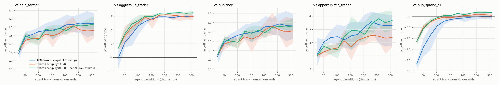
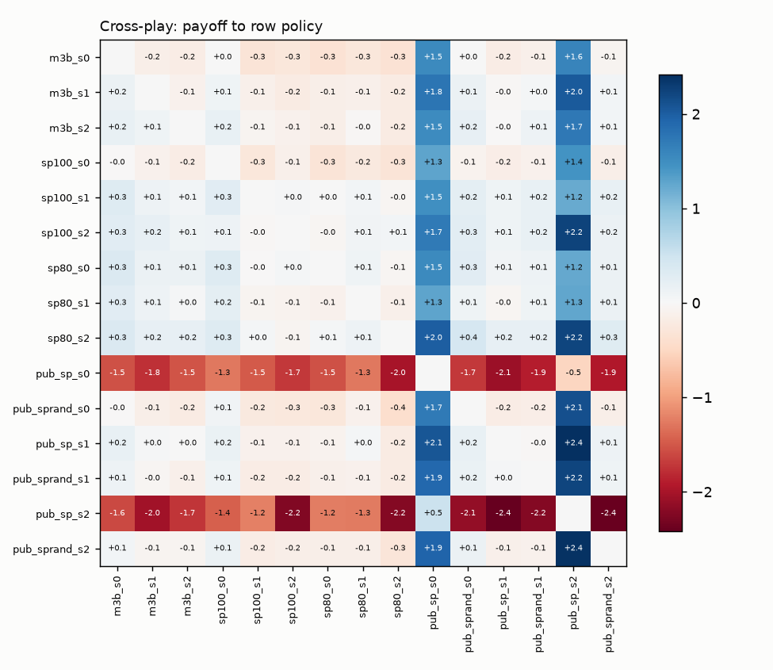
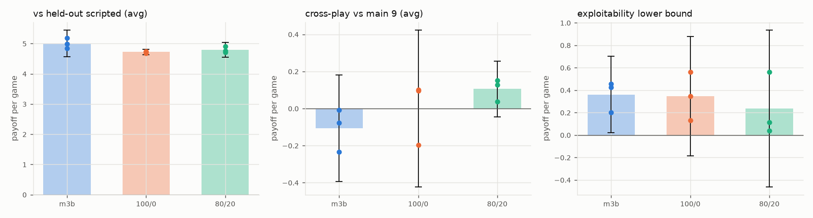
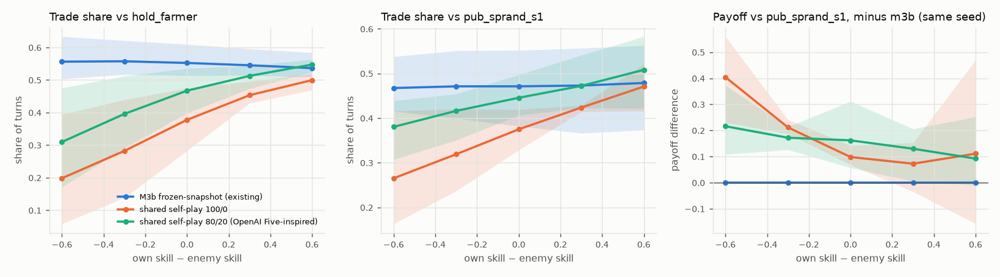

# OpenAI Five-Inspired Shared-Policy Self-Play: Implementation and Controlled Comparison

Branch `research/openai-five-selfplay`, session of 2026-10-11. Companion documents:
`docs/rl/openai_five_adaptation.md` (what the paper documents and what we adapted), `docs/rl/openai_five_progress.md`
(work log and M3 audit). Generated result tables: `results/rl/openai_five/report_main.md` (main comparison),
`report_extra.md` (ablation and equal-environment-turn runs), `exploit_strong.md`, `legacy_exact.md`,
`behavior_detail.md`; figures `results/rl/openai_five/fig_*.png`.

---

## A. Summary

**Implemented.** True shared-policy self-play (`lanegame/rl/shared.py`): one network controls both seats of a
game on their own-perspective observations, and both seats' transitions are PPO samples; a configurable fraction
of games instead pits the current network (one seat, which alone trains) against a frozen past version drawn
uniformly from a bounded pool of snapshots. The OpenAI Five setting is `current_fraction = 0.8`. Rollouts are
collected with one fixed parameter vector; the budget and learning-rate schedule count trainable agent
transitions; environment turns are tracked separately; snapshots carry full metadata and are never overwritten.
14 new tests (including two mutation checks) and the full suite pass (476).

**Reused.** The existing masked PPO update, GAE, network, environment, scripted agents, snapshot pool, evaluation
harness (`head_to_head`) and approximate best responses, all unchanged; the M3b trainer is the baseline, run
through its own unchanged code path.

**Audited.** No material bug in PPO, M3b self-play or evaluation (details in `docs/rl/openai_five_progress.md`).
Confirmed from the source that M3b never plays the current policy against itself. Measured that the champion
game has no seat bias (−0.008 ± 0.016 over 24,000 mirror games) and that the existing confidence intervals
are conservative.

**Experiments.** Three conditions × 3 seeds, all from scratch with the same initial network per seed, randomized
mechanical skill, 307,200 agent transitions each: the existing M3b method, pure shared self-play (100/0) and the
OpenAI Five-inspired mixture (80/20). Evaluated on held-out seeds against 23 scripted agents (10 never trained
against by any condition), in cross-play (with 6 published M3b policies as yardsticks), against their own
historical snapshots, across a 3 × 3 skill matrix and by 30 PPO attackers (plus a 3×-budget attacker check).
Additional runs: an exact-exploitability calibration on the legacy K = 16 game, a 50/50 mixture ablation, and the
shared conditions at equal environment turns. Total RL compute ≈ 60 minutes of wall clock on ≤ 10 processes (≤ 10 CPU-hours), no run longer than 2.5 minutes.

**Results (observed).**
1. *Shared self-play learns more per sample and per game early.* At 25,600 agent transitions the shared policies
   already score −1.15 against the strongest published learned policy versus −2.18 for M3b; the gap closes by
   ~200k transitions. At equal environment turns the early advantage is larger (+1.29 at 51,200 turns).
2. *At the full budget the three methods are close.* Against fixed scripted opponents M3b is best (it trains
   against 13 of them; most of its edge is exploiting the always-yielding `yield_farmer`); on the 10 held-out
   scripted agents the three are within 0.3 of each other (+5.00, +4.72, +4.79). In cross-play the families are
   ordered 80/20 > 100/0 > M3b by small margins: 80/20 beats M3b in **all 9** seed pairings (+0.04 to +0.35,
   mean +0.20 resources per game), 100/0 beats M3b by +0.09 and 80/20 beats 100/0 by +0.08 (mixed signs).
3. *Robustness is not separated by the method.* Approximate exploitability lower bounds are +0.36 ± 0.34 (M3b),
   +0.35 ± 0.53 (100/0) and +0.24 ± 0.70 (80/20) (95% t over 3 seeds). The two least exploitable policies of the
   study are 80/20 seeds (+0.04, +0.11) but the third 80/20 seed is among the most exploitable (+0.56): seed
   variance dominates the method effect. A 3×-budget attacker check shows the standard attacker is
   budget-limited: estimates rise for 5 of 9 targets (up to +1.15) and the ranking of targets changes (Spearman
   +0.57), while condition means stay indistinguishable (+0.53, +0.70, +0.64). One policy per condition
   (`m3b_s1`, `sp100_s1`, `sp80_s0`) stays hard to exploit at both budgets (≤ 0.20).
4. *No strategy collapse or forgetting was observed* in any condition at this budget: no snapshot is beaten by
   an older snapshot of its own run, and later snapshots beat earlier ones monotonically.
5. *Shared self-play learned state-conditional aggression that M3b did not.* With randomized skills, every
   method's policy observes both skills, but only the shared self-play policies use them: their Trade share rises
   with own skill and falls with enemy skill (5 of 6 runs; 0.20–0.55 across skill pairs), while M3b's is flat
   (0.54–0.57, 0 of 3 runs, as in the earlier M3c study). They also trade far less when behind in HP (0.25–0.30
   vs 0.51 for M3b in mirror games). This conditioning pays: when mechanically outclassed by a learned opponent,
   every shared policy loses less than its seed-paired M3b policy (+0.11 to +0.56 per game; 6 of 6 pairings in
   both outclassed cells).
6. *Certified check on the exactly solvable legacy game (K = 16): no method approaches equilibrium.* The exact
   exploitability of every method's snapshots falls early (uniform 3.74 → ~2.5) and then rises: final +3.43 (M3b),
   +3.38 (100/0), +3.93 (80/20), the 80/20 runs above uniform play in 2 of 3 seeds; greedy versions are maximally
   exploitable (4.97) in every condition. Mid-training (61k–143k transitions) 80/20 is more exploitable than 100/0
   in all 3 seed pairs (+0.19 to +2.15). Historical opponents did not make PPO self-play equilibrium-seeking here;
   if anything they hurt. The re-run M3b legacy runs reproduced the published series bit for bit.
7. *Mixture ratio and training length.* A 50/50 mixture behaves like 80/20 in performance (cross-play +0.15 vs the
   main policies; beats M3b in all 3 seeds) but is the most exploitable condition under the 3× attacker (+0.85 ± 0.10,
   all seeds 0.80–0.88). Training the shared conditions to the M3b runs' number of *environment turns* (≈ 2×
   the samples) helps clearly: cross-play +0.31 to +0.76 against the M3b policies in all 6 runs, +0.4 to +0.5
   against the published reference, and lower exploitability (3× attacker: +0.32 for 100/0, +0.46 for 80/20, vs
   +0.70 / +0.64 at the main budget). Training length mattered more than the opponent mixture.

**Did the OpenAI Five-inspired approach improve performance or robustness?** Performance: modestly and
consistently in head-to-head play against learned opponents (cross-play), not against scripted opponents.
Robustness (approximate exploitability, forgetting): no measurable improvement over M3b or over pure shared
self-play at this budget. The historical 20% had nothing to repair, because pure shared self-play showed no
collapse or forgetting, and the two strongest robustness probes point the other way: on the certified legacy game
80/20 was more exploitable than 100/0 mid-training in every seed, and the 50/50 mixture was the most exploitable
champion-game condition under the stronger attacker. The clearest benefit in the study comes from the shared-policy
half of the recipe (both seats' experience: more learning per game, skill- and HP-conditioned play), not from the
historical opponents. **Inconclusive:** whether historical games help at
longer horizons or larger budgets, where OpenAI Five reports collapse; whether the small cross-play edges reflect
the 20% historical games or noise (80/20 − 100/0 differences have mixed signs across seeds).

---

## B. OpenAI Five methodology and our adaptation

Details and section references: `docs/rl/openai_five_adaptation.md`. In short, OpenAI Five (Berner et al. 2019)
trained one LSTM policy with PPO and GAE (λ = 0.95) by self-play, "the latest policy against itself for 80% of
games, and against older policies for 20% of games" (§3.2, App. N), with past versions sampled by a learned
quality score (App. N) to "avoid strategy collapse" (App. N); it made rewards zero-sum explicitly (App. G),
annealed the discount horizon, and measured progress by TrueSkill against a fixed pool of reference agents
(§4.1, App. J). The paper does not say whether both teams' experience is trained on in latest-vs-latest games.

What this study adapts: the 80/20 current/historical mixture, a frozen past-version pool, PPO on fresh
rollouts, zero-sum rewards (already exact here), evaluation against fixed references. What is ours: both seats'
transitions are training samples in current-policy games; uniform (not quality-score) sampling over the 8 most
recent snapshots; the budget counted in trainable agent transitions; head-to-head payoffs with confidence
intervals instead of TrueSkill; approximate best responses as the exploitability probe. Not reproduced: the LSTM,
discount annealing, reward shaping and team spirit, model surgery, asynchronous large-scale training. This is
not a reproduction of OpenAI Five; it is its self-play recipe at the scale of a 32-turn, two-player game.

## C. Architecture

### C.1 Shared-policy self-play

One network π_θ(a | o), V_θ(o) (the existing 50 → 128 → 128 tanh MLP, 46 masked logits, unchanged). Each
seat s ∈ {A, B} acts on its own-perspective observation o_s and legal mask m_s (seat B sees the mirrored
game: `observe(state, k, B) == observe(mirror(state), k, A)` with the skills swapped). Rewards are the
environment's: r_A = r, r_B = −r per turn.

Why both seats can be trained on. Write J_A(θ_A, θ_B) for A's expected return. The game is symmetric and zero-sum,
so J_A(x, y) = −J_A(y, x) and J_B(θ_A, θ_B) = J_A(θ_B, θ_A). With tied parameters the *total* derivative of
J_A(θ, θ) ≡ 0 is useless; the learning signal is each player's derivative with respect to its own policy,
holding the opponent fixed. Per-seat PPO estimates exactly that (only log π_θ(a_s | o_s) of the seat's own action
enters its surrogate; the other seat's action is part of its environment), and by symmetry
∂_B J_B(θ, θ) = ∂_1 J_A(θ, θ): seat B's samples are a second, on-policy estimate of the same direction as seat A's.

### C.2 Training loop (`lanegame/rl/shared.py`, `train_shared`)

```
pool ← empty (8 most recent frozen snapshots, FIFO)          transitions ← 0
while transitions < budget:                                     # budget in agent transitions
    lr ← lr0 · (1 − transitions / budget)
    rollout with FIXED θ (n_envs = 8 environments × 64 turns, two slots per environment):
        at every episode start: matchup ← current-policy game with prob. f (or if pool is empty)
                                         else (snapshot ~ Uniform(pool), learner seat ~ Uniform{A, B})
                                skills (m_A, m_B) ~ Uniform{0.2, 0.5, 0.8}²
        each turn: one batched forward pass for all learner-controlled seats: a_s ~ π_θ(· | o_s, m_s),
                   log π_θ(a_s | o_s) and V_θ(o_s) recorded; snapshot seats: a ~ π_snapshot (frozen NetAgent)
                   (r, −r), o' ← env.step(a_A, a_B); store per learner seat (o_s, m_s, a_s, log π, V, r_s, done)
    GAE (γ = 1, λ = 0.95) per slot (terminated → bootstrap 0; truncated → V(o'); never across episodes)
    batch ← learner-controlled entries only (2 per turn in current-policy games, 1 in historical games)
    θ ← PPO(θ; batch)   (4 epochs, minibatch 256, clip 0.2, value clip 2, entropy 0.01, grad norm 0.5)
    transitions += |batch|;  env_turns += 8 · 64
    if transitions crossed a multiple of 25,600: pool.add(frozen deep copy of θ); save snapshot file
```

A matchup is fixed from its episode's first to last turn; the pool changes only between updates, and the
historical opponent never trains (its parameters have `requires_grad = False`; tested). With f = 1.0 this is
pure current-policy self-play; f = 0.8 is the OpenAI Five-inspired mixture; until the first snapshot exists the
mixture is 100% current-policy (bootstrap), so f = 0.8 and f = 1.0 are bit-identical for the first 25,600
transitions of a seed.

### C.3 The baseline (`train_selfplay`, unchanged)

One learner seat per game (uniform seat) against an opponent drawn per episode: 30% a scripted agent of the
13-agent suite, 35% the latest frozen snapshot, 35% a snapshot drawn uniformly from a pool of 8 (the first
snapshot kept as an anchor), a snapshot every 25 updates (25,600 learner steps); scripted-only until the first
snapshot. Only the learner's transitions are trained on, so learner transitions = environment turns.

### C.4 Checkpoints

`snapshots/snap_<agent transitions>.pt` and `final.pt` hold the weights, the network spec and the game
configuration, plus metadata: method, format version, run name, snapshot identity, agent transitions, environment
turns, update index, seed, the PPO and mixture configurations and the model class. `run.json` repeats the run's
configuration; `history.jsonl` logs every update (cumulative and per-rollout counts, games by kind, returns in
historical games, losses, entropy, KL, clip fraction, explained variance, pool contents). `train_shared` refuses a
non-empty run directory unless `overwrite=True` and `save_checkpoint(..., exist_ok=False)` never replaces a file;
the experiment driver never retrains a run that has a `final.pt` (an interrupted stage resumes by re-running it).
Resumption *inside* a run (optimizer and RNG state) is not implemented.

### C.5 Evaluation (`lanegame/experiments/rl/openai_five_eval.py`)

All evaluation is with frozen networks on held-out episode seeds (SeedSequence roots 40,000–43,000; training
streams derive from roots 1–3 and best-response training from 900–901), both seats on the same seeds (common
random numbers), equal skill 0.5 unless stated:

- A. Fixed scripted opponents: the 13-agent suite (which m3b trains against: in-distribution for m3b only) and 10
  held-out scripted agents no condition trains against (`shove_hold`, `shove_trade`, `hold_vision`, `freeze_hold`,
  `recall_spammer`, `uniform`, and four legacy siege strategies mapped into champion actions), 300 episodes per seat.
- B. Historical checkpoints: every snapshot against a fixed reference panel (four scripted agents and the
  published skill-randomized M3b policy `pub_sprand_s1`, 200 episodes per seat), and every pair of snapshots of a
  run (150 episodes per seat) to look for forgetting and cycles.
- C. Cross-play between the 9 final policies and 6 published M3b policies (external yardsticks trained with a
  different protocol: 205k steps against scripted agents, then 307k steps of frozen-snapshot self-play), 300
  episodes per seat, both seat assignments; reported as a matrix, never collapsed into a ranking.
- D. Approximate exploitability: for each final policy, three PPO attackers trained only against the frozen target
  (two warm-started from the target's own weights, one from scratch; 102,400 steps each, the M3c budget), evaluated
  on 500 held-out episodes per seat, and the best scripted counter-strategy from A. The maximum is a lower bound on
  exploitability, not a certificate.
- F. Behavior: action shares and economy/combat statistics from A and from mirror games; recorded per-turn traces
  for positioning, Trade conditional on HP difference and game phase, recall timing; a 3 × 3 skill matrix (own ×
  enemy skill in {0.2, 0.5, 0.8}) against `hold_farmer` and against `pub_sprand_s1`.

Statistics. A single policy's ± is a 95% interval over evaluation episodes, computed by `head_to_head` as if the 2N
seat games were independent; they are negatively correlated on common seeds (measured −0.17 to −0.45), so these
intervals are conservative. A condition's ± is a 95% t interval over its 3 training seeds (t₂ = 4.30): with three
seeds only large effects are distinguishable, and evaluation episodes are never counted as replicates.

---

## D. Correctness

### D.1 Tests (`tests/test_rl_shared.py`, 14 tests, ~10 s)

| Requirement | Test |
|---|---|
| 1. Both agents use identical policy weights | `test_current_policy_games_use_one_network_for_both_seats_and_record_both` (recomputes every recorded log-prob and value of both seats with the one network) |
| 2. Own-perspective observations | `test_each_seat_receives_its_own_perspective_observation_and_mask` (seat B's vector equals seat A's view of the mirrored game with swapped, asymmetric skills) |
| 3. Both agents contribute in current-policy games | same as 1 (all 2N slots trainable; transitions = 2 × turns) |
| 4. Only the learner contributes in historical games | `test_historical_games_train_only_the_learner_seat_and_snapshots_stay_frozen`, `test_learner_seat_in_historical_games_matches_the_trainable_slot` |
| 5. Frozen policies remain unchanged | same (weights bit-identical after a PPO update of the learner; no `requires_grad`) |
| 6. Old log-probs = rollout policy | `test_rollout_logprobs_are_the_rollout_policy_even_after_the_update` |
| 7. Legal-action masks | `test_actions_are_legal_and_masks_are_the_engine_legal_sets` |
| 8. Zero-sum rewards not double-negated | `test_zero_sum_rewards_are_not_negated_twice` (slot B = −slot A each turn; episode sums = ±the logged payoff) |
| 9. Terminal and truncated rollouts | `test_termination_truncation_and_bootstrap_values` (horizon, `max_turns`, bootstrap values, no GAE leakage) |
| 10. Snapshot loading reproduces distributions | `test_snapshot_files_reproduce_action_distributions_and_metadata` |
| 11. Mixture statistics | `test_mixture_statistics_bootstrap_and_seats` (20,000 draws: 80/20 within 4.5 SE; seats and snapshot choice uniform; empty pool → current) |
| 12. Seat switching symmetry | `test_seat_swap_symmetry_of_a_shared_policy` (1,500 mirror games ≈ 0; seat B's distribution = seat A's on the mirrored state) |
| 13. Fixed seeds reproduce rollouts | `test_training_is_reproducible` (bit-identical weights and history; another seed differs) |
| 14. Champion environment compatibility | all tests run on `GameConfig.champions()` |
| 15. Legacy compatibility | `test_legacy_configuration_is_compatible`; legacy exact-game tests unchanged and passing |
| Checkpoint safety, accounting, numerics | refusal to overwrite run directories/checkpoints; cumulative vs per-rollout counts; finite losses |

Mutation check: making seat B's reward −(−r) fails the zero-sum test; recording the snapshot's seat as trainable
fails both historical-game tests. **Full suite: 476 passed** (462 existing + 14 new; 10.5 min with evaluation
running alongside). Not implemented: resumption *inside* a run (optimizer/RNG state); the driver resumes at run
granularity.

### D.2 Numerical and symmetry checks

- Seat symmetry of the game: always-Trade mirror games, 24,000 episodes: seat-A payoff −0.008 ± 0.016; four other
  mirrors within noise. Existing tests prove turn-level mirror equivariance under a permutation of the chance vector.
- In current-policy training games the mean seat-A return is logged per update (`current_seat_a_return`) as a
  running seat-bias check.
- sp80 and sp100 runs of the same seed are bit-identical until the first snapshot (same seed, empty pool), as the
  bootstrap rule implies; the pilot confirmed it.
- Training stability (all 9 main runs): approximate KL per update ≤ 0.008, clip fraction ≤ 0.13, entropy from
  2.2 to 0.24–0.59 nats, explained variance 0.47–0.78 at the end; no NaN, no instability. M3b's value loss is
  higher (0.49–1.24 vs 0.19–0.34 for shared self-play): its opponent identity (scripted agent or snapshot) is
  unobserved, so its value targets are noisier.
- Attacker calibration: the attacker harness gives +0.17 / +0.12 against the published `pub_sprand_s1`, matching
  the earlier M3c estimate (+0.11) on different held-out seeds.
- Exact legacy calibration reproducibility: the three M3b legacy runs, re-run in a new directory by the new
  driver, reproduce the exploitability series published by the previous session (`results/rl/m3b_selfplay.json`)
  **bit for bit** for every snapshot of every seed: training is deterministic across sessions.

### D.3 Bugs found during the session

- (new code) History records: per-rollout counts overwrote the cumulative `agent_transitions` / `env_turns` keys
  (training unaffected); renamed to `rollout_*`, with a test.
- (new code) Report: sp80 snapshots fall a few hundred transitions apart across seeds; learning curves are now
  binned by the nominal snapshot index.
- (new code) A Markdown header with a literal `|` broke a table; fixed.
- (existing code, documented, unchanged) `Collector._reset` drops `gank_reward` when `skill_levels` rebuilds the
  environment (an unused combination); `train_ppo` / `train_selfplay` silently overwrite a run directory;
  `head_to_head` intervals are conservative (seat games on common seeds are negatively correlated).

---

## E. Experimental configurations

| | M3b frozen-snapshot (existing) | shared 100/0 | shared 80/20 (OpenAI Five-inspired) |
|---|---|---|---|
| Trainer | `train_selfplay` (unchanged) | `train_shared(current_fraction=1.0)` | `train_shared(current_fraction=0.8)` |
| Opponents per episode | 30% scripted (13-agent suite), 35% latest snapshot, 35% uniform snapshot; scripted only before the first snapshot | the current network | 80% the current network; 20% a uniform snapshot of the last 8; 100% current before the first snapshot |
| Seats trained on | the learner's (uniform seat) | both | both (current games); the learner's (historical games) |
| Snapshot pool | 8, first kept as anchor, every 25 updates = 25,600 transitions | (saved every 25,600, never played) | 8, FIFO, every 25,600 transitions |
| Rollout | 16 envs × 64 turns = 1,024 transitions | 8 envs × 64 turns × 2 = 1,024 | 8 envs × 64 × ~1.82 ≈ 931 |
| Agent transitions | 307,200 | 307,200 | 307,264–307,904 |
| Environment turns | 307,200 | 153,600 | 168,960–169,984 |
| PPO updates | 300 | 300 | 330–332 |
| Training games (current / historical) | 9,600 (vs scripted or snapshots) | 4,800 / 0 | ~4,310 / ~985 |
| Train time per run (1 thread) | 129–132 s | 60–64 s | 74 s |

Common to all: `GameConfig.champions()` (K = 32, reward = farm + plates + bounty difference, zero-sum), skills
drawn per episode and seat from {0.2, 0.5, 0.8} (observed), the unchanged `PolicyValueNet` (50 → 128 → 128 tanh,
46 masked logits), PPO defaults (lr 3·10⁻⁴ linearly annealed over the transition budget, γ = 1, λ = 0.95, clip
0.2, value clip 2, entropy 0.01, 4 epochs, minibatch 256, gradient norm 0.5, Adam ε = 10⁻⁵), training seeds 0, 1,
2 (same seed = same initial network in every condition), one torch thread per run. Checkpoint identifiers:
`results/rl/checkpoints/of5/main_<condition>_s<seed>/{final.pt, snapshots/snap_<transitions>.pt}` (git-ignored,
regenerable bit-for-bit). Budget choice: 307,200 transitions per seed (above the suggested 100–200k, equal to the
published M3b self-play budget) because one run takes 1–2 minutes.

Why matched agent transitions with matched batch size. A current-policy game yields two samples per turn, so at
equal environment turns shared self-play would see twice the data. The primary comparison fixes the number of
trainable samples and the PPO batch (~1,024 per update), so the number of updates and gradient steps per sample
are equal; shared self-play then needs half the environment interaction (reported). The secondary comparison at
equal environment turns is in section F.6.

---

## F. Main comparisons

All payoffs: resources per game to the row policy over both seats, held-out seeds, equal skill 0.5 unless stated.
Condition-level `±`: 95% t interval over 3 training seeds (t₂ = 4.30). Full tables: `results/rl/openai_five/report_main.md`.

### F.1 Fixed scripted opponents

| Condition | vs 13 m3b-suite scripted | vs 10 held-out scripted | worst scripted matchup |
|---|---|---|---|
| M3b frozen-snapshot | +4.27 ± 1.26 | +5.00 ± 0.44 | +0.68 ± 0.36 |
| shared 100/0 | +3.47 ± 0.84 | +4.72 ± 0.09 | +0.61 ± 0.51 |
| shared 80/20 | +4.00 ± 1.17 | +4.79 ± 0.25 | +0.73 ± 0.18 |

Every learned policy beats every scripted agent (the best scripted counter-strategy loses by 0.38–0.83 to every
target). The suite average is in-distribution for M3b only; its edge there is mostly one opponent:
`yield_farmer` (permanent Yield) +6.38 (M3b) vs +5.44 (80/20) vs +3.45 (100/0). Against careful farmers the
three are equal (`hold_farmer` +1.06 / +0.97 / +1.09; `punisher` +0.94 / +0.92 / +0.96). Note: two pairs of
held-out agents behave identically (`shove_hold` ≡ `legacy:aggressive`, `hold_vision` ≡
`legacy:stack_builder[vision]`), so the held-out set holds 8 distinct strategies.

### F.2 Learning curves (snapshots against fixed references; `fig_learning_curves.png`)



| Agent transitions | vs `aggressive_trader`: M3b / 100/0 / 80/20 | vs `pub_sprand_s1`: M3b / 100/0 / 80/20 |
|---|---|---|
| 25,600 | −0.08 / +0.65 / +0.65 | −2.18 / −1.15 / −1.15 |
| 51,200 | +1.08 / +1.59 / +1.72 | −1.41 / −0.48 / −0.55 |
| 102,400 | +2.31 / +2.54 / +2.68 | −0.44 / −0.12 / −0.06 |
| 307,200 | +2.99 / +2.99 / +3.25 | −0.01 / +0.05 / +0.18 |

Shared self-play is ahead early at equal samples, M3b catches up by ~200k transitions. All conditions end at
parity with the published skill-randomized M3b policy (trained for 512k steps).

### F.3 Cross-play (`fig_crossplay.png`)

Family block averages (row vs column; 300 episodes per seat per pair, both seat assignments):

| row \ column | M3b | 100/0 | 80/20 | published equal-skill M3b | published skill-rand. M3b |
|---|---|---|---|---|---|
| M3b | (−0.00) | −0.09 | −0.20 | +1.11 | +0.05 |
| 100/0 | +0.09 | (0.00) | −0.08 | +1.04 | +0.09 |
| 80/20 | **+0.20** | +0.08 | (0.00) | +1.08 | +0.20 |

80/20 vs M3b, per seed pairing (row 80/20 seed, column M3b seed): +0.34, +0.14, +0.14 / +0.27, +0.12, +0.04 /
+0.35, +0.19, +0.20, all nine positive, each pair's interval ≈ ±0.25. Paired by training seed: +0.21 ± 0.33 (95% t;
per seed +0.36, +0.11, +0.16). The ordering is transitive at the family level, but individual policies are not
totally ordered (e.g. `sp100_s0` loses to or ties every other new policy; `sp80_s2` and `sp100_s2` nearly tie). The
magnitudes (0.1–0.2 resources) are small next to the scripted margins (1–13) and to the skill effect (≈1.4 per 0.3
skill). Every new policy beats the two published equal-skill M3b policies by 1.2–2.2 (those were known to be
exploitable).



### F.4 Historical checkpoints

Within every run, each later snapshot beats each earlier one or ties: across 9 runs × 66 snapshot pairs no older
snapshot wins by more than 2 standard errors, and the monotonicity check (payoff against an old snapshot never
drops by more than 2 SE as the newer snapshot advances) holds for 100% of snapshot triples. Final vs first snapshot:
+1.91 to +2.15 (M3b), +1.06 to +1.33 (100/0), +1.12 to +1.48 (80/20); the M3b runs start weaker (their first
snapshot follows 25,600 steps against scripted agents only). Final vs the middle snapshot: −0.09 to +0.35: most
improvement happens in the first half of training.

### F.5 Approximate exploitability (`fig_robustness.png`)

| Condition | warm-started attackers (best per target) | from-scratch attackers | best scripted counter | lower bound (max) |
|---|---|---|---|---|
| M3b | +0.42, +0.20, +0.45 | −0.48, −0.45, −0.56 | −0.53, −0.69, −0.82 | +0.36 ± 0.34 |
| shared 100/0 | +0.35, +0.13, +0.56 | −0.37, −0.73, −0.68 | −0.38, −0.69, −0.76 | +0.35 ± 0.53 |
| shared 80/20 | +0.04, +0.11, +0.56 | −0.67, −0.74, −0.83 | −0.73, −0.65, −0.80 | +0.24 ± 0.70 |

102,400 attacker steps each (the M3c budget), 500 held-out episodes per seat; per-seed values in seed order. A
from-scratch PPO attacker never reaches parity at this budget, so the warm-started attacker (a copy of the target,
payoff 0 at the start) is the informative probe; scripted agents never beat a learned policy. Every policy is
exploitable by 0.04–0.56 resources per game, the same range as the published skill-randomized M3b policies
(0.11–0.46). These are lower bounds from a finite attacker, never Nash certificates. 

**Attacker-strength check** (`exploit_strong.md`; one warm-started attacker per target with 307,200 steps):

| Target | best warm, 102,400 steps | warm, 307,200 steps |
|---|---|---|
| m3b_s0 / s1 / s2 | +0.42 / +0.20 / +0.45 | +0.45 / +0.19 / +0.96 |
| sp100_s0 / s1 / s2 | +0.35 / +0.13 / +0.56 | +1.15 / +0.16 / +0.81 |
| sp80_s0 / s1 / s2 | +0.04 / +0.11 / +0.56 | +0.11 / +0.88 / +0.93 |
| condition means (95% t): M3b / 100/0 / 80/20 | +0.36 ± 0.34 / +0.35 ± 0.53 / +0.24 ± 0.70 | +0.53 ± 0.97 / +0.70 ± 1.24 / +0.64 ± 1.15 |

(±0.09 per 307,200-step estimate.) Tripling the attacker budget raises the bound substantially for five targets and
reorders them (Spearman +0.57 between budgets): at the standard budget the attacker, not the target, limits
the estimate for most policies, so standard-budget exploitability (here and in the earlier M3c study) does not
rank policies reliably. Three policies, one from each condition, resist both attackers (≤ 0.20). The method
comparison is unchanged: no condition is less exploitable than another.



### F.6 Additional runs: 50/50 ablation and equal environment turns

`report_extra.md`, `exploit_strong_extra.md`. Same protocol, seeds, evaluation and attackers as the main runs.

| Condition | agent transitions | env turns | held-out scripted | vs `pub_sprand_s1` | cross-play vs main 9 | vs the 3 M3b policies (per seed) | exploitability LB, standard / 3× attacker |
|---|---|---|---|---|---|---|---|
| M3b (main) | 307,200 | 307,200 | +5.00 ± 0.44 | +0.01 ± 0.31 | −0.11 ± 0.29 | — | +0.36 ± 0.34 / +0.53 ± 0.97 |
| shared 100/0 (main) | 307,200 | 153,600 | +4.72 ± 0.09 | +0.08 ± 0.39 | +0.00 ± 0.42 | −0.10, +0.16, +0.19 | +0.35 ± 0.53 / +0.70 ± 1.24 |
| shared 80/20 (main) | ~307,500 | ~169,500 | +4.79 ± 0.25 | +0.14 ± 0.13 | +0.11 ± 0.15 | +0.21, +0.14, +0.25 | +0.24 ± 0.70 / +0.64 ± 1.15 |
| shared 50/50 (ablation) | ~307,700 | ~200,400 | +4.81 ± 0.31 | +0.17 ± 0.17 | +0.15 ± 0.12 | +0.23, +0.20, +0.32 | +0.44 ± 0.79 / **+0.85 ± 0.10** |
| shared 100/0, equal env turns | 614,400 | 307,200 | +4.99 ± 0.54 | +0.47 ± 0.45 | +0.48 ± 0.54 | +0.68, +0.32, +0.68 | +0.11 ± 0.15 / +0.32 ± 0.36 |
| shared 80/20, equal env turns | ~553,500 | ~306,200 | +4.98 ± 0.88 | +0.41 ± 0.55 | +0.43 ± 0.60 | +0.31, +0.46, +0.76 | +0.20 ± 0.24 / +0.46 ± 0.56 |

("vs the 3 M3b policies": each policy's mean payoff against `m3b_s0..s2`; for the main shared rows, the seed's
row average from F.3.) Historical share of transitions: 0.10 (80/20), 0.30 (50/50). Three readings:
(i) the mixture ratio 100/80/50 does not order performance or robustness at equal samples, except that 50/50 is
consistently exploitable under the stronger attacker; (ii) at equal environment interaction shared self-play is
clearly better than M3b, because each game yields twice the samples (the honest headline for compute-limited
settings: the gain comes from using both seats' experience); (iii) longer training lowered exploitability on the
champion game, unlike the legacy game (F.7), where it raised it.

### F.7 Exact calibration on the legacy game

`legacy_exact.md`. `GameConfig(horizon=16)` (4,951 decision nodes, V* = 0, uniform play exploitability 3.74);
each condition trains from scratch for 204,800 agent transitions (seeds 200–202, the published M3b legacy seeds;
legacy scripted suite for M3b), a snapshot every 20,480 transitions. A network is a Markov policy of this game,
so each snapshot's exploitability is EXACT (best response by backward induction), not estimated.

| Agent transitions | M3b frozen-snapshot | shared 100/0 | shared 80/20 |
|---|---|---|---|
| 20,480 | 2.52 (2.52, 2.47, 2.58) | 2.68 (2.91, 2.65, 2.48) | 2.68 (identical to 100/0: no snapshot yet) |
| 61,440 | 2.95 (3.46, 2.49, 2.91) | 2.85 (3.13, 2.92, 2.50) | 3.74 (3.32, 3.89, 4.00) |
| 102,400 | 3.18 (3.87, 2.71, 2.96) | 2.98 (3.39, 3.26, 2.29) | 4.13 (3.91, 4.06, 4.43) |
| 204,800 | 3.43 (4.09, 3.23, 2.96) | 3.38 (3.84, 3.68, 2.62) | 3.93 (4.21, 2.99, 4.59) |
| greedy policy, final | 4.97 | 4.97 | 4.97 |
| environment turns | 204,800 | 102,400 | ~113,000 |

Mean (per seed). Paired 80/20 − 100/0: +0.19 to +2.15 in every seed from 61k to 143k transitions; at the end
+0.37, −0.69, +1.97. All three methods behave like iterated best response: exploitability first falls below
uniform, then climbs as the policies sharpen (final entropies 0.44–1.20; the most exploitable run, 80/20 seed 2,
has the lowest entropy, 0.44, but the entropy ordering does not explain the other seeds). Two caveats: the legacy
game is not the champion game (no exact solver exists for the latter), and PPO's limited best-response quality
on this game (M3a: 23–94% of the exact best-response gain) is part of what is measured.

---

## G. Research findings

### G.1 Did shared-policy self-play improve learning?

Yes in sample efficiency, and decisively per unit of environment interaction; no clear difference at the end of
an equal-sample budget. At equal agent transitions both shared conditions
lead M3b against learned and scripted references for the first ~100–200k transitions (F.2); per environment turn
they get twice the samples, which compounds the early lead (+1.29 vs the learned reference at 51,200 turns). By
307,200 transitions the three conditions are within the 3-seed intervals on every metric, with a small, consistent
cross-play edge for the shared conditions. At equal environment turns (F.6) shared self-play is clearly better:
all 6 runs beat the M3b policies (+0.31 to +0.76) and they are less exploitable. M3b's training opponents include the evaluation's scripted suite, which
makes it the strongest exploiter of naive scripted strategies (F.1): training against predictable opponents is
what teaches exploiting them.

### G.2 Did historical opponents improve robustness?

Not measurably at this budget. 80/20 vs 100/0: exploitability −0.11 ± 0.42 (paired), held-out scripted
+0.07 ± 0.22, cross-play +0.10 ± 0.49; signs differ across seeds. Under the 3× attacker 80/20 and 100/0 are
indistinguishable (+0.64 vs +0.70) and the 50/50 ablation is the most exploitable condition of the study
(+0.85 ± 0.10). On the exactly solvable legacy game, 80/20 was *more* exploitable than 100/0 in every seed from
61k to 143k transitions and ended above uniform play in 2 of 3 seeds (F.7). So the evidence, though limited to 3
seeds per condition, points the other way from the hypothesis: past-opponent games did not reduce, and may have
increased, exploitability. One plausible mechanism (untested): a game against a fixed past version rewards
best-responding to it, which sharpens the policy without making it harder to exploit. The mechanism OpenAI Five guards
against, collapse onto a narrow strategy that beats only the immediate past version, did not appear in pure shared
self-play here (G.3), so there was nothing for the historical games to fix.

### G.3 Strategy collapse, cycling or forgetting?

None detected: snapshot matrices are monotone in all 9 runs (F.4), learning curves against fixed references rise
and then plateau without drops beyond noise, and cross-play is transitive at the family level. Two caveats: the
budget is short (most improvement happens before ~150k transitions), and the learned strategy space is narrow
(G.5), which leaves little room for cycles. The certified legacy calibration (F.7) speaks to equilibrium
convergence, which is a different question from forgetting.

### G.4 Which opponents were most exploitable?

Among scripted agents, the passive and predictable ones: `recall_spammer` (+13), legacy passive play mapped into
champion actions (+9 to +10), `safe_player`/`safe` (+9 to +11), `yield_farmer`/`yield` (+2.4 to +7.9). The careful
farmers (`hold_farmer`, `punisher`, `freeze_hold`, `hold_vision`) concede only +0.6 to +1.1. Among learned policies,
the published equal-skill M3b policies (−1.2 to −2.2 against every new policy). Within the new policies,
exploitability varies more across seeds (+0.04 to +0.56 with the standard attacker, +0.11 to +1.15 with the 3×
attacker) than across methods.

### G.5 Did learned strategies differ?

All methods converge to the same coarse strategy: hold the lane cell, mix Hold (0.32–0.44) and Trade (0.40–0.50),
almost never Yield, Safe, Recall, Freeze, Shove or a siege objective (each ≤ 6% of turns; a recall in ≤ 1% of
games), with no forward positioning (≤ 3% of turns past the lane cell). The difference is *conditioning*: shared self-play
policies trade less overall (0.40–0.46 vs 0.50 in mirror games), much less when behind in HP (Trade share 0.25–0.30
vs 0.51 for M3b and 0.67 for the published policy), less late in the game (0.34–0.46 after turn 22 vs 0.57), and
according to the skill matchup (G.6). M3b trades at nearly the same rate in every situation. Hypothesis (not
tested): in shared self-play the opponent is the same network and also adapts to skill and HP, so a fixed trade
rate is punished when outmatched; M3b's opponents (scripted agents and its own earlier, flat snapshots) punish it
less.

### G.6 How did mechanical skill affect results? (`fig_skill.png`)



- Payoff depends strongly on skill in every condition: ≈ +0.85 per 0.3 of own skill and ≈ −0.8 per 0.3 of enemy skill
  against `hold_farmer`, ≈ ±1.4–1.5 per 0.3 against the learned reference.
- Stronger mechanics → more trading only for shared self-play policies (Trade share 0.20 → 0.50 for 100/0 and
  0.31 → 0.55 for 80/20 from weak-vs-strong to strong-vs-weak against `hold_farmer`; M3b flat 0.54–0.57). This is
  the skill-dependent aggression that the M3c study did not find in frozen-snapshot self-play.
- *Can strategy compensate for mechanics?* Partly, and only against weak opposition. A 0.2-skill learned policy
  beats the 0.5-skill `hold_farmer` (+0.23 to +0.33) but not the 0.8-skill one (−0.10 to −0.66). Against a learned
  opponent of higher skill every condition loses heavily (−1.2 to −1.5 at 0.2 vs 0.5; −2.3 to −3.0 at 0.2 vs 0.8):
  strategic self-play improvements do not offset a 0.3 skill gap against a comparable learned opponent. They
  reduce it: skill-conditioned shared policies lose 0.16–0.29 less at 0.2 vs 0.5 and 0.11–0.56 less at 0.2 vs 0.8
  than the seed-paired M3b policy (all 6 pairings positive).

### G.7 Statistical and practical significance; hypotheses

With 3 seeds, a 95% t interval is ±4.3 × SD/√3; only the skill-conditioning difference (0 of 3 vs 5 of 6 runs)
and the all-pairs cross-play ordering 80/20 > M3b are consistent across every seed. The cross-play edges are
practically small (0.1–0.2 resources per game; the game's skill effect is ~10× larger). Hypotheses supported:
shared self-play is more sample-efficient (decisively per environment turn); learned policies remain exploitable;
self-play learns strategies that generalize to held-out scripted opponents without demonstrations. Not supported:
historical opponents reduce exploitability or prevent forgetting; the certified legacy result and the 50/50 ablation
point the opposite way (limited evidence: 3 seeds). Revised: the M3c conclusion "no skill-dependent aggression is
learned" is specific to frozen-snapshot training; shared self-play learns it.

---

## H. Limitations

- **Budget.** 307,200 agent transitions (≈ 5,000–10,000 games) per run; OpenAI Five-style collapse is reported at
  vastly larger scales. Learning curves flatten, but longer training clearly still helps (F.6 doubles it for the
  shared conditions only; M3b was not run longer).
- **Three seeds.** Seed-to-seed variance (exploitability +0.04 to +0.56 within one condition) is larger than most
  method differences; evaluation episodes are not replicates.
- **Approximate exploitability.** A 102,400-step PPO attacker gives a loose lower bound; from-scratch attackers do
  not even reach parity. A 3× budget raises the bound for 5 of 9 targets, so the attackers are not
  saturated. The exact legacy calibration measures convergence on a different (but
  exactly solvable) game.
- **Narrow strategy space.** Learned policies use 2 of 5 behaviors and no siege objectives, so robustness is tested
  over a small strategic repertoire; the reward structure (farm and bounty, sieges rare against a contesting
  opponent) is the likely cause, not the training method.
- **Evaluation references.** Two held-out scripted pairs are behaviorally identical; the learned reference
  (`pub_sprand_s1`) is one policy from a different protocol.
- **Architecture.** The MLP has no memory; the observation is Markov and complete, so this is not a limitation of
  the game model, but it rules out history-dependent opponent adaptation.
- **Differences from OpenAI Five.** Uniform rather than quality-score past-opponent sampling; no LSTM, discount
  annealing, reward shaping, team spirit or surgery; synchronous small-batch PPO; payoff matrices instead of
  TrueSkill.
- **Baseline protocol.** M3b was run from scratch with randomized skills to match the other conditions; the
  published M3b policies (M3a initialization, 512k steps) are included only as external references.

---

## I. Reproduction

All commands from the repository root (Python 3.13, torch 2.x CPU). Every stage is seeded; runs that already have a
`final.pt` are reused, never retrained (delete `results/rl/checkpoints/of5/<run>` to retrain one). Wall-clock
times are for this 12-thread laptop with 10 worker processes.

```bash
pip install -r requirements.txt && pip install torch

# tests: the new shared self-play tests (~10 s), the RL tests, the full suite (~6 min)
python -m pytest tests/test_rl_shared.py -q
python -m pytest tests/test_rl.py tests/test_rl_selfplay.py tests/test_rl_shared.py -q
python -m pytest -q

# one run of each method by hand
python -m lanegame rl-shared --current-fraction 1.0 --skill-levels 0.2,0.5,0.8 --steps 307200 --seed 0 --out results/rl/checkpoints/my_sp100   # pure shared self-play
python -m lanegame rl-shared --current-fraction 0.8 --skill-levels 0.2,0.5,0.8 --steps 307200 --seed 0 --out results/rl/checkpoints/my_sp80    # 80/20
python -m lanegame rl-selfplay --steps 307200 --seed 0 --snapshot-every 25 --out results/rl/checkpoints/my_m3b                                  # existing M3b method (equal skill; the study adds skill_levels, see openai_five.py)
python -m lanegame rl-eval results/rl/checkpoints/my_sp80/final.pt --episodes 300                                                             # vs scripted, both seats
python -m lanegame rl-eval results/rl/checkpoints/my_sp80/final.pt --opponents results/rl/checkpoints/my_m3b/final.pt                         # cross-play
python -m lanegame rl-br results/rl/checkpoints/my_sp80/final.pt --steps 102400 --seed 0                                                      # approximate best response

# the study, stage by stage (results/rl/openai_five/)
python -m lanegame.experiments.rl.openai_five smoke            # 10,240 transitions per condition (seconds)
python -m lanegame.experiments.rl.openai_five pilot            # 51,200 transitions, seed 0, quick evaluation (~1 min)
python -m lanegame.experiments.rl.openai_five train            # main: 3 conditions x 3 seeds x 307,200 transitions (~2.5 min)
python -m lanegame.experiments.rl.openai_five evaluate         # scripted, curves, snapshot matrices, cross-play, skill (~15 min)
python -m lanegame.experiments.rl.openai_five exploit          # 30 PPO attackers of 102,400 steps (~5 min)
python -m lanegame.experiments.rl.openai_five behavior_detail  # recorded per-turn behavior
python -m lanegame.experiments.rl.openai_five report           # report_main.md and the figures
python -m lanegame.experiments.rl.openai_five legacy_exact     # exact exploitability on the legacy K = 16 game
python -m lanegame.experiments.rl.openai_five train_ablation   # 50/50 mixture, 3 seeds
python -m lanegame.experiments.rl.openai_five train_envturn    # shared conditions at equal environment turns
python -m lanegame.experiments.rl.openai_five evaluate_extra
python -m lanegame.experiments.rl.openai_five exploit_extra
python -m lanegame.experiments.rl.openai_five report_extra     # report_extra.md
python -m lanegame.experiments.rl.openai_five exploit_strong   # 3x-budget attacker check
# or everything of the main comparison in one go:
python -m lanegame experiments-rl openai_five
```

---

## J. Recommended next steps

1. **More seeds and a longer budget on the same protocol before any new method.** Five to ten seeds per
   condition and 1–2M transitions (one run is minutes) would show whether the cross-play edge of 80/20 and the
   seed-dominated exploitability survive, and whether forgetting appears in pure shared self-play at length,
   which is the regime where historical opponents are supposed to matter.
2. **A stronger, standardized exploitability probe.** Warm-started attackers with 3–10× the current budget (and
   two seeds each) as the default robustness metric, reported with its learning curve so that attacker saturation
   is visible; keep the exact legacy calibration as the certified check of the trainer.
3. **Attribute the skill-conditioning result.** Test the hypothesis of G.5 within the existing harness: train M3b
   with a share of current-policy games (or shared self-play with scripted opponents mixed in) and check which
   ingredient produces skill- and HP-conditioned aggression; this matters for the research question of how much
   risk an agent should take when it is mechanically weaker.
