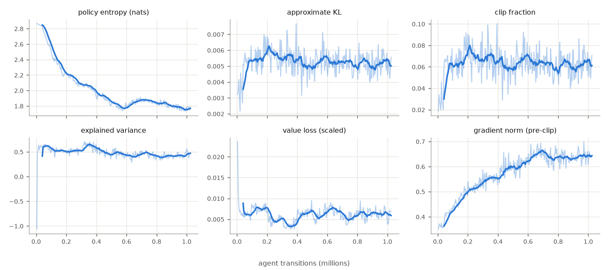
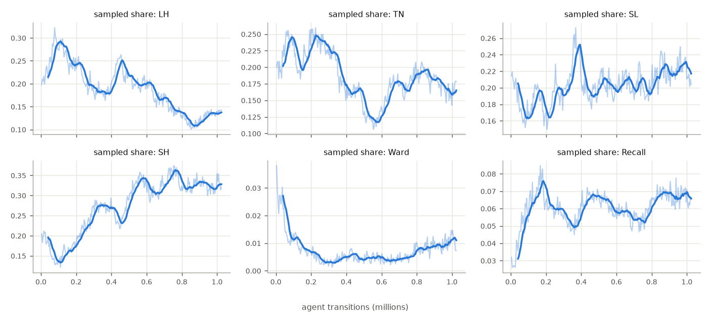
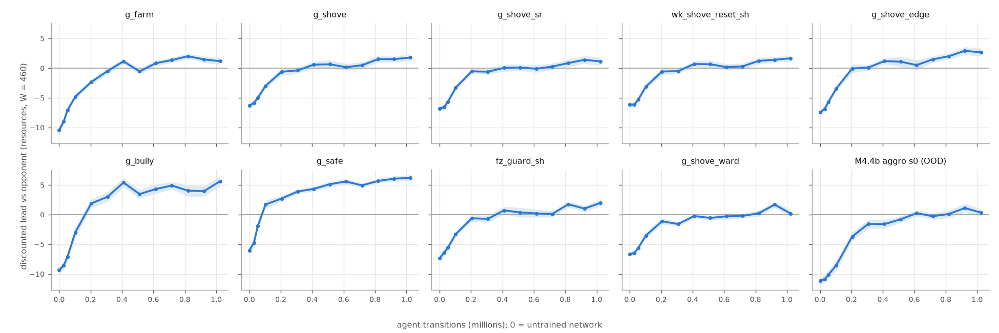

# M4.5c pilot — generated tables

*Generated from results/m45c/*.json; commit 8dc5acf540 (working tree dirty: True). Environment `GameConfig.m45_calibrated()`. Transitions are AGENT transitions (2 per joint environment step) unless stated. Prose and interpretation: docs/m4/m4_5c_pilot_report.md.*

## 1. Interface audit

| check | result |
|---|---|
| preset equals GameConfig.m45_calibrated() | True |
| M4.5b decisions retained (last_front, delay 0, growth 1.08, xp_range 2, ward, alpha 50) | True |
| observation entries / action codes | 90 / 61 |
| ever-legal codes (all observed in random play) | 27 (not observed: none; outside: none) |
| observations outside [0, 1] or non-finite | 0 |
| masks different from the legal sets | 0 |
| mirror-decoding failures (seat B = mirror of seat A) | 0 |
| records' Ward-legality rule vs engine | 0 mismatches |
| fixed opponents legal from both seats | True |
| M4.4 finals on M4.5c | refused: shape |
| OOD adapter (drops the two W entries) | ood:m44:aggro:ext:0: loads |

Random play: 1600 turns.

## 2. Smoke test (10 updates, own schedule) and bit-identical re-run

| check | result |
|---|---|
| s100: finite losses, gradients and critic statistics | pass |
| s100: never terminated; one truncation per finished game | pass |
| s100: critic bounded by the return scale (|V| <= Omega) | pass |
| s100: gradient norms of order 1 (max < 100) | pass |
| s100: approximate KL small (mean < 0.05) | pass |
| s100: both seats trained equally (exact) | pass |
| s100: 2 agent transitions per joint step (100% current-policy) | pass |
| s100: budget reached exactly | pass |
| s100: no illegal action sampled | pass |
| s100: masks never offer a never-legal code | pass |
| s100: rewards exactly antisymmetric between seats | pass |
| s100: both seats see the same vector at the symmetric start (V_A(s0) = V_B(s0)) | pass |
| smoke re-run: bit-identical weights | pass |
| smoke re-run: identical histories (every non-wall-clock field) | pass |
| s100: symmetric start valued near 0 (|V(s0)| <= 0.5 resources) (informational) | no |
| s100: explained variance positive at the end (informational) | yes |
| s100: entropy decreased from its initial value (informational) | yes |

Throughput 4,152 agent transitions/s (two concurrent processes); peak working set 474 MB.

Smoke evaluation: self-play value exactly 0 (paired seats, same network): pass, guard refuses other configurations: pass, every instrument produced output: pass; guard m45_calibrated loads, m45_unified refused: configuration, m4_four_actions_econ_aggro refused: shape.

## 3. Pilot configuration

| setting | value |
|---|---|
| environment | GameConfig.m45_calibrated() |
| network | 90 → 128 → 128 (tanh) → 61 masked logits + value; from scratch |
| initialization seed | 100 (torch.manual_seed; collector streams seed + 1); initial digest `09a4f6c603eb…` |
| learning rate | 0.0003 annealed linearly to 0 over 4,096,000 transitions; stopped at 1,024,000 (final lr 2.25e-04) |
| PPO | clip 0.2, value clip 0.5, vf coef 0.5, entropy 0.03, 4 epochs, minibatch 256, max grad norm 0.5, advantage normalization True, reward scale 0.1 |
| γ / GAE λ | 0.99 / 0.95 |
| rollout | 16 environments × 128 turns × 2 seats = 4,096 agent transitions per update (2,048 joint steps; 64 gradient steps) |
| games | 512 turns, truncated and bootstrapped (continuing time), first game staggered |
| opponents | 100% current-policy self-play (current_fraction 1.0); snapshots every 25,600 (evaluation only) |
| budget | 1,024,000 agent transitions = 512,000 joint steps = 250 updates; 40 snapshots |

Determinism of the pilot itself: its first 7 updates re-trained in a fresh directory give identical histories (True) and weights identical to the pilot's snapshot at 28,672 (True).

## 4. Pilot training health

| check | result |
|---|---|
| s100: finite losses, gradients and critic statistics | pass |
| s100: never terminated; one truncation per finished game | pass |
| s100: critic bounded by the return scale (|V| <= Omega) | pass |
| s100: gradient norms of order 1 (max < 100) | pass |
| s100: approximate KL small (mean < 0.05) | pass |
| s100: both seats trained equally (exact) | pass |
| s100: 2 agent transitions per joint step (100% current-policy) | pass |
| s100: budget reached exactly | pass |
| s100: no illegal action sampled | pass |
| s100: masks never offer a never-legal code | pass |
| s100: rewards exactly antisymmetric between seats | pass |
| s100: both seats see the same vector at the symmetric start (V_A(s0) = V_B(s0)) | pass |
| s100: symmetric start valued near 0 (|V(s0)| <= 0.5 resources) (learning) | yes |
| s100: explained variance positive at the end (learning) | yes |
| s100: entropy decreased from its initial value (learning) | yes |

PPO diagnostics by tenth of the run (means over updates; value statistics in scaled units (× 10 = resources); grad_norm before clipping):

| transitions | entropy | approx_kl | clipfrac | explained_variance | value_loss | policy_loss | grad_norm | grad_norm_max | value_absmax | adv_std | lr | sps |
|---|---|---|---|---|---|---|---|---|---|---|---|---|
| 0.00–0.10M | 2.722 | 0.004628 | 0.0496 | 0.5185 | 0.00731 | -0.01095 | 0.3963 | 0.5139 | 0.7027 | 0.1279 | 0.0002964 | 4378 |
| 0.11–0.20M | 2.308 | 0.00566 | 0.0681 | 0.5153 | 0.007607 | -0.01147 | 0.4796 | 0.7602 | 0.4994 | 0.1258 | 0.0002889 | 4423 |
| 0.21–0.31M | 2.126 | 0.005616 | 0.06812 | 0.524 | 0.004778 | -0.0104 | 0.5248 | 0.8235 | 0.4051 | 0.09886 | 0.0002814 | 4502 |
| 0.31–0.41M | 2.016 | 0.005526 | 0.06802 | 0.6115 | 0.003939 | -0.01036 | 0.5535 | 0.9009 | 0.4461 | 0.08891 | 0.0002739 | 4555 |
| 0.41–0.51M | 1.888 | 0.004975 | 0.059 | 0.4775 | 0.006515 | -0.009438 | 0.5951 | 1.052 | 0.4252 | 0.115 | 0.0002664 | 4419 |
| 0.52–0.61M | 1.793 | 0.005379 | 0.06739 | 0.4552 | 0.006246 | -0.009289 | 0.6137 | 1.118 | 0.3886 | 0.1125 | 0.0002589 | 4512 |
| 0.62–0.72M | 1.864 | 0.005253 | 0.06365 | 0.436 | 0.006704 | -0.009722 | 0.6559 | 1.156 | 0.4042 | 0.1165 | 0.0002514 | 4324 |
| 0.72–0.82M | 1.849 | 0.00514 | 0.06021 | 0.4324 | 0.005782 | -0.009612 | 0.6318 | 1.049 | 0.3566 | 0.1079 | 0.0002439 | 4432 |
| 0.82–0.92M | 1.814 | 0.005086 | 0.06065 | 0.4093 | 0.006322 | -0.009889 | 0.6349 | 1.052 | 0.3605 | 0.113 | 0.0002364 | 4273 |
| 0.93–1.02M | 1.769 | 0.005212 | 0.06337 | 0.4428 | 0.006159 | -0.009897 | 0.6438 | 1.015 | 0.3797 | 0.1115 | 0.0002289 | 4319 |

## 5. Training-time action and mask statistics (sampled actions of every rollout)

| by | LH | TN | SL | SH | Ward | Recall | Absent | Hold | Yield | Trade | Safe | Pressure/lane | legal codes | Ward legal | Recall legal | Pressure legal |
|---|---|---|---|---|---|---|---|---|---|---|---|---|---|---|---|---|
| 0.10M | 0.252 | 0.225 | 0.182 | 0.165 | 0.019 | 0.045 | 0.113 | 0.234 | 0.256 | 0.282 | 0.229 | 0.022 | 15.86 | 0.63 | 0.52 | 0.050 |
| 0.20M | 0.258 | 0.215 | 0.182 | 0.165 | 0.008 | 0.069 | 0.104 | 0.223 | 0.261 | 0.313 | 0.204 | 0.026 | 16.10 | 0.62 | 0.53 | 0.063 |
| 0.31M | 0.207 | 0.236 | 0.189 | 0.232 | 0.004 | 0.059 | 0.073 | 0.270 | 0.287 | 0.217 | 0.226 | 0.029 | 16.67 | 0.60 | 0.57 | 0.074 |
| 0.41M | 0.185 | 0.191 | 0.226 | 0.273 | 0.004 | 0.054 | 0.066 | 0.307 | 0.291 | 0.197 | 0.205 | 0.028 | 16.71 | 0.62 | 0.57 | 0.065 |
| 0.51M | 0.231 | 0.155 | 0.197 | 0.259 | 0.005 | 0.066 | 0.087 | 0.288 | 0.231 | 0.278 | 0.203 | 0.026 | 16.27 | 0.59 | 0.54 | 0.057 |
| 0.61M | 0.199 | 0.125 | 0.203 | 0.331 | 0.005 | 0.061 | 0.076 | 0.327 | 0.230 | 0.227 | 0.215 | 0.028 | 16.36 | 0.58 | 0.54 | 0.049 |
| 0.72M | 0.172 | 0.171 | 0.204 | 0.315 | 0.004 | 0.056 | 0.078 | 0.324 | 0.232 | 0.228 | 0.216 | 0.027 | 16.32 | 0.58 | 0.53 | 0.048 |
| 0.82M | 0.139 | 0.179 | 0.204 | 0.344 | 0.006 | 0.058 | 0.071 | 0.315 | 0.266 | 0.220 | 0.200 | 0.027 | 16.38 | 0.59 | 0.53 | 0.039 |
| 0.92M | 0.114 | 0.188 | 0.220 | 0.327 | 0.009 | 0.068 | 0.074 | 0.310 | 0.263 | 0.243 | 0.184 | 0.034 | 16.35 | 0.58 | 0.51 | 0.047 |
| 1.02M | 0.136 | 0.166 | 0.222 | 0.324 | 0.010 | 0.067 | 0.076 | 0.289 | 0.278 | 0.253 | 0.180 | 0.034 | 16.32 | 0.57 | 0.50 | 0.048 |

Finished training games (per 1000 champion-turns; recalls = completed Recalls; interrupted = share of Recall attempts interrupted by an enemy Trade; connected share of trade attempts; collection = farm / farm available; mean final level):

| by | games | turns | deaths | recalls | interrupted | trade att. | connected | ganks | collection | level |
|---|---|---|---|---|---|---|---|---|---|---|
| 0.10M | 100 | 46939 | 17.1 | 32.5 | 0.25 | 230 | 0.65 | 53.7 | 0.690 | 17.6 |
| 0.20M | 100 | 51200 | 14.1 | 39.6 | 0.43 | 259 | 0.66 | 55.9 | 0.692 | 18.0 |
| 0.31M | 101 | 51712 | 6.8 | 43.7 | 0.27 | 192 | 0.66 | 58.2 | 0.744 | 18.0 |
| 0.41M | 99 | 50688 | 5.3 | 41.5 | 0.22 | 169 | 0.64 | 60.1 | 0.776 | 18.0 |
| 0.51M | 100 | 51200 | 10.1 | 40.3 | 0.39 | 235 | 0.63 | 60.5 | 0.739 | 18.0 |
| 0.61M | 100 | 51200 | 8.0 | 38.2 | 0.38 | 196 | 0.57 | 60.8 | 0.752 | 18.0 |
| 0.72M | 101 | 51712 | 9.1 | 35.1 | 0.38 | 198 | 0.60 | 60.8 | 0.749 | 18.0 |
| 0.82M | 99 | 50688 | 6.5 | 39.5 | 0.31 | 187 | 0.59 | 60.6 | 0.773 | 18.0 |
| 0.92M | 100 | 51200 | 7.1 | 41.7 | 0.39 | 205 | 0.60 | 61.9 | 0.764 | 18.0 |
| 1.02M | 100 | 51200 | 7.8 | 38.8 | 0.42 | 216 | 0.59 | 61.5 | 0.756 | 18.0 |

## 6. Learning curve against fixed opponents

Discounted lead of the checkpoint against each opponent (resources; 32 paired seeds, both seats, W = 460; ± = 95% interval over seeds). Last column: mean over the nine scripted opponents.

| checkpoint | g_farm | g_shove | g_shove_sr | wk_shove_reset_sh | g_shove_edge | g_bully | g_safe | fz_guard_sh | g_shove_ward | M4.4b aggro s0 (OOD) | scripted mean |
|---|---|---|---|---|---|---|---|---|---|---|---|
| untrained | -10.46 ± 0.70 | -6.31 ± 0.41 | -6.83 ± 0.42 | -6.15 ± 0.42 | -7.46 ± 0.46 | -9.37 ± 0.74 | -6.04 ± 0.60 | -7.35 ± 0.47 | -6.63 ± 0.28 | -11.16 ± 0.60 | -7.40 |
| 0.029M | -9.03 ± 0.60 | -5.89 ± 0.51 | -6.58 ± 0.49 | -6.16 ± 0.48 | -6.90 ± 0.59 | -8.58 ± 0.61 | -4.78 ± 0.81 | -6.42 ± 0.64 | -6.47 ± 0.39 | -10.90 ± 0.63 | -6.76 |
| 0.053M | -7.09 ± 0.49 | -5.04 ± 0.57 | -5.68 ± 0.51 | -5.33 ± 0.52 | -5.72 ± 0.56 | -7.09 ± 0.79 | -1.93 ± 0.62 | -5.56 ± 0.65 | -5.63 ± 0.45 | -10.12 ± 0.66 | -5.45 |
| 0.102M | -4.84 ± 0.44 | -3.01 ± 0.48 | -3.31 ± 0.43 | -3.12 ± 0.52 | -3.48 ± 0.45 | -3.02 ± 0.92 | +1.68 ± 0.69 | -3.30 ± 0.44 | -3.52 ± 0.56 | -8.59 ± 0.86 | -2.88 |
| 0.205M | -2.34 ± 0.43 | -0.62 ± 0.65 | -0.55 ± 0.44 | -0.59 ± 0.59 | -0.08 ± 0.73 | +1.89 ± 0.71 | +2.70 ± 0.49 | -0.63 ± 0.58 | -1.13 ± 0.52 | -3.70 ± 0.68 | -0.15 |
| 0.307M | -0.52 ± 0.49 | -0.40 ± 0.55 | -0.62 ± 0.45 | -0.52 ± 0.46 | +0.09 ± 0.49 | +2.98 ± 0.82 | +3.89 ± 0.38 | -0.72 ± 0.57 | -1.60 ± 0.36 | -1.56 ± 0.76 | +0.29 |
| 0.410M | +1.14 ± 0.44 | +0.57 ± 0.52 | +0.03 ± 0.60 | +0.68 ± 0.46 | +1.17 ± 0.53 | +5.40 ± 0.82 | +4.33 ± 0.39 | +0.70 ± 0.67 | -0.25 ± 0.39 | -1.61 ± 0.73 | +1.53 |
| 0.512M | -0.58 ± 0.49 | +0.64 ± 0.71 | +0.09 ± 0.55 | +0.64 ± 0.67 | +1.07 ± 0.84 | +3.45 ± 0.73 | +5.11 ± 0.53 | +0.36 ± 0.80 | -0.57 ± 0.35 | -0.81 ± 0.56 | +1.13 |
| 0.614M | +0.82 ± 0.47 | +0.15 ± 0.57 | -0.12 ± 0.63 | +0.16 ± 0.52 | +0.50 ± 0.87 | +4.30 ± 0.80 | +5.57 ± 0.46 | +0.20 ± 0.67 | -0.29 ± 0.56 | +0.23 ± 0.50 | +1.25 |
| 0.717M | +1.34 ± 0.45 | +0.47 ± 0.56 | +0.24 ± 0.56 | +0.28 ± 0.54 | +1.46 ± 0.55 | +4.89 ± 0.61 | +4.92 ± 0.39 | +0.10 ± 0.54 | -0.23 ± 0.37 | -0.28 ± 0.55 | +1.50 |
| 0.819M | +1.99 ± 0.46 | +1.50 ± 0.58 | +0.84 ± 0.60 | +1.20 ± 0.58 | +1.99 ± 0.52 | +4.03 ± 0.95 | +5.66 ± 0.37 | +1.74 ± 0.50 | +0.20 ± 0.53 | +0.09 ± 0.64 | +2.13 |
| 0.922M | +1.45 ± 0.52 | +1.49 ± 0.46 | +1.38 ± 0.65 | +1.40 ± 0.46 | +2.90 ± 0.66 | +3.93 ± 0.90 | +6.05 ± 0.46 | +1.00 ± 0.54 | +1.68 ± 0.51 | +1.09 ± 0.73 | +2.37 |
| 1.024M | +1.15 ± 0.61 | +1.77 ± 0.60 | +1.12 ± 0.73 | +1.64 ± 0.52 | +2.64 ± 0.68 | +5.62 ± 0.82 | +6.18 ± 0.50 | +1.98 ± 0.51 | +0.16 ± 0.62 | +0.33 ± 0.63 | +2.47 |

## 7. Headline: final (1.024M) and half-way (0.512M) networks

64 paired seeds, W = 1000; seat A / seat B = the policy's mean value in each seat; last column = final − half-way (unpaired 95% interval).

| opponent | role | final | final seat A | final seat B | half-way | final − half-way |
|---|---|---|---|---|---|---|
| g_farm | passive farming | +1.02 ± 0.46 | +0.94 | +1.09 | -0.71 ± 0.41 | +1.73 ± 0.62 |
| g_shove | plain Shove | +1.60 ± 0.49 | +1.37 | +1.83 | +0.67 ± 0.42 | +0.93 ± 0.65 |
| g_shove_sr | Shove with Recall | +1.58 ± 0.51 | +1.34 | +1.81 | +0.85 ± 0.49 | +0.72 ± 0.71 |
| wk_shove_reset_sh | Shove with frozen-on reset | +1.68 ± 0.50 | +1.36 | +2.01 | +0.83 ± 0.47 | +0.85 ± 0.68 |
| g_shove_edge | Shove, selective trades | +3.10 ± 0.55 | +3.21 | +2.99 | +1.53 ± 0.47 | +1.57 ± 0.72 |
| g_bully | aggressive Trading | +5.73 ± 0.58 | +5.60 | +5.86 | +4.09 ± 0.46 | +1.64 ± 0.74 |
| g_safe | defensive Safe | +6.12 ± 0.33 | +6.00 | +6.24 | +4.79 ± 0.33 | +1.33 ± 0.47 |
| fz_guard_sh | freeze-oriented (guarded) | +1.82 ± 0.49 | +1.51 | +2.14 | +0.80 ± 0.38 | +1.03 ± 0.62 |
| g_shove_ward | Ward-oriented Shove | +1.21 ± 0.33 | +1.38 | +1.04 | -0.31 ± 0.38 | +1.52 ± 0.50 |
| M4.4b aggro s0 (OOD) | out of distribution | +0.67 ± 0.48 | +0.45 | +0.88 | -0.83 ± 0.36 | +1.49 ± 0.60 |

## 8. History: the final network against its own past

32 paired seeds, W = 460.

| opponent | final's value | seat A | seat B |
|---|---|---|---|
| untrained network | +9.99 ± 0.61 | +9.98 | +10.01 |
| snapshot 0.029M | +9.69 ± 0.53 | +9.43 | +9.94 |
| snapshot 0.102M | +6.91 ± 0.71 | +6.75 | +7.07 |
| snapshot 0.258M | +2.29 ± 0.62 | +3.05 | +1.53 |
| snapshot 0.512M | +1.54 ± 0.54 | +1.35 | +1.74 |
| snapshot 0.770M | +0.67 ± 0.46 | +0.78 | +0.56 |

## 9. Behaviour of the pilot checkpoints

Self-play, all present decisions: mean probability mass by category (lane codes: LH / TN / SL / SH; behaviours as shares of the lane mass), Pressure mass, mean entropy (nats):

| checkpoint | LH | TN | SL | SH | Ward | Recall | Hold | Yield | Trade | Safe | Pressure | entropy |
|---|---|---|---|---|---|---|---|---|---|---|---|---|
| initial:100 | 0.232 | 0.231 | 0.232 | 0.232 | 0.040 | 0.032 | 0.254 | 0.245 | 0.255 | 0.246 | 0.020 | 2.87 |
| snap:pilot:100:102400 | 0.328 | 0.248 | 0.189 | 0.146 | 0.013 | 0.076 | 0.208 | 0.258 | 0.338 | 0.196 | 0.021 | 2.45 |
| snap:pilot:100:512000 | 0.211 | 0.141 | 0.231 | 0.344 | 0.005 | 0.068 | 0.311 | 0.198 | 0.220 | 0.271 | 0.018 | 1.82 |
| final:pilot:100 | 0.164 | 0.215 | 0.223 | 0.319 | 0.008 | 0.072 | 0.248 | 0.298 | 0.255 | 0.199 | 0.023 | 1.83 |

The final network in self-play, by decision state (rows overlap; n = decisions):

| state | n | LH | TN | SL | SH | Ward | Recall | Hold | Yield | Trade | Safe | Pressure |
|---|---|---|---|---|---|---|---|---|---|---|---|---|
| all present decisions | 29561 | 0.16 | 0.22 | 0.22 | 0.32 | 0.01 | 0.07 | 0.25 | 0.30 | 0.25 | 0.20 | 0.02 |
| waves meet on my half (<= -1) | 7210 | 0.15 | 0.23 | 0.25 | 0.37 | 0.00 | 0.01 | 0.20 | 0.40 | 0.24 | 0.16 | 0.02 |
| waves meet at the lane cell (0) | 10783 | 0.17 | 0.25 | 0.23 | 0.27 | 0.00 | 0.07 | 0.22 | 0.31 | 0.31 | 0.16 | 0.02 |
| waves meet on the enemy half (>= 1) | 7411 | 0.16 | 0.16 | 0.20 | 0.32 | 0.02 | 0.14 | 0.36 | 0.22 | 0.10 | 0.32 | 0.04 |
| stronger (power ratio >= 1.25) | 21 | 0.24 | 0.13 | 0.32 | 0.31 | 0.00 | 0.00 | 0.19 | 0.24 | 0.54 | 0.03 | 0.00 |
| even power | 27346 | 0.17 | 0.22 | 0.23 | 0.31 | 0.01 | 0.07 | 0.23 | 0.31 | 0.26 | 0.20 | 0.02 |
| weaker (power ratio <= 0.8) | 21 | 0.09 | 0.22 | 0.10 | 0.37 | 0.00 | 0.22 | 0.17 | 0.34 | 0.07 | 0.41 | 0.00 |
| HP < 35% | 3025 | 0.09 | 0.23 | 0.08 | 0.29 | 0.00 | 0.31 | 0.07 | 0.18 | 0.10 | 0.65 | 0.01 |
| HP 35-70% | 7437 | 0.14 | 0.20 | 0.18 | 0.35 | 0.01 | 0.12 | 0.19 | 0.25 | 0.19 | 0.36 | 0.03 |
| HP >= 70% | 19099 | 0.19 | 0.22 | 0.26 | 0.31 | 0.01 | 0.01 | 0.30 | 0.34 | 0.30 | 0.06 | 0.02 |
| level 1-5 | 615 | 0.15 | 0.19 | 0.23 | 0.40 | 0.00 | 0.03 | 0.31 | 0.46 | 0.14 | 0.09 | 0.02 |
| level 6-10 | 1135 | 0.14 | 0.15 | 0.20 | 0.45 | 0.00 | 0.06 | 0.29 | 0.34 | 0.18 | 0.19 | 0.05 |
| level 11-18 | 27811 | 0.17 | 0.22 | 0.22 | 0.31 | 0.01 | 0.07 | 0.24 | 0.29 | 0.26 | 0.20 | 0.02 |
| large enemy front (>= 24 HP) | 13 | 0.14 | 0.24 | 0.14 | 0.23 | 0.00 | 0.25 | 0.12 | 0.28 | 0.14 | 0.46 | 0.00 |
| enemy wave much stronger (window -4 or less) | 5546 | 0.09 | 0.20 | 0.19 | 0.45 | 0.00 | 0.07 | 0.22 | 0.44 | 0.15 | 0.19 | 0.00 |
| holding a freeze (freezer) | 2634 | 0.21 | 0.28 | 0.25 | 0.25 | 0.00 | 0.01 | 0.15 | 0.39 | 0.39 | 0.07 | 0.00 |
| frozen on | 2482 | 0.15 | 0.15 | 0.17 | 0.37 | 0.01 | 0.15 | 0.45 | 0.20 | 0.12 | 0.24 | 0.00 |
| enemy champion away | 2173 | 0.12 | 0.10 | 0.18 | 0.49 | 0.01 | 0.11 | 0.46 | 0.16 | 0.23 | 0.15 | 0.08 |
| own crash under the enemy tower, Pressure legal | 1386 | 0.18 | 0.13 | 0.29 | 0.39 | 0.01 | 0.00 | 0.50 | 0.06 | 0.06 | 0.38 | 0.49 |
| enemy crash under my tower | 1809 | 0.12 | 0.25 | 0.29 | 0.33 | 0.00 | 0.01 | 0.26 | 0.53 | 0.07 | 0.14 | 0.00 |
| Ward legal, own vision down | 17652 | 0.18 | 0.22 | 0.23 | 0.30 | 0.01 | 0.04 | 0.27 | 0.25 | 0.26 | 0.23 | 0.03 |
| Ward legal, own vision up | 924 | 0.19 | 0.20 | 0.26 | 0.30 | 0.02 | 0.03 | 0.33 | 0.28 | 0.22 | 0.17 | 0.02 |
| Recall legal | 16575 | 0.13 | 0.24 | 0.19 | 0.32 | 0.00 | 0.13 | 0.18 | 0.36 | 0.24 | 0.22 | 0.00 |
| standing at W | 215 | 0.18 | 0.16 | 0.29 | 0.35 | 0.02 | 0.00 | 0.42 | 0.33 | 0.13 | 0.13 | 0.00 |

Game summaries of the focal policy (per 1000 of its turns unless stated; lead = its gold lead per 100 turns):

| policy | opponent | wards | placed | recalls | deaths | trade att. | connected | Pressure | collection | freezing | frozen on | lead/100 | level end |
|---|---|---|---|---|---|---|---|---|---|---|---|---|---|
| initial:100 | self | 37.2 | 32.5 | 23.2 | 18.6 | 210.0 | 137.3 | 9.8 | 0.69 | 0.13 | 0.13 | +0.00 | 18.0 |
| snap:pilot:100:102400 | self | 12.3 | 10.1 | 39.3 | 14.2 | 279.4 | 186.2 | 17.8 | 0.68 | 0.15 | 0.15 | +0.00 | 18.0 |
| snap:pilot:100:512000 | self | 4.6 | 4.2 | 41.4 | 5.6 | 189.7 | 104.6 | 16.5 | 0.76 | 0.07 | 0.07 | +0.00 | 18.0 |
| final:pilot:100 | self | 6.7 | 6.3 | 41.6 | 7.2 | 222.6 | 137.2 | 20.2 | 0.76 | 0.09 | 0.09 | +0.00 | 18.0 |
| final:pilot:100 | ref:g_shove | 2.8 | 2.8 | 38.1 | 1.2 | 247.0 | 184.8 | 43.5 | 0.78 | 0.01 | 0.02 | +5.47 | 18.0 |
| final:pilot:100 | ref:g_farm | 6.0 | 6.0 | 50.1 | 2.4 | 92.9 | 75.2 | 236.8 | 0.78 | 0.02 | 0.20 | +0.75 | 18.0 |
| final:pilot:100 | ref:g_bully | 5.2 | 3.1 | 81.6 | 11.1 | 140.8 | 113.2 | 65.9 | 0.71 | 0.01 | 0.32 | +5.96 | 18.0 |
| final:pilot:100 | ref:g_safe | 9.9 | 9.9 | 54.2 | 0.9 | 46.2 | 9.6 | 231.6 | 0.79 | 0.02 | 0.22 | +4.26 | 18.0 |
| final:pilot:100 | ref:fz_guard_sh | 3.6 | 3.5 | 38.2 | 1.9 | 252.0 | 190.4 | 41.5 | 0.77 | 0.01 | 0.02 | +4.67 | 18.0 |
| final:pilot:100 | ref:g_shove_ward | 2.4 | 2.4 | 37.4 | 0.9 | 221.9 | 178.6 | 31.0 | 0.78 | 0.02 | 0.01 | +3.27 | 18.0 |

Freezes with the policy as freezer (M4.4 definition: freeze state held >= 4 turns; denial = share of episodes in which the freezer out-earned the frozen-on side; preserving = Last Hit / Thin share of the freezer's held turns, an action pattern, not evidence):

| policy | opponent | freezes | per 1000 turns | mean length | denial share | gold diff | preserving | held share |
|---|---|---|---|---|---|---|---|---|
| initial:100 | self | 417 | 13.0 | 6.7 | 0.64 | +0.92 | 0.55 | 0.131 |
| snap:pilot:100:102400 | self | 496 | 15.5 | 6.9 | 0.67 | +1.28 | 0.72 | 0.148 |
| snap:pilot:100:512000 | self | 150 | 4.7 | 6.3 | 0.67 | +1.23 | 0.57 | 0.070 |
| final:pilot:100 | self | 216 | 6.8 | 5.9 | 0.69 | +1.14 | 0.53 | 0.086 |
| final:pilot:100 | ref:g_shove | 4 | 0.5 | 6.0 | 0.75 | +1.63 | 0.46 | 0.013 |
| final:pilot:100 | ref:g_farm | 9 | 1.1 | 6.3 | 0.89 | +2.12 | 0.38 | 0.018 |
| final:pilot:100 | ref:g_bully | 11 | 1.4 | 6.0 | 1.00 | +2.08 | 0.50 | 0.014 |
| final:pilot:100 | ref:g_safe | 14 | 1.8 | 6.7 | 1.00 | +3.21 | 0.57 | 0.022 |
| final:pilot:100 | ref:fz_guard_sh | 2 | 0.2 | 5.5 | 1.00 | +4.04 | 0.47 | 0.011 |
| final:pilot:100 | ref:g_shove_ward | 2 | 0.2 | 6.0 | 1.00 | +1.80 | 0.31 | 0.024 |

M4.5b ledger (per 100 turns of the focal policy; unc = farm that died out of reach; d_* = damage taken in bars by source, minions split into retaliation / positional aggro; G = discounted lead over 300 turns):

| policy | opponent | earned | unc | d_trade | d_min | d_min_ret | d_min_pos | d_tower | d_gank | deaths | recalls | rec_intr | wards | ward_placed | ward_intr | vis_exposed | held | frozen | at_W | G300 |
|---|---|---|---|---|---|---|---|---|---|---|---|---|---|---|---|---|---|---|---|---|
| initial:100 | self | 38.93 | 15.36 | 2.25 | 0.38 | 0.23 | 0.15 | 0.61 | 1.90 | 2.07 | 2.30 | 0.53 | 3.51 | 3.15 | 0.36 | 10.94 | 14.23 | 14.23 | 3.73 | -0.58 |
| snap:pilot:100:102400 | self | 37.52 | 15.54 | 2.93 | 0.48 | 0.32 | 0.16 | 0.22 | 1.85 | 1.29 | 3.99 | 2.49 | 1.43 | 1.20 | 0.23 | 4.24 | 14.91 | 14.91 | 1.55 | -0.17 |
| snap:pilot:100:512000 | self | 39.95 | 12.26 | 1.74 | 0.19 | 0.11 | 0.07 | 0.44 | 2.12 | 0.76 | 4.24 | 2.37 | 0.58 | 0.51 | 0.07 | 1.94 | 8.46 | 8.46 | 0.59 | -0.54 |
| final:pilot:100 | self | 40.88 | 11.13 | 1.94 | 0.19 | 0.12 | 0.07 | 0.45 | 2.23 | 0.66 | 4.22 | 2.22 | 0.62 | 0.59 | 0.03 | 2.34 | 8.04 | 8.04 | 0.62 | -0.04 |
| final:pilot:100 | ref:g_shove | 43.01 | 11.07 | 0.00 | 0.20 | 0.11 | 0.09 | 0.90 | 2.00 | 0.22 | 3.78 | 0.00 | 0.34 | 0.34 | 0.00 | 0.82 | 1.90 | 2.07 | 0.35 | +1.80 |
| final:pilot:100 | ref:g_bully | 37.35 | 14.37 | 7.74 | 0.21 | 0.16 | 0.05 | 0.36 | 2.54 | 1.26 | 7.99 | 5.81 | 0.62 | 0.32 | 0.30 | 1.11 | 3.08 | 31.68 | 0.66 | +5.02 |
| final:pilot:100 | ref:fz_guard_sh | 42.82 | 11.27 | 0.05 | 0.21 | 0.11 | 0.10 | 0.90 | 2.05 | 0.26 | 3.83 | 0.01 | 0.30 | 0.30 | 0.00 | 0.89 | 1.84 | 2.99 | 0.31 | +1.63 |
| final:pilot:100 | ref:g_shove_ward | 42.97 | 9.89 | 0.00 | 0.17 | 0.12 | 0.06 | 0.56 | 1.58 | 0.11 | 3.86 | 0.00 | 0.21 | 0.21 | 0.00 | 0.45 | 3.53 | 1.53 | 0.22 | +1.25 |

## 10. Measured performance

Pilot (one process, alone on the machine): 1,024,000 agent transitions in 4.0 min = **4,277 agent transitions/s** (2,139 joint steps/s) end to end; collection 3.2 min, PPO updates 0.7 min, everything else (snapshots, diagnostics, logs) 4 s; peak working set 1602 MB.

| by | transitions/s (collect + update) | collect s / update | PPO update s / update |
|---|---|---|---|
| 0.20M | 4,401 | 0.77 | 0.18 |
| 0.41M | 4,529 | 0.75 | 0.18 |
| 0.61M | 4,466 | 0.75 | 0.18 |
| 0.82M | 4,378 | 0.77 | 0.18 |
| 1.02M | 4,296 | 0.83 | 0.18 |

One update (4,096 agent transitions) broken down (instrumented single process, mean of 4 updates after a warm-up):

| network | total s | env stepping | inference | other collection | GAE + batch | PPO update | joint steps/s (stepping only) | transitions/s (end to end) | checkpoint save |
|---|---|---|---|---|---|---|---|---|---|
| untrained | 0.94 | 0.67 (71%) | 0.02 (2%) | 0.08 (9%) | 0.002 | 0.17 (18%) | 3,054 | 4,358 | 18 ms / 149 KB |
| pilot final | 0.94 | 0.66 (70%) | 0.02 (2%) | 0.09 (9%) | 0.002 | 0.17 (18%) | 3,109 | 4,352 | 19 ms / 149 KB |

Concurrent training processes (short runs from the untrained network, 8 updates each):

| processes | transitions/s per process | relative to 1 | aggregate transitions/s | peak MB per process |
|---|---|---|---|---|
| 1 | 4,223 | 1.00 | 4,173 | 445 |
| 3 | 3,515 | 0.83 | 7,570 | 442 |
| 6 | 2,936 | 0.70 | 12,499 | 442 |
| 11 | 2,430 | 0.58 | 18,238 | 442 |

Evaluation overhead of the pilot (wall clock):

| stage | wall | workers |
|---|---|---|
| curve | 5.0 min | 11 |
| headline | 3.5 min | 11 |
| history | 0.4 min | 11 |
| behaviour + ledger | 0.8 min |  |

**Extrapolated** training wall clock (measured pilot throughput × measured concurrency slowdown; 11 processes at most):

| transitions per seed | updates | 1 run alone | 1 run among 11 | 3 seeds concurrent | 6 seeds concurrent | 10 seeds concurrent | 3 seeds sequential | 6 seeds sequential |
|---|---|---|---|---|---|---|---|---|
| 1,000,000 | 245 | 4 min | 7 min | 5 min | 6 min | 7 min | 0.2 h | 0.4 h |
| 2,048,000 | 500 | 8 min | 14 min | 10 min | 11 min | 13 min | 0.4 h | 0.8 h |
| 4,000,000 | 977 | 16 min | 27 min | 19 min | 22 min | 26 min | 0.8 h | 1.6 h |
| 4,096,000 | 1000 | 16 min | 28 min | 19 min | 23 min | 27 min | 0.8 h | 1.6 h |
| 5,000,000 | 1221 | 19 min | 34 min | 23 min | 28 min | 33 min | 1.0 h | 1.9 h |
| 8,000,000 | 1954 | 31 min | 54 min | 37 min | 45 min | 52 min | 1.6 h | 3.1 h |
| 8,192,000 | 2000 | 32 min | 55 min | 38 min | 46 min | 53 min | 1.6 h | 3.2 h |
| 10,000,000 | 2442 | 39 min | 68 min | 47 min | 56 min | 65 min | 1.9 h | 3.9 h |
| 16,384,000 | 4000 | 64 min | 111 min | 77 min | 92 min | 107 min | 3.2 h | 6.4 h |

Memory of concurrent training processes once their lane caches are full (measured per-process working set × processes; this machine has 17 GB):

| processes | lane_cache 20,000 | lane_cache 5,000 | lane_cache 2,000 |
|---|---|---|---|
| 3 processes | 4.4 GB | 1.6 GB | 1.1 GB |
| 6 processes | 8.9 GB | 3.3 GB | 2.2 GB |
| 8 processes | 11.8 GB | 4.4 GB | 2.9 GB |
| 10 processes | 14.8 GB | 5.4 GB | 3.6 GB |
| 11 processes | 16.3 GB | 6.0 GB | 4.0 GB |

Campaign options (**extrapolated**; standard evaluation = curves, headline, history, tournament, cross-play and behaviour of the pilot report's §9 design; strategic battery = its counterfactual families, at the measured evaluation throughput):

| option | seeds | transitions per seed | total | lane cache | peak memory | training | standard evaluation | strategic battery | total |
|---|---|---|---|---|---|---|---|---|---|
| default | 6 | 8,192,000 | 49.2M | 20,000 | 8.9 GB | 46 min | 86 min | 21 min | 2.5 h |
| lower cost | 3 | 4,096,000 | 12.3M | 20,000 | 4.4 GB | 19 min | 30 min | 10 min | 1.0 h |
| higher confidence | 10 | 16,384,000 | 163.8M | 5,000 | 5.4 GB | 111 min | 146 min | 34 min | 4.9 h |
